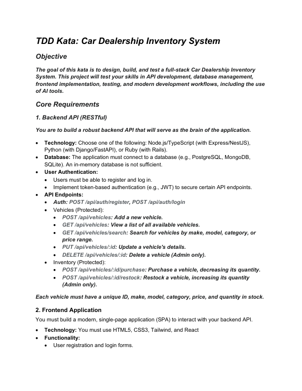
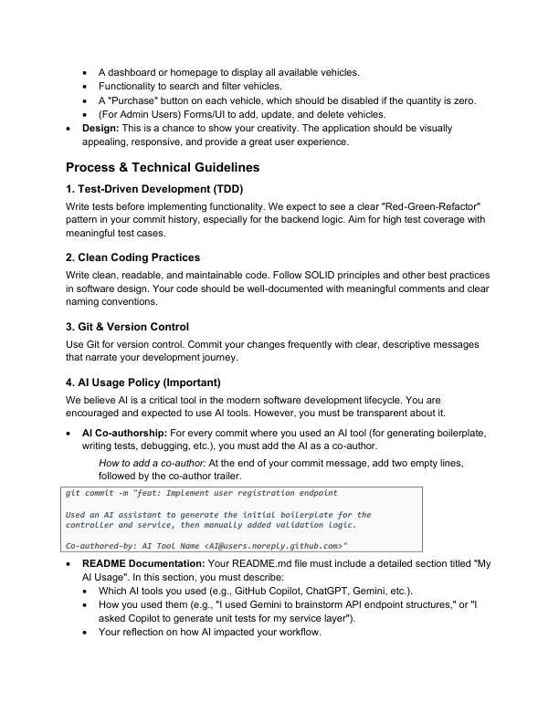
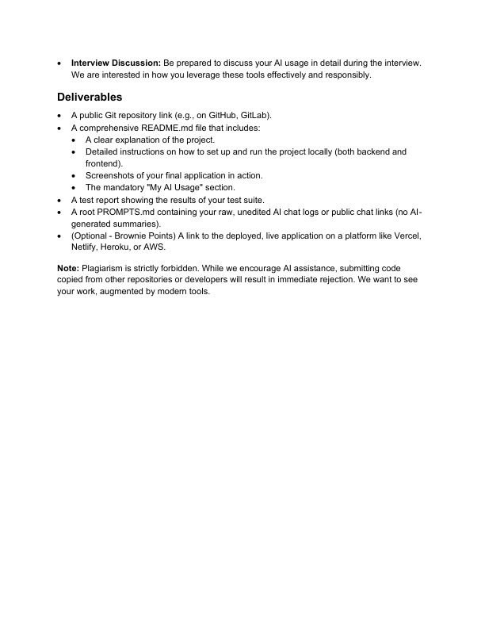
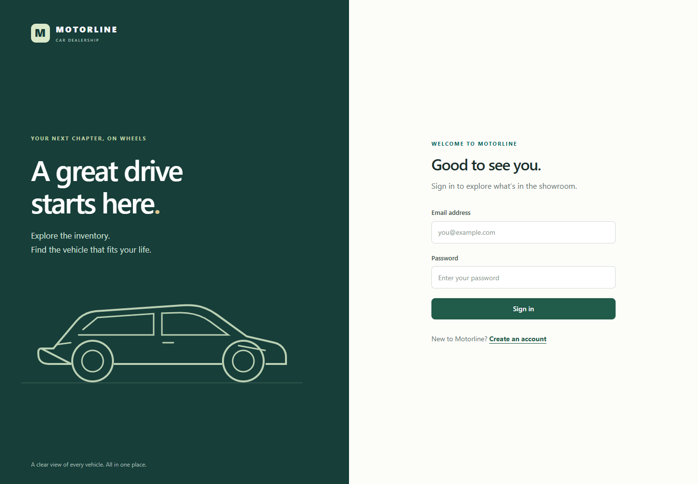
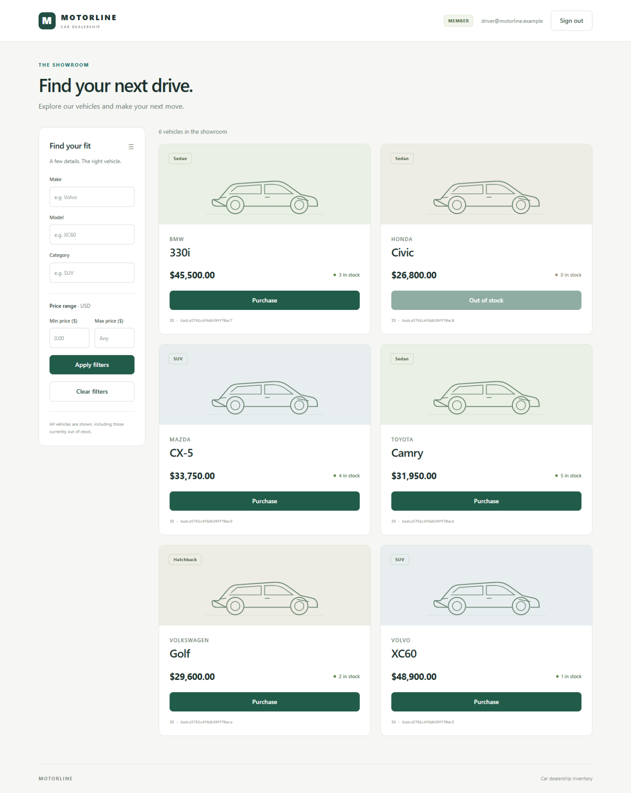
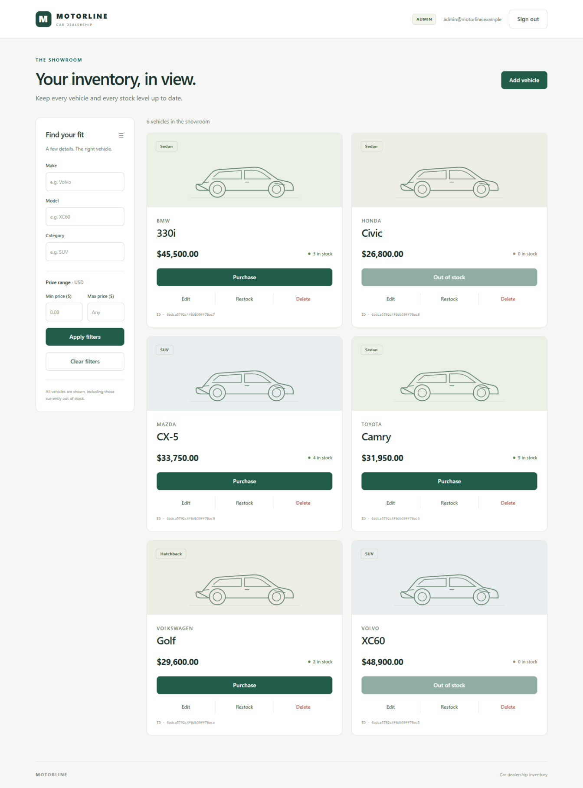
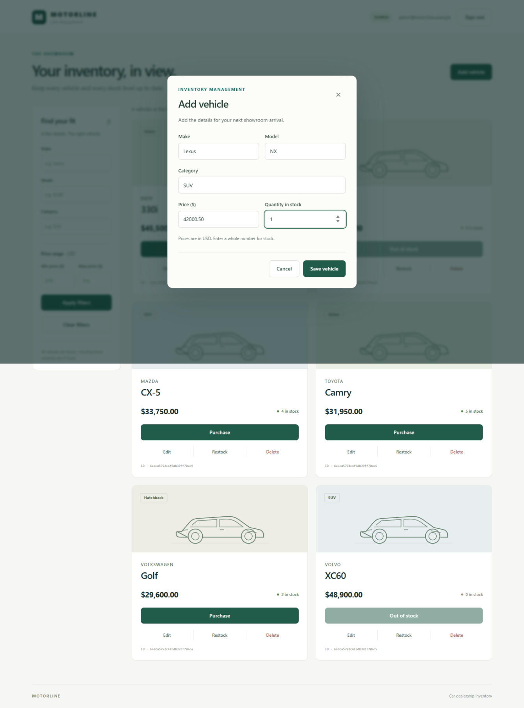

# Original development session: implementation tool activity

Source: **Build car inventory system**, 24 October 2026. [Return to the conversation](../../PROMPTS.md).

Tool input and output text below is preserved as recorded. Stored content blocks are decoded for display; image attachments retain their original bytes. Any truncation notices were already present in the source. Timestamps are UTC.

### Record 001

Tool call: exec — 2026-10-24T11:44:33.694Z

Call ID: `call_LsqHJcGNelEUucDz07No7QYw`

```javascript
const results = await Promise.allSettled([
tools.exec_command({cmd:"Get-Content -Raw -LiteralPath 'C:\\Users\\Dell\\.codex\\attachments\\148fc916-3ddf-4534-993e-52bea3ff0129\\Pasted text.txt'","max_output_tokens":14000}),
tools.exec_command({cmd:"Get-Content -Raw -LiteralPath 'C:\\Users\\Dell\\.codex\\plugins\\cache\\openai-primary-runtime\\pdf\\26.1017.22136\\skills\\pdf\\SKILL.md'","max_output_tokens":10000}),
tools.exec_command({cmd:"Get-Location\nGet-ChildItem -Force\nrg --files -g AGENTS.md -g '!node_modules' -g '!.git' 'D:\\Harsh\\Incubyte'","max_output_tokens":6000})
]);results.forEach((r,i)=>text({i,...r}));

```

### Record 002

Tool output — 2026-10-24T11:44:47.040Z

Call ID: `call_LsqHJcGNelEUucDz07No7QYw`

```text
Script completed
Wall time 13.0 seconds
Output:

```

```text
{"i":0,"status":"fulfilled","value":{"chunk_id":"5c17a3","wall_time_seconds":2.9634085,"exit_code":0,"original_token_count":2306,"output":"Build the “Car Dealership Inventory System” described in `AI_Kata_Car_Dealership_Inventory_System_V2.pdf`.\r\n\r\nRead the PDF if it is available in this workspace. Treat it as the source of truth. Implement every mandatory requirement and do not add extra product features. If you cannot read it, say so and use the requirements below without claiming to have verified the PDF.\r\n\r\nI need a working project, not just a plan. Work incrementally, use genuine test-driven development, and keep the code understandable enough for me to explain in an interview.\r\n\r\nTECHNOLOGY\r\n\r\nUse:\r\n- Backend: Node.js + TypeScript + Express.\r\n- Database: MongoDB with persistent storage.\r\n- Frontend: React, HTML5, CSS3, and Tailwind CSS.\r\n- Authentication: JWT.\r\n- Choose only the supporting libraries needed for database access, password hashing, input validation, development, and testing.\r\n\r\nDo not change this stack. Do not use an in-memory data store as the application database.\r\n\r\nSCOPE\r\n\r\nImplement only the required inventory application. Do not add payments, carts, wishlists, purchase history, analytics, notifications, image uploads, password-reset flows, or other unrequested features. Deployment is optional in the assignment and is outside this implementation.\r\n\r\nFIRST ACTIONS\r\n\r\n1. Inspect the current workspace and any repository instructions.\r\n2. Preserve existing user files and changes.\r\n3. Read the assignment PDF if available.\r\n4. Create a concise requirements checklist and implementation plan.\r\n5. Start implementing immediately after explaining the plan. Do not stop after providing a plan or ask for approval between routine steps.\r\n6. Ask questions only when a genuine ambiguity blocks implementation. Otherwise, make the smallest reasonable assumption and document it.\r\n\r\nPROJECT STRUCTURE\r\n\r\nUse a simple structure:\r\n- backend/\r\n- frontend/\r\n- README.md\r\n- PROMPTS.md\r\n\r\nSeparate routing, authentication/authorization, business logic, and database access where useful. Follow clean coding and SOLID principles without unnecessary abstractions.\r\n\r\nDATA\r\n\r\nUser:\r\n- Unique ID\r\n- Email\r\n- Password hash\r\n- Role: user or admin\r\n\r\nVehicle:\r\n- Unique ID\r\n- Make\r\n- Model\r\n- Category\r\n- Price\r\n- Quantity in stock\r\n\r\nValidate required fields, numeric values, and integer stock quantities. Prevent negative prices and quantities. Use a consistent monetary representation and explain it in the README.\r\n\r\nAUTHENTICATION\r\n\r\nImplement:\r\n- POST /api/auth/register\r\n- POST /api/auth/login\r\n\r\nRequirements:\r\n- Users can register and log in.\r\n- Hash passwords securely.\r\n- Never return password hashes.\r\n- Registration must create regular users; clients cannot grant themselves admin privileges.\r\n- Protect all vehicle and inventory endpoints with JWT authentication.\r\n- Provide a documented local setup procedure for creating an admin account.\r\n- Keep secrets in environment variables and supply .env.example files with placeholders.\r\n- Do not commit credentials or environment files containing secrets.\r\n\r\nVEHICLE ENDPOINTS\r\n\r\nImplement these exact routes:\r\n- POST /api/vehicles — add a vehicle.\r\n- GET /api/vehicles — list vehicles.\r\n- GET /api/vehicles/search — search/filter by make, model, category, or price range.\r\n- PUT /api/vehicles/:id — update a vehicle.\r\n- DELETE /api/vehicles/:id — delete a vehicle; admin-only.\r\n\r\nAll these endpoints require authentication.\r\n\r\nThe brief explicitly makes deletion admin-only and places add/update controls in the admin UI. It does not explicitly make the add/update API endpoints admin-only. Preserve this distinction and document it rather than silently imposing an additional restriction.\r\n\r\nSupport combined search filters and document the query parameters. Show zero-stock vehicles so the frontend can display their disabled purchase buttons.\r\n\r\nINVENTORY ENDPOINTS\r\n\r\nImplement:\r\n- POST /api/vehicles/:id/purchase — decrease quantity.\r\n- POST /api/vehicles/:id/restock — increase quantity; admin-only.\r\n\r\nUse one vehicle per purchase click. Accept a positive integer quantity for restocking. Document these choices because the brief does not define request payloads.\r\n\r\nEnforce stock rules on the backend. Use an atomic conditional database operation so concurrent purchases cannot make stock negative.\r\n\r\nFRONTEND\r\n\r\nBuild a responsive React SPA using HTML5, CSS3, and Tailwind.\r\n\r\nInclude:\r\n- Registration form.\r\n- Login form.\r\n- Dashboard displaying vehicles and their required information.\r\n- Search/filter controls for make, model, category, and price range.\r\n- Purchase button for each vehicle, disabled when quantity is zero.\r\n- Admin controls to add, update, delete, and restock vehicles.\r\n\r\nConnect the UI to the real backend. Refresh displayed inventory after successful mutations. Include clear loading, validation, error, success, and empty states. Prevent duplicate submissions while requests are pending.\r\n\r\nUse a clean, consistent design that works on desktop and mobile. Keep styling focused on the required screens.\r\n\r\nTEST-DRIVEN DEVELOPMENT\r\n\r\nUse genuine Red–Green–Refactor development, especially for backend logic:\r\n\r\n1. Write a meaningful test for one small behaviour.\r\n2. Run it and verify that it fails because that behaviour is missing.\r\n3. Implement the minimum code needed to pass.\r\n4. Run the tests.\r\n5. Refactor while keeping tests passing.\r\n\r\nDo not implement everything first and add tests afterwards. Do not fabricate test results or TDD history.\r\n\r\nCover:\r\n- Registration and duplicate email handling.\r\n- Successful and failed login.\r\n- Missing, invalid, and expired authentication tokens.\r\n- Required role restrictions.\r\n- Vehicle creation, listing, search, updates, and deletion.\r\n- Invalid inputs and nonexistent vehicles.\r\n- Purchase stock reduction.\r\n- Out-of-stock rejection.\r\n- Concurrent attempts to purchase the last unit.\r\n- Restocking and invalid restock quantities.\r\n- Key frontend behaviours, including disabled purchase buttons and admin controls.\r\n\r\nUse an isolated test database so tests cannot modify development data. Aim for high meaningful coverage. Generate a reproducible test report and coverage report.\r\n\r\nIMPLEMENTATION ORDER\r\n\r\n1. Project setup, database configuration, and test infrastructure.\r\n2. Registration, login, JWT verification, and admin authorization.\r\n3. Vehicle creation and listing.\r\n4. Search/filtering.\r\n5. Updates and admin-only deletion.\r\n6. Purchase and admin-only restock.\r\n7. Frontend authentication and dashboard.\r\n8. Search, purchase, and admin interfaces.\r\n9. Responsive styling and frontend tests.\r\n10. Full verification, screenshots, and submission documentation.\r\n\r\nGIT AND AI DOCUMENTATION\r\n\r\nUse Git from the beginning. Keep changes small and make descriptive local commits showing the actual development progression when repository instructions permit. Never manufacture a retrospective TDD commit history.\r\n\r\nRead and surface the assignment’s AI attribution requirements and any conflict with the environment’s repository policies.\r\n\r\nMaintain:\r\n- A README section titled exactly “My AI Usage”, describing the tools actually used, how they were used, and their impact.\r\n- A root PROMPTS.md containing raw, unedited AI conversations or public chat links.\r\n\r\nDo not replace raw chat logs with AI-generated summaries. Do not invent transcripts, links, or personal reflections. If you cannot export the actual conversation, explain exactly what I must export or paste, and mark this requirement as incomplete.\r\n\r\nVERIFICATION AND DELIVERABLES\r\n\r\nProduce:\r\n- Complete backend and frontend source.\r\n- README with the project explanation, prerequisites, environment setup, database setup, admin setup, backend/frontend run commands, test commands, assumptions, screenshots, and “My AI Usage”.\r\n- Root PROMPTS.md.\r\n- Actual test and coverage reports.\r\n- Screenshots of the running application if the environment supports browser capture.\r\n\r\nVerify:\r\n- Registration and login work.\r\n- Protected endpoints reject unauthenticated requests.\r\n- Users can search and purchase vehicles.\r\n- Zero-stock purchases fail.\r\n- Required admin restrictions are enforced.\r\n- Admin inventory operations work.\r\n- Data persists after restarting the application.\r\n- Tests, type checks, and production builds pass.\r\n- README setup instructions match the actual project.\r\n\r\nA public repository link is required for submission. Prepare the repository for publication, but do not publish externally without my explicit authorization. If publication, screenshots, database access, or transcript export requires my action, state the exact remaining step.\r\n\r\nNever claim a test, screenshot, or verification succeeded unless you actually performed it.\r\n\r\nWORKING STYLE\r\n\r\nGive short progress updates explaining what you completed and what comes next. Explain important design choices in plain language. Continue until all locally achievable requirements are implemented and verified, or a genuine blocker prevents progress.\r\n\r\nAt the end, provide:\r\n1. What was implemented.\r\n2. Exact commands to run the project and tests.\r\n3. Actual verification results.\r\n4. Any remaining submission steps or limitations.\r\n"}}
```

````text
{"i":1,"status":"fulfilled","value":{"chunk_id":"f5a3b9","wall_time_seconds":1.8670748000000001,"exit_code":0,"original_token_count":1995,"output":"---\r\nname: \"pdf\"\r\ndescription: \"Read, create, inspect, render, and verify PDF files where visual layout matters, including fillable AcroForms. Use Poppler rendering plus Python tools such as reportlab, pdfplumber, and pypdf for generation and extraction.\"\r\n---\r\n\r\n# PDF Skill\r\n\r\n## When To Use\r\n\r\n- Read or review PDF content where layout and visuals matter.\r\n- Create PDFs programmatically with reliable formatting.\r\n- Fill and validate interactive PDF forms.\r\n- Validate final rendering before delivery.\r\n\r\n## Tools + Contract Requirements\r\n\r\nImmediately before the first create/edit authoring command, run `mark_artifact_operation_started.mjs` successfully exactly once using the command below. Do not run it for read-only work. For edits, replace `create` with `edit`; adjust the expected count and output format to match the requested outputs.\r\n\r\n\r\n\r\n```bash\r\nnode container_tools/mark_artifact_operation_started.mjs --operation-kind create --expected-output-count 1 --output-format pdf\r\n```\r\n\r\n## Workflow\r\n\r\n1. Prefer visual review: render PDF pages to PNGs and inspect them.\r\n   - Use `pdftoppm` from the bundled runtime or system Poppler when available.\r\n   - If unavailable, install Poppler or ask the user to review the output locally.\r\n2. Use `reportlab` to generate PDFs when creating new documents.\r\n3. Use `pdfplumber` or `pypdf` for text extraction and quick checks; do not rely on text extraction for layout fidelity.\r\n4. After each meaningful update, re-render pages and verify alignment, spacing, and legibility.\r\n\r\n## Fill And Validate AcroForms\r\n\r\nVisual review alone is not a correctness check for a fillable PDF. A page `/Widget` annotation can render a value from its appearance stream while the canonical `/AcroForm/Fields` tree is missing or contains a stale value.\r\n\r\n1. Keep the result interactive by default; set `flatten=True` only when the user explicitly requests a completed, static form. Preserve the source PDF, and do not flatten a signed PDF without an explicit workflow decision.\r\n2. Inspect both representations before filling: enumerate fields from `reader.get_fields()` and `/Widget` annotations from every page's `/Annots`, following `/Parent` and `/Kids`. If a widget and a canonical field have the same name but are distinct objects with no `/Parent` relationship, do not call `reattach_fields()` blindly: it can create a second top-level field with the same name. Report the ambiguity or produce a static result.\r\n3. Recover genuinely orphaned widgets, fill all pages, and write the result with `pypdf`:\r\n\r\n```python\r\nfrom pypdf import PdfReader, PdfWriter\r\nfrom pypdf.generic import NameObject\r\n\r\nreader = PdfReader(input_pdf)\r\nwriter = PdfWriter()\r\nwriter.clone_document_from_reader(reader)\r\n\r\n# Restores widgets that are missing from /AcroForm/Fields.\r\nwriter.reattach_fields()\r\nfields = writer.get_fields() or {}\r\nmissing = set(expected_values) - set(fields)\r\nif missing:\r\n    raise ValueError(f\"Form fields not found after repair: {sorted(missing)}\")\r\n\r\nvalues_to_write = dict(expected_values)\r\nif flatten:\r\n    # Paint every existing value before removing every widget.\r\n    values_to_write = {\r\n        name: field.get(\"/V\", \"/Off\" if field.get(\"/FT\") == \"/Btn\" else \"\")\r\n        for name, field in fields.items()\r\n    }\r\n    values_to_write.update(expected_values)\r\n\r\nwriter.update_page_form_field_values(\r\n    None, values_to_write, auto_regenerate=False, flatten=flatten\r\n)\r\n\r\nif flatten:\r\n    # pypdf's flatten=True paints appearances but does not remove widgets.\r\n    writer.remove_annotations(subtypes=\"/Widget\")\r\n    writer.root_object.pop(NameObject(\"/AcroForm\"), None)\r\n\r\nwith open(output_pdf, \"wb\") as stream:\r\n    writer.write(stream)\r\n```\r\n\r\n4. Reopen the written PDF before delivery. For an interactive result, require every expected field to be present in `get_fields()` with the expected `/V`, enumerate page widgets again, and confirm their effective `/V` (the widget value or inherited `/Parent` value) agrees. Confirm each updated widget has a non-empty `/AP` `/N` appearance and render the final pages to catch stale or clipped appearances. Do not rely on `/NeedAppearances` or a successful PNG render as proof that logical field data was updated.\r\n5. For a flattened result, require zero `/Widget` annotations and no remaining `/AcroForm` field tree after reopening, then render the final pages. Keep an editable copy when the user may need to revise the form.\r\n\r\n## Temp And Output Conventions\r\n\r\n- Use `tmp/pdfs/` for intermediate files; delete them when done.\r\n- Write final artifacts under `output/pdf/` when working in this repo.\r\n- Keep filenames stable and descriptive.\r\n\r\n## Dependencies\r\n\r\nPrefer the Codex bundled workspace/runtime dependencies when available. The primary runtime is expected to include:\r\n\r\n- Python packages: `reportlab`, `pdfplumber`, `pypdf`\r\n- Rendering tools: `pdftoppm` and `pdfinfo` from Poppler\r\n\r\nIf a dependency is missing, install only what is needed.\r\n\r\nPython packages:\r\n\r\n```bash\r\nuv pip install reportlab pdfplumber pypdf\r\n```\r\n\r\nIf `uv` is unavailable:\r\n\r\n```bash\r\npython3 -m pip install reportlab pdfplumber pypdf\r\n```\r\n\r\nSystem tools for rendering:\r\n\r\n```bash\r\n# macOS (Homebrew)\r\nbrew install poppler\r\n\r\n# Ubuntu/Debian\r\nsudo apt-get install -y poppler-utils\r\n```\r\n\r\nIf installation is not possible in this environment, tell the user which dependency is missing and how to install it locally.\r\n\r\n## Environment\r\n\r\nNo required environment variables.\r\n\r\n## Rendering Command\r\n\r\n```bash\r\npdftoppm -png \"$INPUT_PDF\" \"$OUTPUT_PREFIX\"\r\n```\r\n\r\n## Quality Expectations\r\n\r\n- Maintain polished visual design: consistent typography, spacing, margins, and section hierarchy.\r\n- Avoid rendering issues: clipped text, overlapping elements, broken tables, black squares, or unreadable glyphs.\r\n- Charts, tables, and images must be sharp, aligned, and clearly labeled.\r\n- Use ASCII hyphens only. Avoid U+2011 and other Unicode dashes.\r\n- Citations and references must be human-readable; never leave tool tokens or placeholder strings.\r\n\r\n## Final Checks\r\n\r\n- Do not deliver until the latest PNG inspection shows zero visual or formatting defects.\r\n- Confirm headers, footers, page numbering, and section transitions look polished.\r\n- Keep intermediate files organized or remove them after final approval.\r\n\r\n## Final response\r\n\r\n### Final Response Citations\r\n\r\n- **Create/edit:** for created or edited PDFs, cite each final deliverable exactly once with `purpose=\"output\"`, in its own paragraph. Briefly describe the result without repeating its filename, path, or link. Never put output directives inside prose or list items.\r\n- **Q&A and summaries:** Every file whose contents you summarize or use to support an answer MUST receive a `:codex-file-citation{...}` with `purpose=\"source\"` in the final response. Use the source citation in place of the filename, wherever the filename would appear. Do not write the filename separately and append its citation at the end. Files merely inspected but not used in the answer need no citation. Do not emit output citations for unchanged files or read-only answers.\r\n\r\n- Emit `:codex-file-citation{...}` directly, without backticks, code fences, or a Markdown-link wrapper. Use verified targets only. No need to cite or reference intermediate work.\r\n\r\nFor file citations, set `path` to the verified absolute file path on the task host. Omit `mode`.\r\n\r\nSome illustrative examples, real responses use verified targets outside code fences.\r\n\r\n```text\r\n:codex-file-citation{path=\"/absolute/path/review.pdf\" purpose=\"output\"}\r\n```\r\n\r\n```text\r\nThe review of :codex-file-citation{path=\"/absolute/path/review.pdf\" purpose=\"source\"} is due Friday.\r\n```\r\n\r\n\r\n### Additional Citation Guidance\r\n\r\nFor PDF Q&A, inspect complete relevant pages and preserve material headings, table/figure labels, footnotes, sources, and sample sizes. PDF citations support only plain file citations; do not add `artifact_kind`, `page_number`, or other locators.\r\n\r\n"}}
````

```text
{"i":2,"status":"fulfilled","value":{"chunk_id":"417621","wall_time_seconds":3.8144299999999998,"exit_code":1,"original_token_count":27,"output":"\r\nPath                            \r\n----                            \r\nD:\\Harsh\\Incubyte\\car dealership\r\n\r\n\r\n"}}
```

### Record 003

Tool call: exec — 2026-10-24T11:45:04.130Z

Call ID: `call_00xMm9Mna4eEYt2DoqPrhgdL`

```javascript
const results = await Promise.allSettled([
tools.exec_command({cmd:"Get-Content -Raw -Encoding UTF8 -LiteralPath 'C:\\Users\\Dell\\.codex\\attachments\\148fc916-3ddf-4534-993e-52bea3ff0129\\Pasted text.txt'\nGet-Item -LiteralPath 'D:\\C_drive_bits\\Desktop\\AI_Kata_Car_Dealership_Inventory_System_V2.pdf'\nGet-Command node,npm,python,git,docker,mongod,pdftoppm -ErrorAction SilentlyContinue | Select-Object Name,Source","max_output_tokens":10000}),
tools.exec_command({cmd:"$paths = @('D:\\AGENTS.md','D:\\Harsh\\AGENTS.md','D:\\Harsh\\Incubyte\\AGENTS.md','D:\\Harsh\\Incubyte\\car dealership\\AGENTS.md')\nforeach ($path in $paths) { if (Test-Path -LiteralPath $path) { Get-Content -Raw -LiteralPath $path } }\ngit status --short\npython -c \"import importlib.util; print({m:bool(importlib.util.find_spec(m)) for m in ['pypdf','pdfplumber','fitz']})\"\nnode --version\nnpm --version","max_output_tokens":4000})
]);results.forEach((r,i)=>text({i,...r}));
text(ALL_TOOLS.filter(x=>/browser|playwright|computer/i.test(x.name+" "+x.description)).map(x=>({name:x.name,description:x.description.substring(0,180)})));

```

### Record 004

Tool output — 2026-10-24T11:45:16.378Z

Call ID: `call_00xMm9Mna4eEYt2DoqPrhgdL`

```text
Script completed
Wall time 12.0 seconds
Output:

```

```text
{"i":0,"status":"fulfilled","value":{"chunk_id":"539bc9","wall_time_seconds":9.4485685,"exit_code":1,"original_token_count":2447,"output":"Build the “Car Dealership Inventory System” described in `AI_Kata_Car_Dealership_Inventory_System_V2.pdf`.\r\n\r\nRead the PDF if it is available in this workspace. Treat it as the source of truth. Implement every mandatory requirement and do not add extra product features. If you cannot read it, say so and use the requirements below without claiming to have verified the PDF.\r\n\r\nI need a working project, not just a plan. Work incrementally, use genuine test-driven development, and keep the code understandable enough for me to explain in an interview.\r\n\r\nTECHNOLOGY\r\n\r\nUse:\r\n- Backend: Node.js + TypeScript + Express.\r\n- Database: MongoDB with persistent storage.\r\n- Frontend: React, HTML5, CSS3, and Tailwind CSS.\r\n- Authentication: JWT.\r\n- Choose only the supporting libraries needed for database access, password hashing, input validation, development, and testing.\r\n\r\nDo not change this stack. Do not use an in-memory data store as the application database.\r\n\r\nSCOPE\r\n\r\nImplement only the required inventory application. Do not add payments, carts, wishlists, purchase history, analytics, notifications, image uploads, password-reset flows, or other unrequested features. Deployment is optional in the assignment and is outside this implementation.\r\n\r\nFIRST ACTIONS\r\n\r\n1. Inspect the current workspace and any repository instructions.\r\n2. Preserve existing user files and changes.\r\n3. Read the assignment PDF if available.\r\n4. Create a concise requirements checklist and implementation plan.\r\n5. Start implementing immediately after explaining the plan. Do not stop after providing a plan or ask for approval between routine steps.\r\n6. Ask questions only when a genuine ambiguity blocks implementation. Otherwise, make the smallest reasonable assumption and document it.\r\n\r\nPROJECT STRUCTURE\r\n\r\nUse a simple structure:\r\n- backend/\r\n- frontend/\r\n- README.md\r\n- PROMPTS.md\r\n\r\nSeparate routing, authentication/authorization, business logic, and database access where useful. Follow clean coding and SOLID principles without unnecessary abstractions.\r\n\r\nDATA\r\n\r\nUser:\r\n- Unique ID\r\n- Email\r\n- Password hash\r\n- Role: user or admin\r\n\r\nVehicle:\r\n- Unique ID\r\n- Make\r\n- Model\r\n- Category\r\n- Price\r\n- Quantity in stock\r\n\r\nValidate required fields, numeric values, and integer stock quantities. Prevent negative prices and quantities. Use a consistent monetary representation and explain it in the README.\r\n\r\nAUTHENTICATION\r\n\r\nImplement:\r\n- POST /api/auth/register\r\n- POST /api/auth/login\r\n\r\nRequirements:\r\n- Users can register and log in.\r\n- Hash passwords securely.\r\n- Never return password hashes.\r\n- Registration must create regular users; clients cannot grant themselves admin privileges.\r\n- Protect all vehicle and inventory endpoints with JWT authentication.\r\n- Provide a documented local setup procedure for creating an admin account.\r\n- Keep secrets in environment variables and supply .env.example files with placeholders.\r\n- Do not commit credentials or environment files containing secrets.\r\n\r\nVEHICLE ENDPOINTS\r\n\r\nImplement these exact routes:\r\n- POST /api/vehicles — add a vehicle.\r\n- GET /api/vehicles — list vehicles.\r\n- GET /api/vehicles/search — search/filter by make, model, category, or price range.\r\n- PUT /api/vehicles/:id — update a vehicle.\r\n- DELETE /api/vehicles/:id — delete a vehicle; admin-only.\r\n\r\nAll these endpoints require authentication.\r\n\r\nThe brief explicitly makes deletion admin-only and places add/update controls in the admin UI. It does not explicitly make the add/update API endpoints admin-only. Preserve this distinction and document it rather than silently imposing an additional restriction.\r\n\r\nSupport combined search filters and document the query parameters. Show zero-stock vehicles so the frontend can display their disabled purchase buttons.\r\n\r\nINVENTORY ENDPOINTS\r\n\r\nImplement:\r\n- POST /api/vehicles/:id/purchase — decrease quantity.\r\n- POST /api/vehicles/:id/restock — increase quantity; admin-only.\r\n\r\nUse one vehicle per purchase click. Accept a positive integer quantity for restocking. Document these choices because the brief does not define request payloads.\r\n\r\nEnforce stock rules on the backend. Use an atomic conditional database operation so concurrent purchases cannot make stock negative.\r\n\r\nFRONTEND\r\n\r\nBuild a responsive React SPA using HTML5, CSS3, and Tailwind.\r\n\r\nInclude:\r\n- Registration form.\r\n- Login form.\r\n- Dashboard displaying vehicles and their required information.\r\n- Search/filter controls for make, model, category, and price range.\r\n- Purchase button for each vehicle, disabled when quantity is zero.\r\n- Admin controls to add, update, delete, and restock vehicles.\r\n\r\nConnect the UI to the real backend. Refresh displayed inventory after successful mutations. Include clear loading, validation, error, success, and empty states. Prevent duplicate submissions while requests are pending.\r\n\r\nUse a clean, consistent design that works on desktop and mobile. Keep styling focused on the required screens.\r\n\r\nTEST-DRIVEN DEVELOPMENT\r\n\r\nUse genuine Red–Green–Refactor development, especially for backend logic:\r\n\r\n1. Write a meaningful test for one small behaviour.\r\n2. Run it and verify that it fails because that behaviour is missing.\r\n3. Implement the minimum code needed to pass.\r\n4. Run the tests.\r\n5. Refactor while keeping tests passing.\r\n\r\nDo not implement everything first and add tests afterwards. Do not fabricate test results or TDD history.\r\n\r\nCover:\r\n- Registration and duplicate email handling.\r\n- Successful and failed login.\r\n- Missing, invalid, and expired authentication tokens.\r\n- Required role restrictions.\r\n- Vehicle creation, listing, search, updates, and deletion.\r\n- Invalid inputs and nonexistent vehicles.\r\n- Purchase stock reduction.\r\n- Out-of-stock rejection.\r\n- Concurrent attempts to purchase the last unit.\r\n- Restocking and invalid restock quantities.\r\n- Key frontend behaviours, including disabled purchase buttons and admin controls.\r\n\r\nUse an isolated test database so tests cannot modify development data. Aim for high meaningful coverage. Generate a reproducible test report and coverage report.\r\n\r\nIMPLEMENTATION ORDER\r\n\r\n1. Project setup, database configuration, and test infrastructure.\r\n2. Registration, login, JWT verification, and admin authorization.\r\n3. Vehicle creation and listing.\r\n4. Search/filtering.\r\n5. Updates and admin-only deletion.\r\n6. Purchase and admin-only restock.\r\n7. Frontend authentication and dashboard.\r\n8. Search, purchase, and admin interfaces.\r\n9. Responsive styling and frontend tests.\r\n10. Full verification, screenshots, and submission documentation.\r\n\r\nGIT AND AI DOCUMENTATION\r\n\r\nUse Git from the beginning. Keep changes small and make descriptive local commits showing the actual development progression when repository instructions permit. Never manufacture a retrospective TDD commit history.\r\n\r\nRead and surface the assignment’s AI attribution requirements and any conflict with the environment’s repository policies.\r\n\r\nMaintain:\r\n- A README section titled exactly “My AI Usage”, describing the tools actually used, how they were used, and their impact.\r\n- A root PROMPTS.md containing raw, unedited AI conversations or public chat links.\r\n\r\nDo not replace raw chat logs with AI-generated summaries. Do not invent transcripts, links, or personal reflections. If you cannot export the actual conversation, explain exactly what I must export or paste, and mark this requirement as incomplete.\r\n\r\nVERIFICATION AND DELIVERABLES\r\n\r\nProduce:\r\n- Complete backend and frontend source.\r\n- README with the project explanation, prerequisites, environment setup, database setup, admin setup, backend/frontend run commands, test commands, assumptions, screenshots, and “My AI Usage”.\r\n- Root PROMPTS.md.\r\n- Actual test and coverage reports.\r\n- Screenshots of the running application if the environment supports browser capture.\r\n\r\nVerify:\r\n- Registration and login work.\r\n- Protected endpoints reject unauthenticated requests.\r\n- Users can search and purchase vehicles.\r\n- Zero-stock purchases fail.\r\n- Required admin restrictions are enforced.\r\n- Admin inventory operations work.\r\n- Data persists after restarting the application.\r\n- Tests, type checks, and production builds pass.\r\n- README setup instructions match the actual project.\r\n\r\nA public repository link is required for submission. Prepare the repository for publication, but do not publish externally without my explicit authorization. If publication, screenshots, database access, or transcript export requires my action, state the exact remaining step.\r\n\r\nNever claim a test, screenshot, or verification succeeded unless you actually performed it.\r\n\r\nWORKING STYLE\r\n\r\nGive short progress updates explaining what you completed and what comes next. Explain important design choices in plain language. Continue until all locally achievable requirements are implemented and verified, or a genuine blocker prevents progress.\r\n\r\nAt the end, provide:\r\n1. What was implemented.\r\n2. Exact commands to run the project and tests.\r\n3. Actual verification results.\r\n4. Any remaining submission steps or limitations.\r\n\r\n\r\n    Directory: D:\\C_drive_bits\\Desktop\r\n\r\n\r\nMode                 LastWriteTime         Length Name                                                                 \r\n----                 -------------         ------ ----                                                                 \r\n-a----        24-10-2026     10:14         169892 AI_Kata_Car_Dealership_Inventory_System_V2.pdf                       \r\n\r\nName   : node.exe\r\nSource : D:\\Harsh\\Node\\node.exe\r\n\r\n\r\nName   : npm.ps1\r\nSource : D:\\Harsh\\Node\\npm.ps1\r\n\r\n\r\nName   : python.exe\r\nSource : D:\\New folder\\python.exe\r\n\r\n\r\nName   : git.exe\r\nSource : D:\\Harsh\\Git\\cmd\\git.exe\r\n\r\n\r\n\r\n"}}
```

```text
{"i":1,"status":"fulfilled","value":{"chunk_id":"1f8961","wall_time_seconds":10.0132818,"session_id":76083,"original_token_count":34,"output":"fatal: not a git repository (or any of the parent directories): .git\n{'pypdf': False, 'pdfplumber': False, 'fitz': False}\r\nv24.13.1\r\n"}}
```

```text
[{"name":"mcp__codex_apps__chatgpt_space_upload_artifact_images","description":"Upload images from the cloud workspace to an existing writable Spaces spreadsheet, presentation, or Canvas before inserting them. Ordinary text Pages are not supported; use write_p"},{"name":"mcp__node_repl__js","description":"Execute JavaScript in a persistent `node_repl` with top-level await. Top-level bindings persist until `js_reset` and can be redeclared. Use `const` for stable values and `let` for "},{"name":"mcp__node_repl__js_add_node_module_dir","description":"Add an absolute `node_modules` directory for package imports. The directory remains available after `js_reset`.\n\nUse `js` for `node_repl` execution with persistent, redeclarable to"},{"name":"mcp__node_repl__js_reset","description":"Reset the JavaScript kernel and clear all bindings.\n\nUse `js` for `node_repl` execution with persistent, redeclarable top-level bindings, `js_reset` to clear bindings, and `js_add_"}]
```

### Record 005

Tool call: exec — 2026-10-24T11:45:24.387Z

Call ID: `call_4Gk9VsDz1btk4MSlH5IUUsVm`

```javascript
const results=await Promise.allSettled([
tools.exec_command({cmd:"python -m pip install --target .tools/python pypdf pymupdf","max_output_tokens":3000}),
tools.exec_command({cmd:"git init\ngit config --get user.name\ngit config --get user.email\nGet-ChildItem -LiteralPath 'C:\\Program Files\\MongoDB','D:\\Harsh','C:\\Users\\Dell\\AppData\\Local\\ms-playwright' -ErrorAction SilentlyContinue | Select-Object FullName\nnpm.cmd --version","max_output_tokens":4000})
]);results.forEach((r,i)=>text({i,...r}));

```

### Record 006

Tool output — 2026-10-24T11:45:37.180Z

Call ID: `call_4Gk9VsDz1btk4MSlH5IUUsVm`

```text
Script completed
Wall time 12.8 seconds
Output:

```

```text
{"i":0,"status":"fulfilled","value":{"chunk_id":"e6a117","wall_time_seconds":10.0111716,"session_id":8646,"original_token_count":0,"output":""}}
```

```text
{"i":1,"status":"fulfilled","value":{"chunk_id":"4a9dc1","wall_time_seconds":3.3702037000000002,"exit_code":0,"original_token_count":939,"output":"Initialized empty Git repository in D:/Harsh/Incubyte/car dealership/.git/\nHarsh Mangesh Dagare\nharshmdagare@gmail.com\n\r\n11.8.0\nFullName                                         \r\n--------                                         \r\nC:\\Program Files\\MongoDB\\Server                  \r\nD:\\Harsh\\1st year                                \r\nD:\\Harsh\\3rd sem                                 \r\nD:\\Harsh\\4th sem                                 \r\nD:\\Harsh\\5thsem                                  \r\nD:\\Harsh\\6thsem                                  \r\nD:\\Harsh\\7thsem                                  \r\nD:\\Harsh\\adm                                     \r\nD:\\Harsh\\ai_exp                                  \r\nD:\\Harsh\\Arduino                                 \r\nD:\\Harsh\\bain                                    \r\nD:\\Harsh\\capgemini                               \r\nD:\\Harsh\\Cisco_Packet_Tracer                     \r\nD:\\Harsh\\CNW_assgn2                              \r\nD:\\Harsh\\Coursera                                \r\nD:\\Harsh\\Crypt-Talk-main                         \r\nD:\\Harsh\\DMProjectPrep                           \r\nD:\\Harsh\\Doc                                     \r\nD:\\Harsh\\DSA                                     \r\nD:\\Harsh\\DSA2                                    \r\nD:\\Harsh\\fractal                                 \r\nD:\\Harsh\\Gate                                    \r\nD:\\Harsh\\Git                                     \r\nD:\\Harsh\\hyperverge                              \r\nD:\\Harsh\\Incubyte                                \r\nD:\\Harsh\\infy                                    \r\nD:\\Harsh\\Int                                     \r\nD:\\Harsh\\IntelliJ IDEA Community Edition 2024.1.4\r\nD:\\Harsh\\itr                                     \r\nD:\\Harsh\\itrreport                               \r\nD:\\Harsh\\javafxdemo                              \r\nD:\\Harsh\\Leet                                    \r\nD:\\Harsh\\meme                                    \r\nD:\\Harsh\\mern                                    \r\nD:\\Harsh\\Minor                                   \r\nD:\\Harsh\\Mongodb                                 \r\nD:\\Harsh\\MSYS2                                   \r\nD:\\Harsh\\MYSQL                                   \r\nD:\\Harsh\\New folder (2)                          \r\nD:\\Harsh\\New Laptop Details                      \r\nD:\\Harsh\\Node                                    \r\nD:\\Harsh\\OracleXE2                               \r\nD:\\Harsh\\Packettracer                            \r\nD:\\Harsh\\photos_photoshoot                       \r\nD:\\Harsh\\Powerbi                                 \r\nD:\\Harsh\\PreviousLaptop                          \r\nD:\\Harsh\\projectdemo                             \r\nD:\\Harsh\\Project_Demo                            \r\nD:\\Harsh\\proton                                  \r\nD:\\Harsh\\pycharm                                 \r\nD:\\Harsh\\pyt                                     \r\nD:\\Harsh\\Rapid MIner                             \r\nD:\\Harsh\\Resume                                  \r\nD:\\Harsh\\SQL+                                    \r\nD:\\Harsh\\swayam                                  \r\nD:\\Harsh\\Talend                                  \r\nD:\\Harsh\\Telegramstudies                         \r\nD:\\Harsh\\Today2                                  \r\nD:\\Harsh\\unilever                                \r\nD:\\Harsh\\wikigacha                               \r\nD:\\Harsh\\Winrar                                  \r\nD:\\Harsh\\WireShark                               \r\nD:\\Harsh\\CNW Project.zip                         \r\nD:\\Harsh\\Crypt-Talk-main.zip                     \r\nD:\\Harsh\\lab-9.zip                               \r\nD:\\Harsh\\projectdemo1.txt                        \r\nD:\\Harsh\\SceneBuilder-23.0.1.msi                 \r\nD:\\Harsh\\scenebuilder-kit-23.0.1.jar             \r\nD:\\Harsh\\VisualStudioSetup.exe                   \r\n\r\n\r\n"}}
```

### Record 007

Tool call: exec — 2026-10-24T11:45:42.173Z

Call ID: `call_OjUDyJb5vhFzqnU0AnASjRcP`

```javascript
text(await tools.write_stdin({session_id:8646,chars:"","yield_time_ms":1000,"max_output_tokens":3000}));
text(await tools.exec_command({cmd:"rg --files 'C:\\Program Files\\MongoDB' -g mongod.exe\nGet-Service -Name '*Mongo*' -ErrorAction SilentlyContinue\nGet-ChildItem -LiteralPath 'C:\\Program Files\\Google\\Chrome\\Application','C:\\Program Files (x86)\\Microsoft\\Edge\\Application' -Filter '*.exe' -ErrorAction SilentlyContinue | Select-Object FullName","max_output_tokens":3000}));
text(await tools.web__run({search_query:[{q:"site.mongodb.com/docs manual atomicity single document update inc"},{q:"site.tailwindcss.com/docs installation using vite"},{q:"site.expressjs.com/en/guide error handling express 5"}],response_length:"short"}));

```

### Record 008

Tool output — 2026-10-24T11:45:54.158Z

Call ID: `call_OjUDyJb5vhFzqnU0AnASjRcP`

```text
Script completed
Wall time 12.0 seconds
Output:

```

```text
{"chunk_id":"a171d4","wall_time_seconds":5.0041202,"session_id":8646,"original_token_count":374,"output":"WARNING: Retrying (Retry(total=4, connect=None, read=None, redirect=None, status=None)) after connection broken by 'NewConnectionError('<pip._vendor.urllib3.connection.HTTPSConnection object at 0x000002A65734B0E0>: Failed to establish a new connection: [WinError 10013] An attempt was made to access a socket in a way forbidden by its access permissions')': /simple/pypdf/\r\nWARNING: Retrying (Retry(total=3, connect=None, read=None, redirect=None, status=None)) after connection broken by 'NewConnectionError('<pip._vendor.urllib3.connection.HTTPSConnection object at 0x000002A657371F90>: Failed to establish a new connection: [WinError 10013] An attempt was made to access a socket in a way forbidden by its access permissions')': /simple/pypdf/\r\nWARNING: Retrying (Retry(total=2, connect=None, read=None, redirect=None, status=None)) after connection broken by 'NewConnectionError('<pip._vendor.urllib3.connection.HTTPSConnection object at 0x000002A6573720D0>: Failed to establish a new connection: [WinError 10013] An attempt was made to access a socket in a way forbidden by its access permissions')': /simple/pypdf/\r\nWARNING: Retrying (Retry(total=1, connect=None, read=None, redirect=None, status=None)) after connection broken by 'NewConnectionError('<pip._vendor.urllib3.connection.HTTPSConnection object at 0x000002A657372210>: Failed to establish a new connection: [WinError 10013] An attempt was made to access a socket in a way forbidden by its access permissions')': /simple/pypdf/\r\n"}
```

```text
{"chunk_id":"722b66","wall_time_seconds":1.5557523,"exit_code":0,"original_token_count":162,"output":"C:\\Program Files\\MongoDB\\Server\\8.0\\bin\\mongod.exe\n\r\nStatus   Name               DisplayName                           \r\n------   ----               -----------                           \r\nRunning  MongoDB            MongoDB Server (MongoDB)              \r\n\r\nFullName : C:\\Program Files\\Google\\Chrome\\Application\\chrome.exe\r\n\r\n\r\nFullName : C:\\Program Files\\Google\\Chrome\\Application\\chrome_proxy.exe\r\n\r\n\r\nFullName : C:\\Program Files (x86)\\Microsoft\\Edge\\Application\\msedge.exe\r\n\r\n\r\nFullName : C:\\Program Files (x86)\\Microsoft\\Edge\\Application\\msedge_proxy.exe\r\n\r\n\r\nFullName : C:\\Program Files (x86)\\Microsoft\\Edge\\Application\\pwahelper.exe\r\n\r\n\r\n\r\n"}
```

```text
Installing Tailwind CSS with Vite - Tailwind CSS (https://tailwindcss.com/docs/installation/using-vite)
citeturn0search0 [wordlim: 200] Crawled: today; Install `tailwindcss` and `@tailwindcss/vite` via npm. ... Make sure your compiled CSS is included in the `<head>` (your framework might handle this for you), then start using Tailwind’s utility classes to style your content.
--------------------------------------------------------------------------------
Atomicity and Transactions - Database Manual - MongoDB Docs (https://www.mongodb.com/docs/manual/core/write-operations-atomicity/)
citeturn0search1 [wordlim: 200] Crawled: yesterday; # Atomicity and TransactionsIn MongoDB, write operations are atomic on the single-document level, even if modifying multiple values. ... To prevent conflicts during concurrent updates, include the expected current value in the update filter.
--------------------------------------------------------------------------------
Error Handling · Express.js 5.x (https://expressjs.com/en/5x/guide/error-handling/)
citeturn0search2 [wordlim: 200] Crawled: last month; If `readFile` causes an error, then it passes the error to Express, otherwise you quickly return to the world of synchronous error handling in the next handler in the chain. ... If you pass an error to `next()` and you do not handle it in a custom error handler, it will be handled by the built-in error handler; the error will be written to the client with the stack trace. ... If this value is outside the 4xx or 5xx range, it will be set to 500.
--------------------------------------------------------------------------------
MongoDB does support several methods of manipulating single documents atomically, which are detailed below. (https://downloads.mongodb.org/docs/mongodb-docs-2012-04-21.pdf)
citeturn0search12 [wordlim: 200] Published: 14.5 years ago; MongoDB does support several methods of manipulating single documents atomically, which are detailed below. ... The Mongo DB update command supports several modifiers, all of which atomically update an element in a document. ... Another strategy for atomic updates is "Update if Current". ... Thus the following code is better, although less general -- we can get away with this as we are using a predefined modifier operation ($inc).
--------------------------------------------------------------------------------
Getting Started | Vite (https://vite.dev/guide/)
citeturn0search3 [wordlim: 200] Crawled: today; Read about what's possible in the Features Guide. ... ## Manual Installation ​In your project, you can install the `vite` CLI using: ... Even inline `<script type="module">` and CSS referenced via `<link href>` also enjoy Vite-specific features. ... You will see it referenced as `<root>` throughout the rest of the docs.Absolute URLs in your source code will be resolved using the project root as base, so you can write code as if you are working with a normal static file server (except way more powerful!). ... To replace the Vite version used by dependencies transitively, you should use npm overrides or pnpm overrides.
--------------------------------------------------------------------------------
expressjs.com/src/content/pages/en/guide/migrating-5.mdx at main · expressjs/expressjs.com · GitHub (https://github.com/expressjs/expressjs.com/blob/main/src/content/pages/en/guide/migrating-5.mdx)
citeturn0search4 [wordlim: 200] Crawled: last week; In Express 5, the `app.listen` method will invoke the user-provided callback function (if provided) when the server receives an error event. ... This change shifts error-handling responsibility to the callback function in Express 5.
--------------------------------------------------------------------------------
specifications/source/crud/bulk-write.md at master · mongodb/specifications · GitHub (https://github.com/mongodb/specifications/blob/master/source/crud/bulk-write.md)
citeturn0search5 [wordlim: 200] Crawled: 2 months ago; Update documents provided in `UpdateOne` and `UpdateMany` write models are required only to contain atomic modifiers (i.e. keys that start with `$`). ... Drivers MUST rely on the server to return an error if any other entries in the update document are not atomic modifiers. ...          * This option is intended for internal use by MongoDB teams and should be discouraged for
--------------------------------------------------------------------------------
orm/docs/reference/mongodb-primitives-reference.md at main · prisma/orm · GitHub (https://github.com/prisma/orm/blob/main/docs/reference/mongodb-primitives-reference.md)
citeturn0search6 [wordlim: 200] Crawled: last month; MongoDB provides two levels of atomicity. ... This is the most important distinction from SQL: because MongoDB encourages embedding related data in a single document, many operations that would require a multi-row transaction in SQL are naturally atomic in MongoDB without any explicit transaction. ... Core API — manual start/commit/abort: ...       console.log(change.fullDocument);  // the document (for insert/replace/update with fullDocument option)
--------------------------------------------------------------------------------
Install Tailwind CSS with Vue 3 and Vite - Tailwind CSS (https://v2.tailwindcss.com/docs/guides/vue-3-vite)
citeturn0search7 [wordlim: 200] Crawled: last week; If you’re planning to use any other PostCSS plugins, you should read our documentation on using PostCSS as your preprocessor for more details about the best way to order them alongside Tailwind.
--------------------------------------------------------------------------------
Get started with vite is broken · Issue #2466 · tailwindlabs/tailwindcss.com · GitHub (https://github.com/tailwindlabs/tailwindcss.com/issues/2466)
citeturn0search8 [wordlim: 200] Published: 7 months ago; Crawled: 3 weeks ago; The get started page (https://tailwindcss.com/docs/installation/using-vite) has these instructions to setup with vite: ... Since vite has been updated to version 8 and tailwindcss is not compatible yet, I suggest to update the docs to use `npm create vite@8.3.0` which seems to be the latest version that does not default to vite 8.
--------------------------------------------------------------------------------
Installation · Tailwind CSS Handbook (https://prajwalchnayak.github.io/tailwind_doc/getting-started/installation/)
citeturn0search9 [wordlim: 200] Crawled: last month; # InstallationInstall Tailwind CSS v4 with Vite, PostCSS, the standalone CLI or the Play CDN — plus what each of those replaced from v3. ... Vite plugin  | `@tailwindcss/vite`  | You use Vite, Astro, SvelteKit, Nuxt, Laravel, Remix — fastest option
--------------------------------------------------------------------------------
MongoDB Documentation, Release 3.0.0 (https://web.cs.wpi.edu/~cs585/s15/Lectures/W12/MongoDB-manual.pdf)
citeturn0search13 [wordlim: 200] Published: 11.6 years ago; In MongoDB, a write operation is atomic on the level of a single document, even if the operation modifies multiple embedded documents within a single document. ... Since a single document can contain multiple embedded documents, single-document atomicity is sufficient for many practical use cases.
--------------------------------------------------------------------------------
Tailwind CSS v4.0 Beta - Tailwind CSS (https://v3.tailwindcss.com/docs/v4-beta)
citeturn0search10 [wordlim: 200] Crawled: last week; If you’re using Vite or a Vite-powered framework like SvelteKit or Remix, install Tailwind along with our new dedicated Vite plugin: ...     `$ npm install tailwindcss@next @tailwindcss/vite@next`
--------------------------------------------------------------------------------
mongo/src/mongo/db/storage/README.md at master · mongodb/mongo · GitHub (https://github.com/mongodb/mongo/blob/master/src/mongo/db/storage/README.md)
citeturn0search11 [wordlim: 200] Crawled: last week; Such transactions are called storage transactions elsewhere in this document, to differentiate them from the higher-level multi-document transactions accessible to users of MongoDB. ... In MongoDB, a snapshot can be opened with or without a timestamp when using a ReadSource that uses timestamps. ... Storage engines must ensure that atomicity and isolation guarantees span all record stores, as otherwise the guarantee of atomic updates on a document and all its indexes would be violated. ... This option uses the `BatchedWriteContext` class to stage writes and to generate a single applyOps entry at commit, similar to what multi-document transactions do via the `TransactionParticipant` class. ... These actions will typically update in-memory state to match what was written in the storage transaction, in a transactional way.
--------------------------------------------------------------------------------
DBMS 17.5 UPDATES ATOMIC OPERATIONS… (https://www.anucde.info/material/201CP24.pdf)
citeturn0search14 [wordlim: 200] Published: 11 months ago; &nbsp;&nbsp;db.products.updateMany({ category: "Electronics" }, { $inc: { stock: 25 } }) ... Atomic operations in MongoDB ensure that updates to a document are completed entirely or not at all. ... 17.3.2 Single-Document Atomicity
--------------------------------------------------------------------------------
Tailwindcss User Guide (https://doccompiler.ai/api/v1/jobs/shared/job_1776399442451_ed46f9ae/download/tailwindlabs__tailwindcss__UserGuide.pdf)
citeturn0search15 [wordlim: 200] Published: 5 months ago; ## Using the Vite plugin ... npm install tailwindcss @tailwindcss/vite
--------------------------------------------------------------------------------
Efficient CRUD Queries in MongoDB (https://www.percona.com/sites/default/files/presentations/Efficient-CRUD-Queries-in-MongoDB.pdf)
citeturn0search16 [wordlim: 200] Published: 6 months ago; Isolation and Atomicity ... ■Single-document Update
--------------------------------------------------------------------------------
tailwind v4.0 issue in installing for vite framework (https://www.reddit.com/r/tailwindcss/comments/1i8xajo)
citeturn0reddit17 [wordlim: 200] Published: 1.7 years ago; Crawled: 1.3 years ago; i am new to web development and started using tailwind recently . earlier there was clear explanation in framework guide for vite but in the recent update it is gone . i tried vite plugin but i am not able to use tailwind intellisense ...    2 install tailwind follow https://tailwindcss.com/docs/installation/using-vite
--------------------------------------------------------------------------------
Question on error handling (https://www.reddit.com/r/expressjs/comments/1burzax)
citeturn0reddit18 [wordlim: 200] Published: 2.6 years ago; Crawled: 2.6 years ago; In the documentation for Express(http://expressjs.com/en/guide/error-handling.html), it is written that for synchronous functions, Express catches and processes the error.
--------------------------------------------------------------------------------
How to connect tailwind css with react (vite) (https://www.reddit.com/r/react/comments/1lzvgdj/how_to_connect_tailwind_css_with_react_vite/)
citeturn0reddit19 [wordlim: 200] Published: 1.3 years ago; This should be pretty straight forward: https://tailwindcss.com/docs/installation/using-vite
--------------------------------------------------------------------------------
Express Error Handling Confusion (https://www.reddit.com/r/learnjavascript/comments/1490cc4)
citeturn0reddit20 [wordlim: 200] Published: 3.4 years ago; Crawled: 3.4 years ago; So, I'm following Colt's course and stuck on error handling for Async functions, Colt said something in a video that in Express 5 these would be handled by next itself. ... There's no place anymore to catch and handle the error.
--------------------------------------------------------------------------------
Express/node.js Error Handling (https://www.reddit.com/r/webdev/comments/104sj8o)
citeturn0reddit21 [wordlim: 200] Published: 3.8 years ago; Crawled: 3.2 years ago; From express documentation https://expressjs.com/en/guide/error-handling.html
--------------------------------------------------------------------------------
Help needed (mongo v7) (https://www.reddit.com/r/mongodb/comments/1gov6hj)
citeturn0reddit22 [wordlim: 200] Published: 1.9 years ago; Crawled: 1.9 years ago; Do I understand correctly that the updateOne/updateMany operation with ***single pipeline stage*** (contains $set/$arrayToObject/$map/$objectToArray ops) is atomic? ... UpdateOne only updates one document, so it's atomic for that given document.
--------------------------------------------------------------------------------
[HELP] Tailwind in vite (new implementation) (https://www.reddit.com/r/tailwindcss/comments/1iiw6xw)
citeturn0reddit23 [wordlim: 200] Published: 1.7 years ago; Crawled: 1.7 years ago; I followed the docs to install tailwindcss in vite here: https://tailwindcss.com/docs/installation/using-vite
--------------------------------------------------------------------------------
Cant install tailwindCSS anymore (https://www.reddit.com/r/reactjs/comments/1i8xv4a/cant_install_tailwindcss_anymore/)
citeturn0reddit24 [wordlim: 200] Published: 1.7 years ago; However, I have to use shadcn library and the docs for the library is not up to date with the latest version of tailwindcss. ... https://tailwindcss.com/docs/installation/using-vite
--------------------------------------------------------------------------------
PLEASE HELP!!!!!! TailwindCss Issues with Vite+React app (https://www.reddit.com/r/tailwindcss/comments/1n43mzg)
citeturn0reddit25 [wordlim: 200] Published: 1.1 years ago; Crawled: 1.1 years ago; https://tailwindcss.com/docs/installation/using-vite ... You can see the setup with vite in the official tailwindcss docs.
--------------------------------------------------------------------------------
Best way to handle async Errors in express (https://www.reddit.com/r/node/comments/1h5adb2)
citeturn0reddit26 [wordlim: 200] Published: 1.9 years ago; Crawled: 1.9 years ago; So I had a debate with some of my friends about the best way to handle async errors, i prefer to use the package "express-async-errors" if I can to keep my code as clean as possible (and with express v5 news this seems better), but some of them are using asyncCatch of asyncErrorHandler wrapper functions. so I was wondering what people prefer to use if both solutions are available? ...     after catching an error close to site, doesnt throwing exact custom error object with specific message do the job ? ...     not officially no, you could also use this if you want to stick to v4 https://www.npmjs.com/package/express-generator-typescript
--------------------------------------------------------------------------------
How to prevent express() server to crash when error occurs? (https://www.reddit.com/r/node/comments/mgnrup)
citeturn0reddit27 [wordlim: 200] Published: 5.6 years ago; Crawled: 1.7 years ago; Here you have a nice error handling guide (official docs): https://expressjs.com/es/guide/error-handling.html
--------------------------------------------------------------------------------
Express error handling pattern — is centralized middleware enough or should I add try/catch everywhere? (https://www.reddit.com/r/node/comments/1t576pb/express_error_handling_pattern_is_centralized/)
citeturn0reddit28 [wordlim: 200] Published: 5 months ago; I’m building a Node.js (Express) backend and using a centralized error handling approach: ... With express 5 you don’t need catchAsync
--------------------------------------------------------------------------------
Express.js (https://en.wikipedia.org/wiki/Express.js)
citeturn0search29 [wordlim: 200] Crawled: last week; * github.com/expressjs/express ... StrongLoop was acquired by IBM in September 2015; in January 2016, IBM announced that it would place Express.js under the stewardship of the Node.js Foundation incubator. ... *  "Guide: Routing".
--------------------------------------------------------------------------------
Install Tailwind CSS with Vite (HTML, JavaScript & Vite - Using PostCSS) - YouTube (https://www.youtube.com/watch?v=c0UnSx06BCU)
citeturn0youtube30 [wordlim: 200] Published: 4.6 years ago; # Install Tailwind CSS with Vite (HTML, JavaScript & Vite - Using PostCSS) ... In this video, I'm going to teach how to integrate Tailwind CSS into a Vanilla Vite project.
# Install Tailwind CSS with Vite (HTML, JavaScript & Vite - Using PostCSS)
By: Devtamin (28000 followers)
Published: 2022-03-20, 29844 views, 408 likes

## Description
In this video, I'm going to teach how to integrate Tailwind CSS into a Vanilla Vite project. The installation is so easy. You will love it. Vite is a bundle tool that help you set up frontend project easily. Tailwind is a CSS framework that focuses on utility classes. Now, Tailwind CSS framework is really popular among developers. You should learn about it.
--------------------------------------------------------------------------------
Exception handling syntax (https://en.wikipedia.org/wiki/Exception_handling_syntax)
citeturn0search31 [wordlim: 200] Crawled: 2 months ago; Handling the exception asynchronously has the benefit that errors inside the error handler do not propagate further outwards. ...         // handle errors of type TypeError

```

### Record 009

Tool call: exec — 2026-10-24T11:45:57.168Z

Call ID: `call_rUbkW7RiI5LT1qAiMO3VYtFh`

```javascript
text(await tools.exec_command({cmd:"python -m pip install --target .tools/python pypdf pymupdf","sandbox_permissions":"require_escalated","justification":"May I download the PDF reading tools into this workspace? The sandbox blocked the download needed to read and verify your assignment.","prefix_rule":["python","-m","pip","install"],"max_output_tokens":3000}));

```

### Record 010

Tool output — 2026-10-24T11:46:54.370Z

Call ID: `call_rUbkW7RiI5LT1qAiMO3VYtFh`

```text
Script running with cell ID 5
Wall time 31.0 seconds
Output:

```

### Record 011

Tool call: wait — 2026-10-24T11:46:59.864Z

Call ID: `call_duQD22Tgvs0fTAFdq4OmLFd9`

```json
{"cell_id":"5","max_tokens":3000,"yield_time_ms":1000}
```

### Record 012

Tool output — 2026-10-24T11:47:00.885Z

Call ID: `call_duQD22Tgvs0fTAFdq4OmLFd9`

```text
Script running with cell ID 5
Wall time 1.0 seconds
Output:

```

### Record 013

Tool call: wait — 2026-10-24T11:47:08.891Z

Call ID: `call_Vstq8Eac4RpimyR9WW52LE9x`

```json
{"cell_id":"5","max_tokens":3000,"yield_time_ms":1000}
```

### Record 014

Tool output — 2026-10-24T11:47:09.011Z

Call ID: `call_Vstq8Eac4RpimyR9WW52LE9x`

```text
Script completed
Wall time 0.0 seconds
Output:

```

```text
{"chunk_id":"a09c43","wall_time_seconds":10.0137849,"session_id":30862,"original_token_count":26,"output":"Collecting pypdf\r\n  Downloading pypdf-6.21.2-py3-none-any.whl.metadata (7.6 kB)\r\nCollecting pymupdf\r\n"}
```

### Record 015

Tool call: exec — 2026-10-24T11:47:12.762Z

Call ID: `call_ft1hiYIETz1SRvyRsfIiGUCg`

```javascript
text(await tools.write_stdin({session_id:30862,chars:"","yield_time_ms":1000,"max_output_tokens":3000}));
text(await tools.exec_command({cmd:"Get-ChildItem -Force\nGet-ChildItem -LiteralPath 'C:\\Users\\Dell\\AppData\\Local\\npm-cache' -ErrorAction SilentlyContinue | Select-Object Name","max_output_tokens":2000}));

```

### Record 016

Tool output — 2026-10-24T11:47:21.520Z

Call ID: `call_ft1hiYIETz1SRvyRsfIiGUCg`

```text
Script completed
Wall time 8.8 seconds
Output:

```

```text
{"chunk_id":"3e2269","wall_time_seconds":5.0025036,"session_id":30862,"original_token_count":357,"output":"  Downloading pymupdf-2.0-cp311-abi3-win_amd64.whl.metadata (25 kB)\r\nCollecting networkx (from pymupdf)\r\n  Using cached networkx-3.7-py3-none-any.whl.metadata (6.7 kB)\r\nCollecting numpy (from pymupdf)\r\n  Downloading numpy-2.5.4-cp312-cp312-win_amd64.whl.metadata (6.6 kB)\r\nCollecting onnxruntime (from pymupdf)\r\n  Downloading onnxruntime-1.31.0-cp312-cp312-win_amd64.whl.metadata (6.0 kB)\r\nCollecting pyyaml (from pymupdf)\r\n  Using cached pyyaml-6.0.3-cp312-cp312-win_amd64.whl.metadata (2.4 kB)\r\nCollecting pymupdf-layout==2.0 (from pymupdf)\r\n  Downloading pymupdf_layout-2.0-py3-none-any.whl.metadata (368 bytes)\r\nCollecting psutil (from pymupdf)\r\n  Using cached psutil-7.2.2-cp37-abi3-win_amd64.whl.metadata (22 kB)\r\nCollecting tabulate (from pymupdf)\r\n  Downloading tabulate-0.10.0-py3-none-any.whl.metadata (40 kB)\r\nCollecting pymupdf4llm==2.0 (from pymupdf)\r\n  Downloading pymupdf4llm-2.0-py3-none-any.whl.metadata (360 bytes)\r\nCollecting flatbuffers (from onnxruntime->pymupdf)\r\n  Using cached flatbuffers-25.12.19-py2.py3-none-any.whl.metadata (1.0 kB)\r\nCollecting packaging (from onnxruntime->pymupdf)\r\n  Using cached packaging-26.3-py3-none-any.whl.metadata (3.5 kB)\r\nCollecting protobuf>=4.25.8 (from onnxruntime->pymupdf)\r\n  Using cached protobuf-7.36.2-cp310-abi3-win_amd64.whl.metadata (595 bytes)\r\nDownloading pypdf-6.21.2-py3-none-any.whl (407 kB)\r\nDownloading pymupdf-2.0-cp311-abi3-win_amd64.whl (63.0 MB)\r\n"}
```

```text
{"chunk_id":"4ac33e","wall_time_seconds":1.4853932,"exit_code":1,"original_token_count":106,"output":"\r\n\r\n    Directory: D:\\Harsh\\Incubyte\\car dealership\r\n\r\n\r\nMode                 LastWriteTime         Length Name                                                                 \r\n----                 -------------         ------ ----                                                                 \r\nd--h--        24-10-2026     17:15                .git                                                                 \r\n\r\n\r\n"}
```

### Record 017

Tool call: exec — 2026-10-24T11:48:10.528Z

Call ID: `call_QTgTOY18NHigA7lVoR3uHa80`

```javascript
text(await tools.apply_patch("*** Begin Patch\n*** Add File: .gitignore\n+node_modules/\n+dist/\n+.env\n+.env.*\n+!.env.example\n+.tools/\n+.local/\n+tmp/\n+coverage/\n+playwright-report/\n+test-results/\n+*.log\n+reports/*.json\n+reports/*.xml\n*** Add File: .gitattributes\n+* text=auto eol=lf\n+*.png binary\n*** Add File: package.json\n+{\n+  \"name\": \"car-dealership-inventory\",\n+  \"private\": true,\n+  \"version\": \"1.0.0\",\n+  \"workspaces\": [\"backend\", \"frontend\"],\n+  \"engines\": { \"node\": \">=22.12.0\" },\n+  \"scripts\": {\n+    \"dev:backend\": \"npm run dev --workspace backend\",\n+    \"dev:frontend\": \"npm run dev --workspace frontend\",\n+    \"test\": \"npm run test --workspaces\",\n+    \"test:coverage\": \"npm run test:coverage --workspaces\",\n+    \"typecheck\": \"npm run typecheck --workspaces\",\n+    \"build\": \"npm run build --workspaces\"\n+  }\n+}\n*** Add File: backend/package.json\n+{\n+  \"name\": \"backend\",\n+  \"private\": true,\n+  \"version\": \"1.0.0\",\n+  \"type\": \"module\",\n+  \"scripts\": {\n+    \"dev\": \"node --watch --env-file-if-exists=.env --import tsx src/server.ts\",\n+    \"start\": \"node --env-file-if-exists=.env dist/server.js\",\n+    \"admin\": \"node --env-file-if-exists=.env --import tsx src/create-admin.ts\",\n+    \"build\": \"tsc -p tsconfig.build.json\",\n+    \"typecheck\": \"tsc --noEmit\",\n+    \"test\": \"vitest run\",\n+    \"test:coverage\": \"vitest run --coverage\"\n+  },\n+  \"dependencies\": {\n+    \"bcryptjs\": \"^3.0.2\",\n+    \"express\": \"^5.1.0\",\n+    \"jsonwebtoken\": \"^9.0.2\",\n+    \"mongodb\": \"^6.20.0\",\n+    \"zod\": \"^4.1.11\"\n+  },\n+  \"devDependencies\": {\n+    \"@types/express\": \"^5.0.3\",\n+    \"@types/jsonwebtoken\": \"^9.0.10\",\n+    \"@types/node\": \"^24.5.2\",\n+    \"@types/supertest\": \"^6.0.3\",\n+    \"@vitest/coverage-v8\": \"^3.2.4\",\n+    \"supertest\": \"^7.1.4\",\n+    \"tsx\": \"^4.20.6\",\n+    \"typescript\": \"^5.9.2\",\n+    \"vitest\": \"^3.2.4\"\n+  }\n+}\n*** Add File: backend/tsconfig.json\n+{\n+  \"compilerOptions\": {\n+    \"target\": \"ES2022\",\n+    \"module\": \"NodeNext\",\n+    \"moduleResolution\": \"NodeNext\",\n+    \"strict\": true,\n+    \"esModuleInterop\": true,\n+    \"skipLibCheck\": true,\n+    \"outDir\": \"dist\",\n+    \"types\": [\"node\", \"vitest/globals\"]\n+  },\n+  \"include\": [\"src\", \"tests\", \"vitest.config.ts\"]\n+}\n*** Add File: backend/tsconfig.build.json\n+{\n+  \"extends\": \"./tsconfig.json\",\n+  \"compilerOptions\": { \"rootDir\": \"src\" },\n+  \"include\": [\"src\"],\n+  \"exclude\": [\"tests\", \"vitest.config.ts\"]\n+}\n*** Add File: backend/vitest.config.ts\n+import { defineConfig } from 'vitest/config';\n+\n+export default defineConfig({\n+  test: {\n+    environment: 'node',\n+    testTimeout: 15000,\n+    hookTimeout: 20000,\n+    fileParallelism: false,\n+    reporters: ['default', 'json', 'junit'],\n+    outputFile: { json: 'reports/tests.json', junit: 'reports/junit.xml' },\n+    coverage: {\n+      provider: 'v8',\n+      include: ['src/**/*.ts'],\n+      exclude: ['src/server.ts', 'src/create-admin.ts'],\n+      reporter: ['text', 'html', 'json-summary', 'lcov'],\n+      thresholds: { statements: 90, branches: 80, functions: 90, lines: 90 }\n+    }\n+  }\n+});\n*** Add File: backend/.env.example\n+MONGODB_URI=mongodb://127.0.0.1:27017/car_dealership\n+JWT_SECRET=replace-with-a-random-secret-at-least-32-characters\n+PORT=3000\n+# Optional test connection. Only a database name ending in _test is accepted.\n+# TEST_MONGODB_URI=mongodb://127.0.0.1:27017/car_dealership_test\n*** Add File: frontend/package.json\n+{\n+  \"name\": \"frontend\",\n+  \"private\": true,\n+  \"version\": \"1.0.0\",\n+  \"type\": \"module\",\n+  \"scripts\": {\n+    \"dev\": \"vite --host 127.0.0.1\",\n+    \"build\": \"tsc --noEmit && vite build\",\n+    \"preview\": \"vite preview --host 127.0.0.1\",\n+    \"typecheck\": \"tsc --noEmit\",\n+    \"test\": \"vitest run\",\n+    \"test:coverage\": \"vitest run --coverage\"\n+  },\n+  \"dependencies\": { \"react\": \"^19.1.1\", \"react-dom\": \"^19.1.1\" },\n+  \"devDependencies\": {\n+    \"@tailwindcss/vite\": \"^4.1.13\",\n+    \"@testing-library/jest-dom\": \"^6.8.0\",\n+    \"@testing-library/react\": \"^16.3.0\",\n+    \"@testing-library/user-event\": \"^14.6.1\",\n+    \"@types/react\": \"^19.1.13\",\n+    \"@types/react-dom\": \"^19.1.9\",\n+    \"@vitejs/plugin-react\": \"^5.0.3\",\n+    \"@vitest/coverage-v8\": \"^3.2.4\",\n+    \"jsdom\": \"^26.1.0\",\n+    \"@playwright/test\": \"^1.55.1\",\n+    \"tailwindcss\": \"^4.1.13\",\n+    \"typescript\": \"^5.9.2\",\n+    \"vite\": \"^7.1.7\",\n+    \"vitest\": \"^3.2.4\"\n+  }\n+}\n*** Add File: frontend/.env.example\n+# Vite proxies /api to the Express backend. Never put secrets in VITE_* variables.\n+API_PROXY_TARGET=http://127.0.0.1:3000\n*** End Patch"));
text(await tools.write_stdin({session_id:30862,chars:"","yield_time_ms":1000,"max_output_tokens":2000}));
text(await tools.exec_command({cmd:"npm.cmd install --cache .tools/npm-cache --fetch-retries=0 --fetch-timeout=15000","yield_time_ms":1000,"max_output_tokens":2000}));

```

### Record 018

Tool output — 2026-10-24T11:48:41.566Z

Call ID: `call_QTgTOY18NHigA7lVoR3uHa80`

```text
Script running with cell ID 7
Wall time 31.0 seconds
Output:

```

```text
{}
```

### Record 019

Tool call: wait — 2026-10-24T11:48:44.161Z

Call ID: `call_McHBpU5mtyT9C3fUri0nvnFx`

```json
{"cell_id":"7","yield_time_ms":1000,"max_tokens":3000}
```

### Record 020

Tool output — 2026-10-24T11:48:45.165Z

Call ID: `call_McHBpU5mtyT9C3fUri0nvnFx`

```text
Script running with cell ID 7
Wall time 1.0 seconds
Output:

```

```text
{"chunk_id":"1ae975","wall_time_seconds":5.0079689,"session_id":30862,"original_token_count":320,"output":"   ---------------------------------------- 63.0/63.0 MB 2.5 MB/s  0:00:25\r\nDownloading pymupdf_layout-2.0-py3-none-any.whl (927 bytes)\r\nDownloading pymupdf4llm-2.0-py3-none-any.whl (904 bytes)\r\nUsing cached networkx-3.7-py3-none-any.whl (2.1 MB)\r\nDownloading numpy-2.5.4-cp312-cp312-win_amd64.whl (12.6 MB)\r\n   ---------------------------------------- 12.6/12.6 MB 2.6 MB/s  0:00:04\r\nDownloading onnxruntime-1.31.0-cp312-cp312-win_amd64.whl (14.9 MB)\r\n   ---------------------------------------- 14.9/14.9 MB 2.5 MB/s  0:00:05\r\nUsing cached protobuf-7.36.2-cp310-abi3-win_amd64.whl (456 kB)\r\nUsing cached flatbuffers-25.12.19-py2.py3-none-any.whl (26 kB)\r\nUsing cached packaging-26.3-py3-none-any.whl (129 kB)\r\nUsing cached psutil-7.2.2-cp37-abi3-win_amd64.whl (137 kB)\r\nUsing cached pyyaml-6.0.3-cp312-cp312-win_amd64.whl (154 kB)\r\nDownloading tabulate-0.10.0-py3-none-any.whl (39 kB)\r\nInstalling collected packages: pymupdf4llm, pymupdf-layout, flatbuffers, tabulate, pyyaml, pypdf, psutil, protobuf, packaging, numpy, networkx, onnxruntime, pymupdf\r\n\r\nSuccessfully installed flatbuffers-25.12.19 networkx-3.7 numpy-2.5.4 onnxruntime-1.31.0 packaging-26.3 protobuf-7.36.2 psutil-7.2.2 pymupdf-2.0 pymupdf-layout-2.0 pymupdf4llm-2.0 pypdf-6.21.2 pyyaml-6.0.3 tabulate-0.10.0\r\n"}
```

### Record 021

Tool call: wait — 2026-10-24T11:48:47.428Z

Call ID: `call_lEZ2aafuBM16wndnIPvekMHH`

```json
{"cell_id":"7","yield_time_ms":1000,"max_tokens":3000}
```

### Record 022

Tool output — 2026-10-24T11:48:48.436Z

Call ID: `call_lEZ2aafuBM16wndnIPvekMHH`

```text
Script running with cell ID 7
Wall time 1.0 seconds
Output:

```

### Record 023

Tool call: wait — 2026-10-24T11:48:51.251Z

Call ID: `call_vB7n5EYytnihEwF4Bt3a0aJV`

```json
{"cell_id":"7","yield_time_ms":1000,"max_tokens":3000}
```

### Record 024

Tool output — 2026-10-24T11:48:52.265Z

Call ID: `call_vB7n5EYytnihEwF4Bt3a0aJV`

```text
Script running with cell ID 7
Wall time 1.0 seconds
Output:

```

### Record 025

Tool call: wait — 2026-10-24T11:48:55.521Z

Call ID: `call_vGT5D0FazrLYAZDIGrqtgqW7`

```json
{"cell_id":"7","yield_time_ms":1000,"max_tokens":3000}
```

### Record 026

Tool output — 2026-10-24T11:48:56.013Z

Call ID: `call_vGT5D0FazrLYAZDIGrqtgqW7`

```text
Script completed
Wall time 0.5 seconds
Output:

```

```text
{"chunk_id":"9d8838","wall_time_seconds":10.0077408,"session_id":39028,"original_token_count":0,"output":""}
```

### Record 027

Tool call: exec — 2026-10-24T11:49:00.129Z

Call ID: `call_TKHzWaFkUaTz56ucUPLnDEsM`

```javascript
const results=await Promise.allSettled([
tools.exec_command({cmd:"python -c \"import sys; sys.path.insert(0, '.tools/python'); from pypdf import PdfReader; r=PdfReader(r'D:\\C_drive_bits\\Desktop\\AI_Kata_Car_Dealership_Inventory_System_V2.pdf'); print('\\n'.join(f'PAGE {i+1}\\n'+p.extract_text() for i,p in enumerate(r.pages)))\"","max_output_tokens":16000}),
tools.write_stdin({session_id:39028,chars:"","yield_time_ms":1000,"max_output_tokens":3000})
]);results.forEach((r,i)=>text({i,...r}));

```

### Record 028

Tool output — 2026-10-24T11:49:08.048Z

Call ID: `call_TKHzWaFkUaTz56ucUPLnDEsM`

```text
Script completed
Wall time 7.9 seconds
Output:

```

```text
{"i":0,"status":"fulfilled","value":{"chunk_id":"56ddb0","wall_time_seconds":6.6101829,"exit_code":0,"original_token_count":1309,"output":"PAGE 1\r\nTDD Kata: Car Dealership Inventory System \r\nObjective \r\nThe goal of this kata is to design, build, and test a full-stack Car Dealership Inventory \r\nSystem. This project will test your skills in API development, database management, \r\nfrontend implementation, testing, and modern development workflows, including the use \r\nof AI tools. \r\nCore Requirements \r\n1. Backend API (RESTful) \r\nYou are to build a robust backend API that will serve as the brain of the application. \r\n� Technology: Choose one of the following: Node.js/TypeScript (with Express/NestJS), \r\nPython (with Django/FastAPI), or Ruby (with Rails). \r\n� Database: The application must connect to a database (e.g., PostgreSQL, MongoDB, \r\nSQLite). An in-memory database is not sufficient. \r\n� User Authentication: \r\n� Users must be able to register and log in. \r\n� Implement token-based authentication (e.g., JWT) to secure certain API endpoints. \r\n� API Endpoints: \r\n� Auth: POST /api/auth/register, POST /api/auth/login \r\n� Vehicles (Protected): \r\n� POST /api/vehicles: Add a new vehicle. \r\n� GET /api/vehicles: View a list of all available vehicles. \r\n� GET /api/vehicles/search: Search for vehicles by make, model, category, or \r\nprice range. \r\n� PUT /api/vehicles/:id: Update a vehicle's details. \r\n� DELETE /api/vehicles/:id: Delete a vehicle (Admin only). \r\n� Inventory (Protected): \r\n� POST /api/vehicles/:id/purchase: Purchase a vehicle, decreasing its quantity. \r\n� POST /api/vehicles/:id/restock: Restock a vehicle, increasing its quantity \r\n(Admin only). \r\nEach vehicle must have a unique ID, make, model, category, price, and quantity in stock. \r\n2. Frontend Application \r\nYou must build a modern, single-page application (SPA) to interact with your backend API. \r\n� Technology: You must use HTML5, CSS3, Tailwind, and React \r\n� Functionality: \r\n� User registration and login forms. \r\nPAGE 2\r\n� A dashboard or homepage to display all available vehicles. \r\n� Functionality to search and filter vehicles. \r\n� A \"Purchase\" button on each vehicle, which should be disabled if the quantity is zero. \r\n� (For Admin Users) Forms/UI to add, update, and delete vehicles. \r\n� Design: This is a chance to show your creativity. The application should be visually \r\nappealing, responsive, and provide a great user experience. \r\nProcess & Technical Guidelines \r\n1. Test-Driven Development (TDD) \r\nWrite tests before implementing functionality. We expect to see a clear \"Red-Green-Refactor\" \r\npattern in your commit history, especially for the backend logic. Aim for high test coverage with \r\nmeaningful test cases. \r\n2. Clean Coding Practices \r\nWrite clean, readable, and maintainable code. Follow SOLID principles and other best practices \r\nin software design. Your code should be well-documented with meaningful comments and clear \r\nnaming conventions. \r\n3. Git & Version Control \r\nUse Git for version control. Commit your changes frequently with clear, descriptive messages \r\nthat narrate your development journey. \r\n4. AI Usage Policy (Important) \r\nWe believe AI is a critical tool in the modern software development lifecycle. You are \r\nencouraged and expected to use AI tools. However, you must be transparent about it. \r\n� AI Co-authorship: For every commit where you used an AI tool (for generating boilerplate, \r\nwriting tests, debugging, etc.), you must add the AI as a co-author. \r\nHow to add a co-author: At the end of your commit message, add two empty lines, \r\nfollowed by the co-author trailer. \r\ngit commit -m \"feat: Implement user registration endpoint \r\n \r\nUsed an AI assistant to generate the initial boilerplate for the \r\ncontroller and service, then manually added validation logic. \r\n \r\nCo-authored-by: AI Tool Name <AI@users.noreply.github.com>\" \r\n� README Documentation: Your README.md file must include a detailed section titled \"My \r\nAI Usage\". In this section, you must describe: \r\n� Which AI tools you used (e.g., GitHub Copilot, ChatGPT, Gemini, etc.). \r\n� How you used them (e.g., \"I used Gemini to brainstorm API endpoint structures,\" or \"I \r\nasked Copilot to generate unit tests for my service layer\"). \r\n� Your reflection on how AI impacted your workflow. \r\nPAGE 3\r\n� Interview Discussion: Be prepared to discuss your AI usage in detail during the interview. \r\nWe are interested in how you leverage these tools effectively and responsibly. \r\nDeliverables \r\n� A public Git repository link (e.g., on GitHub, GitLab). \r\n� A comprehensive README.md file that includes: \r\n� A clear explanation of the project. \r\n� Detailed instructions on how to set up and run the project locally (both backend and \r\nfrontend). \r\n� Screenshots of your final application in action. \r\n� The mandatory \"My AI Usage\" section. \r\n� A test report showing the results of your test suite. \r\n� A root PROMPTS.md containing your raw, unedited AI chat logs or public chat links (no AI-\r\ngenerated summaries). \r\n� (Optional - Brownie Points) A link to the deployed, live application on a platform like Vercel, \r\nNetlify, Heroku, or AWS. \r\nNote: Plagiarism is strictly forbidden. While we encourage AI assistance, submitting code \r\ncopied from other repositories or developers will result in immediate rejection. We want to see \r\nyour work, augmented by modern tools. \r\n"}}
```

```text
{"i":1,"status":"fulfilled","value":{"chunk_id":"9e7e75","wall_time_seconds":5.0031998,"session_id":39028,"original_token_count":0,"output":""}}
```

### Record 029

Tool call: exec — 2026-10-24T11:49:19.049Z

Call ID: `call_QfvmlA77Ai5WSoDQUQadr6vB`

```javascript
text(await tools.exec_command({cmd:"Get-ChildItem -LiteralPath '.tools/npm-cache/_logs' -Filter '*.log' | Sort-Object LastWriteTime -Descending | Select-Object -First 1 | Get-Content -Tail 24\npython -c \"import sys,pathlib; sys.path.insert(0,'.tools/python'); import pymupdf; out=pathlib.Path('tmp/pdfs'); out.mkdir(parents=True,exist_ok=True); doc=pymupdf.open(r'D:\\C_drive_bits\\Desktop\\AI_Kata_Car_Dealership_Inventory_System_V2.pdf'); [p.get_pixmap(matrix=pymupdf.Matrix(1,1)).save(str(out/f'page-{i+1}.png')) for i,p in enumerate(doc)]\"","max_output_tokens":2500}));

```

### Record 030

Tool output — 2026-10-24T11:49:25.574Z

Call ID: `call_QfvmlA77Ai5WSoDQUQadr6vB`

```text
Script completed
Wall time 6.5 seconds
Output:

```

```text
{"chunk_id":"9a4cad","wall_time_seconds":5.140288,"exit_code":0,"original_token_count":295,"output":"141 error     at onSocketNT (node:_http_client:983:5)\r\n141 error     at process.processTicksAndRejections (node:internal/process/task_queues:90:21) {\r\n141 error   code: 'EACCES',\r\n141 error   errno: 'EACCES',\r\n141 error   type: 'system',\r\n141 error   requiredBy: 'backend'\r\n141 error }\r\n142 error\r\n142 error The operation was rejected by your operating system.\r\n142 error It's possible that the file was already in use (by a text editor or antivirus),\r\n142 error or that you lack permissions to access it.\r\n142 error\r\n142 error If you believe this might be a permissions issue, please double-check the\r\n142 error permissions of the file and its containing directories, or try running\r\n142 error the command again as root/Administrator.\r\n143 silly unfinished npm timer reify 1792842553208\r\n144 silly unfinished npm timer reify:loadTrees 1792842553209\r\n145 verbose cwd D:\\Harsh\\Incubyte\\car dealership\r\n146 verbose os Windows_NT 10.0.26200\r\n147 verbose node v24.13.1\r\n148 verbose npm  v11.8.0\r\n149 verbose exit 1\r\n150 verbose code 1\r\n151 error A complete log of this run can be found in: D:\\Harsh\\Incubyte\\car dealership\\.tools\\npm-cache\\_logs\\2026-10-24T11_48_50_466Z-debug-0.log\r\n"}
```

### Record 031

Tool call: exec — 2026-10-24T11:49:28.686Z

Call ID: `call_lccZ1YMrmPqt6EFn0vMGD7E7`

```javascript
text(await tools.exec_command({cmd:"npm.cmd install --cache .tools/npm-cache --fetch-retries=1 --fetch-timeout=30000","sandbox_permissions":"require_escalated","justification":"May I install the project’s backend, frontend, and testing dependencies? The sandbox blocked access to the npm registry.","prefix_rule":["npm.cmd","install"],"yield_time_ms":1000,"max_output_tokens":3000}));

```

### Record 032

Tool output — 2026-10-24T11:49:59.697Z

Call ID: `call_lccZ1YMrmPqt6EFn0vMGD7E7`

```text
Script running with cell ID 10
Wall time 31.0 seconds
Output:

```

### Record 033

Tool call: wait — 2026-10-24T11:50:03.087Z

Call ID: `call_mTfTf9w9hUqq5JLpJI8CuSwH`

```json
{"cell_id":"10","yield_time_ms":1000,"max_tokens":3000}
```

### Record 034

Tool output — 2026-10-24T11:50:03.191Z

Call ID: `call_mTfTf9w9hUqq5JLpJI8CuSwH`

```text
Script completed
Wall time 0.0 seconds
Output:

```

```text
{"chunk_id":"56b9ff","wall_time_seconds":10.011846,"session_id":79262,"original_token_count":0,"output":""}
```

### Record 035

Tool call: exec — 2026-10-24T11:50:40.035Z

Call ID: `call_j2Ki0sUzY0tYD1j5sxeoCkeM`

```javascript
for (const p of ["tmp/pdfs/page-1.png","tmp/pdfs/page-2.png","tmp/pdfs/page-3.png"]) { const r=await tools.view_image({path:"D:/Harsh/Incubyte/car dealership/"+p});image(r.image_url); }
text(await tools.apply_patch("*** Begin Patch\n*** Add File: README.md\n+# Car Dealership Inventory System\n+\n+Implementation in progress. Node.js + TypeScript + Express, persistent MongoDB,\n+and React + Tailwind CSS. The assignment PDF was read in full (three pages).\n+\n+## Requirements and implementation checklist\n+\n+- [ ] Persistent MongoDB; isolated disposable test databases; no application memory store.\n+- [ ] Registration, secure password hashing, login, JWT verification, role checks, admin setup.\n+- [ ] Protected create/list/search/update vehicle APIs; admin-only delete.\n+- [ ] Atomic one-unit purchase; admin-only positive-integer restock.\n+- [ ] React registration/login/dashboard, combined filters, purchase and admin controls.\n+- [ ] Responsive design; loading, empty, success, error, validation and pending states.\n+- [ ] Backend and frontend tests, coverage, builds, browser screenshots, persistence check.\n+- [ ] Complete setup/API documentation, AI attribution and submission instructions.\n+- [ ] User action: full raw conversation export, personal AI reflection, public repository.\n+\n+Implementation follows this order, with actual failing tests committed before the\n+code that makes them pass. No retrospective TDD history will be created.\n+\n+## Decisions\n+\n+- API and database prices are nonnegative integer cents in USD. UI inputs/display\n+  use dollars. The assignment does not specify a currency.\n+- All vehicle endpoints require JWT authentication. Add/update APIs accept any\n+  authenticated user; only admins see the add/update UI. Delete/restock APIs are\n+  admin-only. This preserves the assignment's explicit permission distinction.\n+- Purchases decrement one vehicle per click. Restock accepts `{ \"quantity\": 1 }`\n+  with a positive integer. Zero-stock vehicles remain visible.\n+- No deployment or external publication is included.\n+\n+## My AI Usage\n+\n+OpenAI Codex is being used to read the assignment, write tests and implementation,\n+run checks, debug failures, and prepare documentation in this local repository.\n+AI-assisted commits include `Co-authored-by: OpenAI Codex <AI@users.noreply.github.com>`.\n+There were no pre-existing repository instructions conflicting with the PDF's\n+attribution policy. The final documentation will distinguish performed work from\n+remaining user actions. The submitter must add their own honest reflection; this\n+agent cannot invent their personal experience.\n+\n+The complete raw conversation export is still required; see [PROMPTS.md](PROMPTS.md).\n*** Add File: backend/src/app.ts\n+import express from 'express';\n+import type { Db } from 'mongodb';\n+\n+export function createApp(_db: Db, _jwtSecret: string) {\n+  const app = express();\n+  app.use(express.json({ limit: '16kb' }));\n+  return app;\n+}\n*** Add File: backend/tests/database.ts\n+import { randomUUID } from 'node:crypto';\n+import { MongoClient } from 'mongodb';\n+\n+// Never use MONGODB_URI here. Only drop the unique database created by this run.\n+export async function testDatabase() {\n+  const uri = process.env.TEST_MONGODB_URI ?? 'mongodb://127.0.0.1:27017/car_dealership_test';\n+  const databaseName = new URL(uri).pathname.slice(1);\n+  if (!/^[a-zA-Z0-9_]+_test$/.test(databaseName)) {\n+    throw new Error('TEST_MONGODB_URI must name a database ending in _test');\n+  }\n+  const client = await new MongoClient(uri, { serverSelectionTimeoutMS: 5000 }).connect();\n+  const db = client.db(`${databaseName}_${randomUUID().replaceAll('-', '')}`);\n+  return {\n+    db,\n+    async close() {\n+      await db.dropDatabase();\n+      await client.close();\n+    }\n+  };\n+}\n*** Add File: backend/tests/auth.test.ts\n+import { afterAll, beforeAll, describe, expect, it } from 'vitest';\n+import request from 'supertest';\n+import bcrypt from 'bcryptjs';\n+import { createApp } from '../src/app.js';\n+import { testDatabase } from './database.js';\n+\n+describe('registration', () => {\n+  let database: Awaited<ReturnType<typeof testDatabase>>;\n+  let app: ReturnType<typeof createApp>;\n+  beforeAll(async () => {\n+    database = await testDatabase();\n+    app = createApp(database.db, 'test-only-secret-with-at-least-32-characters');\n+  });\n+  afterAll(async () => { await database?.close(); });\n+\n+  it('registers a regular user and persists a hash without returning it', async () => {\n+    const response = await request(app).post('/api/auth/register').send({\n+      email: '  DRIVER@example.com ', password: 'correct-horse-42', role: 'admin'\n+    });\n+    expect(response.status).toBe(201);\n+    expect(response.body.user).toEqual({\n+      id: expect.any(String), email: 'driver@example.com', role: 'user'\n+    });\n+    expect(response.body.token).toEqual(expect.any(String));\n+    expect(JSON.stringify(response.body)).not.toContain('password');\n+    const stored = await database.db.collection('users').findOne({ email: 'driver@example.com' });\n+    expect(stored?.passwordHash).not.toBe('correct-horse-42');\n+    expect(await bcrypt.compare('correct-horse-42', stored!.passwordHash)).toBe(true);\n+    expect(stored?.role).toBe('user');\n+  });\n+});\n*** End Patch"));
text(await tools.exec_command({cmd:"$rawRequest = Get-Content -Raw -Encoding UTF8 -LiteralPath 'C:\\Users\\Dell\\.codex\\attachments\\148fc916-3ddf-4534-993e-52bea3ff0129\\Pasted text.txt'\n$preface = \"# Raw AI conversation record`n`nStatus: INCOMPLETE. The exact original pasted user request is preserved below.`nThis is not the full conversation. Before submission, export this complete Codex`nchat (user and assistant messages, and tool activity if available) and paste it`nverbatim below or add a public chat link. Do not replace it with a summary.`nThe agent cannot export the full chat from this environment.`n`n## Original pasted user request (verbatim)`n`n\"\n[IO.File]::WriteAllText((Join-Path (Get-Location) 'PROMPTS.md'), $preface + $rawRequest, [Text.UTF8Encoding]::new($false))","max_output_tokens":1000}));
text(await tools.write_stdin({session_id:79262,chars:"","yield_time_ms":1000,"max_output_tokens":3000}));

```

### Record 036

Tool output — 2026-10-24T11:50:57.504Z

Call ID: `call_j2Ki0sUzY0tYD1j5sxeoCkeM`

```text
Script completed
Wall time 17.3 seconds
Output:

```







```text
{}
```

```text
{"chunk_id":"ccfa43","wall_time_seconds":0.8452347,"exit_code":0,"original_token_count":0,"output":""}
```

```text
{"chunk_id":"9b6c31","wall_time_seconds":5.0093179,"session_id":79262,"original_token_count":0,"output":""}
```

### Record 037

Tool call: exec — 2026-10-24T11:51:06.049Z

Call ID: `call_SWAN3YXrZpnoPhNViZYp1asb`

```javascript
text(await tools.exec_command({cmd:"git add .gitignore .gitattributes package.json backend/package.json backend/tsconfig.json backend/tsconfig.build.json backend/vitest.config.ts backend/.env.example frontend/package.json frontend/.env.example README.md PROMPTS.md backend/src/app.ts backend/tests/database.ts\ngit commit -m \"chore: initialize workspace, MongoDB test isolation, and assignment checklist\" -m \"AI assistance: OpenAI Codex prepared setup and preserved the original request.\" -m \"Co-authored-by: OpenAI Codex <AI@users.noreply.github.com>\"","max_output_tokens":3000}));
text(await tools.write_stdin({session_id:79262,chars:"","yield_time_ms":1000,"max_output_tokens":3000}));

```

### Record 038

Tool output — 2026-10-24T11:51:13.266Z

Call ID: `call_SWAN3YXrZpnoPhNViZYp1asb`

```text
Script completed
Wall time 7.2 seconds
Output:

```

```text
{"chunk_id":"82170f","wall_time_seconds":0,"exit_code":1,"original_token_count":47,"output":"fatal: Unable to create 'D:/Harsh/Incubyte/car dealership/.git/index.lock': Permission denied\nfatal: Unable to create 'D:/Harsh/Incubyte/car dealership/.git/index.lock': Permission denied\n"}
```

```text
{"chunk_id":"2ecfef","wall_time_seconds":5.005167,"session_id":79262,"original_token_count":0,"output":""}
```

### Record 039

Tool call: exec — 2026-10-24T11:51:19.132Z

Call ID: `call_VHHz5iN9S5orkRJgheH378ei`

```javascript
text(await tools.exec_command({cmd:"git add .gitignore .gitattributes package.json backend/package.json backend/tsconfig.json backend/tsconfig.build.json backend/vitest.config.ts backend/.env.example frontend/package.json frontend/.env.example README.md PROMPTS.md backend/src/app.ts backend/tests/database.ts\ngit commit -m \"chore: initialize workspace, MongoDB test isolation, and assignment checklist\" -m \"AI assistance: OpenAI Codex prepared setup and preserved the original request.\" -m \"Co-authored-by: OpenAI Codex <AI@users.noreply.github.com>\"","sandbox_permissions":"require_escalated","justification":"May I create the local Git commits you requested? The workspace policy makes .git read-only, so recording the actual TDD progression needs elevated filesystem access.","max_output_tokens":3000}));

```

### Record 040

Tool output — 2026-10-24T11:52:37.589Z

Call ID: `call_VHHz5iN9S5orkRJgheH378ei`

```text
Script running with cell ID 13
Wall time 31.0 seconds
Output:

```

### Record 041

Tool call: wait — 2026-10-24T11:52:45.715Z

Call ID: `call_DKSvGSaSQqOrlLlIYolkRHHO`

```json
{"cell_id":"13","yield_time_ms":1000,"max_tokens":3000}
```

### Record 042

Tool output — 2026-10-24T11:52:45.941Z

Call ID: `call_DKSvGSaSQqOrlLlIYolkRHHO`

```text
Script completed
Wall time 0.0 seconds
Output:

```

```text
{"chunk_id":"82b9ca","wall_time_seconds":1.7566910999999998,"exit_code":1,"original_token_count":222,"output":"fatal: detected dubious ownership in repository at 'D:/Harsh/Incubyte/car dealership'\n'D:/Harsh/Incubyte/car dealership/.git' is owned by:\n\tDESKTOP-OOQ13MG/CodexSandboxOffline (S-1-5-21-1564487067-3352359830-941278063-1019)\nbut the current user is:\n\tDESKTOP-OOQ13MG/Dell (S-1-5-21-1564487067-3352359830-941278063-1001)\nTo add an exception for this directory, call:\n\n\tgit config --global --add safe.directory 'D:/Harsh/Incubyte/car dealership'\nfatal: detected dubious ownership in repository at 'D:/Harsh/Incubyte/car dealership'\n'D:/Harsh/Incubyte/car dealership/.git' is owned by:\n\tDESKTOP-OOQ13MG/CodexSandboxOffline (S-1-5-21-1564487067-3352359830-941278063-1019)\nbut the current user is:\n\tDESKTOP-OOQ13MG/Dell (S-1-5-21-1564487067-3352359830-941278063-1001)\nTo add an exception for this directory, call:\n\n\tgit config --global --add safe.directory 'D:/Harsh/Incubyte/car dealership'\n"}
```

### Record 043

Tool call: exec — 2026-10-24T11:52:52.880Z

Call ID: `call_MtAwrCEHql16H9dcZtLtiZuO`

```javascript
text(await tools.exec_command({cmd:"git -c 'safe.directory=D:/Harsh/Incubyte/car dealership' add .gitignore .gitattributes package.json backend/package.json backend/tsconfig.json backend/tsconfig.build.json backend/vitest.config.ts backend/.env.example frontend/package.json frontend/.env.example README.md PROMPTS.md backend/src/app.ts backend/tests/database.ts\ngit -c 'safe.directory=D:/Harsh/Incubyte/car dealership' commit -m \"chore: initialize workspace, MongoDB test isolation, and assignment checklist\" -m \"AI assistance: OpenAI Codex prepared setup and preserved the original request.\" -m \"Co-authored-by: OpenAI Codex <AI@users.noreply.github.com>\"","sandbox_permissions":"require_escalated","justification":"May I record local commits in this repository with a directory-specific ownership exception? Git detects different owners for the sandbox and approved commands; this avoids changing global Git settings.","prefix_rule":["git","-c","safe.directory=D:/Harsh/Incubyte/car dealership"],"max_output_tokens":3000}));
text(await tools.write_stdin({session_id:79262,chars:"","yield_time_ms":1000,"max_output_tokens":3000}));

```

### Record 044

Tool output — 2026-10-24T11:53:20.561Z

Call ID: `call_MtAwrCEHql16H9dcZtLtiZuO`

```text
Script completed
Wall time 27.7 seconds
Output:

```

```text
{"chunk_id":"b45b99","wall_time_seconds":7.8891995999999995,"exit_code":0,"original_token_count":199,"output":"warning: in the working copy of 'PROMPTS.md', CRLF will be replaced by LF the next time Git touches it\n[master (root-commit) 5381210] chore: initialize workspace, MongoDB test isolation, and assignment checklist\n 14 files changed, 420 insertions(+)\n create mode 100644 .gitattributes\n create mode 100644 .gitignore\n create mode 100644 PROMPTS.md\n create mode 100644 README.md\n create mode 100644 backend/.env.example\n create mode 100644 backend/package.json\n create mode 100644 backend/src/app.ts\n create mode 100644 backend/tests/database.ts\n create mode 100644 backend/tsconfig.build.json\n create mode 100644 backend/tsconfig.json\n create mode 100644 backend/vitest.config.ts\n create mode 100644 frontend/.env.example\n create mode 100644 frontend/package.json\n create mode 100644 package.json\n"}
```

```text
{"chunk_id":"afad3d","wall_time_seconds":5.0023971,"session_id":79262,"original_token_count":100,"output":"npm warn deprecated whatwg-encoding@3.1.1: Use @exodus/bytes instead for a more spec-conformant and faster implementation\nnpm warn deprecated glob@10.5.0: Old versions of glob are not supported, and contain widely publicized security vulnerabilities, which have been fixed in the current version. Please update. Support for old versions may be purchased (at exorbitant rates) by contacting i@izs.me\n"}
```

### Record 045

Tool call: exec — 2026-10-24T11:53:32.606Z

Call ID: `call_AuxMLhme9Qf8dYqjljwhn4Dh`

```javascript
text(await tools.apply_patch("*** Begin Patch\n*** Add File: frontend/tsconfig.json\n+{\n+  \"compilerOptions\": {\n+    \"target\": \"ES2022\",\n+    \"lib\": [\"ES2022\", \"DOM\", \"DOM.Iterable\"],\n+    \"module\": \"ESNext\",\n+    \"moduleResolution\": \"Bundler\",\n+    \"jsx\": \"react-jsx\",\n+    \"strict\": true,\n+    \"skipLibCheck\": true,\n+    \"allowImportingTsExtensions\": true,\n+    \"resolveJsonModule\": true,\n+    \"noEmit\": true,\n+    \"types\": [\"vite/client\", \"vitest/globals\", \"@testing-library/jest-dom\"]\n+  },\n+  \"include\": [\"src\", \"vite.config.ts\", \"vitest.config.ts\"]\n+}\n*** Add File: frontend/vite.config.ts\n+import { defineConfig, loadEnv } from 'vite';\n+import react from '@vitejs/plugin-react';\n+import tailwindcss from '@tailwindcss/vite';\n+\n+export default defineConfig(({ mode }) => {\n+  const env = loadEnv(mode, process.cwd(), '');\n+  return {\n+    plugins: [react(), tailwindcss()],\n+    server: {\n+      port: 5173,\n+      strictPort: true,\n+      proxy: { '/api': env.API_PROXY_TARGET || 'http://127.0.0.1:3000' }\n+    }\n+  };\n+});\n*** Add File: frontend/vitest.config.ts\n+import { defineConfig } from 'vitest/config';\n+import react from '@vitejs/plugin-react';\n+\n+export default defineConfig({\n+  plugins: [react()],\n+  test: {\n+    environment: 'jsdom',\n+    setupFiles: ['src/test-setup.ts'],\n+    include: ['src/**/*.test.{ts,tsx}'],\n+    reporters: ['default', 'json', 'junit'],\n+    outputFile: { json: 'reports/tests.json', junit: 'reports/junit.xml' },\n+    coverage: {\n+      provider: 'v8',\n+      include: ['src/**/*.{ts,tsx}'],\n+      exclude: ['src/**/*.test.*', 'src/test-setup.ts', 'src/main.tsx', 'src/types.ts'],\n+      reporter: ['text', 'html', 'json-summary', 'lcov'],\n+      thresholds: { statements: 85, branches: 75, functions: 85, lines: 85 }\n+    }\n+  }\n+});\n*** Add File: frontend/src/test-setup.ts\n+import '@testing-library/jest-dom/vitest';\n+import { cleanup } from '@testing-library/react';\n+import { afterEach } from 'vitest';\n+\n+afterEach(cleanup);\n*** End Patch"));
text(await tools.write_stdin({session_id:79262,chars:"","yield_time_ms":1000,"max_output_tokens":3000}));
text(await tools.exec_command({cmd:"npm.cmd run test --workspace backend -- --reporter=verbose","yield_time_ms":1000,"max_output_tokens":4000}));

```

### Record 046

Tool output — 2026-10-24T11:54:01.220Z

Call ID: `call_AuxMLhme9Qf8dYqjljwhn4Dh`

```text
Script completed
Wall time 28.6 seconds
Output:

```

```text
{}
```

```text
{"chunk_id":"9c3b61","wall_time_seconds":5.0028234,"session_id":79262,"original_token_count":0,"output":""}
```

```text
{"chunk_id":"e360e9","wall_time_seconds":10.0165198,"session_id":57261,"original_token_count":14,"output":"\n> backend@1.0.0 test\n> vitest run --reporter=verbose\n\n"}
```

### Record 047

Tool call: exec — 2026-10-24T11:54:05.733Z

Call ID: `call_MIK2BCKy2Q266IciQmBR17xK`

```javascript
const r=await Promise.allSettled([
tools.write_stdin({session_id:57261,chars:"","yield_time_ms":1000,"max_output_tokens":4000}),
tools.write_stdin({session_id:79262,chars:"","yield_time_ms":1000,"max_output_tokens":3000})
]);r.forEach((v,i)=>text({i,...v}));

```

### Record 048

Tool output — 2026-10-24T11:54:10.795Z

Call ID: `call_MIK2BCKy2Q266IciQmBR17xK`

```text
Script completed
Wall time 5.0 seconds
Output:

```

```text
{"i":0,"status":"fulfilled","value":{"chunk_id":"65aab7","wall_time_seconds":5.0015409,"session_id":57261,"original_token_count":14,"output":"\n RUN  v3.2.7 D:/Harsh/Incubyte/car dealership/backend\n\n"}}
```

```text
{"i":1,"status":"fulfilled","value":{"chunk_id":"84bd1f","wall_time_seconds":0.0000142,"exit_code":0,"original_token_count":69,"output":"\nadded 360 packages, and audited 363 packages in 4m\n\n81 packages are looking for funding\n  run `npm fund` for details\n\n4 vulnerabilities (2 moderate, 2 critical)\n\nTo address all issues (including breaking changes), run:\n  npm audit fix --force\n\nRun `npm audit` for details.\n"}}
```

### Record 049

Tool call: exec — 2026-10-24T11:54:15.697Z

Call ID: `call_QCatprMIVdGcsOcAFCLgjRU6`

```javascript
text(await tools.write_stdin({session_id:57261,chars:"","yield_time_ms":1000,"max_output_tokens":4000}));
text(await tools.exec_command({cmd:"npm.cmd audit --json --cache .tools/npm-cache --fetch-retries=0 --fetch-timeout=15000","yield_time_ms":1000,"max_output_tokens":4000}));

```

### Record 050

Tool output — 2026-10-24T11:54:19.404Z

Call ID: `call_QCatprMIVdGcsOcAFCLgjRU6`

```text
Script completed
Wall time 3.7 seconds
Output:

```

```text
{"chunk_id":"eac247","wall_time_seconds":0.0000137,"exit_code":1,"original_token_count":345,"output":" × tests/auth.test.ts > registration > registers a regular user and persists a hash without returning it 263ms\n   → expected 404 to be 201 // Object.is equality\n\n⎯⎯⎯⎯⎯⎯⎯ Failed Tests 1 ⎯⎯⎯⎯⎯⎯⎯\n\n FAIL  tests/auth.test.ts > registration > registers a regular user and persists a hash without returning it\nAssertionError: expected 404 to be 201 // Object.is equality\n\n- Expected\n+ Received\n\n- 201\n+ 404\n\n ❯ tests/auth.test.ts:20:29\n     18|       email: '  DRIVER@example.com ', password: 'correct-horse-42', ro…\n     19|     });\n     20|     expect(response.status).toBe(201);\n       |                             ^\n     21|     expect(response.body.user).toEqual({\n     22|       id: expect.any(String), email: 'driver@example.com', role: 'user'\n\n⎯⎯⎯⎯⎯⎯⎯⎯⎯⎯⎯⎯⎯⎯⎯⎯⎯⎯⎯⎯⎯⎯⎯⎯[1/1]⎯\n\n\n Test Files  1 failed (1)\n      Tests  1 failed (1)\n   Start at  17:24:04\n   Duration  10.37s (transform 949ms, setup 0ms, collect 7.12s, tests 364ms, environment 0ms, prepare 2.43s)\n\nnpm error Lifecycle script `test` failed with error:\nnpm error code 1\nnpm error path D:\\Harsh\\Incubyte\\car dealership\\backend\nnpm error workspace backend@1.0.0\nnpm error location D:\\Harsh\\Incubyte\\car dealership\\backend\nnpm error command failed\nnpm error command C:\\WINDOWS\\system32\\cmd.exe /d /s /c vitest run --reporter=verbose\n"}
```

```text
{"chunk_id":"3da24b","wall_time_seconds":2.5845081,"exit_code":1,"original_token_count":114,"output":"npm warn audit request to https://registry.npmjs.org/-/npm/v1/security/advisories/bulk failed, reason: \nnpm error audit endpoint returned an error\n{\n  \"message\": \"request to https://registry.npmjs.org/-/npm/v1/security/advisories/bulk failed, reason: \",\n  \"error\": {\n    \"summary\": \"\",\n    \"detail\": \"\"\n  }\n}\nnpm error A complete log of this run can be found in: D:\\Harsh\\Incubyte\\car dealership\\.tools\\npm-cache\\_logs\\2026-10-24T11_54_17_489Z-debug-0.log\n"}
```

### Record 051

Tool call: exec — 2026-10-24T11:54:26.382Z

Call ID: `call_YkFylEHwUMwS0js8AV8urEZZ`

```javascript
text(await tools.exec_command({cmd:"npm.cmd audit --json --cache .tools/npm-cache","sandbox_permissions":"require_escalated","justification":"May I check npm’s vulnerability report so I can address the dependency warnings from installation? The sandbox blocked the audit endpoint.","prefix_rule":["npm.cmd","audit"],"max_output_tokens":6000}));
text(await tools.exec_command({cmd:"git -c 'safe.directory=D:/Harsh/Incubyte/car dealership' add backend/tests/auth.test.ts package-lock.json frontend/tsconfig.json frontend/vite.config.ts frontend/vitest.config.ts frontend/src/test-setup.ts\ngit -c 'safe.directory=D:/Harsh/Incubyte/car dealership' commit -m \"test: specify registration persistence and safe role defaults (red)\" -m \"Observed failure: POST /api/auth/register returned 404 instead of 201 against real MongoDB.\" -m \"Co-authored-by: OpenAI Codex <AI@users.noreply.github.com>\"","sandbox_permissions":"require_escalated","justification":"May I commit the observed failing registration test as part of the requested TDD history?","prefix_rule":["git","-c","safe.directory=D:/Harsh/Incubyte/car dealership"],"max_output_tokens":2000}));

```

### Record 052

Tool output — 2026-10-24T11:54:47.970Z

Call ID: `call_YkFylEHwUMwS0js8AV8urEZZ`

```text
Script completed
Wall time 21.6 seconds
Output:

```

```text
{"chunk_id":"b85885","wall_time_seconds":4.1882262,"exit_code":1,"original_token_count":1173,"output":"{\n  \"auditReportVersion\": 2,\n  \"vulnerabilities\": {\n    \"@vitest/coverage-v8\": {\n      \"name\": \"@vitest/coverage-v8\",\n      \"severity\": \"moderate\",\n      \"isDirect\": true,\n      \"via\": [\n        \"vitest\"\n      ],\n      \"effects\": [],\n      \"range\": \"2.1.0-beta.1 - 4.1.10\",\n      \"nodes\": [\n        \"node_modules/@vitest/coverage-v8\"\n      ],\n      \"fixAvailable\": {\n        \"name\": \"@vitest/coverage-v8\",\n        \"version\": \"5.0.5\",\n        \"isSemVerMajor\": true\n      }\n    },\n    \"@vitest/mocker\": {\n      \"name\": \"@vitest/mocker\",\n      \"severity\": \"moderate\",\n      \"isDirect\": false,\n      \"via\": [\n        {\n          \"source\": 1193684,\n          \"name\": \"@vitest/mocker\",\n          \"dependency\": \"@vitest/mocker\",\n          \"title\": \"Vitest: Path Traversal / Arbitrary File Read via @vitest/mocker Redirect Mock\",\n          \"url\": \"https://github.com/advisories/GHSA-82fw-gwwq-j7x9\",\n          \"severity\": \"moderate\",\n          \"cwe\": [\n            \"CWE-22\"\n          ],\n          \"cvss\": {\n            \"score\": 5.9,\n            \"vectorString\": \"CVSS:3.1/AV:N/AC:H/PR:N/UI:N/S:U/C:H/I:N/A:N\"\n          },\n          \"range\": \">=2.1.0 <4.1.11\"\n        },\n        {\n          \"source\": 1242767,\n          \"name\": \"@vitest/mocker\",\n          \"dependency\": \"@vitest/mocker\",\n          \"title\": \"Vitest: Code injection via unauthenticated manual mock registration\",\n          \"url\": \"https://github.com/advisories/GHSA-qxg6-89mg-rqv8\",\n          \"severity\": \"moderate\",\n          \"cwe\": [\n            \"CWE-94\",\n            \"CWE-116\",\n            \"CWE-306\"\n          ],\n          \"cvss\": {\n            \"score\": 4.7,\n            \"vectorString\": \"CVSS:3.1/AV:N/AC:H/PR:N/UI:R/S:C/C:L/I:L/A:N\"\n          },\n          \"range\": \">=2.1.0-beta.7 <4.1.12\"\n        }\n      ],\n      \"effects\": [\n        \"vitest\"\n      ],\n      \"range\": \"<=4.1.11\",\n      \"nodes\": [\n        \"node_modules/@vitest/mocker\"\n      ],\n      \"fixAvailable\": {\n        \"name\": \"vitest\",\n        \"version\": \"5.0.5\",\n        \"isSemVerMajor\": true\n      }\n    },\n    \"tinypool\": {\n      \"name\": \"tinypool\",\n      \"severity\": \"critical\",\n      \"isDirect\": false,\n      \"via\": [\n        {\n          \"source\": 1241260,\n          \"name\": \"tinypool\",\n          \"dependency\": \"tinypool\",\n          \"title\": \"Tinypool: Prototype Pollution gadget in worker options leads to Remote Code Execution\",\n          \"url\": \"https://github.com/advisories/GHSA-5gmw-xhrv-c9v3\",\n          \"severity\": \"critical\",\n          \"cwe\": [\n            \"CWE-1321\"\n          ],\n          \"cvss\": {\n            \"score\": 0,\n            \"vectorString\": null\n          },\n          \"range\": \"<=2.1.0\"\n        },\n        {\n          \"source\": 1241261,\n          \"name\": \"tinypool\",\n          \"dependency\": \"tinypool\",\n          \"title\": \"Tinypool: Prototype Pollution Gadget to RCE in run() options\",\n          \"url\": \"https://github.com/advisories/GHSA-85c8-ppgw-ccpr\",\n          \"severity\": \"critical\",\n          \"cwe\": [\n            \"CWE-94\",\n            \"CWE-1321\"\n          ],\n          \"cvss\": {\n            \"score\": 0,\n            \"vectorString\": null\n          },\n          \"range\": \"<2.1.2\"\n        }\n      ],\n      \"effects\": [\n        \"vitest\"\n      ],\n      \"range\": \"<=2.1.1\",\n      \"nodes\": [\n        \"node_modules/tinypool\"\n      ],\n      \"fixAvailable\": {\n        \"name\": \"vitest\",\n        \"version\": \"5.0.5\",\n        \"isSemVerMajor\": true\n      }\n    },\n    \"vitest\": {\n      \"name\": \"vitest\",\n      \"severity\": \"critical\",\n      \"isDirect\": true,\n      \"via\": [\n        \"@vitest/mocker\",\n        {\n          \"source\": 1193683,\n          \"name\": \"vitest\",\n          \"dependency\": \"vitest\",\n          \"title\": \"Vitest: Path Traversal / Arbitrary File Read via @vitest/mocker Redirect Mock\",\n          \"url\": \"https://github.com/advisories/GHSA-82fw-gwwq-j7x9\",\n          \"severity\": \"moderate\",\n          \"cwe\": [\n            \"CWE-22\"\n          ],\n          \"cvss\": {\n            \"score\": 5.9,\n            \"vectorString\": \"CVSS:3.1/AV:N/AC:H/PR:N/UI:N/S:U/C:H/I:N/A:N\"\n          },\n          \"range\": \">=2.1.0 <4.1.11\"\n        },\n        \"tinypool\"\n      ],\n      \"effects\": [\n        \"@vitest/coverage-v8\"\n      ],\n      \"range\": \"0.0.95 - 4.1.10\",\n      \"nodes\": [\n        \"node_modules/vitest\"\n      ],\n      \"fixAvailable\": {\n        \"name\": \"vitest\",\n        \"version\": \"5.0.5\",\n        \"isSemVerMajor\": true\n      }\n    }\n  },\n  \"metadata\": {\n    \"vulnerabilities\": {\n      \"info\": 0,\n      \"low\": 0,\n      \"moderate\": 2,\n      \"high\": 0,\n      \"critical\": 2,\n      \"total\": 4\n    },\n    \"dependencies\": {\n      \"prod\": 101,\n      \"dev\": 333,\n      \"optional\": 77,\n      \"peer\": 7,\n      \"peerOptional\": 0,\n      \"total\": 433\n    }\n  }\n}\n"}
```

```text
{"chunk_id":"9385c6","wall_time_seconds":1.7643965000000001,"exit_code":0,"original_token_count":97,"output":"[master 2d7bb6d] test: specify registration persistence and safe role defaults (red)\n 6 files changed, 6127 insertions(+)\n create mode 100644 backend/tests/auth.test.ts\n create mode 100644 frontend/src/test-setup.ts\n create mode 100644 frontend/tsconfig.json\n create mode 100644 frontend/vite.config.ts\n create mode 100644 frontend/vitest.config.ts\n create mode 100644 package-lock.json\n"}
```

### Record 053

Tool call: exec — 2026-10-24T11:55:17.758Z

Call ID: `call_F6zacTQod85RL292eP40FtQz`

```javascript
text(await tools.apply_patch("*** Begin Patch\n*** Add File: backend/src/database.ts\n+import { MongoClient, type Db, type ObjectId } from 'mongodb';\n+\n+export interface UserDocument {\n+  _id: ObjectId;\n+  email: string;\n+  passwordHash: string;\n+  role: 'user' | 'admin';\n+}\n+\n+export const users = (db: Db) => db.collection<UserDocument>('users');\n+\n+export async function connectDatabase(uri: string) {\n+  const client = await new MongoClient(uri, { serverSelectionTimeoutMS: 5000 }).connect();\n+  return { client, db: client.db() };\n+}\n*** Add File: backend/src/errors.ts\n+import type { ErrorRequestHandler } from 'express';\n+import { ZodError } from 'zod';\n+\n+export class HttpError extends Error {\n+  constructor(public status: number, message: string) { super(message); }\n+}\n+\n+export const errorHandler: ErrorRequestHandler = (error, _req, res, _next) => {\n+  if (error instanceof ZodError) {\n+    res.status(400).json({ error: 'Invalid input', details: error.issues.map(issue => ({\n+      field: issue.path.join('.'), message: issue.message\n+    })) });\n+    return;\n+  }\n+  if (error instanceof HttpError) {\n+    res.status(error.status).json({ error: error.message });\n+    return;\n+  }\n+  if (error.type === 'entity.parse.failed') {\n+    res.status(400).json({ error: 'Invalid JSON body' });\n+    return;\n+  }\n+  if (error.type === 'entity.too.large') {\n+    res.status(413).json({ error: 'Request body too large' });\n+    return;\n+  }\n+  console.error('Unexpected request failure:', error);\n+  res.status(500).json({ error: 'An unexpected error occurred' });\n+};\n*** Add File: backend/src/auth/service.ts\n+import bcrypt from 'bcryptjs';\n+import jwt from 'jsonwebtoken';\n+import { ObjectId, type Db } from 'mongodb';\n+import { z } from 'zod';\n+import { users, type UserDocument } from '../database.js';\n+\n+const credentials = z.object({\n+  email: z.string().trim().toLowerCase().email().max(254),\n+  password: z.string().min(8).refine(value => Buffer.byteLength(value, 'utf8') <= 72,\n+    'Password must be at most 72 UTF-8 bytes')\n+});\n+\n+export function authResult(user: UserDocument, secret: string) {\n+  return {\n+    user: { id: user._id.toHexString(), email: user.email, role: user.role },\n+    token: jwt.sign({}, secret, {\n+      subject: user._id.toHexString(), expiresIn: '1h', algorithm: 'HS256',\n+      issuer: 'car-dealership', audience: 'car-dealership-ui'\n+    })\n+  };\n+}\n+\n+export async function register(db: Db, secret: string, input: unknown) {\n+  const { email, password } = credentials.parse(input);\n+  const user: UserDocument = {\n+    _id: new ObjectId(), email, passwordHash: await bcrypt.hash(password, 12), role: 'user'\n+  };\n+  await users(db).insertOne(user);\n+  return authResult(user, secret);\n+}\n*** Add File: backend/src/auth/routes.ts\n+import { Router } from 'express';\n+import type { Db } from 'mongodb';\n+import { register } from './service.js';\n+\n+export function authRoutes(db: Db, secret: string) {\n+  const router = Router();\n+  router.post('/register', async (req, res) => {\n+    res.status(201).json(await register(db, secret, req.body));\n+  });\n+  return router;\n+}\n*** Update File: backend/src/app.ts\n@@\n import type { Db } from 'mongodb';\n+import { authRoutes } from './auth/routes.js';\n+import { errorHandler } from './errors.js';\n \n-export function createApp(_db: Db, _jwtSecret: string) {\n+export function createApp(db: Db, jwtSecret: string) {\n@@\n   app.use(express.json({ limit: '16kb' }));\n+  app.use('/api/auth', authRoutes(db, jwtSecret));\n+  app.use(errorHandler);\n*** End Patch"));
text(await tools.exec_command({cmd:"npm.cmd run test --workspace backend","yield_time_ms":1000,"max_output_tokens":3000}));
text(await tools.exec_command({cmd:"npm.cmd install --save-dev 'vitest@^5.0.5' '@vitest/coverage-v8@^5.0.5' --workspace backend --workspace frontend --cache .tools/npm-cache","sandbox_permissions":"require_escalated","justification":"May I update the test runner and coverage plugin to patched versions identified by npm audit?","prefix_rule":["npm.cmd","install"],"yield_time_ms":1000,"max_output_tokens":2000}));

```

### Record 054

Tool output — 2026-10-24T11:56:30.764Z

Call ID: `call_F6zacTQod85RL292eP40FtQz`

```text
Script running with cell ID 19
Wall time 31.0 seconds
Output:

```

```text
{}
```

```text
{"chunk_id":"40f81d","wall_time_seconds":10.0036552,"session_id":30550,"original_token_count":23,"output":"\n> backend@1.0.0 test\n> vitest run\n\n\n RUN  v3.2.7 D:/Harsh/Incubyte/car dealership/backend\n\n"}
```

### Record 055

Tool call: wait — 2026-10-24T11:56:36.082Z

Call ID: `call_9tRaHXxlZxgDWcP0AWbK3Ooq`

```json
{"cell_id":"19","yield_time_ms":1000,"max_tokens":3000}
```

### Record 056

Tool output — 2026-10-24T11:56:37.115Z

Call ID: `call_9tRaHXxlZxgDWcP0AWbK3Ooq`

```text
Script running with cell ID 19
Wall time 1.0 seconds
Output:

```

### Record 057

Tool call: wait — 2026-10-24T11:56:42.193Z

Call ID: `call_OSe84gVx27GFFqUVF4LQ5Yp4`

```json
{"cell_id":"19","yield_time_ms":1000,"max_tokens":3000}
```

### Record 058

Tool output — 2026-10-24T11:56:42.349Z

Call ID: `call_OSe84gVx27GFFqUVF4LQ5Yp4`

```text
Script completed
Wall time 0.0 seconds
Output:

```

```text
{"chunk_id":"6d25b2","wall_time_seconds":10.0059665,"session_id":99332,"original_token_count":0,"output":""}
```

### Record 059

Tool call: exec — 2026-10-24T11:56:47.694Z

Call ID: `call_iJpa6N0AMop7oj4nPWtrV6Rg`

```javascript
text(await tools.write_stdin({session_id:30550,chars:"","yield_time_ms":1000,"max_output_tokens":3000}));
text(await tools.exec_command({cmd:"git -c 'safe.directory=D:/Harsh/Incubyte/car dealership' add backend/src\ngit -c 'safe.directory=D:/Harsh/Incubyte/car dealership' commit -m \"feat: register users with hashed passwords and JWT sessions (green)\" -m \"Registration integration test passed against isolated MongoDB.\" -m \"Co-authored-by: OpenAI Codex <AI@users.noreply.github.com>\"","sandbox_permissions":"require_escalated","justification":"May I record the passing registration implementation in the local TDD history?","prefix_rule":["git","-c","safe.directory=D:/Harsh/Incubyte/car dealership"],"max_output_tokens":2000}));

```

### Record 060

Tool output — 2026-10-24T11:57:04.263Z

Call ID: `call_iJpa6N0AMop7oj4nPWtrV6Rg`

```text
Script completed
Wall time 16.5 seconds
Output:

```

```text
{"chunk_id":"87be03","wall_time_seconds":0.0000102,"exit_code":0,"original_token_count":122,"output":" ✓ tests/auth.test.ts (1 test) 1584ms\n   ✓ registration > registers a regular user and persists a hash without returning it  1400ms\n\n Test Files  1 passed (1)\n      Tests  1 passed (1)\n   Start at  17:25:35\n   Duration  13.43s (transform 1.77s, setup 0ms, collect 9.06s, tests 1.58s, environment 0ms, prepare 2.36s)\n\nJSON report written to D:/Harsh/Incubyte/car dealership/backend/reports/tests.json\nJUNIT report written to D:/Harsh/Incubyte/car dealership/backend/reports/junit.xml\n"}
```

```text
{"chunk_id":"fc0ff0","wall_time_seconds":10.0153873,"session_id":73469,"original_token_count":0,"output":""}
```

### Record 061

Tool call: exec — 2026-10-24T11:57:27.723Z

Call ID: `call_p23bssHi69qRe5xNdePt4wJw`

```javascript
text(await tools.apply_patch("*** Begin Patch\n*** Update File: backend/tests/auth.test.ts\n@@\n   it('registers a regular user and persists a hash without returning it', async () => {\n@@\n     expect(stored?.role).toBe('user');\n   });\n+\n+  it('rejects duplicate normalized email addresses, including racing registrations', async () => {\n+    const attempts = await Promise.all([\n+      request(app).post('/api/auth/register').send({ email: 'same@example.com', password: 'correct-horse-42' }),\n+      request(app).post('/api/auth/register').send({ email: ' SAME@EXAMPLE.COM ', password: 'different-pass-42' })\n+    ]);\n+    expect(attempts.map(result => result.status).sort()).toEqual([201, 409]);\n+    expect(await database.db.collection('users').countDocuments({ email: 'same@example.com' })).toBe(1);\n+  });\n+\n+  it.each([\n+    {}, { email: 'not-an-email', password: 'correct-horse-42' },\n+    { email: 'short@example.com', password: 'short' },\n+    { email: 'long@example.com', password: 'x'.repeat(73) },\n+    { email: 'unicode@example.com', password: '界'.repeat(25) }\n+  ])('rejects invalid credentials %j', async input => {\n+    expect((await request(app).post('/api/auth/register').send(input)).status).toBe(400);\n+  });\n });\n*** End Patch"));
text(await tools.write_stdin({session_id:99332,chars:"","yield_time_ms":1000,"max_output_tokens":3000}));
text(await tools.write_stdin({session_id:73469,chars:"","yield_time_ms":1000,"max_output_tokens":2000}));
text(await tools.exec_command({cmd:"npm.cmd run test --workspace backend","yield_time_ms":1000,"max_output_tokens":3000}));

```

### Record 062

Tool output — 2026-10-24T11:57:40.131Z

Call ID: `call_p23bssHi69qRe5xNdePt4wJw`

```text
Script completed
Wall time 12.4 seconds
Output:

```

```text
{}
```

```text
{"chunk_id":"6da678","wall_time_seconds":0.0000195,"exit_code":0,"original_token_count":41,"output":"\nadded 33 packages, removed 85 packages, and audited 311 packages in 37s\n\n60 packages are looking for funding\n  run `npm fund` for details\n\nfound 0 vulnerabilities\n"}
```

```text
{"chunk_id":"5df0a5","wall_time_seconds":0.0000123,"exit_code":0,"original_token_count":79,"output":"[master a9c1d98] feat: register users with hashed passwords and JWT sessions (green)\n 5 files changed, 90 insertions(+), 1 deletion(-)\n create mode 100644 backend/src/auth/routes.ts\n create mode 100644 backend/src/auth/service.ts\n create mode 100644 backend/src/database.ts\n create mode 100644 backend/src/errors.ts\n"}
```

```text
{"chunk_id":"5d4e51","wall_time_seconds":10.0025389,"session_id":67672,"original_token_count":23,"output":"\n> backend@1.0.0 test\n> vitest run\n\n\n RUN  v5.0.5 D:/Harsh/Incubyte/car dealership/backend\n\n"}
```

### Record 063

Tool call: exec — 2026-10-24T11:57:42.817Z

Call ID: `call_GbfNvA62HmmlqYvetkjjMrlb`

```javascript
text(await tools.write_stdin({session_id:67672,chars:"","yield_time_ms":1000,"max_output_tokens":4000}));

```

### Record 064

Tool output — 2026-10-24T11:57:45.367Z

Call ID: `call_GbfNvA62HmmlqYvetkjjMrlb`

```text
Script completed
Wall time 2.5 seconds
Output:

```

```text
{"chunk_id":"21cb17","wall_time_seconds":2.5239081,"exit_code":1,"original_token_count":548,"output":" ❯ tests/auth.test.ts (7 tests | 1 failed) 2089ms\n   ❯ registration (7)\n     ✓ registers a regular user and persists a hash without returning it 1123ms\n     × rejects duplicate normalized email addresses, including racing registrations 870ms\n     ✓ rejects invalid credentials {} 7ms\n     ✓ rejects invalid credentials {\"email\":\"not-an-email\",\"password\":\"correct-horse-42\"} 5ms\n     ✓ rejects invalid credentials {\"email\":\"short@example.com\",\"password\":\"short\"} 6ms\n     ✓ rejects invalid credentials {\"email\":\"long@example.com\",\"password\":\"xxxxxxxxxxxxxxxxxxxxxxxxxxxxxxxxxxxxxxxxxxxxxxxxxxxxxxxxxxxxxxxxxxxxxxxxx\"} 6ms\n     ✓ rejects invalid credentials {\"email\":\"unicode@example.com\",\"password\":\"界界界界界界界界界界界界界界界界界界界界界界界界界\"} 6ms\n\n⎯⎯⎯⎯⎯⎯⎯ Failed Tests 1 ⎯⎯⎯⎯⎯⎯⎯\n\n FAIL  tests/auth.test.ts > registration > rejects duplicate normalized email addresses, including racing registrations\nAssertionError: expected [ 201, 201 ] to deeply equal [ 201, 409 ]\n\n- Expected\n+ Received\n\n  [\n    201,\n-   409,\n+   201,\n  ]\n\n ❯ tests/auth.test.ts:37:58\n     35|       request(app).post('/api/auth/register').send({ email: ' SAME@EXA…\n     36|     ]);\n     37|     expect(attempts.map(result => result.status).sort()).toEqual([201,…\n       |                                                          ^\n     38|     expect(await database.db.collection('users').countDocuments({ emai…\n     39|   });\n\n⎯⎯⎯⎯⎯⎯⎯⎯⎯⎯⎯⎯⎯⎯⎯⎯⎯⎯⎯⎯⎯⎯⎯⎯[1/1]⎯\n\n\n Test Files  1 failed (1)\n      Tests  1 failed | 6 passed (7)\n   Start at  17:27:35\n   Duration  9.13s (import 67%, tests 24%, transform 9%)\n\nJSON report written to D:/Harsh/Incubyte/car dealership/backend/reports/tests.json\nJUNIT report written to D:/Harsh/Incubyte/car dealership/backend/reports/junit.xml\nnpm error Lifecycle script `test` failed with error:\nnpm error code 1\nnpm error path D:\\Harsh\\Incubyte\\car dealership\\backend\nnpm error workspace backend@1.0.0\nnpm error location D:\\Harsh\\Incubyte\\car dealership\\backend\nnpm error command failed\nnpm error command C:\\WINDOWS\\system32\\cmd.exe /d /s /c vitest run\n"}
```

### Record 065

Tool call: exec — 2026-10-24T11:57:57.428Z

Call ID: `call_zPs8ySO74rnf9sk3VbFbqQlL`

```javascript
text(await tools.exec_command({cmd:"git -c 'safe.directory=D:/Harsh/Incubyte/car dealership' add backend/tests/auth.test.ts backend/package.json frontend/package.json package-lock.json\ngit -c 'safe.directory=D:/Harsh/Incubyte/car dealership' commit -m \"test: expose duplicate-email race and validate credentials (red)\" -m \"Observed two 201 responses for simultaneous duplicate emails; expected 201 and 409. Updated test tools; npm audit reports zero vulnerabilities.\" -m \"Co-authored-by: OpenAI Codex <AI@users.noreply.github.com>\"","sandbox_permissions":"require_escalated","justification":"May I commit the observed duplicate-email failure and patched testing dependencies?","prefix_rule":["git","-c","safe.directory=D:/Harsh/Incubyte/car dealership"],"max_output_tokens":2000}));
text(await tools.apply_patch("*** Begin Patch\n*** Update File: backend/src/database.ts\n@@\n export const users = (db: Db) => db.collection<UserDocument>('users');\n \n+export async function initializeDatabase(db: Db) {\n+  await users(db).createIndex({ email: 1 }, { unique: true });\n+}\n+\n export async function connectDatabase(uri: string) {\n   const client = await new MongoClient(uri, { serverSelectionTimeoutMS: 5000 }).connect();\n-  return { client, db: client.db() };\n+  try {\n+    const db = client.db();\n+    await initializeDatabase(db);\n+    return { client, db };\n+  } catch (error) {\n+    await client.close();\n+    throw error;\n+  }\n }\n*** Update File: backend/src/auth/service.ts\n@@\n-import { ObjectId, type Db } from 'mongodb';\n+import { MongoServerError, ObjectId, type Db } from 'mongodb';\n@@\n import { users, type UserDocument } from '../database.js';\n+import { HttpError } from '../errors.js';\n@@\n-  await users(db).insertOne(user);\n+  try {\n+    await users(db).insertOne(user);\n+  } catch (error) {\n+    if (error instanceof MongoServerError && error.code === 11000) {\n+      throw new HttpError(409, 'An account with that email already exists');\n+    }\n+    throw error;\n+  }\n*** Update File: backend/tests/auth.test.ts\n@@\n import { testDatabase } from './database.js';\n+import { initializeDatabase } from '../src/database.js';\n@@\n     database = await testDatabase();\n+    await initializeDatabase(database.db);\n*** End Patch"));
text(await tools.exec_command({cmd:"npm.cmd run test --workspace backend","yield_time_ms":1000,"max_output_tokens":3000}));

```

### Record 066

Tool output — 2026-10-24T11:58:12.264Z

Call ID: `call_zPs8ySO74rnf9sk3VbFbqQlL`

```text
Script completed
Wall time 14.8 seconds
Output:

```

```text
{"chunk_id":"74f928","wall_time_seconds":1.4165193999999999,"exit_code":0,"original_token_count":35,"output":"[master 790baf0] test: expose duplicate-email race and validate credentials (red)\n 4 files changed, 592 insertions(+), 1148 deletions(-)\n"}
```

```text
{}
```

```text
{"chunk_id":"fbd640","wall_time_seconds":4.9477778,"exit_code":0,"original_token_count":158,"output":"\n> backend@1.0.0 test\n> vitest run\n\n\n RUN  v5.0.5 D:/Harsh/Incubyte/car dealership/backend\n\n ✓ tests/auth.test.ts (7 tests) 1699ms\n   ✓ registration (7)\n     ✓ registers a regular user and persists a hash without returning it 706ms\n     ✓ rejects duplicate normalized email addresses, including racing registrations 697ms\n\n Test Files  1 passed (1)\n      Tests  7 passed (7)\n   Start at  17:28:09\n   Duration  2.89s (tests 64%, import 29%, transform 7%)\n\nJSON report written to D:/Harsh/Incubyte/car dealership/backend/reports/tests.json\nJUNIT report written to D:/Harsh/Incubyte/car dealership/backend/reports/junit.xml\n"}
```

### Record 067

Tool call: exec — 2026-10-24T11:58:30.101Z

Call ID: `call_0ewSUxF3kqrNLWfcx0ifEkC0`

```javascript
text(await tools.exec_command({cmd:"git -c 'safe.directory=D:/Harsh/Incubyte/car dealership' add backend/src backend/tests/auth.test.ts\ngit -c 'safe.directory=D:/Harsh/Incubyte/car dealership' commit -m \"fix: enforce unique email with a database index (green)\" -m \"All 7 registration tests pass, including concurrent duplicate requests.\" -m \"Co-authored-by: OpenAI Codex <AI@users.noreply.github.com>\"","sandbox_permissions":"require_escalated","justification":"May I record the verified duplicate-email fix locally?","prefix_rule":["git","-c","safe.directory=D:/Harsh/Incubyte/car dealership"],"max_output_tokens":1000}));
text(await tools.apply_patch("*** Begin Patch\n*** Update File: backend/tests/auth.test.ts\n@@\n import bcrypt from 'bcryptjs';\n+import jwt from 'jsonwebtoken';\n+import { ObjectId } from 'mongodb';\n@@\n   it.each([\n@@\n     expect((await request(app).post('/api/auth/register').send(input)).status).toBe(400);\n   });\n+\n+  it('logs in with a normalized email and returns only public user fields', async () => {\n+    const response = await request(app).post('/api/auth/login').send({\n+      email: 'DRIVER@example.com', password: 'correct-horse-42'\n+    });\n+    expect(response.status).toBe(200);\n+    expect(response.body.user.email).toBe('driver@example.com');\n+    expect(response.body.user.role).toBe('user');\n+    expect(JSON.stringify(response.body)).not.toContain('password');\n+    const claims = jwt.verify(response.body.token, 'test-only-secret-with-at-least-32-characters');\n+    expect(claims).toMatchObject({ sub: response.body.user.id });\n+  });\n+\n+  it.each([\n+    { email: 'driver@example.com', password: 'wrong-password' },\n+    { email: 'missing@example.com', password: 'correct-horse-42' }\n+  ])('rejects bad login without disclosing whether email exists', async input => {\n+    const response = await request(app).post('/api/auth/login').send(input);\n+    expect(response.status).toBe(401);\n+    expect(response.body).toEqual({ error: 'Email or password is incorrect' });\n+  });\n+\n+  it('rejects malformed login inputs', async () => {\n+    expect((await request(app).post('/api/auth/login').send({})).status).toBe(400);\n+  });\n+\n+  it.each([\n+    undefined,\n+    'Bearer nonsense',\n+    'Basic abc',\n+    `Bearer ${jwt.sign({}, 'test-only-secret-with-at-least-32-characters', {\n+      subject: new ObjectId().toHexString(), expiresIn: -1,\n+      issuer: 'car-dealership', audience: 'car-dealership-ui'\n+    })}`,\n+    `Bearer ${jwt.sign({}, 'different-secret', { subject: new ObjectId().toHexString() })}`,\n+    `Bearer ${jwt.sign({}, 'test-only-secret-with-at-least-32-characters', {\n+      subject: 'not-an-id', issuer: 'car-dealership', audience: 'car-dealership-ui'\n+    })}`,\n+    `Bearer ${jwt.sign({}, 'test-only-secret-with-at-least-32-characters', {\n+      subject: new ObjectId().toHexString(), issuer: 'car-dealership', audience: 'car-dealership-ui'\n+    })}`\n+  ])('requires a valid unexpired token for every vehicle route (case %#)', async token => {\n+    const routes = [\n+      ['get', '/api/vehicles'], ['post', '/api/vehicles'], ['get', '/api/vehicles/search'],\n+      ['put', '/api/vehicles/123'], ['delete', '/api/vehicles/123'],\n+      ['post', '/api/vehicles/123/purchase'], ['post', '/api/vehicles/123/restock']\n+    ] as const;\n+    for (const [method, route] of routes) {\n+      const call = request(app)[method](route);\n+      if (token) call.set('Authorization', token);\n+      expect((await call).status, `${method} ${route}`).toBe(401);\n+    }\n+  });\n });\n*** End Patch"));
text(await tools.exec_command({cmd:"npm.cmd run test --workspace backend","yield_time_ms":1000,"max_output_tokens":4500}));

```

### Record 068

Tool output — 2026-10-24T11:58:43.253Z

Call ID: `call_0ewSUxF3kqrNLWfcx0ifEkC0`

```text
Script completed
Wall time 13.1 seconds
Output:

```

```text
{"chunk_id":"53ef21","wall_time_seconds":1.3127947,"exit_code":0,"original_token_count":31,"output":"[master c4ea8b0] fix: enforce unique email with a database index (green)\n 3 files changed, 24 insertions(+), 3 deletions(-)\n"}
```

```text
{}
```

```text
{"chunk_id":"a7ee57","wall_time_seconds":5.6864679,"exit_code":1,"original_token_count":1401,"output":"\n> backend@1.0.0 test\n> vitest run\n\n\n RUN  v5.0.5 D:/Harsh/Incubyte/car dealership/backend\n\n ❯ tests/auth.test.ts (18 tests | 11 failed) 1922ms\n   ❯ registration (18)\n     ✓ registers a regular user and persists a hash without returning it 858ms\n     ✓ rejects duplicate normalized email addresses, including racing registrations 689ms\n     ✓ rejects invalid credentials {} 5ms\n     ✓ rejects invalid credentials {\"email\":\"not-an-email\",\"password\":\"correct-horse-42\"} 5ms\n     ✓ rejects invalid credentials {\"email\":\"short@example.com\",\"password\":\"short\"} 5ms\n     ✓ rejects invalid credentials {\"email\":\"long@example.com\",\"password\":\"xxxxxxxxxxxxxxxxxxxxxxxxxxxxxxxxxxxxxxxxxxxxxxxxxxxxxxxxxxxxxxxxxxxxxxxxx\"} 5ms\n     ✓ rejects invalid credentials {\"email\":\"unicode@example.com\",\"password\":\"界界界界界界界界界界界界界界界界界界界界界界界界界\"} 4ms\n     × logs in with a normalized email and returns only public user fields 9ms\n     × rejects bad login without disclosing whether email exists 6ms\n     × rejects bad login without disclosing whether email exists 5ms\n     × rejects malformed login inputs 4ms\n     × requires a valid unexpired token for every vehicle route (case 0) 5ms\n     × requires a valid unexpired token for every vehicle route (case 1) 4ms\n     × requires a valid unexpired token for every vehicle route (case 2) 4ms\n     × requires a valid unexpired token for every vehicle route (case 3) 4ms\n     × requires a valid unexpired token for every vehicle route (case 4) 5ms\n     × requires a valid unexpired token for every vehicle route (case 5) 4ms\n     × requires a valid unexpired token for every vehicle route (case 6) 3ms\n\n⎯⎯⎯⎯⎯⎯ Failed Tests 11 ⎯⎯⎯⎯⎯⎯⎯\n\n FAIL  tests/auth.test.ts > registration > logs in with a normalized email and returns only public user fields\nAssertionError: expected 404 to be 200 // Object.is equality\n\n- Expected\n+ Received\n\n- 200\n+ 404\n\n ❯ tests/auth.test.ts:58:29\n     56|       email: 'DRIVER@example.com', password: 'correct-horse-42'\n     57|     });\n     58|     expect(response.status).toBe(200);\n       |                             ^\n     59|     expect(response.body.user.email).toBe('driver@example.com');\n     60|     expect(response.body.user.role).toBe('user');\n\n⎯⎯⎯⎯⎯⎯⎯⎯⎯⎯⎯⎯⎯⎯⎯⎯⎯⎯⎯⎯⎯⎯⎯[1/11]⎯\n\n FAIL  tests/auth.test.ts > registration > rejects bad login without disclosing whether email exists\n FAIL  tests/auth.test.ts > registration > rejects bad login without disclosing whether email exists\nAssertionError: expected 404 to be 401 // Object.is equality\n\n- Expected\n+ Received\n\n- 401\n+ 404\n\n ❯ tests/auth.test.ts:71:29\n     69|   ])('rejects bad login without disclosing whether email exists', asyn…\n     70|     const response = await request(app).post('/api/auth/login').send(i…\n     71|     expect(response.status).toBe(401);\n       |                             ^\n     72|     expect(response.body).toEqual({ error: 'Email or password is incor…\n     73|   });\n\n⎯⎯⎯⎯⎯⎯⎯⎯⎯⎯⎯⎯⎯⎯⎯⎯⎯⎯⎯⎯⎯⎯⎯[2/11]⎯\n\n FAIL  tests/auth.test.ts > registration > rejects malformed login inputs\nAssertionError: expected 404 to be 400 // Object.is equality\n\n- Expected\n+ Received\n\n- 400\n+ 404\n\n ❯ tests/auth.test.ts:76:74\n     74|\n     75|   it('rejects malformed login inputs', async () => {\n     76|     expect((await request(app).post('/api/auth/login').send({})).statu…\n       |                                                                          ^\n     77|   });\n     78|\n\n⎯⎯⎯⎯⎯⎯⎯⎯⎯⎯⎯⎯⎯⎯⎯⎯⎯⎯⎯⎯⎯⎯⎯[3/11]⎯\n\n FAIL  tests/auth.test.ts > registration > requires a valid unexpired token for every vehicle route (case 0)\n FAIL  tests/auth.test.ts > registration > requires a valid unexpired token for every vehicle route (case 1)\n FAIL  tests/auth.test.ts > registration > requires a valid unexpired token for every vehicle route (case 2)\n FAIL  tests/auth.test.ts > registration > requires a valid unexpired token for every vehicle route (case 3)\n FAIL  tests/auth.test.ts > registration > requires a valid unexpired token for every vehicle route (case 4)\n FAIL  tests/auth.test.ts > registration > requires a valid unexpired token for every vehicle route (case 5)\n FAIL  tests/auth.test.ts > registration > requires a valid unexpired token for every vehicle route (case 6)\nAssertionError: get /api/vehicles: expected 404 to be 401 // Object.is equality\n\n- Expected\n+ Received\n\n- 401\n+ 404\n\n ❯ tests/auth.test.ts:103:57\n    101|       const call = request(app)[method](route);\n    102|       if (token) call.set('Authorization', token);\n    103|       expect((await call).status, `${method} ${route}`).toBe(401);\n       |                                                         ^\n    104|     }\n    105|   });\n\n⎯⎯⎯⎯⎯⎯⎯⎯⎯⎯⎯⎯⎯⎯⎯⎯⎯⎯⎯⎯⎯⎯⎯[4/11]⎯\n\n\n Test Files  1 failed (1)\n      Tests  11 failed | 7 passed (18)\n   Start at  17:28:40\n   Duration  2.92s (tests 72%, import 22%, transform 6%)\n\nJSON report written to D:/Harsh/Incubyte/car dealership/backend/reports/tests.json\nJUNIT report written to D:/Harsh/Incubyte/car dealership/backend/reports/junit.xml\nnpm error Lifecycle script `test` failed with error:\nnpm error code 1\nnpm error path D:\\Harsh\\Incubyte\\car dealership\\backend\nnpm error workspace backend@1.0.0\nnpm error location D:\\Harsh\\Incubyte\\car dealership\\backend\nnpm error command failed\nnpm error command C:\\WINDOWS\\system32\\cmd.exe /d /s /c vitest run\n"}
```

### Record 069

Tool call: exec — 2026-10-24T11:59:08.603Z

Call ID: `call_pcttZkB5ddCnmP28ZSn6ukPP`

```javascript
text(await tools.exec_command({cmd:"git -c 'safe.directory=D:/Harsh/Incubyte/car dealership' add backend/tests/auth.test.ts\ngit -c 'safe.directory=D:/Harsh/Incubyte/car dealership' commit -m \"test: specify login and JWT protection for all vehicle routes (red)\" -m \"Observed 11 failing cases for missing login and authentication behaviour.\" -m \"Co-authored-by: OpenAI Codex <AI@users.noreply.github.com>\"","sandbox_permissions":"require_escalated","justification":"May I record the failing login and token tests locally?","prefix_rule":["git","-c","safe.directory=D:/Harsh/Incubyte/car dealership"],"max_output_tokens":1000}));
text(await tools.apply_patch("*** Begin Patch\n*** Update File: backend/src/auth/service.ts\n@@\n export async function register(db: Db, secret: string, input: unknown) {\n@@\n   return authResult(user, secret);\n }\n+\n+export async function login(db: Db, secret: string, input: unknown) {\n+  const { email, password } = credentials.parse(input);\n+  const user = await users(db).findOne({ email });\n+  // Spend the same hashing work on unknown emails, too.\n+  const hash = user?.passwordHash ?? await bcrypt.hash('dummy-password-for-timing', 12);\n+  const matches = await bcrypt.compare(password, hash);\n+  if (!user || !matches) throw new HttpError(401, 'Email or password is incorrect');\n+  return authResult(user, secret);\n+}\n*** Update File: backend/src/auth/routes.ts\n@@\n-import { register } from './service.js';\n+import { login, register } from './service.js';\n@@\n   router.post('/register', async (req, res) => {\n@@\n   });\n+  router.post('/login', async (req, res) => {\n+    res.json(await login(db, secret, req.body));\n+  });\n*** Add File: backend/src/auth/middleware.ts\n+import type { RequestHandler } from 'express';\n+import { ObjectId, type Db } from 'mongodb';\n+import jwt from 'jsonwebtoken';\n+import { users } from '../database.js';\n+import { HttpError } from '../errors.js';\n+\n+export function authenticate(db: Db, secret: string): RequestHandler {\n+  return async (req, res, next) => {\n+    const match = /^Bearer ([^ ]+)$/i.exec(req.header('Authorization') ?? '');\n+    if (!match) throw new HttpError(401, 'Authentication required');\n+    let subject: string;\n+    try {\n+      const claims = jwt.verify(match[1], secret, {\n+        algorithms: ['HS256'], issuer: 'car-dealership', audience: 'car-dealership-ui'\n+      });\n+      if (typeof claims === 'string' || typeof claims.sub !== 'string' ||\n+          !/^[a-fA-F0-9]{24}$/.test(claims.sub)) throw new Error('Invalid subject');\n+      subject = claims.sub;\n+    } catch {\n+      throw new HttpError(401, 'Invalid or expired authentication token');\n+    }\n+    const user = await users(db).findOne({ _id: new ObjectId(subject) });\n+    if (!user) throw new HttpError(401, 'Invalid or expired authentication token');\n+    res.locals.user = { id: user._id.toHexString(), email: user.email, role: user.role };\n+    next();\n+  };\n+}\n*** Update File: backend/src/app.ts\n@@\n import { errorHandler } from './errors.js';\n+import { authenticate } from './auth/middleware.js';\n@@\n   app.use('/api/auth', authRoutes(db, jwtSecret));\n+  app.use('/api/vehicles', authenticate(db, jwtSecret));\n*** End Patch"));
text(await tools.exec_command({cmd:"npm.cmd run test --workspace backend\nnpm.cmd run typecheck --workspace backend","yield_time_ms":1000,"max_output_tokens":4000}));

```

### Record 070

Tool output — 2026-10-24T11:59:28.506Z

Call ID: `call_pcttZkB5ddCnmP28ZSn6ukPP`

```text
Script completed
Wall time 19.9 seconds
Output:

```

```text
{"chunk_id":"1b48a9","wall_time_seconds":1.2782381,"exit_code":0,"original_token_count":30,"output":"[master 408a530] test: specify login and JWT protection for all vehicle routes (red)\n 1 file changed, 55 insertions(+)\n"}
```

```text
{}
```

```text
{"chunk_id":"13e506","wall_time_seconds":10.0118221,"session_id":38910,"original_token_count":227,"output":"\n> backend@1.0.0 test\n> vitest run\n\n\n RUN  v5.0.5 D:/Harsh/Incubyte/car dealership/backend\n\n ✓ tests/auth.test.ts (18 tests) 3207ms\n   ✓ registration (18)\n     ✓ registers a regular user and persists a hash without returning it 736ms\n     ✓ rejects duplicate normalized email addresses, including racing registrations 665ms\n     ✓ logs in with a normalized email and returns only public user fields 368ms\n     ✓ rejects bad login without disclosing whether email exists 323ms\n     ✓ rejects bad login without disclosing whether email exists 678ms\n\n Test Files  1 passed (1)\n      Tests  18 passed (18)\n   Start at  17:29:20\n   Duration  4.30s (tests 79%, import 15%, transform 6%)\n\nJSON report written to D:/Harsh/Incubyte/car dealership/backend/reports/tests.json\nJUNIT report written to D:/Harsh/Incubyte/car dealership/backend/reports/junit.xml\n\n> backend@1.0.0 typecheck\n> tsc --noEmit\n\n"}
```

### Record 071

Tool call: exec — 2026-10-24T11:59:52.755Z

Call ID: `call_FHtvg4eatihu9eu7KZC4r2vA`

```javascript
text(await tools.write_stdin({session_id:38910,chars:"","yield_time_ms":1000,"max_output_tokens":2000}));
text(await tools.exec_command({cmd:"git -c 'safe.directory=D:/Harsh/Incubyte/car dealership' add backend/src\ngit -c 'safe.directory=D:/Harsh/Incubyte/car dealership' commit -m \"feat: authenticate logins and protect vehicle routes with verified JWTs (green)\" -m \"All 18 integration tests pass; authorization loads current users from MongoDB.\" -m \"Co-authored-by: OpenAI Codex <AI@users.noreply.github.com>\"","sandbox_permissions":"require_escalated","justification":"May I commit the verified login and JWT implementation?","prefix_rule":["git","-c","safe.directory=D:/Harsh/Incubyte/car dealership"],"max_output_tokens":1000}));
text(await tools.apply_patch("*** Begin Patch\n*** Add File: backend/tests/vehicles.test.ts\n+import { afterAll, beforeAll, beforeEach, describe, expect, it } from 'vitest';\n+import request from 'supertest';\n+import { ObjectId } from 'mongodb';\n+import { createApp } from '../src/app.js';\n+import { initializeDatabase } from '../src/database.js';\n+import { authResult } from '../src/auth/service.js';\n+import { testDatabase } from './database.js';\n+\n+const vehicle = { make: 'Volvo', model: 'XC60', category: 'SUV', price: 4890000, quantity: 3 };\n+const secret = 'test-only-secret-with-at-least-32-characters';\n+\n+describe('vehicle inventory', () => {\n+  let database: Awaited<ReturnType<typeof testDatabase>>;\n+  let app: ReturnType<typeof createApp>;\n+  let userToken: string;\n+  let adminToken: string;\n+  beforeAll(async () => {\n+    database = await testDatabase();\n+    await initializeDatabase(database.db);\n+    app = createApp(database.db, secret);\n+    for (const role of ['user', 'admin'] as const) {\n+      const user = { _id: new ObjectId(), email: `${role}@example.com`, role, passwordHash: 'unused-fixture' };\n+      await database.db.collection('users').insertOne(user);\n+      const token = authResult(user, secret).token;\n+      if (role === 'user') userToken = token;\n+      else adminToken = token;\n+    }\n+  });\n+  beforeEach(async () => { await database.db.collection('vehicles').deleteMany({}); });\n+  afterAll(async () => { await database?.close(); });\n+\n+  const create = (input = vehicle, token = userToken) =>\n+    request(app).post('/api/vehicles').auth(token, { type: 'bearer' }).send(input);\n+\n+  it('allows an authenticated regular user to create a persistent vehicle', async () => {\n+    const response = await create();\n+    expect(response.status).toBe(201);\n+    expect(response.body).toEqual({ ...vehicle, id: expect.any(String) });\n+    expect(await database.db.collection('vehicles').countDocuments()).toBe(1);\n+  });\n+\n+  it('lists vehicles including zero-stock vehicles', async () => {\n+    await create();\n+    await create({ ...vehicle, model: 'S60', quantity: 0 });\n+    const response = await request(app).get('/api/vehicles').auth(userToken, { type: 'bearer' });\n+    expect(response.status).toBe(200);\n+    expect(response.body).toHaveLength(2);\n+    expect(response.body.find((item: typeof vehicle) => item.model === 'S60').quantity).toBe(0);\n+  });\n+\n+  it('returns an empty array for an empty inventory', async () => {\n+    const response = await request(app).get('/api/vehicles').auth(userToken, { type: 'bearer' });\n+    expect(response.status).toBe(200);\n+    expect(response.body).toEqual([]);\n+  });\n+\n+  it.each([\n+    {}, { ...vehicle, make: ' ' }, { ...vehicle, model: '' }, { ...vehicle, category: '' },\n+    { ...vehicle, price: -1 }, { ...vehicle, price: 1.5 }, { ...vehicle, price: '100' },\n+    { ...vehicle, quantity: -1 }, { ...vehicle, quantity: 0.5 }, { ...vehicle, quantity: '1' },\n+    { ...vehicle, quantity: Number.MAX_SAFE_INTEGER + 1 }, { ...vehicle, price: Number.MAX_SAFE_INTEGER + 1 },\n+    { ...vehicle, unexpected: true }\n+  ])('rejects invalid vehicle input %#', async input => {\n+    expect((await request(app).post('/api/vehicles').auth(userToken, { type: 'bearer' }).send(input)).status).toBe(400);\n+    expect(await database.db.collection('vehicles').countDocuments()).toBe(0);\n+  });\n+});\n*** End Patch"));
text(await tools.exec_command({cmd:"npm.cmd run test --workspace backend -- tests/vehicles.test.ts","yield_time_ms":1000,"max_output_tokens":3000}));

```

### Record 072

Tool output — 2026-10-24T12:00:03.891Z

Call ID: `call_FHtvg4eatihu9eu7KZC4r2vA`

```text
Script completed
Wall time 11.1 seconds
Output:

```

```text
{"chunk_id":"71ebe4","wall_time_seconds":0.0000163,"exit_code":0,"original_token_count":0,"output":""}
```

```text
{"chunk_id":"4d9085","wall_time_seconds":1.3291243,"exit_code":0,"original_token_count":50,"output":"[master 88f66c1] feat: authenticate logins and protect vehicle routes with verified JWTs (green)\n 4 files changed, 43 insertions(+), 1 deletion(-)\n create mode 100644 backend/src/auth/middleware.ts\n"}
```

```text
{}
```

```text
{"chunk_id":"8065d1","wall_time_seconds":3.8168736,"exit_code":1,"original_token_count":1357,"output":"\n> backend@1.0.0 test\n> vitest run tests/vehicles.test.ts\n\n\n RUN  v5.0.5 D:/Harsh/Incubyte/car dealership/backend\n\n ❯ tests/vehicles.test.ts (16 tests | 16 failed) 471ms\n   ❯ vehicle inventory (16)\n     × allows an authenticated regular user to create a persistent vehicle 51ms\n     × lists vehicles including zero-stock vehicles 23ms\n     × returns an empty array for an empty inventory 8ms\n     × rejects invalid vehicle input 0 8ms\n     × rejects invalid vehicle input 1 8ms\n     × rejects invalid vehicle input 2 9ms\n     × rejects invalid vehicle input 3 9ms\n     × rejects invalid vehicle input 4 7ms\n     × rejects invalid vehicle input 5 7ms\n     × rejects invalid vehicle input 6 10ms\n     × rejects invalid vehicle input 7 6ms\n     × rejects invalid vehicle input 8 5ms\n     × rejects invalid vehicle input 9 6ms\n     × rejects invalid vehicle input 10 5ms\n     × rejects invalid vehicle input 11 7ms\n     × rejects invalid vehicle input 12 6ms\n\n⎯⎯⎯⎯⎯⎯ Failed Tests 16 ⎯⎯⎯⎯⎯⎯⎯\n\n FAIL  tests/vehicles.test.ts > vehicle inventory > allows an authenticated regular user to create a persistent vehicle\nAssertionError: expected 404 to be 201 // Object.is equality\n\n- Expected\n+ Received\n\n- 201\n+ 404\n\n ❯ tests/vehicles.test.ts:37:29\n     35|   it('allows an authenticated regular user to create a persistent vehi…\n     36|     const response = await create();\n     37|     expect(response.status).toBe(201);\n       |                             ^\n     38|     expect(response.body).toEqual({ ...vehicle, id: expect.any(String)…\n     39|     expect(await database.db.collection('vehicles').countDocuments()).…\n\n⎯⎯⎯⎯⎯⎯⎯⎯⎯⎯⎯⎯⎯⎯⎯⎯⎯⎯⎯⎯⎯⎯⎯[1/16]⎯\n\n FAIL  tests/vehicles.test.ts > vehicle inventory > lists vehicles including zero-stock vehicles\nAssertionError: expected 404 to be 200 // Object.is equality\n\n- Expected\n+ Received\n\n- 200\n+ 404\n\n ❯ tests/vehicles.test.ts:46:29\n     44|     await create({ ...vehicle, model: 'S60', quantity: 0 });\n     45|     const response = await request(app).get('/api/vehicles').auth(user…\n     46|     expect(response.status).toBe(200);\n       |                             ^\n     47|     expect(response.body).toHaveLength(2);\n     48|     expect(response.body.find((item: typeof vehicle) => item.model ===…\n\n⎯⎯⎯⎯⎯⎯⎯⎯⎯⎯⎯⎯⎯⎯⎯⎯⎯⎯⎯⎯⎯⎯⎯[2/16]⎯\n\n FAIL  tests/vehicles.test.ts > vehicle inventory > returns an empty array for an empty inventory\nAssertionError: expected 404 to be 200 // Object.is equality\n\n- Expected\n+ Received\n\n- 200\n+ 404\n\n ❯ tests/vehicles.test.ts:53:29\n     51|   it('returns an empty array for an empty inventory', async () => {\n     52|     const response = await request(app).get('/api/vehicles').auth(user…\n     53|     expect(response.status).toBe(200);\n       |                             ^\n     54|     expect(response.body).toEqual([]);\n     55|   });\n\n⎯⎯⎯⎯⎯⎯⎯⎯⎯⎯⎯⎯⎯⎯⎯⎯⎯⎯⎯⎯⎯⎯⎯[3/16]⎯\n\n FAIL  tests/vehicles.test.ts > vehicle inventory > rejects invalid vehicle input 0\n FAIL  tests/vehicles.test.ts > vehicle inventory > rejects invalid vehicle input 1\n FAIL  tests/vehicles.test.ts > vehicle inventory > rejects invalid vehicle input 2\n FAIL  tests/vehicles.test.ts > vehicle inventory > rejects invalid vehicle input 3\n FAIL  tests/vehicles.test.ts > vehicle inventory > rejects invalid vehicle input 4\n FAIL  tests/vehicles.test.ts > vehicle inventory > rejects invalid vehicle input 5\n FAIL  tests/vehicles.test.ts > vehicle inventory > rejects invalid vehicle input 6\n FAIL  tests/vehicles.test.ts > vehicle inventory > rejects invalid vehicle input 7\n FAIL  tests/vehicles.test.ts > vehicle inventory > rejects invalid vehicle input 8\n FAIL  tests/vehicles.test.ts > vehicle inventory > rejects invalid vehicle input 9\n FAIL  tests/vehicles.test.ts > vehicle inventory > rejects invalid vehicle input 10\n FAIL  tests/vehicles.test.ts > vehicle inventory > rejects invalid vehicle input 11\n FAIL  tests/vehicles.test.ts > vehicle inventory > rejects invalid vehicle input 12\nAssertionError: expected 404 to be 400 // Object.is equality\n\n- Expected\n+ Received\n\n- 400\n+ 404\n\n ❯ tests/vehicles.test.ts:64:111\n     62|     { ...vehicle, unexpected: true }\n     63|   ])('rejects invalid vehicle input %#', async input => {\n     64|     expect((await request(app).post('/api/vehicles').auth(userToken, {…\n       |                                                                                                               ^\n     65|     expect(await database.db.collection('vehicles').countDocuments()).…\n     66|   });\n\n⎯⎯⎯⎯⎯⎯⎯⎯⎯⎯⎯⎯⎯⎯⎯⎯⎯⎯⎯⎯⎯⎯⎯[4/16]⎯\n\n\n Test Files  1 failed (1)\n      Tests  16 failed (16)\n   Start at  17:30:02\n   Duration  1.45s (import 48%, tests 38%, transform 13%, worker 1%)\n\nJSON report written to D:/Harsh/Incubyte/car dealership/backend/reports/tests.json\nJUNIT report written to D:/Harsh/Incubyte/car dealership/backend/reports/junit.xml\nnpm error Lifecycle script `test` failed with error:\nnpm error code 1\nnpm error path D:\\Harsh\\Incubyte\\car dealership\\backend\nnpm error workspace backend@1.0.0\nnpm error location D:\\Harsh\\Incubyte\\car dealership\\backend\nnpm error command failed\nnpm error command C:\\WINDOWS\\system32\\cmd.exe /d /s /c vitest run tests/vehicles.test.ts\n"}
```

### Record 073

Tool call: exec — 2026-10-24T12:00:16.827Z

Call ID: `call_eFpoGGiAa9QGu9UqBmM6Yas4`

```javascript
text(await tools.exec_command({cmd:"git -c 'safe.directory=D:/Harsh/Incubyte/car dealership' add backend/tests/vehicles.test.ts\ngit -c 'safe.directory=D:/Harsh/Incubyte/car dealership' commit -m \"test: specify vehicle creation, listing, and validation (red)\" -m \"All 16 new vehicle cases fail because routes are absent.\" -m \"Co-authored-by: OpenAI Codex <AI@users.noreply.github.com>\"","sandbox_permissions":"require_escalated","justification":"May I record the failing vehicle creation and listing tests?","prefix_rule":["git","-c","safe.directory=D:/Harsh/Incubyte/car dealership"],"max_output_tokens":1000}));
text(await tools.apply_patch("*** Begin Patch\n*** Add File: backend/src/vehicles/validation.ts\n+import { z } from 'zod';\n+\n+const text = z.string().trim().min(1).max(100);\n+export const vehicleInput = z.object({\n+  make: text,\n+  model: text,\n+  category: text,\n+  price: z.number().int().nonnegative().max(Number.MAX_SAFE_INTEGER),\n+  quantity: z.number().int().nonnegative().max(Number.MAX_SAFE_INTEGER)\n+}).strict();\n+\n+export type VehicleInput = z.infer<typeof vehicleInput>;\n*** Add File: backend/src/vehicles/repository.ts\n+import { ObjectId, type Db } from 'mongodb';\n+import type { VehicleInput } from './validation.js';\n+\n+export interface VehicleDocument extends VehicleInput { _id: ObjectId }\n+export const vehicles = (db: Db) => db.collection<VehicleDocument>('vehicles');\n+export function publicVehicle({ _id, ...vehicle }: VehicleDocument) {\n+  return { id: _id.toHexString(), ...vehicle };\n+}\n+\n+export async function insertVehicle(db: Db, input: VehicleInput) {\n+  const vehicle = { _id: new ObjectId(), ...input };\n+  await vehicles(db).insertOne(vehicle);\n+  return publicVehicle(vehicle);\n+}\n+\n+export async function listVehicles(db: Db) {\n+  return (await vehicles(db).find().sort({ make: 1, model: 1, _id: 1 }).toArray()).map(publicVehicle);\n+}\n*** Add File: backend/src/vehicles/routes.ts\n+import { Router } from 'express';\n+import type { Db } from 'mongodb';\n+import { insertVehicle, listVehicles } from './repository.js';\n+import { vehicleInput } from './validation.js';\n+\n+export function vehicleRoutes(db: Db) {\n+  const router = Router();\n+  router.post('/', async (req, res) => {\n+    res.status(201).json(await insertVehicle(db, vehicleInput.parse(req.body)));\n+  });\n+  router.get('/', async (_req, res) => {\n+    res.json(await listVehicles(db));\n+  });\n+  return router;\n+}\n*** Update File: backend/src/app.ts\n@@\n import { authenticate } from './auth/middleware.js';\n+import { vehicleRoutes } from './vehicles/routes.js';\n@@\n-  app.use('/api/vehicles', authenticate(db, jwtSecret));\n+  app.use('/api/vehicles', authenticate(db, jwtSecret), vehicleRoutes(db));\n*** End Patch"));
text(await tools.exec_command({cmd:"npm.cmd run test --workspace backend","yield_time_ms":1000,"max_output_tokens":3000}));

```

### Record 074

Tool output — 2026-10-24T12:00:43.287Z

Call ID: `call_eFpoGGiAa9QGu9UqBmM6Yas4`

```text
Script completed
Wall time 26.4 seconds
Output:

```

```text
{"chunk_id":"d5f00c","wall_time_seconds":1.0299688,"exit_code":0,"original_token_count":41,"output":"[master a30acfa] test: specify vehicle creation, listing, and validation (red)\n 1 file changed, 67 insertions(+)\n create mode 100644 backend/tests/vehicles.test.ts\n"}
```

```text
{}
```

```text
{"chunk_id":"bbc8a3","wall_time_seconds":10.0134646,"session_id":78769,"original_token_count":186,"output":"\n> backend@1.0.0 test\n> vitest run\n\n\n RUN  v5.0.5 D:/Harsh/Incubyte/car dealership/backend\n\n ✓ tests/vehicles.test.ts (16 tests) 607ms\n ✓ tests/auth.test.ts (18 tests) 3945ms\n   ✓ registration (18)\n     ✓ registers a regular user and persists a hash without returning it 938ms\n     ✓ rejects duplicate normalized email addresses, including racing registrations 889ms\n     ✓ logs in with a normalized email and returns only public user fields 496ms\n     ✓ rejects bad login without disclosing whether email exists 409ms\n     ✓ rejects bad login without disclosing whether email exists 759ms\n\n Test Files  2 passed (2)\n      Tests  34 passed (34)\n   Start at  17:30:35\n   Duration  7.76s (tests 66%, import 31%, transform 3%)\n\n"}
```

### Record 075

Tool call: exec — 2026-10-24T12:01:00.055Z

Call ID: `call_LDTS3vz8POIt9sNckGt9ysmf`

```javascript
text(await tools.write_stdin({session_id:78769,chars:"","yield_time_ms":1000,"max_output_tokens":1000}));
text(await tools.exec_command({cmd:"git -c 'safe.directory=D:/Harsh/Incubyte/car dealership' add backend/src\ngit -c 'safe.directory=D:/Harsh/Incubyte/car dealership' commit -m \"feat: persist validated vehicles and list all stock levels (green)\" -m \"All 34 backend tests pass. Prices and quantities use safe nonnegative integers.\" -m \"Co-authored-by: OpenAI Codex <AI@users.noreply.github.com>\"","sandbox_permissions":"require_escalated","justification":"May I commit the passing vehicle creation and listing implementation?","prefix_rule":["git","-c","safe.directory=D:/Harsh/Incubyte/car dealership"],"max_output_tokens":1000}));
text(await tools.apply_patch("*** Begin Patch\n*** Update File: backend/tests/vehicles.test.ts\n@@\n   it.each([\n@@\n     expect(await database.db.collection('vehicles').countDocuments()).toBe(0);\n   });\n+\n+  it('combines case-insensitive text filters and inclusive price bounds', async () => {\n+    await create();\n+    await create({ ...vehicle, model: 'S60', category: 'Sedan', price: 3000000 });\n+    await create({ ...vehicle, make: 'Toyota', model: 'RAV4', price: 3500000 });\n+    const response = await request(app).get('/api/vehicles/search')\n+      .query({ make: 'VOL', model: 'xc', category: 'su', minPrice: '4890000', maxPrice: '4890000' })\n+      .auth(userToken, { type: 'bearer' });\n+    expect(response.status).toBe(200);\n+    expect(response.body).toEqual([{ ...vehicle, id: expect.any(String) }]);\n+  });\n+\n+  it('supports individual filters, no filters, and no matches', async () => {\n+    await create();\n+    for (const query of [{ make: 'Volvo' }, { model: 'XC60' }, { category: 'SUV' }, { minPrice: '0' }, { maxPrice: '5000000' }, {}]) {\n+      const response = await request(app).get('/api/vehicles/search').query(query).auth(userToken, { type: 'bearer' });\n+      expect(response.status).toBe(200);\n+      expect(response.body).toHaveLength(1);\n+    }\n+    const response = await request(app).get('/api/vehicles/search').query({ make: 'missing' }).auth(userToken, { type: 'bearer' });\n+    expect(response.body).toEqual([]);\n+  });\n+\n+  it('treats regex characters as literal search text', async () => {\n+    await create();\n+    await create({ ...vehicle, make: 'A+B' });\n+    const response = await request(app).get('/api/vehicles/search').query({ make: 'A+B' }).auth(userToken, { type: 'bearer' });\n+    expect(response.status).toBe(200);\n+    expect(response.body).toHaveLength(1);\n+    expect(response.body[0].make).toBe('A+B');\n+  });\n+\n+  it.each([\n+    { minPrice: '-1' }, { maxPrice: '1.5' }, { minPrice: 'abc' },\n+    { minPrice: '20', maxPrice: '10' }, { minPrice: '' },\n+    { minPrice: '9007199254740992' }, { make: ['Volvo', 'Toyota'] }, { unknown: 'x' }\n+  ])('rejects invalid search filters %#', async query => {\n+    expect((await request(app).get('/api/vehicles/search').query(query).auth(userToken, { type: 'bearer' })).status).toBe(400);\n+  });\n });\n*** End Patch"));
text(await tools.exec_command({cmd:"npm.cmd run test --workspace backend -- tests/vehicles.test.ts","yield_time_ms":1000,"max_output_tokens":3500}));

```

### Record 076

Tool output — 2026-10-24T12:01:50.427Z

Call ID: `call_LDTS3vz8POIt9sNckGt9ysmf`

```text
Script running with cell ID 28
Wall time 31.0 seconds
Output:

```

```text
{"chunk_id":"ee91d2","wall_time_seconds":0.0000165,"exit_code":0,"original_token_count":42,"output":"JSON report written to D:/Harsh/Incubyte/car dealership/backend/reports/tests.json\nJUNIT report written to D:/Harsh/Incubyte/car dealership/backend/reports/junit.xml\n"}
```

### Record 077

Tool call: wait — 2026-10-24T12:01:53.642Z

Call ID: `call_FFYXZI05EYg11oivirSWZWTZ`

```json
{"cell_id":"28","yield_time_ms":1000,"max_tokens":3500}
```

### Record 078

Tool output — 2026-10-24T12:01:54.658Z

Call ID: `call_FFYXZI05EYg11oivirSWZWTZ`

```text
Script running with cell ID 28
Wall time 1.0 seconds
Output:

```

```text
{"chunk_id":"2b192c","wall_time_seconds":1.7892628,"exit_code":0,"original_token_count":74,"output":"[master 4063c5b] feat: persist validated vehicles and list all stock levels (green)\n 4 files changed, 47 insertions(+), 1 deletion(-)\n create mode 100644 backend/src/vehicles/repository.ts\n create mode 100644 backend/src/vehicles/routes.ts\n create mode 100644 backend/src/vehicles/validation.ts\n"}
```

```text
{}
```

### Record 079

Tool call: wait — 2026-10-24T12:02:16.747Z

Call ID: `call_DHIrGSPljN66r6h4EkI5MPxI`

```json
{"cell_id":"28","yield_time_ms":1000,"max_tokens":4000}
```

### Record 080

Tool output — 2026-10-24T12:02:16.998Z

Call ID: `call_DHIrGSPljN66r6h4EkI5MPxI`

```text
Script completed
Wall time 0.0 seconds
Output:

```

```text
{"chunk_id":"22d941","wall_time_seconds":4.150906,"exit_code":1,"original_token_count":1376,"output":"\n> backend@1.0.0 test\n> vitest run tests/vehicles.test.ts\n\n\n RUN  v5.0.5 D:/Harsh/Incubyte/car dealership/backend\n\n ❯ tests/vehicles.test.ts (27 tests | 11 failed) 783ms\n   ❯ vehicle inventory (27)\n     ✓ allows an authenticated regular user to create a persistent vehicle 245ms\n     ✓ lists vehicles including zero-stock vehicles 29ms\n     ✓ returns an empty array for an empty inventory 13ms\n     ✓ rejects invalid vehicle input 0 11ms\n     ✓ rejects invalid vehicle input 1 9ms\n     ✓ rejects invalid vehicle input 2 9ms\n     ✓ rejects invalid vehicle input 3 12ms\n     ✓ rejects invalid vehicle input 4 11ms\n     ✓ rejects invalid vehicle input 5 10ms\n     ✓ rejects invalid vehicle input 6 9ms\n     ✓ rejects invalid vehicle input 7 9ms\n     ✓ rejects invalid vehicle input 8 8ms\n     ✓ rejects invalid vehicle input 9 11ms\n     ✓ rejects invalid vehicle input 10 10ms\n     ✓ rejects invalid vehicle input 11 8ms\n     ✓ rejects invalid vehicle input 12 8ms\n     × combines case-insensitive text filters and inclusive price bounds 32ms\n     × supports individual filters, no filters, and no matches 14ms\n     × treats regex characters as literal search text 18ms\n     × rejects invalid search filters 0 8ms\n     × rejects invalid search filters 1 6ms\n     × rejects invalid search filters 2 8ms\n     × rejects invalid search filters 3 6ms\n     × rejects invalid search filters 4 6ms\n     × rejects invalid search filters 5 7ms\n     × rejects invalid search filters 6 6ms\n     × rejects invalid search filters 7 6ms\n\n⎯⎯⎯⎯⎯⎯ Failed Tests 11 ⎯⎯⎯⎯⎯⎯⎯\n\n FAIL  tests/vehicles.test.ts > vehicle inventory > combines case-insensitive text filters and inclusive price bounds\nAssertionError: expected 404 to be 200 // Object.is equality\n\n- Expected\n+ Received\n\n- 200\n+ 404\n\n ❯ tests/vehicles.test.ts:75:29\n     73|       .query({ make: 'VOL', model: 'xc', category: 'su', minPrice: '48…\n     74|       .auth(userToken, { type: 'bearer' });\n     75|     expect(response.status).toBe(200);\n       |                             ^\n     76|     expect(response.body).toEqual([{ ...vehicle, id: expect.any(String…\n     77|   });\n\n⎯⎯⎯⎯⎯⎯⎯⎯⎯⎯⎯⎯⎯⎯⎯⎯⎯⎯⎯⎯⎯⎯⎯[1/11]⎯\n\n FAIL  tests/vehicles.test.ts > vehicle inventory > supports individual filters, no filters, and no matches\nAssertionError: expected 404 to be 200 // Object.is equality\n\n- Expected\n+ Received\n\n- 200\n+ 404\n\n ❯ tests/vehicles.test.ts:83:31\n     81|     for (const query of [{ make: 'Volvo' }, { model: 'XC60' }, { categ…\n     82|       const response = await request(app).get('/api/vehicles/search').…\n     83|       expect(response.status).toBe(200);\n       |                               ^\n     84|       expect(response.body).toHaveLength(1);\n     85|     }\n\n⎯⎯⎯⎯⎯⎯⎯⎯⎯⎯⎯⎯⎯⎯⎯⎯⎯⎯⎯⎯⎯⎯⎯[2/11]⎯\n\n FAIL  tests/vehicles.test.ts > vehicle inventory > treats regex characters as literal search text\nAssertionError: expected 404 to be 200 // Object.is equality\n\n- Expected\n+ Received\n\n- 200\n+ 404\n\n ❯ tests/vehicles.test.ts:94:29\n     92|     await create({ ...vehicle, make: 'A+B' });\n     93|     const response = await request(app).get('/api/vehicles/search').qu…\n     94|     expect(response.status).toBe(200);\n       |                             ^\n     95|     expect(response.body).toHaveLength(1);\n     96|     expect(response.body[0].make).toBe('A+B');\n\n⎯⎯⎯⎯⎯⎯⎯⎯⎯⎯⎯⎯⎯⎯⎯⎯⎯⎯⎯⎯⎯⎯⎯[3/11]⎯\n\n FAIL  tests/vehicles.test.ts > vehicle inventory > rejects invalid search filters 0\n FAIL  tests/vehicles.test.ts > vehicle inventory > rejects invalid search filters 1\n FAIL  tests/vehicles.test.ts > vehicle inventory > rejects invalid search filters 2\n FAIL  tests/vehicles.test.ts > vehicle inventory > rejects invalid search filters 3\n FAIL  tests/vehicles.test.ts > vehicle inventory > rejects invalid search filters 4\n FAIL  tests/vehicles.test.ts > vehicle inventory > rejects invalid search filters 5\n FAIL  tests/vehicles.test.ts > vehicle inventory > rejects invalid search filters 6\n FAIL  tests/vehicles.test.ts > vehicle inventory > rejects invalid search filters 7\nAssertionError: expected 404 to be 400 // Object.is equality\n\n- Expected\n+ Received\n\n- 400\n+ 404\n\n ❯ tests/vehicles.test.ts:104:118\n    102|     { minPrice: '9007199254740992' }, { make: ['Volvo', 'Toyota'] }, {…\n    103|   ])('rejects invalid search filters %#', async query => {\n    104|     expect((await request(app).get('/api/vehicles/search').query(query…\n       |                                                                                                                      ^\n    105|   });\n    106| });\n\n⎯⎯⎯⎯⎯⎯⎯⎯⎯⎯⎯⎯⎯⎯⎯⎯⎯⎯⎯⎯⎯⎯⎯[4/11]⎯\n\n\n Test Files  1 failed (1)\n      Tests  11 failed | 16 passed (27)\n   Start at  17:31:56\n   Duration  1.74s (tests 52%, import 41%, transform 6%)\n\nJSON report written to D:/Harsh/Incubyte/car dealership/backend/reports/tests.json\nJUNIT report written to D:/Harsh/Incubyte/car dealership/backend/reports/junit.xml\nnpm error Lifecycle script `test` failed with error:\nnpm error code 1\nnpm error path D:\\Harsh\\Incubyte\\car dealership\\backend\nnpm error workspace backend@1.0.0\nnpm error location D:\\Harsh\\Incubyte\\car dealership\\backend\nnpm error command failed\nnpm error command C:\\WINDOWS\\system32\\cmd.exe /d /s /c vitest run tests/vehicles.test.ts\n"}
```

### Record 081

Tool call: exec — 2026-10-24T12:02:30.613Z

Call ID: `call_EfhwY3nfEQhYUBM67HE4Tpyr`

```javascript
text(await tools.exec_command({cmd:"git -c 'safe.directory=D:/Harsh/Incubyte/car dealership' add backend/tests/vehicles.test.ts\ngit -c 'safe.directory=D:/Harsh/Incubyte/car dealership' commit -m \"test: specify combined vehicle search and safe query parsing (red)\" -m \"Observed 11 failing search cases; existing 16 vehicle tests still pass.\" -m \"Co-authored-by: OpenAI Codex <AI@users.noreply.github.com>\"","sandbox_permissions":"require_escalated","justification":"May I record the failing combined search tests?","prefix_rule":["git","-c","safe.directory=D:/Harsh/Incubyte/car dealership"],"max_output_tokens":1000}));
text(await tools.apply_patch("*** Begin Patch\n*** Update File: backend/src/vehicles/validation.ts\n@@\n export type VehicleInput = z.infer<typeof vehicleInput>;\n+\n+const queryPrice = z.string().regex(/^\\d+$/, 'Price must be a nonnegative integer in cents')\n+  .transform(Number).pipe(z.number().int().max(Number.MAX_SAFE_INTEGER)).optional();\n+export const searchInput = z.object({\n+  make: text.optional(), model: text.optional(), category: text.optional(),\n+  minPrice: queryPrice, maxPrice: queryPrice\n+}).strict().refine(value => value.minPrice === undefined || value.maxPrice === undefined ||\n+  value.minPrice <= value.maxPrice, 'Minimum price must not exceed maximum price');\n+\n+export type SearchInput = z.infer<typeof searchInput>;\n*** Update File: backend/src/vehicles/repository.ts\n@@\n-import { ObjectId, type Db } from 'mongodb';\n-import type { VehicleInput } from './validation.js';\n+import { ObjectId, type Db, type Filter } from 'mongodb';\n+import type { SearchInput, VehicleInput } from './validation.js';\n@@\n-export async function listVehicles(db: Db) {\n-  return (await vehicles(db).find().sort({ make: 1, model: 1, _id: 1 }).toArray()).map(publicVehicle);\n+export async function listVehicles(db: Db, search: SearchInput = {}) {\n+  const filter: Filter<VehicleDocument> = {};\n+  for (const field of ['make', 'model', 'category'] as const) {\n+    const value = search[field];\n+    if (value) filter[field] = { $regex: value.replace(/[.*+?^${}()|[\\]\\\\]/g, '\\\\$&'), $options: 'i' };\n+  }\n+  if (search.minPrice !== undefined || search.maxPrice !== undefined) {\n+    filter.price = {\n+      ...(search.minPrice !== undefined ? { $gte: search.minPrice } : {}),\n+      ...(search.maxPrice !== undefined ? { $lte: search.maxPrice } : {})\n+    };\n+  }\n+  return (await vehicles(db).find(filter).sort({ make: 1, model: 1, _id: 1 }).toArray()).map(publicVehicle);\n }\n*** Update File: backend/src/vehicles/routes.ts\n@@\n-import { vehicleInput } from './validation.js';\n+import { searchInput, vehicleInput } from './validation.js';\n@@\n   router.get('/', async (_req, res) => {\n@@\n   });\n+  router.get('/search', async (req, res) => {\n+    res.json(await listVehicles(db, searchInput.parse(req.query)));\n+  });\n*** End Patch"));
text(await tools.exec_command({cmd:"npm.cmd run test --workspace backend","yield_time_ms":1000,"max_output_tokens":2500}));

```

### Record 082

Tool output — 2026-10-24T12:02:51.397Z

Call ID: `call_EfhwY3nfEQhYUBM67HE4Tpyr`

```text
Script completed
Wall time 20.8 seconds
Output:

```

```text
{"chunk_id":"6c8a95","wall_time_seconds":1.5748589,"exit_code":0,"original_token_count":30,"output":"[master d3c75db] test: specify combined vehicle search and safe query parsing (red)\n 1 file changed, 39 insertions(+)\n"}
```

```text
{}
```

```text
{"chunk_id":"f066b8","wall_time_seconds":8.0052372,"exit_code":0,"original_token_count":227,"output":"\n> backend@1.0.0 test\n> vitest run\n\n\n RUN  v5.0.5 D:/Harsh/Incubyte/car dealership/backend\n\n ✓ tests/vehicles.test.ts (27 tests) 771ms\n ✓ tests/auth.test.ts (18 tests) 3178ms\n   ✓ registration (18)\n     ✓ registers a regular user and persists a hash without returning it 713ms\n     ✓ rejects duplicate normalized email addresses, including racing registrations 664ms\n     ✓ logs in with a normalized email and returns only public user fields 340ms\n     ✓ rejects bad login without disclosing whether email exists 342ms\n     ✓ rejects bad login without disclosing whether email exists 692ms\n\n Test Files  2 passed (2)\n      Tests  45 passed (45)\n   Start at  17:32:45\n   Duration  5.79s (tests 73%, import 21%, transform 5%)\n\nJSON report written to D:/Harsh/Incubyte/car dealership/backend/reports/tests.json\nJUNIT report written to D:/Harsh/Incubyte/car dealership/backend/reports/junit.xml\n"}
```

### Record 083

Tool call: exec — 2026-10-24T12:02:57.633Z

Call ID: `call_bFm9u4jfLFga280vZopIW4Xg`

```javascript
text(await tools.exec_command({cmd:"git -c 'safe.directory=D:/Harsh/Incubyte/car dealership' add backend/src/vehicles\ngit -c 'safe.directory=D:/Harsh/Incubyte/car dealership' commit -m \"feat: combine literal text search with inclusive price filters (green)\" -m \"All 45 backend tests pass.\" -m \"Co-authored-by: OpenAI Codex <AI@users.noreply.github.com>\"","sandbox_permissions":"require_escalated","justification":"May I record the verified search implementation?","prefix_rule":["git","-c","safe.directory=D:/Harsh/Incubyte/car dealership"],"max_output_tokens":1000}));
text(await tools.apply_patch("*** Begin Patch\n*** Update File: backend/tests/vehicles.test.ts\n@@\n   it.each([\n     { minPrice: '-1' },\n*** End Patch"));

```

### Record 084

Tool output — 2026-10-24T12:03:56.623Z

Call ID: `call_bFm9u4jfLFga280vZopIW4Xg`

```text
Script running with cell ID 30
Wall time 31.0 seconds
Output:

```

### Record 085

Tool call: wait — 2026-10-24T12:03:59.931Z

Call ID: `call_b14hN9zLWMMCNA5vl7QaNckY`

```json
{"cell_id":"30","yield_time_ms":1000,"max_tokens":1500}
```

### Record 086

Tool output — 2026-10-24T12:04:00.458Z

Call ID: `call_b14hN9zLWMMCNA5vl7QaNckY`

```text
Script failed
Wall time 0.0 seconds
Output:

```

```text
{"chunk_id":"10be4d","wall_time_seconds":1.546296,"exit_code":0,"original_token_count":35,"output":"[master cab2fdf] feat: combine literal text search with inclusive price filters (green)\n 3 files changed, 29 insertions(+), 5 deletions(-)\n"}
```

```text
Script error:
apply_patch verification failed: Failed to find expected lines in D:\Harsh\Incubyte\car dealership\backend\tests\vehicles.test.ts:
  it.each([
    { minPrice: '-1' },
```

### Record 087

Tool call: exec — 2026-10-24T12:04:18.629Z

Call ID: `call_ttKjHSebspUcfyfPoFzx6PRa`

```javascript
text(await tools.apply_patch("*** Begin Patch\n*** Update File: backend/tests/vehicles.test.ts\n@@\n-  ])('rejects invalid search filters %#', async query => {\n+  ])('rejects invalid search filters %#', async query => {\n     expect((await request(app).get('/api/vehicles/search').query(query).auth(userToken, { type: 'bearer' })).status).toBe(400);\n   });\n+\n+  it('allows regular users to replace vehicle details and keeps its ID', async () => {\n+    const original = await create();\n+    const updated = { ...vehicle, model: 'XC90', price: 6500000, quantity: 2 };\n+    const response = await request(app).put(`/api/vehicles/${original.body.id}`).auth(userToken, { type: 'bearer' }).send(updated);\n+    expect(response.status).toBe(200);\n+    expect(response.body).toEqual({ ...updated, id: original.body.id });\n+    const stored = await database.db.collection('vehicles').findOne({ _id: new ObjectId(original.body.id) });\n+    expect(stored?.model).toBe('XC90');\n+  });\n+\n+  it('rejects incomplete and invalid replacements without changing the vehicle', async () => {\n+    const original = await create();\n+    for (const input of [{ model: 'XC90' }, { ...vehicle, quantity: -2 }, { ...vehicle, price: 1.1 }]) {\n+      expect((await request(app).put(`/api/vehicles/${original.body.id}`).auth(userToken, { type: 'bearer' }).send(input)).status).toBe(400);\n+    }\n+    expect((await database.db.collection('vehicles').findOne())?.quantity).toBe(3);\n+  });\n+\n+  it('allows admins to delete vehicles and forbids regular users', async () => {\n+    const original = await create();\n+    expect((await request(app).delete(`/api/vehicles/${original.body.id}`).auth(userToken, { type: 'bearer' })).status).toBe(403);\n+    expect(await database.db.collection('vehicles').countDocuments()).toBe(1);\n+    const response = await request(app).delete(`/api/vehicles/${original.body.id}`).auth(adminToken, { type: 'bearer' });\n+    expect(response.status).toBe(204);\n+    expect(await database.db.collection('vehicles').countDocuments()).toBe(0);\n+  });\n+\n+  it('checks the stored role even if an old token belongs to a former admin', async () => {\n+    await database.db.collection('users').updateOne({ email: 'admin@example.com' }, { $set: { role: 'user' } });\n+    try {\n+      expect((await request(app).delete(`/api/vehicles/${new ObjectId()}`).auth(adminToken, { type: 'bearer' })).status).toBe(403);\n+    } finally {\n+      await database.db.collection('users').updateOne({ email: 'admin@example.com' }, { $set: { role: 'admin' } });\n+    }\n+  });\n+\n+  it.each(['put', 'delete'] as const)('handles invalid and nonexistent IDs on %s', async method => {\n+    for (const [id, status] of [['invalid-id', 400], [new ObjectId().toHexString(), 404]] as const) {\n+      const response = await request(app)[method](`/api/vehicles/${id}`).auth(adminToken, { type: 'bearer' }).send(vehicle);\n+      expect(response.status).toBe(status);\n+      expect(response.body.error).toEqual(expect.any(String));\n+    }\n+  });\n });\n*** End Patch"));
text(await tools.exec_command({cmd:"npm.cmd run test --workspace backend -- tests/vehicles.test.ts","yield_time_ms":1000,"max_output_tokens":2800}));

```

### Record 088

Tool output — 2026-10-24T12:04:25.472Z

Call ID: `call_ttKjHSebspUcfyfPoFzx6PRa`

```text
Script completed
Wall time 6.8 seconds
Output:

```

```text
{}
```

```text
{"chunk_id":"4a5005","wall_time_seconds":4.533226,"exit_code":1,"original_token_count":1654,"output":"\n> backend@1.0.0 test\n> vitest run tests/vehicles.test.ts\n\n\n RUN  v5.0.5 D:/Harsh/Incubyte/car dealership/backend\n\n ❯ tests/vehicles.test.ts (33 tests | 6 failed) 1175ms\n   ❯ vehicle inventory (33)\n     ✓ allows an authenticated regular user to create a persistent vehicle 259ms\n     ✓ lists vehicles including zero-stock vehicles 42ms\n     ✓ returns an empty array for an empty inventory 9ms\n     ✓ rejects invalid vehicle input 0 10ms\n     ✓ rejects invalid vehicle input 1 9ms\n     ✓ rejects invalid vehicle input 2 8ms\n     ✓ rejects invalid vehicle input 3 8ms\n     ✓ rejects invalid vehicle input 4 9ms\n     ✓ rejects invalid vehicle input 5 8ms\n     ✓ rejects invalid vehicle input 6 9ms\n     ✓ rejects invalid vehicle input 7 8ms\n     ✓ rejects invalid vehicle input 8 8ms\n     ✓ rejects invalid vehicle input 9 8ms\n     ✓ rejects invalid vehicle input 10 7ms\n     ✓ rejects invalid vehicle input 11 7ms\n     ✓ rejects invalid vehicle input 12 7ms\n     ✓ combines case-insensitive text filters and inclusive price bounds 28ms\n     ✓ supports individual filters, no filters, and no matches 52ms\n     ✓ treats regex characters as literal search text 18ms\n     ✓ rejects invalid search filters 0 7ms\n     ✓ rejects invalid search filters 1 6ms\n     ✓ rejects invalid search filters 2 5ms\n     ✓ rejects invalid search filters 3 6ms\n     ✓ rejects invalid search filters 4 6ms\n     ✓ rejects invalid search filters 5 6ms\n     ✓ rejects invalid search filters 6 6ms\n     ✓ rejects invalid search filters 7 5ms\n     × allows regular users to replace vehicle details and keeps its ID 18ms\n     × rejects incomplete and invalid replacements without changing the vehicle 11ms\n     × allows admins to delete vehicles and forbids regular users 12ms\n     × checks the stored role even if an old token belongs to a former admin 27ms\n     × handles invalid and nonexistent IDs on put 6ms\n     × handles invalid and nonexistent IDs on delete 6ms\n\n Test Files  1 failed (1)\n      Tests  6 failed | 27 passed (33)\n   Start at  17:34:23\n   Duration  2.25s (tests 59%, import 32%, transform 9%)\n\n\n⎯⎯⎯⎯⎯⎯⎯ Failed Tests 6 ⎯⎯⎯⎯⎯⎯⎯\n\n FAIL  tests/vehicles.test.ts > vehicle inventory > allows regular users to replace vehicle details and keeps its ID\nAssertionError: expected 404 to be 200 // Object.is equality\n\n- Expected\n+ Received\n\n- 200\n+ 404\n\n ❯ tests/vehicles.test.ts:111:29\n    109|     const updated = { ...vehicle, model: 'XC90', price: 6500000, quant…\n    110|     const response = await request(app).put(`/api/vehicles/${original.…\n    111|     expect(response.status).toBe(200);\n       |                             ^\n    112|     expect(response.body).toEqual({ ...updated, id: original.body.id }…\n    113|     const stored = await database.db.collection('vehicles').findOne({ …\n\n⎯⎯⎯⎯⎯⎯⎯⎯⎯⎯⎯⎯⎯⎯⎯⎯⎯⎯⎯⎯⎯⎯⎯⎯[1/6]⎯\n\n FAIL  tests/vehicles.test.ts > vehicle inventory > rejects incomplete and invalid replacements without changing the vehicle\nAssertionError: expected 404 to be 400 // Object.is equality\n\n- Expected\n+ Received\n\n- 400\n+ 404\n\n ❯ tests/vehicles.test.ts:120:132\n    118|     const original = await create();\n    119|     for (const input of [{ model: 'XC90' }, { ...vehicle, quantity: -2…\n    120|       expect((await request(app).put(`/api/vehicles/${original.body.id…\n       |                                                                                                                                    ^\n    121|     }\n    122|     expect((await database.db.collection('vehicles').findOne())?.quant…\n\n⎯⎯⎯⎯⎯⎯⎯⎯⎯⎯⎯⎯⎯⎯⎯⎯⎯⎯⎯⎯⎯⎯⎯⎯[2/6]⎯\n\n FAIL  tests/vehicles.test.ts > vehicle inventory > allows admins to delete vehicles and forbids regular users\nAssertionError: expected 404 to be 403 // Object.is equality\n\n- Expected\n+ Received\n\n- 403\n+ 404\n\n ❯ tests/vehicles.test.ts:127:121\n    125|   it('allows admins to delete vehicles and forbids regular users', asy…\n    126|     const original = await create();\n    127|     expect((await request(app).delete(`/api/vehicles/${original.body.i…\n       |                                                                                                                         ^\n    128|     expect(await database.db.collection('vehicles').countDocuments()).…\n    129|     const response = await request(app).delete(`/api/vehicles/${origin…\n\n⎯⎯⎯⎯⎯⎯⎯⎯⎯⎯⎯⎯⎯⎯⎯⎯⎯⎯⎯⎯⎯⎯⎯⎯[3/6]⎯\n\n FAIL  tests/vehicles.test.ts > vehicle inventory > checks the stored role even if an old token belongs to a former admin\nAssertionError: expected 404 to be 403 // Object.is equality\n\n- Expected\n+ Received\n\n- 403\n+ 404\n\n ❯ tests/vehicles.test.ts:137:122\n    135|     await database.db.collection('users').updateOne({ email: 'admin@ex…\n    136|     try {\n    137|       expect((await request(app).delete(`/api/vehicles/${new ObjectId(…\n       |                                                                                                                          ^\n    138|     } finally {\n    139|       await database.db.collection('users').updateOne({ email: 'admin@…\n\n⎯⎯⎯⎯⎯⎯⎯⎯⎯⎯⎯⎯⎯⎯⎯⎯⎯⎯⎯⎯⎯⎯⎯⎯[4/6]⎯\n\n FAIL  tests/vehicles.test.ts > vehicle inventory > handles invalid and nonexistent IDs on put\n FAIL  tests/vehicles.test.ts > vehicle inventory > handles invalid and nonexistent IDs on delete\nAssertionError: expected 404 to be 400 // Object.is equality\n\n- Expected\n+ Received\n\n- 400\n+ 404\n\n ❯ tests/vehicles.test.ts:146:31\n    144|     for (const [id, status] of [['invalid-id', 400], [new ObjectId().t…\n    145|       const response = await request(app)[method](`/api/vehicles/${id}…\n    146|       expect(response.status).toBe(status);\n       |                               ^\n    147|       expect(response.body.error).toEqual(expect.any(String));\n    148|     }\n\n⎯⎯⎯⎯⎯⎯⎯⎯⎯⎯⎯⎯⎯⎯⎯⎯⎯⎯⎯⎯⎯⎯⎯⎯[5/6]⎯\n\nJSON report written to D:/Harsh/Incubyte/car dealership/backend/reports/tests.json\nJUNIT report written to D:/Harsh/Incubyte/car dealership/backend/reports/junit.xml\nnpm error Lifecycle script `test` failed with error:\nnpm error code 1\nnpm error path D:\\Harsh\\Incubyte\\car dealership\\backend\nnpm error workspace backend@1.0.0\nnpm error location D:\\Harsh\\Incubyte\\car dealership\\backend\nnpm error command failed\nnpm error command C:\\WINDOWS\\system32\\cmd.exe /d /s /c vitest run tests/vehicles.test.ts\n"}
```

### Record 089

Tool call: exec — 2026-10-24T12:04:42.815Z

Call ID: `call_IZ1c7TTQ4nDFvzPrPudN0PUD`

```javascript
text(await tools.exec_command({cmd:"git -c 'safe.directory=D:/Harsh/Incubyte/car dealership' add backend/tests/vehicles.test.ts\ngit -c 'safe.directory=D:/Harsh/Incubyte/car dealership' commit -m \"test: specify updates, admin-only deletion, and current-role checks (red)\" -m \"Six new cases fail for absent update and delete routes.\" -m \"Co-authored-by: OpenAI Codex <AI@users.noreply.github.com>\"","sandbox_permissions":"require_escalated","justification":"May I record the observed update and deletion failures?","prefix_rule":["git","-c","safe.directory=D:/Harsh/Incubyte/car dealership"],"max_output_tokens":1000}));
text(await tools.apply_patch("*** Begin Patch\n*** Update File: backend/src/auth/middleware.ts\n@@\n export function authenticate(db: Db, secret: string): RequestHandler {\n@@\n }\n+\n+export const requireAdmin: RequestHandler = (_req, res, next) => {\n+  if (res.locals.user.role !== 'admin') throw new HttpError(403, 'Admin access required');\n+  next();\n+};\n*** Update File: backend/src/vehicles/validation.ts\n@@\n import { z } from 'zod';\n+import { ObjectId } from 'mongodb';\n+\n+export const vehicleId = z.string().regex(/^[a-fA-F0-9]{24}$/, 'Invalid vehicle ID')\n+  .transform(value => new ObjectId(value));\n*** Update File: backend/src/vehicles/repository.ts\n@@\n import type { SearchInput, VehicleInput } from './validation.js';\n+import { HttpError } from '../errors.js';\n@@\n export async function listVehicles(db: Db, search: SearchInput = {}) {\n@@\n }\n+\n+export async function replaceVehicle(db: Db, id: ObjectId, input: VehicleInput) {\n+  const result = await vehicles(db).findOneAndUpdate({ _id: id }, { $set: input }, { returnDocument: 'after' });\n+  if (!result) throw new HttpError(404, 'Vehicle not found');\n+  return publicVehicle(result);\n+}\n+\n+export async function deleteVehicle(db: Db, id: ObjectId) {\n+  const result = await vehicles(db).deleteOne({ _id: id });\n+  if (!result.deletedCount) throw new HttpError(404, 'Vehicle not found');\n+}\n*** Update File: backend/src/vehicles/routes.ts\n@@\n-import { insertVehicle, listVehicles } from './repository.js';\n-import { searchInput, vehicleInput } from './validation.js';\n+import { deleteVehicle, insertVehicle, listVehicles, replaceVehicle } from './repository.js';\n+import { searchInput, vehicleId, vehicleInput } from './validation.js';\n+import { requireAdmin } from '../auth/middleware.js';\n@@\n   router.get('/search', async (req, res) => {\n@@\n   });\n+  router.put('/:id', async (req, res) => {\n+    res.json(await replaceVehicle(db, vehicleId.parse(req.params.id), vehicleInput.parse(req.body)));\n+  });\n+  router.delete('/:id', requireAdmin, async (req, res) => {\n+    await deleteVehicle(db, vehicleId.parse(req.params.id));\n+    res.status(204).end();\n+  });\n*** End Patch"));
text(await tools.exec_command({cmd:"npm.cmd run test --workspace backend","yield_time_ms":1000,"max_output_tokens":2500}));

```

### Record 090

Tool output — 2026-10-24T12:05:08.186Z

Call ID: `call_IZ1c7TTQ4nDFvzPrPudN0PUD`

```text
Script completed
Wall time 25.3 seconds
Output:

```

```text
{"chunk_id":"532517","wall_time_seconds":1.0880688,"exit_code":0,"original_token_count":32,"output":"[master 7f2718e] test: specify updates, admin-only deletion, and current-role checks (red)\n 1 file changed, 44 insertions(+)\n"}
```

```text
{}
```

```text
{"chunk_id":"fc4754","wall_time_seconds":8.1152074,"exit_code":0,"original_token_count":227,"output":"\n> backend@1.0.0 test\n> vitest run\n\n\n RUN  v5.0.5 D:/Harsh/Incubyte/car dealership/backend\n\n ✓ tests/vehicles.test.ts (33 tests) 899ms\n ✓ tests/auth.test.ts (18 tests) 3197ms\n   ✓ registration (18)\n     ✓ registers a regular user and persists a hash without returning it 705ms\n     ✓ rejects duplicate normalized email addresses, including racing registrations 683ms\n     ✓ logs in with a normalized email and returns only public user fields 351ms\n     ✓ rejects bad login without disclosing whether email exists 351ms\n     ✓ rejects bad login without disclosing whether email exists 668ms\n\n Test Files  2 passed (2)\n      Tests  51 passed (51)\n   Start at  17:35:02\n   Duration  5.83s (tests 75%, import 22%, transform 3%)\n\nJSON report written to D:/Harsh/Incubyte/car dealership/backend/reports/tests.json\nJUNIT report written to D:/Harsh/Incubyte/car dealership/backend/reports/junit.xml\n"}
```

### Record 091

Tool call: exec — 2026-10-24T12:05:34.076Z

Call ID: `call_bIhWBVFBK2ueDCyfFY1MJoaU`

```javascript
text(await tools.exec_command({cmd:"git -c 'safe.directory=D:/Harsh/Incubyte/car dealership' add backend/src\ngit -c 'safe.directory=D:/Harsh/Incubyte/car dealership' commit -m \"feat: replace vehicle details and restrict deletion to admins (green)\" -m \"All 51 backend tests pass, including revoked admin roles and missing IDs.\" -m \"Co-authored-by: OpenAI Codex <AI@users.noreply.github.com>\"","sandbox_permissions":"require_escalated","justification":"May I commit the passing update and deletion implementation?","prefix_rule":["git","-c","safe.directory=D:/Harsh/Incubyte/car dealership"],"max_output_tokens":1000}));
text(await tools.apply_patch("*** Begin Patch\n*** Update File: backend/tests/vehicles.test.ts\n@@\n   it.each(['put', 'delete'] as const)('handles invalid and nonexistent IDs on %s', async method => {\n@@\n     }\n   });\n+\n+  it('purchases exactly one unit and persists the new stock', async () => {\n+    const original = await create();\n+    const response = await request(app).post(`/api/vehicles/${original.body.id}/purchase`).auth(userToken, { type: 'bearer' });\n+    expect(response.status).toBe(200);\n+    expect(response.body.quantity).toBe(2);\n+    expect((await database.db.collection('vehicles').findOne())?.quantity).toBe(2);\n+  });\n+\n+  it('rejects purchases of sold-out vehicles without changing stock', async () => {\n+    const original = await create({ ...vehicle, quantity: 0 });\n+    const response = await request(app).post(`/api/vehicles/${original.body.id}/purchase`).auth(userToken, { type: 'bearer' });\n+    expect(response.status).toBe(409);\n+    expect(response.body.error).toBe('Vehicle is out of stock');\n+    expect((await database.db.collection('vehicles').findOne())?.quantity).toBe(0);\n+  });\n+\n+  it('allows only one of twelve concurrent purchases of the last unit', async () => {\n+    const original = await create({ ...vehicle, quantity: 1 });\n+    const results = await Promise.all(Array.from({ length: 12 }, () =>\n+      request(app).post(`/api/vehicles/${original.body.id}/purchase`).auth(userToken, { type: 'bearer' })));\n+    expect(results.filter(result => result.status === 200)).toHaveLength(1);\n+    expect(results.filter(result => result.status === 409)).toHaveLength(11);\n+    expect((await database.db.collection('vehicles').findOne())?.quantity).toBe(0);\n+  });\n+\n+  it('rejects client-specified purchase quantities', async () => {\n+    const original = await create();\n+    const response = await request(app).post(`/api/vehicles/${original.body.id}/purchase`).auth(userToken, { type: 'bearer' }).send({ quantity: -1 });\n+    expect(response.status).toBe(400);\n+    expect((await database.db.collection('vehicles').findOne())?.quantity).toBe(3);\n+  });\n+\n+  it('allows only admins to restock and adds quantities atomically', async () => {\n+    const original = await create({ ...vehicle, quantity: 0 });\n+    expect((await request(app).post(`/api/vehicles/${original.body.id}/restock`).auth(userToken, { type: 'bearer' }).send({ quantity: 2 })).status).toBe(403);\n+    const results = await Promise.all([2, 3].map(quantity => request(app).post(`/api/vehicles/${original.body.id}/restock`)\n+      .auth(adminToken, { type: 'bearer' }).send({ quantity })));\n+    expect(results.every(result => result.status === 200)).toBe(true);\n+    expect((await database.db.collection('vehicles').findOne())?.quantity).toBe(5);\n+  });\n+\n+  it.each([{}, { quantity: 0 }, { quantity: -1 }, { quantity: 1.1 }, { quantity: '2' }, { quantity: null },\n+    { quantity: Number.MAX_SAFE_INTEGER + 1 }, { quantity: 1, extra: true }])('rejects invalid restocking %#', async input => {\n+    const original = await create();\n+    expect((await request(app).post(`/api/vehicles/${original.body.id}/restock`).auth(adminToken, { type: 'bearer' }).send(input)).status).toBe(400);\n+    expect((await database.db.collection('vehicles').findOne())?.quantity).toBe(3);\n+  });\n+\n+  it('prevents stock integer overflow', async () => {\n+    const original = await create({ ...vehicle, quantity: Number.MAX_SAFE_INTEGER });\n+    expect((await request(app).post(`/api/vehicles/${original.body.id}/restock`).auth(adminToken, { type: 'bearer' }).send({ quantity: 1 })).status).toBe(409);\n+    expect((await database.db.collection('vehicles').findOne())?.quantity).toBe(Number.MAX_SAFE_INTEGER);\n+  });\n+\n+  it.each(['purchase', 'restock'])('handles invalid and missing IDs for %s', async action => {\n+    for (const [id, status] of [['invalid', 400], [new ObjectId().toHexString(), 404]] as const) {\n+      const response = await request(app).post(`/api/vehicles/${id}/${action}`).auth(adminToken, { type: 'bearer' })\n+        .send(action === 'restock' ? { quantity: 1 } : {});\n+      expect(response.status).toBe(status);\n+      expect(response.body.error).toEqual(expect.any(String));\n+    }\n+  });\n });\n*** End Patch"));
text(await tools.exec_command({cmd:"npm.cmd run test --workspace backend -- tests/vehicles.test.ts","yield_time_ms":1000,"max_output_tokens":1800}));

```

### Record 092

Tool output — 2026-10-24T12:06:03.880Z

Call ID: `call_bIhWBVFBK2ueDCyfFY1MJoaU`

```text
Script completed
Wall time 29.8 seconds
Output:

```

```text
{"chunk_id":"2938b6","wall_time_seconds":1.5386377,"exit_code":0,"original_token_count":35,"output":"[master f99b2bc] feat: replace vehicle details and restrict deletion to admins (green)\n 4 files changed, 31 insertions(+), 2 deletions(-)\n"}
```

```text
{}
```

```text
{"chunk_id":"994ea4","wall_time_seconds":4.6242732,"exit_code":1,"original_token_count":2533,"output":"Warning: truncated output (original token count: 2533)\nTotal output lines: 236\n\n\n> backend@1.0.0 test\n> vitest run tests/vehicles.test.ts\n\n\n RUN  v5.0.5 D:/Harsh/Incubyte/car dealership/backend\n\n ❯ tests/vehicles.test.ts (49 tests | 16 failed) 1495ms\n   ❯ vehicle inventory (49)\n     ✓ allows an authenticated regular user to create a persistent vehicle 175ms\n     ✓ lists vehicles including zero-stock vehicles 28ms\n     ✓ returns an empty array for an empty inventory 8ms\n     ✓ rejects invalid vehicle input 0 15ms\n     ✓ rejects invalid vehicle input 1 9ms\n     ✓ rejects invalid vehicle input 2 9ms\n     ✓ rejects invalid vehicle input 3 10ms\n     ✓ rejects invalid vehicle input 4 9ms\n     ✓ rejects invalid vehicle input 5 8ms\n     ✓ rejects invalid vehicle input 6 9ms\n     ✓ rejects invalid vehicle input 7 8ms\n     ✓ rejects invalid vehicle input 8 9ms\n     ✓ rejects invalid vehicle input 9 8ms\n     ✓ rejects invalid vehicle input 10 8ms\n     ✓ rejects invalid vehicle input 11 9ms\n     ✓ rejects invalid vehicle input 12 8ms\n     ✓ combines case-insensitive text filters and inclusive price bounds 27ms\n     ✓ supports individual filters, no filters, and no matches 54ms\n     ✓ treats regex characters as literal search text 19ms\n     ✓ rejects invalid search filters 0 6ms\n     ✓ rejects invalid search filters 1 6ms\n     ✓ rejects invalid search filters 2 7ms\n     ✓ rejects invalid search filters 3 6ms\n     ✓ rejects invalid search filters 4 9ms\n     ✓ rejects invalid search filters 5 6ms\n     ✓ rejects invalid search filters 6 6ms\n     ✓ rejects invalid search filters 7 7ms\n     ✓ allows regular users to replace vehicle details and keeps its ID 14ms\n     ✓ rejects incomplete and invalid replacements without changing the vehicle 23ms\n     ✓ allows admins to delete vehicles and forbids regular users 21ms\n     ✓ checks the stored role even if an old token belongs to a former admin 9ms\n     ✓ handles invalid and nonexistent IDs on put 12ms\n     ✓ handles invalid and nonexistent IDs on delete 13ms\n     × purchases exactly one unit and persists the new stock 22ms\n     × rejects purchases of sold-out vehicles without changing stock 14ms\n     × allows only one of twelve concurrent purchases of the last unit 53ms\n     × rejects client-specified purchase quantities 11ms\n     × allows only admins to restock and adds quantities atomically 12ms\n     × rejects invalid restocking 0 12ms\n     × rejects invalid restocking 1 10ms\n     × rejects invalid restocking 2 12ms\n     × rejects invalid restocking 3 12ms\n     × rejects invalid restocking 4 10ms\n     × rejects invalid restocking 5 11ms\n     × rejects invalid restocking 6 12ms\n     × rejects invalid restocking 7 13ms\n     × prevents stock integer overflow 13ms\n     × handles invalid and missing IDs for purchase 7ms\n     × handles invalid and missing IDs for restock 6ms\n\n⎯⎯⎯⎯⎯⎯ Failed Tests 16 ⎯⎯⎯⎯⎯⎯⎯\n\n FAIL  tests/vehicles.test.ts > vehicle inventory > purchases exactly one unit and persists the new stock\nAssertionError: expected 404 to be 200 // Object.is equality\n\n- Expected\n+ Received\n\n- 200\n+ 404\n\n ❯ tests/vehicles.test.ts:154:29\n    152|     const original = await create();\n    153|     const response = await request(app).post(`/api/vehicles/${original…\n    154|     expect(response.status).toBe(200);\n       |                             ^\n    155|     expect(response.body.quantity).toBe(2);\n    156|     expect((await database.db.collection('vehicles').findOne())?.quant…\n\n⎯⎯⎯⎯⎯⎯⎯⎯⎯⎯⎯⎯⎯⎯⎯⎯⎯⎯⎯⎯⎯⎯⎯[1/16]⎯\n\n FAIL  tests…733 tokens truncated….send({ quantity })));\n\n⎯⎯⎯⎯⎯⎯⎯⎯⎯⎯⎯⎯⎯⎯⎯⎯⎯⎯⎯⎯⎯⎯⎯[5/16]⎯\n\n FAIL  tests/vehicles.test.ts > vehicle inventory > rejects invalid restocking 0\n FAIL  tests/vehicles.test.ts > vehicle inventory > rejects invalid restocking 1\n FAIL  tests/vehicles.test.ts > vehicle inventory > rejects invalid restocking 2\n FAIL  tests/vehicles.test.ts > vehicle inventory > rejects invalid restocking 3\n FAIL  tests/vehicles.test.ts > vehicle inventory > rejects invalid restocking 4\n FAIL  tests/vehicles.test.ts > vehicle inventory > rejects invalid restocking 5\n FAIL  tests/vehicles.test.ts > vehicle inventory > rejects invalid restocking 6\n FAIL  tests/vehicles.test.ts > vehicle inventory > rejects invalid restocking 7\nAssertionError: expected 404 to be 400 // Object.is equality\n\n- Expected\n+ Received\n\n- 400\n+ 404\n\n ❯ tests/vehicles.test.ts:195:140\n    193|     { quantity: Number.MAX_SAFE_INTEGER + 1 }, { quantity: 1, extra: t…\n    194|     const original = await create();\n    195|     expect((await request(app).post(`/api/vehicles/${original.body.id}…\n       |                                                                                                                                            ^\n    196|     expect((await database.db.collection('vehicles').findOne())?.quant…\n    197|   });\n\n⎯⎯⎯⎯⎯⎯⎯⎯⎯⎯⎯⎯⎯⎯⎯⎯⎯⎯⎯⎯⎯⎯⎯[6/16]⎯\n\n FAIL  tests/vehicles.test.ts > vehicle inventory > prevents stock integer overflow\nAssertionError: expected 404 to be 409 // Object.is equality\n\n- Expected\n+ Received\n\n- 409\n+ 404\n\n ❯ tests/vehicles.test.ts:201:150\n    199|   it('prevents stock integer overflow', async () => {\n    200|     const original = await create({ ...vehicle, quantity: Number.MAX_S…\n    201|     expect((await request(app).post(`/api/vehicles/${original.body.id}…\n       |                                                                                                                                                      ^\n    202|     expect((await database.db.collection('vehicles').findOne())?.quant…\n    203|   });\n\n⎯⎯⎯⎯⎯⎯⎯⎯⎯⎯⎯⎯⎯⎯⎯⎯⎯⎯⎯⎯⎯⎯⎯[7/16]⎯\n\n FAIL  tests/vehicles.test.ts > vehicle inventory > handles invalid and missing IDs for purchase\n FAIL  tests/vehicles.test.ts > vehicle inventory > handles invalid and missing IDs for restock\nAssertionError: expected 404 to be 400 // Object.is equality\n\n- Expected\n+ Received\n\n- 400\n+ 404\n\n ❯ tests/vehicles.test.ts:209:31\n    207|       const response = await request(app).post(`/api/vehicles/${id}/${…\n    208|         .send(action === 'restock' ? { quantity: 1 } : {});\n    209|       expect(response.status).toBe(status);\n       |                               ^\n    210|       expect(response.body.error).toEqual(expect.any(String));\n    211|     }\n\n⎯⎯⎯⎯⎯⎯⎯⎯⎯⎯⎯⎯⎯⎯⎯⎯⎯⎯⎯⎯⎯⎯⎯[8/16]⎯\n\n\n Test Files  1 failed (1)\n      Tests  16 failed | 33 passed (49)\n   Start at  17:36:01\n   Duration  2.47s (tests 68%, import 28%, transform 4%)\n\nJSON report written to D:/Harsh/Incubyte/car dealership/backend/reports/tests.json\nJUNIT report written to D:/Harsh/Incubyte/car dealership/backend/reports/junit.xml\nnpm error Lifecycle script `test` failed with error:\nnpm error code 1\nnpm error path D:\\Harsh\\Incubyte\\car dealership\\backend\nnpm error workspace backend@1.0.0\nnpm error location D:\\Harsh\\Incubyte\\car dealership\\backend\nnpm error command failed\nnpm error command C:\\WINDOWS\\system32\\cmd.exe /d /s /c vitest run tests/vehicles.test.ts\n"}
```

### Record 093

Tool call: exec — 2026-10-24T12:06:25.463Z

Call ID: `call_ojzpq27fkv4iNkV07lSnAzZx`

```javascript
text(await tools.exec_command({cmd:"git -c 'safe.directory=D:/Harsh/Incubyte/car dealership' add backend/tests/vehicles.test.ts\ngit -c 'safe.directory=D:/Harsh/Incubyte/car dealership' commit -m \"test: specify purchase races and admin restocking (red)\" -m \"16 inventory tests fail, including twelve concurrent attempts to buy the last unit.\" -m \"Co-authored-by: OpenAI Codex <AI@users.noreply.github.com>\"","sandbox_permissions":"require_escalated","justification":"May I commit the failing purchase and restock tests?","prefix_rule":["git","-c","safe.directory=D:/Harsh/Incubyte/car dealership"],"max_output_tokens":1000}));
text(await tools.apply_patch("*** Begin Patch\n*** Update File: backend/src/vehicles/validation.ts\n@@\n export type SearchInput = z.infer<typeof searchInput>;\n+\n+export const purchaseInput = z.object({}).strict();\n+export const restockInput = z.object({\n+  quantity: z.number().int().positive().max(Number.MAX_SAFE_INTEGER)\n+}).strict();\n*** Update File: backend/src/vehicles/repository.ts\n@@\n export async function deleteVehicle(db: Db, id: ObjectId) {\n@@\n }\n+\n+export async function changeStock(db: Db, id: ObjectId, change: number) {\n+  // The stock condition and increment happen in ONE MongoDB write.\n+  // Checking stock in a separate read before writing would allow overselling.\n+  const quantity = change < 0 ? { $gte: -change } : { $lte: Number.MAX_SAFE_INTEGER - change };\n+  return vehicles(db).findOneAndUpdate(\n+    { _id: id, quantity }, { $inc: { quantity: change } }, { returnDocument: 'after' }\n+  );\n+}\n*** Add File: backend/src/vehicles/inventory.ts\n+import type { Db, ObjectId } from 'mongodb';\n+import { HttpError } from '../errors.js';\n+import { changeStock, publicVehicle, vehicles } from './repository.js';\n+\n+export async function adjustStock(db: Db, id: ObjectId, change: number) {\n+  const result = await changeStock(db, id, change);\n+  if (result) return publicVehicle(result);\n+  if (!await vehicles(db).findOne({ _id: id }, { projection: { _id: 1 } })) {\n+    throw new HttpError(404, 'Vehicle not found');\n+  }\n+  throw new HttpError(409, change < 0 ? 'Vehicle is out of stock' : 'Stock exceeds the supported maximum');\n+}\n*** Update File: backend/src/vehicles/routes.ts\n@@\n-import { searchInput, vehicleId, vehicleInput } from './validation.js';\n+import { purchaseInput, restockInput, searchInput, vehicleId, vehicleInput } from './validation.js';\n import { requireAdmin } from '../auth/middleware.js';\n+import { adjustStock } from './inventory.js';\n@@\n   router.delete('/:id', requireAdmin, async (req, res) => {\n@@\n   });\n+  router.post('/:id/purchase', async (req, res) => {\n+    purchaseInput.parse(req.body ?? {});\n+    res.json(await adjustStock(db, vehicleId.parse(req.params.id), -1));\n+  });\n+  router.post('/:id/restock', requireAdmin, async (req, res) => {\n+    const { quantity } = restockInput.parse(req.body);\n+    res.json(await adjustStock(db, vehicleId.parse(req.params.id), quantity));\n+  });\n*** End Patch"));
text(await tools.exec_command({cmd:"npm.cmd run test:coverage --workspace backend\nnpm.cmd run typecheck --workspace backend","yield_time_ms":1000,"max_output_tokens":3500}));

```

### Record 094

Tool output — 2026-10-24T12:06:46.667Z

Call ID: `call_ojzpq27fkv4iNkV07lSnAzZx`

```text
Script completed
Wall time 21.2 seconds
Output:

```

```text
{"chunk_id":"7741af","wall_time_seconds":1.4270483999999999,"exit_code":0,"original_token_count":27,"output":"[master b0c465c] test: specify purchase races and admin restocking (red)\n 1 file changed, 63 insertions(+)\n"}
```

```text
{}
```

```text
{"chunk_id":"286a5d","wall_time_seconds":10.0063863,"session_id":89362,"original_token_count":48,"output":"\n> backend@1.0.0 test:coverage\n> vitest run --coverage\n\n\n RUN  v5.0.5 D:/Harsh/Incubyte/car dealership/backend\n      Coverage enabled with v8\n\n ✓ tests/vehicles.test.ts (49 tests) 1463ms\n"}
```

### Record 095

Tool call: exec — 2026-10-24T12:06:50.925Z

Call ID: `call_x7Jtj5rxj3qzyIIQ1y3HTQLd`

```javascript
text(await tools.write_stdin({session_id:89362,chars:"","yield_time_ms":1000,"max_output_tokens":4000}));

```

### Record 096

Tool output — 2026-10-24T12:06:55.946Z

Call ID: `call_x7Jtj5rxj3qzyIIQ1y3HTQLd`

```text
Script completed
Wall time 5.0 seconds
Output:

```

```text
{"chunk_id":"1b5665","wall_time_seconds":5.0091569,"session_id":89362,"original_token_count":602,"output":" ✓ tests/auth.test.ts (18 tests) 4534ms\n   ✓ registration (18)\n     ✓ registers a regular user and persists a hash without returning it 1032ms\n     ✓ rejects duplicate normalized email addresses, including racing registrations 914ms\n     ✓ logs in with a normalized email and returns only public user fields 479ms\n     ✓ rejects bad login without disclosing whether email exists 491ms\n     ✓ rejects bad login without disclosing whether email exists 975ms\n\n Test Files  2 passed (2)\n      Tests  67 passed (67)\n   Start at  17:36:39\n   Duration  9.01s (tests 73%, import 16%, transform 8%, worker 3%)\n\nJSON report written to D:/Harsh/Incubyte/car dealership/backend/reports/tests.json\nJUNIT report written to D:/Harsh/Incubyte/car dealership/backend/reports/junit.xml\n % Coverage report from v8\n----------------|---------|----------|---------|---------|-------------------\nFile            | % Stmts | % Branch | % Funcs | % Lines | Uncovered Line #s \n----------------|---------|----------|---------|---------|-------------------\nAll files       |   88.05 |    89.83 |   97.14 |   86.88 |                   \n src            |   55.88 |     37.5 |   85.71 |   51.61 |                   \n  database.ts   |      30 |      100 |   66.66 |   22.22 | 17-24             \n  errors.ts     |   55.55 |     37.5 |     100 |      50 | 19-28             \n src/auth       |   97.67 |    95.65 |     100 |   97.43 |                   \n  service.ts    |   94.44 |       90 |     100 |   94.11 | 35                \n----------------|---------|----------|---------|---------|-------------------\n\n=============================== Coverage summary ===============================\nStatements   : 88.05% ( 118/134 )\nBranches     : 89.83% ( 53/59 )\nFunctions    : 97.14% ( 34/35 )\nLines        : 86.88% ( 106/122 )\n================================================================================\nERROR: Coverage for lines (86.88%) does not meet global threshold (90%)\nERROR: Coverage for statements (88.05%) does not meet global threshold (90%)\nnpm error Lifecycle script `test:coverage` failed with error:\nnpm error code 1\nnpm error path D:\\Harsh\\Incubyte\\car dealership\\backend\nnpm error workspace backend@1.0.0\nnpm error location D:\\Harsh\\Incubyte\\car dealership\\backend\nnpm error command failed\nnpm error command C:\\WINDOWS\\system32\\cmd.exe /d /s /c vitest run --coverage\n\n> backend@1.0.0 typecheck\n> tsc --noEmit\n\n"}
```

### Record 097

Tool call: exec — 2026-10-24T12:07:45.510Z

Call ID: `call_enz4FXgRhlkFe2VdlV4KA4Rv`

```javascript
text(await tools.exec_command({cmd:"git -c 'safe.directory=D:/Harsh/Incubyte/car dealership' add backend/src\ngit -c 'safe.directory=D:/Harsh/Incubyte/car dealership' commit -m \"feat: enforce atomic purchases and admin-only restock (green)\" -m \"All 67 integration tests pass. First coverage run is below the 90% line target; database startup and HTTP error paths remain to verify.\" -m \"Co-authored-by: OpenAI Codex <AI@users.noreply.github.com>\"","sandbox_permissions":"require_escalated","justification":"May I record the passing stock implementation and the current coverage gap honestly?","prefix_rule":["git","-c","safe.directory=D:/Harsh/Incubyte/car dealership"],"max_output_tokens":1000}));
text(await tools.apply_patch("*** Begin Patch\n*** Add File: backend/src/config.ts\n+export function readConfig(env: Record<string, string | undefined>) {\n+  return env;\n+}\n*** Add File: backend/tests/config.test.ts\n+import { describe, expect, it } from 'vitest';\n+import { readConfig } from '../src/config.js';\n+\n+describe('server configuration', () => {\n+  const valid = { MONGODB_URI: 'mongodb://127.0.0.1:27017/car_dealership', JWT_SECRET: 'a'.repeat(48) };\n+  it('reads the connection and secret, and defaults the port', () => {\n+    expect(readConfig(valid)).toEqual({ mongoUri: valid.MONGODB_URI, jwtSecret: valid.JWT_SECRET, port: 3000 });\n+    expect(readConfig({ ...valid, PORT: '3100' }).port).toBe(3100);\n+  });\n+  it.each([\n+    {}, { ...valid, JWT_SECRET: 'short' },\n+    { ...valid, JWT_SECRET: 'replace-with-a-random-secret-at-least-32-characters' },\n+    { ...valid, MONGODB_URI: 'http://example.com' },\n+    { ...valid, MONGODB_URI: 'mongodb://127.0.0.1:27017' },\n+    { ...valid, PORT: '0' }, { ...valid, PORT: '65536' }, { ...valid, PORT: 'abc' }\n+  ])('rejects unsafe or incomplete configuration %#', env => {\n+    expect(() => readConfig(env)).toThrow();\n+  });\n+});\n*** Update File: backend/tests/database.ts\n@@\n   const db = client.db(`${databaseName}_${randomUUID().replaceAll('-', '')}`);\n+  const isolatedUri = new URL(uri);\n+  isolatedUri.pathname = `/${db.databaseName}`;\n   return {\n-    db,\n+    db, uri: isolatedUri.toString(),\n*** Add File: backend/tests/http.test.ts\n+import { afterAll, beforeAll, describe, expect, it, vi } from 'vitest';\n+import request from 'supertest';\n+import { createApp } from '../src/app.js';\n+import { connectDatabase } from '../src/database.js';\n+import { testDatabase } from './database.js';\n+\n+describe('HTTP errors and persistent connection lifecycle', () => {\n+  let database: Awaited<ReturnType<typeof testDatabase>>;\n+  beforeAll(async () => { database = await testDatabase(); });\n+  afterAll(async () => { await database?.close(); });\n+  const secret = 'test-only-secret-with-at-least-32-characters';\n+\n+  it('preserves users across closing connections and recreating the application', async () => {\n+    const first = await connectDatabase(database.uri);\n+    const original = await request(createApp(first.db, secret)).post('/api/auth/register')\n+      .send({ email: 'persistent@example.com', password: 'persistent-pass-42' });\n+    expect(original.status).toBe(201);\n+    await first.client.close();\n+    const second = await connectDatabase(database.uri);\n+    try {\n+      const login = await request(createApp(second.db, secret)).post('/api/auth/login')\n+        .send({ email: 'persistent@example.com', password: 'persistent-pass-42' });\n+      expect(login.status).toBe(200);\n+      expect(login.body.user.id).toBe(original.body.user.id);\n+    } finally { await second.client.close(); }\n+  });\n+\n+  it('returns JSON errors for malformed JSON and oversized requests', async () => {\n+    const app = createApp(database.db, secret);\n+    const malformed = await request(app).post('/api/auth/login').set('Content-Type', 'application/json').send('{broken');\n+    expect(malformed.status).toBe(400);\n+    expect(malformed.body).toEqual({ error: 'Invalid JSON body' });\n+    const oversized = await request(app).post('/api/auth/login').send({ data: 'x'.repeat(17000) });\n+    expect(oversized.status).toBe(413);\n+  });\n+\n+  it('returns JSON for unknown API routes', async () => {\n+    const response = await request(createApp(database.db, secret)).get('/api/missing');\n+    expect(response.status).toBe(404);\n+    expect(response.body).toEqual({ error: 'Route not found' });\n+  });\n+\n+  it('does not disclose database errors to the client', async () => {\n+    const connected = await connectDatabase(database.uri);\n+    await connected.client.close();\n+    const log = vi.spyOn(console, 'error').mockImplementation(() => {});\n+    try {\n+      const response = await request(createApp(connected.db, secret)).post('/api/auth/login')\n+        .send({ email: 'driver@example.com', password: 'correct-horse-42' });\n+      expect(response.status).toBe(500);\n+      expect(response.body).toEqual({ error: 'An unexpected error occurred' });\n+    } finally { log.mockRestore(); }\n+  });\n+});\n*** End Patch"));
text(await tools.exec_command({cmd:"npm.cmd run test --workspace backend -- tests/config.test.ts tests/http.test.ts","yield_time_ms":1000,"max_output_tokens":2500}));

```

### Record 098

Tool output — 2026-10-24T12:08:01.474Z

Call ID: `call_enz4FXgRhlkFe2VdlV4KA4Rv`

```text
Script completed
Wall time 15.9 seconds
Output:

```

```text
{"chunk_id":"6304da","wall_time_seconds":1.4850044,"exit_code":0,"original_token_count":46,"output":"[master 6ddaf80] feat: enforce atomic purchases and admin-only restock (green)\n 4 files changed, 36 insertions(+), 1 deletion(-)\n create mode 100644 backend/src/vehicles/inventory.ts\n"}
```

```text
{}
```

```text
{"chunk_id":"c798df","wall_time_seconds":4.9231921,"exit_code":1,"original_token_count":1176,"output":"\n> backend@1.0.0 test\n> vitest run tests/config.test.ts tests/http.test.ts\n\n\n RUN  v5.0.5 D:/Harsh/Incubyte/car dealership/backend\n\n ❯ tests/http.test.ts (4 tests | 1 failed) 1225ms\n   ❯ HTTP errors and persistent connection lifecycle (4)\n     ✓ preserves users across closing connections and recreating the application 1074ms\n     ✓ returns JSON errors for malformed JSON and oversized requests 78ms\n     × returns JSON for unknown API routes 12ms\n     ✓ does not disclose database errors to the client 17ms\n ❯ tests/config.test.ts (9 tests | 9 failed) 20ms\n   ❯ server configuration (9)\n     × reads the connection and secret, and defaults the port 10ms\n     × rejects unsafe or incomplete configuration 0 3ms\n     × rejects unsafe or incomplete configuration 1 1ms\n     × rejects unsafe or incomplete configuration 2 1ms\n     × rejects unsafe or incomplete configuration 3 1ms\n     × rejects unsafe or incomplete configuration 4 0ms\n     × rejects unsafe or incomplete configuration 5 0ms\n     × rejects unsafe or incomplete configuration 6 0ms\n     × rejects unsafe or incomplete configuration 7 2ms\n\n⎯⎯⎯⎯⎯⎯ Failed Tests 10 ⎯⎯⎯⎯⎯⎯⎯\n\n FAIL  tests/config.test.ts > server configuration > reads the connection and secret, and defaults the port\nAssertionError: expected { …(2) } to deeply equal { …(3) }\n\n- Expected\n+ Received\n\n  {\n-   \"jwtSecret\": \"aaaaaaaaaaaaaaaaaaaaaaaaaaaaaaaaaaaaaaaaaaaaaaaa\",\n-   \"mongoUri\": \"mongodb://127.0.0.1:27017/car_dealership\",\n-   \"port\": 3000,\n+   \"JWT_SECRET\": \"aaaaaaaaaaaaaaaaaaaaaaaaaaaaaaaaaaaaaaaaaaaaaaaa\",\n+   \"MONGODB_URI\": \"mongodb://127.0.0.1:27017/car_dealership\",\n  }\n\n ❯ tests/config.test.ts:7:31\n      5|   const valid = { MONGODB_URI: 'mongodb://127.0.0.1:27017/car_dealersh…\n      6|   it('reads the connection and secret, and defaults the port', () => {\n      7|     expect(readConfig(valid)).toEqual({ mongoUri: valid.MONGODB_URI, j…\n       |                               ^\n      8|     expect(readConfig({ ...valid, PORT: '3100' }).port).toBe(3100);\n      9|   });\n\n⎯⎯⎯⎯⎯⎯⎯⎯⎯⎯⎯⎯⎯⎯⎯⎯⎯⎯⎯⎯⎯⎯⎯[1/10]⎯\n\n FAIL  tests/config.test.ts > server configuration > rejects unsafe or incomplete configuration 0\n FAIL  tests/config.test.ts > server configuration > rejects unsafe or incomplete configuration 1\n FAIL  tests/config.test.ts > server configuration > rejects unsafe or incomplete configuration 2\n FAIL  tests/config.test.ts > server configuration > rejects unsafe or incomplete configuration 3\n FAIL  tests/config.test.ts > server configuration > rejects unsafe or incomplete configuration 4\n FAIL  tests/config.test.ts > server configuration > rejects unsafe or incomplete configuration 5\n FAIL  tests/config.test.ts > server configuration > rejects unsafe or incomplete configuration 6\n FAIL  tests/config.test.ts > server configuration > rejects unsafe or incomplete configuration 7\nAssertionError: expected [Function] to throw an error\n ❯ tests/config.test.ts:17:35\n     15|     { ...valid, PORT: '0' }, { ...valid, PORT: '65536' }, { ...valid, …\n     16|   ])('rejects unsafe or incomplete configuration %#', env => {\n     17|     expect(() => readConfig(env)).toThrow();\n       |                                   ^\n     18|   });\n     19| });\n\n⎯⎯⎯⎯⎯⎯⎯⎯⎯⎯⎯⎯⎯⎯⎯⎯⎯⎯⎯⎯⎯⎯⎯[2/10]⎯\n\n FAIL  tests/http.test.ts > HTTP errors and persistent connection lifecycle > returns JSON for unknown API routes\nAssertionError: expected {} to deeply equal { error: 'Route not found' }\n\n- Expected\n+ Received\n\n- {\n-   \"error\": \"Route not found\",\n- }\n+ {}\n\n ❯ tests/http.test.ts:40:27\n     38|     const response = await request(createApp(database.db, secret)).get…\n     39|     expect(response.status).toBe(404);\n     40|     expect(response.body).toEqual({ error: 'Route not found' });\n       |                           ^\n     41|   });\n     42|\n\n⎯⎯⎯⎯⎯⎯⎯⎯⎯⎯⎯⎯⎯⎯⎯⎯⎯⎯⎯⎯⎯⎯⎯[3/10]⎯\n\n\n Test Files  2 failed (2)\n      Tests  10 failed | 3 passed (13)\n   Start at  17:37:58\n   Duration  2.65s (tests 58%, import 32%, transform 10%, worker 1%)\n\nJUNIT report written to D:/Harsh/Incubyte/car dealership/backend/reports/junit.xml\nJSON report written to D:/Harsh/Incubyte/car dealership/backend/reports/tests.json\nnpm error Lifecycle script `test` failed with error:\nnpm error code 1\nnpm error path D:\\Harsh\\Incubyte\\car dealership\\backend\nnpm error workspace backend@1.0.0\nnpm error location D:\\Harsh\\Incubyte\\car dealership\\backend\nnpm error command failed\nnpm error command C:\\WINDOWS\\system32\\cmd.exe /d /s /c vitest run tests/config.test.ts tests/http.test.ts\n"}
```

### Record 099

Tool call: exec — 2026-10-24T12:08:35.027Z

Call ID: `call_pP1FCp85PtuVP2PSSOTi4ViQ`

```javascript
text(await tools.exec_command({cmd:"git -c 'safe.directory=D:/Harsh/Incubyte/car dealership' add backend/src/config.ts backend/tests\ngit -c 'safe.directory=D:/Harsh/Incubyte/car dealership' commit -m \"test: verify connection persistence and specify startup validation (red)\" -m \"Persistence and malformed-body checks pass; config validation and JSON 404 cases fail as expected.\" -m \"Co-authored-by: OpenAI Codex <AI@users.noreply.github.com>\"","sandbox_permissions":"require_escalated","justification":"May I record startup validation tests and the performed persistence check?","prefix_rule":["git","-c","safe.directory=D:/Harsh/Incubyte/car dealership"],"max_output_tokens":1000}));
text(await tools.apply_patch("*** Begin Patch\n*** Update File: backend/src/config.ts\n@@\n-export function readConfig(env: Record<string, string | undefined>) {\n-  return env;\n-}\n+import { z } from 'zod';\n+\n+const configSchema = z.object({\n+  MONGODB_URI: z.string().regex(/^mongodb(?:\\+srv)?:\\/\\/[^/]+\\/[^?\\s/]+(?:\\?.*)?$/, 'MongoDB URI must include a database name'),\n+  JWT_SECRET: z.string().min(32).refine(value => !value.startsWith('replace-'), 'Replace the example JWT secret'),\n+  PORT: z.coerce.number().int().min(1).max(65535).default(3000)\n+});\n+\n+export function readConfig(env: Record<string, string | undefined>) {\n+  const config = configSchema.parse(env);\n+  return { mongoUri: config.MONGODB_URI, jwtSecret: config.JWT_SECRET, port: config.PORT };\n+}\n*** Update File: backend/src/app.ts\n@@\n   app.use('/api/vehicles', authenticate(db, jwtSecret), vehicleRoutes(db));\n+  app.use('/api', (_req, res) => { res.status(404).json({ error: 'Route not found' }); });\n*** Update File: backend/src/auth/service.ts\n@@\n const credentials = z.object({\n@@\n });\n+const dummyPasswordHash = bcrypt.hashSync('unused-password-for-timing', 12);\n@@\n export async function register(db: Db, secret: string, input: unknown) {\n+  return authResult(await createUser(db, input, 'user'), secret);\n+}\n+\n+// The role argument is chosen by server code, never from a registration body.\n+export async function createUser(db: Db, input: unknown, role: UserDocument['role']) {\n   const { email, password } = credentials.parse(input);\n   const user: UserDocument = {\n-    _id: new ObjectId(), email, passwordHash: await bcrypt.hash(password, 12), role: 'user'\n+    _id: new ObjectId(), email, passwordHash: await bcrypt.hash(password, 12), role\n@@\n-  return authResult(user, secret);\n+  return user;\n@@\n-  const hash = user?.passwordHash ?? await bcrypt.hash('dummy-password-for-timing', 12);\n+  const hash = user?.passwordHash ?? dummyPasswordHash;\n*** Add File: backend/src/server.ts\n+import express from 'express';\n+import { fileURLToPath } from 'node:url';\n+import { createApp } from './app.js';\n+import { readConfig } from './config.js';\n+import { connectDatabase } from './database.js';\n+\n+const config = readConfig(process.env);\n+const { client, db } = await connectDatabase(config.mongoUri);\n+const app = createApp(db, config.jwtSecret);\n+// Built assets share the API origin; Vite supplies a proxy during development.\n+const frontendDirectory = fileURLToPath(new URL('../../frontend/dist/', import.meta.url));\n+app.use(express.static(frontendDirectory));\n+app.get('/{*path}', (_req, res) => { res.sendFile(`${frontendDirectory}/index.html`); });\n+const server = app.listen(config.port, '127.0.0.1', () => {\n+  console.log(`Car Dealership running at http://127.0.0.1:${config.port}`);\n+});\n+server.on('error', async error => {\n+  console.error('Unable to start HTTP server:', error.message);\n+  await client.close();\n+  process.exitCode = 1;\n+});\n+\n+for (const signal of ['SIGINT', 'SIGTERM'] as const) {\n+  process.once(signal, () => {\n+    server.close(async () => { await client.close(); });\n+    server.closeIdleConnections();\n+  });\n+}\n*** Add File: backend/src/create-admin.ts\n+import { z } from 'zod';\n+import { createUser } from './auth/service.js';\n+import { connectDatabase } from './database.js';\n+\n+const uri = z.string().min(1).parse(process.env.MONGODB_URI);\n+const { client, db } = await connectDatabase(uri);\n+try {\n+  const user = await createUser(db, {\n+    email: process.env.ADMIN_EMAIL,\n+    password: process.env.ADMIN_PASSWORD\n+  }, 'admin');\n+  console.log(`Admin account created: ${user.email}`);\n+} catch (error) {\n+  console.error(error instanceof Error ? error.message : 'Could not create admin');\n+  process.exitCode = 1;\n+} finally {\n+  await client.close();\n+}\n*** End Patch"));
text(await tools.exec_command({cmd:"npm.cmd run test:coverage --workspace backend\nnpm.cmd run typecheck --workspace backend\nnpm.cmd run build --workspace backend","yield_time_ms":1000,"max_output_tokens":3500}));

```

### Record 100

Tool output — 2026-10-24T12:11:55.593Z

Call ID: `call_pP1FCp85PtuVP2PSSOTi4ViQ`

```text
Script running with cell ID 37
Wall time 31.0 seconds
Output:

```

### Record 101

Tool call: wait — 2026-10-24T12:12:20.828Z

Call ID: `call_WcIh8XzSMyLPmf4rnKOjY4fW`

```json
{"cell_id":"37","yield_time_ms":1000,"max_tokens":4000}
```

### Record 102

Tool output — 2026-10-24T12:12:21.198Z

Call ID: `call_WcIh8XzSMyLPmf4rnKOjY4fW`

```text
Script completed
Wall time 0.0 seconds
Output:

```

```text
{"chunk_id":"d9d3c1","wall_time_seconds":2.9000016,"exit_code":0,"original_token_count":70,"output":"[master ffad750] test: verify connection persistence and specify startup validation (red)\n 4 files changed, 79 insertions(+), 1 deletion(-)\n create mode 100644 backend/src/config.ts\n create mode 100644 backend/tests/config.test.ts\n create mode 100644 backend/tests/http.test.ts\n"}
```

```text
{}
```

```text
{"chunk_id":"8b226d","wall_time_seconds":10.1412607,"session_id":30841,"original_token_count":14,"output":"\n> backend@1.0.0 test:coverage\n> vitest run --coverage\n\n"}
```

### Record 103

Tool call: exec — 2026-10-24T12:12:50.906Z

Call ID: `call_hALBF63lIckbAWvII3nhsuq1`

```javascript
text(await tools.write_stdin({session_id:30841,chars:"","yield_time_ms":1000,"max_output_tokens":4000}));
text(await tools.apply_patch("*** Begin Patch\n*** Add File: frontend/src/App.tsx\n+export default function App() {\n+  return <main />;\n+}\n*** Add File: frontend/src/App.test.tsx\n+import { beforeEach, describe, expect, it, vi } from 'vitest';\n+import { act, render, screen, waitFor, within } from '@testing-library/react';\n+import userEvent from '@testing-library/user-event';\n+import App from './App';\n+\n+const car = { id: '123', make: 'Volvo', model: 'XC60', category: 'SUV', price: 4890000, quantity: 2 };\n+const session = { token: 'test-token', user: { id: 'user-id', email: 'driver@example.com', role: 'user' } };\n+const json = (body: unknown, status = 200) => new Response(JSON.stringify(body), {\n+  status, headers: { 'Content-Type': 'application/json' }\n+});\n+const fetchMock = vi.fn<typeof fetch>();\n+\n+beforeEach(() => {\n+  sessionStorage.clear();\n+  fetchMock.mockReset();\n+  vi.stubGlobal('fetch', fetchMock);\n+});\n+\n+async function signIn() {\n+  const user = userEvent.setup();\n+  await user.type(screen.getByLabelText('Email address'), 'driver@example.com');\n+  await user.type(screen.getByLabelText('Password'), 'correct-horse-42');\n+  await user.click(screen.getByRole('button', { name: 'Sign in', exact: true }));\n+  return user;\n+}\n+\n+describe('authentication and inventory dashboard', () => {\n+  it('signs in, requests the real API contract, and shows vehicle information', async () => {\n+    fetchMock.mockResolvedValueOnce(json(session)).mockResolvedValueOnce(json([car]));\n+    render(<App />);\n+    await signIn();\n+    expect(await screen.findByRole('heading', { name: 'XC60' })).toBeInTheDocument();\n+    expect(screen.getByText('Volvo')).toBeInTheDocument();\n+    expect(screen.getByText('$48,900.00')).toBeInTheDocument();\n+    expect(screen.getByText('SUV')).toBeInTheDocument();\n+    expect(screen.getByText('2 in stock')).toBeInTheDocument();\n+    expect(fetchMock.mock.calls[0][0]).toBe('/api/auth/login');\n+    expect(JSON.parse(fetchMock.mock.calls[0][1]!.body as string)).toEqual({ email: 'driver@example.com', password: 'correct-horse-42' });\n+    expect(fetchMock.mock.calls[1][1]!.headers).toMatchObject({ Authorization: 'Bearer test-token' });\n+    expect(screen.queryByRole('button', { name: 'Add vehicle' })).not.toBeInTheDocument();\n+    expect(screen.queryByRole('button', { name: 'Edit' })).not.toBeInTheDocument();\n+  });\n+\n+  it('registers an account without submitting a role', async () => {\n+    fetchMock.mockResolvedValueOnce(json(session, 201)).mockResolvedValueOnce(json([]));\n+    render(<App />);\n+    const user = userEvent.setup();\n+    await user.click(screen.getByRole('button', { name: 'Create an account' }));\n+    await user.type(screen.getByLabelText('Email address'), 'new@example.com');\n+    await user.type(screen.getByLabelText('Password'), 'correct-horse-42');\n+    await user.click(screen.getByRole('button', { name: 'Create account', exact: true }));\n+    expect(await screen.findByText('No vehicles yet')).toBeInTheDocument();\n+    expect(fetchMock.mock.calls[0][0]).toBe('/api/auth/register');\n+    expect(JSON.parse(fetchMock.mock.calls[0][1]!.body as string)).not.toHaveProperty('role');\n+  });\n+\n+  it('disables sold-out purchases and hides admin controls for regular users', async () => {\n+    sessionStorage.setItem('dealership-session', JSON.stringify(session));\n+    fetchMock.mockResolvedValueOnce(json([{ ...car, quantity: 0 }]));\n+    render(<App />);\n+    expect(await screen.findByRole('button', { name: 'Out of stock' })).toBeDisabled();\n+    expect(screen.queryByRole('button', { name: 'Delete' })).not.toBeInTheDocument();\n+    expect(screen.queryByRole('button', { name: 'Restock' })).not.toBeInTheDocument();\n+  });\n+\n+  it('shows inventory management controls to admins', async () => {\n+    sessionStorage.setItem('dealership-session', JSON.stringify({ ...session, user: { ...session.user, role: 'admin' } }));\n+    fetchMock.mockResolvedValueOnce(json([car]));\n+    render(<App />);\n+    expect(await screen.findByRole('button', { name: 'Add vehicle' })).toBeInTheDocument();\n+    expect(await screen.findByRole('button', { name: 'Edit' })).toBeInTheDocument();\n+    expect(screen.getByRole('button', { name: 'Restock' })).toBeInTheDocument();\n+    expect(screen.getByRole('button', { name: 'Delete' })).toBeInTheDocument();\n+  });\n+\n+  it('shows login errors and lets the user retry', async () => {\n+    fetchMock.mockResolvedValueOnce(json({ error: 'Email or password is incorrect' }, 401));\n+    render(<App />);\n+    await signIn();\n+    expect(await screen.findByRole('alert')).toHaveTextContent('Email or password is incorrect');\n+    expect(screen.getByRole('button', { name: 'Sign in', exact: true })).toBeEnabled();\n+  });\n+\n+  it('prevents duplicate login submissions while pending', async () => {\n+    let finish!: (response: Response) => void;\n+    fetchMock.mockReturnValueOnce(new Promise(resolve => { finish = resolve; }));\n+    render(<App />);\n+    await signIn();\n+    expect(screen.getByRole('button', { name: 'Signing in…' })).toBeDisabled();\n+    expect(fetchMock).toHaveBeenCalledTimes(1);\n+    await act(async () => { finish(json({ error: 'Try again' }, 500)); });\n+  });\n+});\n*** End Patch"));
text(await tools.exec_command({cmd:"npm.cmd run test --workspace frontend","yield_time_ms":1000,"max_output_tokens":2000}));

```

### Record 104

Tool output — 2026-10-24T12:13:11.536Z

Call ID: `call_hALBF63lIckbAWvII3nhsuq1`

```text
Script completed
Wall time 20.3 seconds
Output:

```

```text
{"chunk_id":"94b9dc","wall_time_seconds":5.0109616,"session_id":30841,"original_token_count":80,"output":"\n RUN  v5.0.5 D:/Harsh/Incubyte/car dealership/backend\n      Coverage enabled with v8\n\n ✓ tests/http.test.ts (4 tests) 2029ms\n   ✓ HTTP errors and persistent connection lifecycle (4)\n     ✓ preserves users across closing connections and recreating the application 1707ms\n ✓ tests/config.test.ts (9 tests) 12ms\n"}
```

```text
{}
```

```text
{"chunk_id":"996e77","wall_time_seconds":10.0040628,"session_id":38307,"original_token_count":10,"output":"\n> frontend@1.0.0 test\n> vitest run\n\n"}
```

### Record 105

Tool call: exec — 2026-10-24T12:13:18.889Z

Call ID: `call_ebIkwkoU5ojRynxpoGaIlzQF`

```javascript
const r=await Promise.allSettled([
tools.write_stdin({session_id:30841,chars:"","yield_time_ms":1000,"max_output_tokens":4000}),
tools.write_stdin({session_id:38307,chars:"","yield_time_ms":1000,"max_output_tokens":2000})
]);r.forEach((v,i)=>text({i,...v}));

```

### Record 106

Tool output — 2026-10-24T12:13:23.941Z

Call ID: `call_ebIkwkoU5ojRynxpoGaIlzQF`

```text
Script completed
Wall time 5.0 seconds
Output:

```

```text
{"i":0,"status":"fulfilled","value":{"chunk_id":"a1c02b","wall_time_seconds":5.0124736,"session_id":30841,"original_token_count":541,"output":" ✓ tests/auth.test.ts (18 tests) 6220ms\n   ✓ registration (18)\n     ✓ registers a regular user and persists a hash without returning it 1420ms\n     ✓ rejects duplicate normalized email addresses, including racing registrations 1432ms\n     ✓ logs in with a normalized email and returns only public user fields 854ms\n     ✓ rejects bad login without disclosing whether email exists 667ms\n     ✓ rejects bad login without disclosing whether email exists 732ms\n ✓ tests/vehicles.test.ts (49 tests) 2955ms\n   ✓ vehicle inventory (49)\n     ✓ allows an authenticated regular user to create a persistent vehicle 813ms\n\n Test Files  4 passed (4)\n      Tests  80 passed (80)\n   Start at  17:42:26\n   Duration  53.45s (import 68%, tests 25%, transform 6%, worker 1%)\n\n    Isolate  4 workers spawned · ~1.49s startup each (spawn + environment, per file)\n             at least ~4.47s faster with isolate: false — reuses workers across files instead of one per file\n\nJSON report written to D:/Harsh/Incubyte/car dealership/backend/reports/tests.json\nJUNIT report written to D:/Harsh/Incubyte/car dealership/backend/reports/junit.xml\n % Coverage report from v8\n----------------|---------|----------|---------|---------|-------------------\nFile            | % Stmts | % Branch | % Funcs | % Lines | Uncovered Line #s \n----------------|---------|----------|---------|---------|-------------------\nAll files       |   97.88 |     98.3 |     100 |   97.67 |                   \n src            |      95 |      100 |     100 |   94.44 |                   \n  database.ts   |      80 |      100 |     100 |   77.77 | 23-24             \n src/auth       |   97.77 |    95.65 |     100 |   97.56 |                   \n  service.ts    |      95 |       90 |     100 |   94.73 | 41                \n----------------|---------|----------|---------|---------|-------------------\n\n=============================== Coverage summary ===============================\nStatements   : 97.88% ( 139/142 )\nBranches     : 98.3% ( 58/59 )\nFunctions    : 100% ( 39/39 )\nLines        : 97.67% ( 126/129 )\n================================================================================\n"}}
```

```text
{"i":1,"status":"fulfilled","value":{"chunk_id":"e8ff45","wall_time_seconds":5.011614,"session_id":38307,"original_token_count":15,"output":"\n RUN  v5.0.5 D:/Harsh/Incubyte/car dealership/frontend\n\n"}}
```

### Record 107

Tool call: exec — 2026-10-24T12:13:28.668Z

Call ID: `call_fhzzdbDjeKtTVIX70EAUY33b`

```javascript
text(await tools.write_stdin({session_id:38307,chars:"","yield_time_ms":1000,"max_output_tokens":2500}));
text(await tools.write_stdin({session_id:30841,chars:"","yield_time_ms":1000,"max_output_tokens":2000}));

```

### Record 108

Tool output — 2026-10-24T12:13:38.776Z

Call ID: `call_fhzzdbDjeKtTVIX70EAUY33b`

```text
Script completed
Wall time 10.1 seconds
Output:

```

```text
{"chunk_id":"ad22bd","wall_time_seconds":5.0091657,"session_id":38307,"original_token_count":237,"output":" ❯ src/App.test.tsx (0 test)\n\n⎯⎯⎯⎯⎯⎯ Failed Suites 1 ⎯⎯⎯⎯⎯⎯⎯\n\n FAIL  src/App.test.tsx [ src/App.test.tsx ]\nError: Cannot find package 'vitest' imported from D:\\Harsh\\Incubyte\\car dealership\\node_modules\\@testing-library\\jest-dom\\dist\\vitest.mjs\n⎯⎯⎯⎯⎯⎯⎯⎯⎯⎯⎯⎯⎯⎯⎯⎯⎯⎯⎯⎯⎯⎯⎯⎯[1/1]⎯\n\n\n Test Files  1 failed (1)\n      Tests  no tests\n   Start at  17:43:11\n   Duration  21.17s (environment 100%)\n\nJUNIT report written to D:/Harsh/Incubyte/car dealership/frontend/reports/junit.xml\nJSON report written to D:/Harsh/Incubyte/car dealership/frontend/reports/tests.json\nnpm error Lifecycle script `test` failed with error:\nnpm error code 1\nnpm error path D:\\Harsh\\Incubyte\\car dealership\\frontend\nnpm error workspace frontend@1.0.0\nnpm error location D:\\Harsh\\Incubyte\\car dealership\\frontend\nnpm error command failed\nnpm error command C:\\WINDOWS\\system32\\cmd.exe /d /s /c vitest run\n"}
```

```text
{"chunk_id":"f6033a","wall_time_seconds":5.0022981,"session_id":30841,"original_token_count":11,"output":"\n> backend@1.0.0 typecheck\n> tsc --noEmit\n\n"}
```

### Record 109

Tool call: exec — 2026-10-24T12:13:51.092Z

Call ID: `call_VkE05Itb1QQiecgd2rotALPt`

```javascript
text(await tools.exec_command({cmd:"npm.cmd ls vitest vite @vitest/coverage-v8\nGet-Content -Raw frontend/package.json\nGet-Content -Raw node_modules/@testing-library/jest-dom/package.json","max_output_tokens":4500}));

```

### Record 110

Tool output — 2026-10-24T12:14:03.743Z

Call ID: `call_VkE05Itb1QQiecgd2rotALPt`

```text
Script completed
Wall time 12.6 seconds
Output:

```

```text
{"chunk_id":"ad83a0","wall_time_seconds":10.0150277,"session_id":68844,"original_token_count":0,"output":""}
```

### Record 111

Tool call: exec — 2026-10-24T12:14:10.104Z

Call ID: `call_tsZI4wKGasVJfTAeEQYDgaON`

```javascript
text(await tools.write_stdin({session_id:68844,chars:"","yield_time_ms":1000,"max_output_tokens":4500}));
text(await tools.write_stdin({session_id:30841,chars:"","yield_time_ms":1000,"max_output_tokens":2000}));

```

### Record 112

Tool output — 2026-10-24T12:14:20.155Z

Call ID: `call_tsZI4wKGasVJfTAeEQYDgaON`

```text
Script completed
Wall time 10.0 seconds
Output:

```

```text
{"chunk_id":"07ec0a","wall_time_seconds":5.0064435,"session_id":68844,"original_token_count":0,"output":""}
```

```text
{"chunk_id":"528565","wall_time_seconds":5.0084458,"session_id":30841,"original_token_count":0,"output":""}
```

### Record 113

Tool call: exec — 2026-10-24T12:14:24.885Z

Call ID: `call_XPMGDjggyhcKR62sQcIIPhMh`

```javascript
text(await tools.exec_command({cmd:"Get-Process node,python -ErrorAction SilentlyContinue | Select-Object Id,CPU,WorkingSet,StartTime\nGet-Content -Raw frontend/package.json\nGet-Item node_modules/vitest,frontend/node_modules/vitest,backend/node_modules/vitest -ErrorAction SilentlyContinue | Select-Object FullName","max_output_tokens":3000}));

```

### Record 114

Tool output — 2026-10-24T12:14:30.307Z

Call ID: `call_XPMGDjggyhcKR62sQcIIPhMh`

```text
Script completed
Wall time 5.4 seconds
Output:

```

```text
{"chunk_id":"58a6a3","wall_time_seconds":3.4168332,"exit_code":1,"original_token_count":312,"output":"\r\n   Id      CPU WorkingSet StartTime          \r\n   --      --- ---------- ---------          \r\n13288 1.984375    2732032 24-10-2026 15:59:23\r\n19208 0.828125   75030528 24-10-2026 17:44:17\r\n20004 0.328125   71901184 24-10-2026 17:44:25\r\n{\n  \"name\": \"frontend\",\n  \"private\": true,\n  \"version\": \"1.0.0\",\n  \"type\": \"module\",\n  \"scripts\": {\n    \"dev\": \"vite --host 127.0.0.1\",\n    \"build\": \"tsc --noEmit && vite build\",\n    \"preview\": \"vite preview --host 127.0.0.1\",\n    \"typecheck\": \"tsc --noEmit\",\n    \"test\": \"vitest run\",\n    \"test:coverage\": \"vitest run --coverage\"\n  },\n  \"dependencies\": {\n    \"react\": \"^19.1.1\",\n    \"react-dom\": \"^19.1.1\"\n  },\n  \"devDependencies\": {\n    \"@playwright/test\": \"^1.55.1\",\n    \"@tailwindcss/vite\": \"^4.1.13\",\n    \"@testing-library/jest-dom\": \"^6.8.0\",\n    \"@testing-library/react\": \"^16.3.0\",\n    \"@testing-library/user-event\": \"^14.6.1\",\n    \"@types/react\": \"^19.1.13\",\n    \"@types/react-dom\": \"^19.1.9\",\n    \"@vitejs/plugin-react\": \"^5.0.3\",\n    \"@vitest/coverage-v8\": \"^5.0.5\",\n    \"jsdom\": \"^26.1.0\",\n    \"tailwindcss\": \"^4.1.13\",\n    \"typescript\": \"^5.9.2\",\n    \"vite\": \"^7.1.7\",\n    \"vitest\": \"^5.0.5\"\n  }\n}\n\r\n                                             \r\n                                             \r\n\r\n\r\n"}
```

### Record 115

Tool call: exec — 2026-10-24T12:14:40.347Z

Call ID: `call_GytVLgbpHQqv9wQUKWyR5xA9`

```javascript
text(await tools.apply_patch("*** Begin Patch\n*** Update File: frontend/src/test-setup.ts\n@@\n-import '@testing-library/jest-dom/vitest';\n+import * as matchers from '@testing-library/jest-dom/matchers';\n import { cleanup } from '@testing-library/react';\n-import { afterEach } from 'vitest';\n+import { afterEach, expect } from 'vitest';\n \n+expect.extend(matchers);\n afterEach(cleanup);\n*** End Patch"));
text(await tools.exec_command({cmd:"npm.cmd run test --workspace frontend","yield_time_ms":1000,"max_output_tokens":2000}));
text(await tools.write_stdin({session_id:68844,chars:"","yield_time_ms":1000,"max_output_tokens":3500}));
text(await tools.write_stdin({session_id:30841,chars:"","yield_time_ms":1000,"max_output_tokens":2000}));

```

### Record 116

Tool output — 2026-10-24T12:14:53.024Z

Call ID: `call_GytVLgbpHQqv9wQUKWyR5xA9`

```text
Script completed
Wall time 12.7 seconds
Output:

```

```text
{}
```

```text
{"chunk_id":"b1e0b3","wall_time_seconds":10.0119074,"session_id":66353,"original_token_count":24,"output":"\n> frontend@1.0.0 test\n> vitest run\n\n\n RUN  v5.0.5 D:/Harsh/Incubyte/car dealership/frontend\n\n"}
```

```text
{"chunk_id":"7a424a","wall_time_seconds":0.0000082,"exit_code":0,"original_token_count":1413,"output":"car-dealership-inventory@1.0.0 D:\\Harsh\\Incubyte\\car dealership\n├─┬ backend@1.0.0 -> .\\backend\n│ ├─┬ @vitest/coverage-v8@5.0.5\n│ │ └── vitest@5.0.5 deduped\n│ └─┬ vitest@5.0.5\n│   ├── @vitest/coverage-v8@5.0.5 deduped\n│   ├─┬ @vitest/mocker@5.0.5\n│   │ └── vite@7.3.7 deduped\n│   └── vite@7.3.7 deduped\n└─┬ frontend@1.0.0 -> .\\frontend\n  ├─┬ @tailwindcss/vite@4.3.3\n  │ └── vite@7.3.7 deduped\n  ├─┬ @vitejs/plugin-react@5.2.0\n  │ └── vite@7.3.7 deduped\n  ├─┬ @vitest/coverage-v8@5.0.5\n  │ └── vitest@5.0.5 deduped\n  ├── vite@7.3.7\n  └─┬ vitest@5.0.5\n    ├── @vitest/coverage-v8@5.0.5 deduped\n    ├─┬ @vitest/mocker@5.0.5\n    │ └── vite@7.3.7 deduped\n    └── vite@7.3.7 deduped\n\n{\n  \"name\": \"frontend\",\n  \"private\": true,\n  \"version\": \"1.0.0\",\n  \"type\": \"module\",\n  \"scripts\": {\n    \"dev\": \"vite --host 127.0.0.1\",\n    \"build\": \"tsc --noEmit && vite build\",\n    \"preview\": \"vite preview --host 127.0.0.1\",\n    \"typecheck\": \"tsc --noEmit\",\n    \"test\": \"vitest run\",\n    \"test:coverage\": \"vitest run --coverage\"\n  },\n  \"dependencies\": {\n    \"react\": \"^19.1.1\",\n    \"react-dom\": \"^19.1.1\"\n  },\n  \"devDependencies\": {\n    \"@playwright/test\": \"^1.55.1\",\n    \"@tailwindcss/vite\": \"^4.1.13\",\n    \"@testing-library/jest-dom\": \"^6.8.0\",\n    \"@testing-library/react\": \"^16.3.0\",\n    \"@testing-library/user-event\": \"^14.6.1\",\n    \"@types/react\": \"^19.1.13\",\n    \"@types/react-dom\": \"^19.1.9\",\n    \"@vitejs/plugin-react\": \"^5.0.3\",\n    \"@vitest/coverage-v8\": \"^5.0.5\",\n    \"jsdom\": \"^26.1.0\",\n    \"tailwindcss\": \"^4.1.13\",\n    \"typescript\": \"^5.9.2\",\n    \"vite\": \"^7.1.7\",\n    \"vitest\": \"^5.0.5\"\n  }\n}\n\r\n{\n  \"name\": \"@testing-library/jest-dom\",\n  \"version\": \"6.9.1\",\n  \"description\": \"Custom jest matchers to test the state of the DOM\",\n  \"main\": \"dist/index.js\",\n  \"module\": \"dist/index.mjs\",\n  \"exports\": {\n    \".\": {\n      \"require\": {\n        \"types\": \"./types/index.d.ts\",\n        \"default\": \"./dist/index.js\"\n      },\n      \"import\": {\n        \"types\": \"./types/index.d.ts\",\n        \"default\": \"./dist/index.mjs\"\n      }\n    },\n    \"./jest-globals\": {\n      \"require\": {\n        \"types\": \"./types/jest-globals.d.ts\",\n        \"default\": \"./dist/jest-globals.js\"\n      },\n      \"import\": {\n        \"types\": \"./types/jest-globals.d.ts\",\n        \"default\": \"./dist/jest-globals.mjs\"\n      }\n    },\n    \"./matchers\": {\n      \"require\": {\n        \"types\": \"./types/matchers-standalone.d.ts\",\n        \"default\": \"./dist/matchers.js\"\n      },\n      \"import\": {\n        \"types\": \"./types/matchers-standalone.d.ts\",\n        \"default\": \"./dist/matchers.mjs\"\n      }\n    },\n    \"./vitest\": {\n      \"require\": {\n        \"types\": \"./types/vitest.d.ts\",\n        \"default\": \"./dist/vitest.js\"\n      },\n      \"import\": {\n        \"types\": \"./types/vitest.d.ts\",\n        \"default\": \"./dist/vitest.mjs\"\n      }\n    },\n    \"./package.json\": \"./package.json\"\n  },\n  \"types\": \"types/index.d.ts\",\n  \"engines\": {\n    \"node\": \">=14\",\n    \"npm\": \">=6\",\n    \"yarn\": \">=1\"\n  },\n  \"scripts\": {\n    \"build\": \"rollup -c\",\n    \"format\": \"kcd-scripts format\",\n    \"lint\": \"kcd-scripts lint\",\n    \"setup\": \"npm install && npm run validate -s\",\n    \"test\": \"kcd-scripts test\",\n    \"test:update\": \"npm test -- --updateSnapshot --coverage\",\n    \"test:types\": \"tsc -p types/__tests__/jest && tsc -p types/__tests__/jest-globals && tsc -p types/__tests__/vitest && tsc -p types/__tests__/bun\",\n    \"validate\": \"kcd-scripts validate && npm run test:types\"\n  },\n  \"files\": [\n    \"dist\",\n    \"types\",\n    \"*.d.ts\",\n    \"jest-globals.js\",\n    \"matchers.js\",\n    \"vitest.js\"\n  ],\n  \"keywords\": [\n    \"testing\",\n    \"dom\",\n    \"jest\",\n    \"jsdom\"\n  ],\n  \"author\": \"Ernesto Garcia <gnapse@gmail.com> (http://gnapse.github.io)\",\n  \"license\": \"MIT\",\n  \"dependencies\": {\n    \"@adobe/css-tools\": \"^4.4.0\",\n    \"aria-query\": \"^5.0.0\",\n    \"css.escape\": \"^1.5.1\",\n    \"dom-accessibility-api\": \"^0.6.3\",\n    \"picocolors\": \"^1.1.1\",\n    \"redent\": \"^3.0.0\"\n  },\n  \"devDependencies\": {\n    \"@jest/globals\": \"^29.6.2\",\n    \"@rollup/plugin-commonjs\": \"^25.0.4\",\n    \"@types/bun\": \"latest\",\n    \"@types/web\": \"latest\",\n    \"expect\": \"^29.6.2\",\n    \"jest-environment-jsdom-sixteen\": \"^1.0.3\",\n    \"jest-watch-select-projects\": \"^2.0.0\",\n    \"jsdom\": \"^16.2.1\",\n    \"kcd-scripts\": \"^14.0.0\",\n    \"pretty-format\": \"^25.1.0\",\n    \"rollup\": \"^3.28.1\",\n    \"rollup-plugin-delete\": \"^2.0.0\",\n    \"typescript\": \"^5.1.6\",\n    \"vitest\": \"^0.34.1\"\n  },\n  \"eslintConfig\": {\n    \"extends\": \"./node_modules/kcd-scripts/eslint.js\",\n    \"parserOptions\": {\n      \"sourceType\": \"module\",\n      \"ecmaVersion\": 2020\n    },\n    \"rules\": {\n      \"no-invalid-this\": \"off\"\n    },\n    \"overrides\": [\n      {\n        \"files\": [\n          \"src/__tests__/*.js\"\n        ],\n        \"rules\": {\n          \"max-lines-per-function\": \"off\"\n        }\n      },\n      {\n        \"files\": [\n          \"**/*.d.ts\"\n        ],\n        \"rules\": {\n          \"@typescript-eslint/no-empty-interface\": \"off\",\n          \"@typescript-eslint/no-explicit-any\": \"off\",\n          \"@typescript-eslint/no-invalid-void-type\": \"off\",\n          \"@typescript-eslint/no-unused-vars\": \"off\",\n          \"@typescript-eslint/triple-slash-reference\": \"off\"\n        }\n      }\n    ]\n  },\n  \"eslintIgnore\": [\n    \"node_modules\",\n    \"coverage\",\n    \"dist\",\n    \"types/__tests__\"\n  ],\n  \"repository\": {\n    \"type\": \"git\",\n    \"url\": \"https://github.com/testing-library/jest-dom\"\n  },\n  \"bugs\": {\n    \"url\": \"https://github.com/testing-library/jest-dom/issues\"\n  },\n  \"homepage\": \"https://github.com/testing-library/jest-dom#readme\"\n}\n\r\n"}
```

```text
{"chunk_id":"35b1f5","wall_time_seconds":0.0000106,"exit_code":0,"original_token_count":14,"output":"\n> backend@1.0.0 build\n> tsc -p tsconfig.build.json\n\n"}
```

### Record 117

Tool call: exec — 2026-10-24T12:14:59.236Z

Call ID: `call_Llw0FxqwowvPks8jHvIlCBO2`

```javascript
text(await tools.write_stdin({session_id:66353,chars:"","yield_time_ms":1000,"max_output_tokens":2000}));
text(await tools.exec_command({cmd:"git -c 'safe.directory=D:/Harsh/Incubyte/car dealership' add backend/src\ngit -c 'safe.directory=D:/Harsh/Incubyte/car dealership' commit -m \"feat: add validated startup, local admin setup, and persistent server (green)\" -m \"80 tests pass; lines 97.67%, branches 98.3%. Backend typecheck and build pass.\" -m \"Co-authored-by: OpenAI Codex <AI@users.noreply.github.com>\"","sandbox_permissions":"require_escalated","justification":"May I commit the verified server and admin setup?","prefix_rule":["git","-c","safe.directory=D:/Harsh/Incubyte/car dealership"],"max_output_tokens":1000}));

```

### Record 118

Tool output — 2026-10-24T12:15:59.240Z

Call ID: `call_Llw0FxqwowvPks8jHvIlCBO2`

```text
Script running with cell ID 45
Wall time 31.0 seconds
Output:

```

```text
{"chunk_id":"9959c2","wall_time_seconds":5.00869,"session_id":66353,"original_token_count":0,"output":""}
```

### Record 119

Tool call: wait — 2026-10-24T12:16:04.440Z

Call ID: `call_6ACvKHY08xFJEulqf6WONrZb`

```json
{"cell_id":"45","yield_time_ms":1000,"max_tokens":1500}
```

### Record 120

Tool output — 2026-10-24T12:16:05.212Z

Call ID: `call_6ACvKHY08xFJEulqf6WONrZb`

```text
Script completed
Wall time 0.8 seconds
Output:

```

```text
{"chunk_id":"0aa0e6","wall_time_seconds":5.7733309,"exit_code":0,"original_token_count":59,"output":"[master 7406a14] feat: add validated startup, local admin setup, and persistent server (green)\n 5 files changed, 66 insertions(+), 4 deletions(-)\n create mode 100644 backend/src/create-admin.ts\n create mode 100644 backend/src/server.ts\n"}
```

### Record 121

Tool call: exec — 2026-10-24T12:16:09.262Z

Call ID: `call_SenaHK1wSZ8Cau7WBWag7vPX`

```javascript
text(await tools.write_stdin({session_id:66353,chars:"","yield_time_ms":1000,"max_output_tokens":2500}));
text(await tools.exec_command({cmd:"Get-Process node -ErrorAction SilentlyContinue | Select-Object Id,CPU,WorkingSet,StartTime\nGet-Content -Raw frontend/reports/tests.json | Select-Object -First 1","max_output_tokens":1000}));

```

### Record 122

Tool output — 2026-10-24T12:16:13.762Z

Call ID: `call_SenaHK1wSZ8Cau7WBWag7vPX`

```text
Script completed
Wall time 4.5 seconds
Output:

```

```text
{"chunk_id":"ddc6ee","wall_time_seconds":0.0000379,"exit_code":1,"original_token_count":2058,"output":" ❯ src/App.test.tsx (6 tests | 6 failed) 2254ms\n   ❯ authentication and inventory dashboard (6)\n     × signs in, requests the real API contract, and shows vehicle information 119ms\n     × registers an account without submitting a role 92ms\n     × disables sold-out purchases and hides admin controls for regular users 1013ms\n     × shows inventory management controls to admins 1015ms\n     × shows login errors and lets the user retry 5ms\n     × prevents duplicate login submissions while pending 5ms\n\n⎯⎯⎯⎯⎯⎯⎯ Failed Tests 6 ⎯⎯⎯⎯⎯⎯⎯\n\n FAIL  src/App.test.tsx > authentication and inventory dashboard > signs in, requests the real API contract, and shows vehicle information\nTestingLibraryElementError: Unable to find a label with the text of: Email address\n\nIgnored nodes: comments, script, style\n\u001b[36m<body>\u001b[39m\n  \u001b[36m<div>\u001b[39m\n    \u001b[36m<main />\u001b[39m\n  \u001b[36m</div>\u001b[39m\n\u001b[36m</body>\u001b[39m\n ❯ Object.getElementError ../node_modules/@testing-library/dom/dist/config.js:37:19\n ❯ getAllByLabelText ../node_modules/@testing-library/dom/dist/queries/label-text.js:111:38\n ❯ ../node_modules/@testing-library/dom/dist/query-helpers.js:52:17\n ❯ ../node_modules/@testing-library/dom/dist/query-helpers.js:95:19\n ❯ signIn src/App.test.tsx:21:26\n     19| async function signIn() {\n     20|   const user = userEvent.setup();\n     21|   await user.type(screen.getByLabelText('Email address'), 'driver@exam…\n       |                          ^\n     22|   await user.type(screen.getByLabelText('Password'), 'correct-horse-42…\n     23|   await user.click(screen.getByRole('button', { name: 'Sign in', exact…\n ❯ src/App.test.tsx:31:11\n\n⎯⎯⎯⎯⎯⎯⎯⎯⎯⎯⎯⎯⎯⎯⎯⎯⎯⎯⎯⎯⎯⎯⎯⎯[1/6]⎯\n\n FAIL  src/App.test.tsx > authentication and inventory dashboard > registers an account without submitting a role\nTestingLibraryElementError: Unable to find an accessible element with the role \"button\" and name \"Create an account\"\n\nHere are the accessible roles:\n\n  main:\n\n  Name \"\":\n  \u001b[36m<main />\u001b[39m\n\n  --------------------------------------------------\n\nIgnored nodes: comments, script, style\n\u001b[36m<body>\u001b[39m\n  \u001b[36m<div>\u001b[39m\n    \u001b[36m<main />\u001b[39m\n  \u001b[36m</div>\u001b[39m\n\u001b[36m</body>\u001b[39m\n ❯ Object.getElementError ../node_modules/@testing-library/dom/dist/config.js:37:19\n ❯ ../node_modules/@testing-library/dom/dist/query-helpers.js:76:38\n ❯ ../node_modules/@testing-library/dom/dist/query-helpers.js:52:17\n ❯ ../node_modules/@testing-library/dom/dist/query-helpers.js:95:19\n ❯ src/App.test.tsx:48:29\n     46|     render(<App />);\n     47|     const user = userEvent.setup();\n     48|     await user.click(screen.getByRole('button', { name: 'Create an acc…\n       |                             ^\n     49|     await user.type(screen.getByLabelText('Email address'), 'new@examp…\n     50|     await user.type(screen.getByLabelText('Password'), 'correct-horse-…\n\n⎯⎯⎯⎯⎯⎯⎯⎯⎯⎯⎯⎯⎯⎯⎯⎯⎯⎯⎯⎯⎯⎯⎯⎯[2/6]⎯\n\n FAIL  src/App.test.tsx > authentication and inventory dashboard > disables sold-out purchases and hides admin controls for regular users\nTestingLibraryElementError: Unable to find role=\"button\" and name \"Out of stock\"\n\nIgnored nodes: comments, script, style\n\u001b[36m<body>\u001b[39m\n  \u001b[36m<div>\u001b[39m\n    \u001b[36m<main />\u001b[39m\n  \u001b[36m</div>\u001b[39m\n\u001b[36m</body>\u001b[39m\n\nIgnored nodes: comments, script, style\n\u001b[36m<body>\u001b[39m\n  \u001b[36m<div>\u001b[39m\n    \u001b[36m<main />\u001b[39m\n  \u001b[36m</div>\u001b[39m\n\u001b[36m</body>\u001b[39m\n ❯ waitForWrapper ../node_modules/@testing-library/dom/dist/wait-for.js:163:27\n ❯ ../node_modules/@testing-library/dom/dist/query-helpers.js:86:33\n ❯ src/App.test.tsx:61:25\n     59|     fetchMock.mockResolvedValueOnce(json([{ ...car, quantity: 0 }]));\n     60|     render(<App />);\n     61|     expect(await screen.findByRole('button', { name: 'Out of stock' })…\n       |                         ^\n     62|     expect(screen.queryByRole('button', { name: 'Delete' })).not.toBeI…\n     63|     expect(screen.queryByRole('button', { name: 'Restock' })).not.toBe…\n\n⎯⎯⎯⎯⎯⎯⎯⎯⎯⎯⎯⎯⎯⎯⎯⎯⎯⎯⎯⎯⎯⎯⎯⎯[3/6]⎯\n\n FAIL  src/App.test.tsx > authentication and inventory dashboard > shows inventory management controls to admins\nTestingLibraryElementError: Unable to find role=\"button\" and name \"Add vehicle\"\n\nIgnored nodes: comments, script, style\n\u001b[36m<body>\u001b[39m\n  \u001b[36m<div>\u001b[39m\n    \u001b[36m<main />\u001b[39m\n  \u001b[36m</div>\u001b[39m\n\u001b[36m</body>\u001b[39m\n\nIgnored nodes: comments, script, style\n\u001b[36m<body>\u001b[39m\n  \u001b[36m<div>\u001b[39m\n    \u001b[36m<main />\u001b[39m\n  \u001b[36m</div>\u001b[39m\n\u001b[36m</body>\u001b[39m\n ❯ waitForWrapper ../node_modules/@testing-library/dom/dist/wait-for.js:163:27\n ❯ ../node_modules/@testing-library/dom/dist/query-helpers.js:86:33\n ❯ src/App.test.tsx:70:25\n     68|     fetchMock.mockResolvedValueOnce(json([car]));\n     69|     render(<App />);\n     70|     expect(await screen.findByRole('button', { name: 'Add vehicle' }))…\n       |                         ^\n     71|     expect(await screen.findByRole('button', { name: 'Edit' })).toBeIn…\n     72|     expect(screen.getByRole('button', { name: 'Restock' })).toBeInTheD…\n\n⎯⎯⎯⎯⎯⎯⎯⎯⎯⎯⎯⎯⎯⎯⎯⎯⎯⎯⎯⎯⎯⎯⎯⎯[4/6]⎯\n\n FAIL  src/App.test.tsx > authentication and inventory dashboard > shows login errors and lets the user retry\nTestingLibraryElementError: Unable to find a label with the text of: Email address\n\nIgnored nodes: comments, script, style\n\u001b[36m<body>\u001b[39m\n  \u001b[36m<div>\u001b[39m\n    \u001b[36m<main />\u001b[39m\n  \u001b[36m</div>\u001b[39m\n\u001b[36m</body>\u001b[39m\n ❯ Object.getElementError ../node_modules/@testing-library/dom/dist/config.js:37:19\n ❯ getAllByLabelText ../node_modules/@testing-library/dom/dist/queries/label-text.js:111:38\n ❯ ../node_modules/@testing-library/dom/dist/query-helpers.js:52:17\n ❯ ../node_modules/@testing-library/dom/dist/query-helpers.js:95:19\n ❯ signIn src/App.test.tsx:21:26\n     19| async function signIn() {\n     20|   const user = userEvent.setup();\n     21|   await user.type(screen.getByLabelText('Email address'), 'driver@exam…\n       |                          ^\n     22|   await user.type(screen.getByLabelText('Password'), 'correct-horse-42…\n     23|   await user.click(screen.getByRole('button', { name: 'Sign in', exact…\n ❯ src/App.test.tsx:79:11\n\n⎯⎯⎯⎯⎯⎯⎯⎯⎯⎯⎯⎯⎯⎯⎯⎯⎯⎯⎯⎯⎯⎯⎯⎯[5/6]⎯\n\n FAIL  src/App.test.tsx > authentication and inventory dashboard > prevents duplicate login submissions while pending\nTestingLibraryElementError: Unable to find a label with the text of: Email address\n\nIgnored nodes: comments, script, style\n\u001b[36m<body>\u001b[39m\n  \u001b[36m<div>\u001b[39m\n    \u001b[36m<main />\u001b[39m\n  \u001b[36m</div>\u001b[39m\n\u001b[36m</body>\u001b[39m\n ❯ Object.getElementError ../node_modules/@testing-library/dom/dist/config.js:37:19\n ❯ getAllByLabelText ../node_modules/@testing-library/dom/dist/queries/label-text.js:111:38\n ❯ ../node_modules/@testing-library/dom/dist/query-helpers.js:52:17\n ❯ ../node_modules/@testing-library/dom/dist/query-helpers.js:95:19\n ❯ signIn src/App.test.tsx:21:26\n     19| async function signIn() {\n     20|   const user = userEvent.setup();\n     21|   await user.type(screen.getByLabelText('Email address'), 'driver@exam…\n       |                          ^\n     22|   await user.type(screen.getByLabelText('Password'), 'correct-horse-42…\n     23|   await user.click(screen.getByRole('button', { name: 'Sign in', exact…\n ❯ src/App.test.tsx:88:11\n\n⎯⎯⎯⎯⎯⎯⎯⎯⎯⎯⎯⎯⎯⎯⎯⎯⎯⎯⎯⎯⎯⎯⎯⎯[6/6]⎯\n\n\n Test Files  1 failed (1)\n      Tests  6 failed (6)\n   Start at  17:44:50\n   Duration  19.44s (environment 36%, setup 30%, tests 12%, import 12%, transform 9%)\n\nJSON report written to D:/Harsh/Incubyte/car dealership/frontend/reports/tests.json\nJUNIT report written to D:/Harsh/Incubyte/car dealership/frontend/reports/junit.xml\nnpm error Lifecycle script `test` failed with error:\nnpm error code 1\nnpm error path D:\\Harsh\\Incubyte\\car dealership\\frontend\nnpm error workspace frontend@1.0.0\nnpm error location D:\\Harsh\\Incubyte\\car dealership\\frontend\nnpm error command failed\nnpm error command C:\\WINDOWS\\system32\\cmd.exe /d /s /c vitest run\n"}
```

```text
{"chunk_id":"732d88","wall_time_seconds":1.4468784000000001,"exit_code":0,"original_token_count":2679,"output":"Warning: truncated output (original token count: 2679)\nTotal output lines: 7\n\n\r\n   Id      CPU WorkingSet StartTime          \r\n   --      --- ---------- ---------          \r\n13288 1.984375    2715648 24-10-2026 15:59:23\r\n{\"numTotalTestSuites\":2,\"numPassedTestSuites\":0,\"numFailedTestSuites\":2,\"numPendingTestSuites\":0,\"numTotalTests\":6,\"numPassedTests\":0,\"numFailedTests\":6,\"numPendingTests\":0,\"numTodoTests\":0,\"snapshot\":{\"added\":0,\"failure\":false,\"filesAdded\":0,\"filesRemoved\":0,\"filesRemovedList\":[],\"filesUnmatched\":0,\"filesUpdated\":0,\"matched\":0,\"total\":0,\"unchecked\":0,\"uncheckedKeysByFile\":[],\"unmatched\":0,\"updated\":0,\"didUpdate\":false},\"startTime\":1792844090154,\"success\":false,\"testResults\":[{\"assertionResults\":[{\"ancestorTitles\":[\"authentication and inventory dashboard\"],\"fullName\":\"authentication and inventory dashboard signs in, requests the real API contract, and shows vehicle information\",\"status\":\"failed\",\"title\":\"signs in, requests the real API contract, and shows vehicle information\",\"duration\":118.71040000000357,\"failureMessages\":[\"TestingLibraryElementError: Unable to find a label with the text of: Email address\\n\\nIgnored nodes: comments, script, style\\n\\u001b[36m<body>\\u001b[39m\\n  \\u001b[36m<div>\\u001b[39m\\n    \\u001b[36m<main />\\u001b[39m\\n  \\u001b[36m</div>\\u001b[39m\\n\\u001b[36m</body>\\u001b[39m\\n    at Object.getElementError (D:\\\\Harsh\\\\Incubyte\\\\car dealership\\\\node_modules\\\\@testing-library\\\\dom\\\\dist\\\\config.js:37:19)\\n    at getAllByLabelText (D:\\\\Harsh\\\\Incubyte\\\\car dealership\\\\node_modules\\\\@testing-library\\\\dom\\\\dist\\\\queries\\\\label-text.js:111:38)\\n    at D:\\\\Harsh\\\\Incubyte\\\\car dealership\\\\node_modules\\\\@testing-library\\\\dom\\\\dist\\\\query-helpers.js:52:17\\n    at D:\\\\Harsh\\\\Incubyte\\\\car dealership\\\\node_modules\\\\@testing-library\\\\dom\\\\dist\\\\query-helpers.js:95:19\\n    at signIn (D:/Harsh/Incubyte/car dealership/frontend/src/App.test.tsx:21:26)\\n    at D:/Harsh/Incubyte/car dealership/frontend/src/App.test.tsx:31:11\\n    at file:///D:/Harsh/Incubyte/car%20dealership/frontend/node_modules/vitest/dist/chunks/run.BPv-B…1679 tokens truncated…BBRv.js:2801:26\\n    at file:///D:/Harsh/Incubyte/car%20dealership/frontend/node_modules/vitest/dist/chunks/run.BPv-BBRv.js:3338:20\\n    at new Promise (<anonymous>)\"],\"meta\":{},\"tags\":[],\"benchmarks\":[]},{\"ancestorTitles\":[\"authentication and inventory dashboard\"],\"fullName\":\"authentication and inventory dashboard prevents duplicate login submissions while pending\",\"status\":\"failed\",\"title\":\"prevents duplicate login submissions while pending\",\"duration\":4.8158000000003085,\"failureMessages\":[\"TestingLibraryElementError: Unable to find a label with the text of: Email address\\n\\nIgnored nodes: comments, script, style\\n\\u001b[36m<body>\\u001b[39m\\n  \\u001b[36m<div>\\u001b[39m\\n    \\u001b[36m<main />\\u001b[39m\\n  \\u001b[36m</div>\\u001b[39m\\n\\u001b[36m</body>\\u001b[39m\\n    at Object.getElementError (D:\\\\Harsh\\\\Incubyte\\\\car dealership\\\\node_modules\\\\@testing-library\\\\dom\\\\dist\\\\config.js:37:19)\\n    at getAllByLabelText (D:\\\\Harsh\\\\Incubyte\\\\car dealership\\\\node_modules\\\\@testing-library\\\\dom\\\\dist\\\\queries\\\\label-text.js:111:38)\\n    at D:\\\\Harsh\\\\Incubyte\\\\car dealership\\\\node_modules\\\\@testing-library\\\\dom\\\\dist\\\\query-helpers.js:52:17\\n    at D:\\\\Harsh\\\\Incubyte\\\\car dealership\\\\node_modules\\\\@testing-library\\\\dom\\\\dist\\\\query-helpers.js:95:19\\n    at signIn (D:/Harsh/Incubyte/car dealership/frontend/src/App.test.tsx:21:26)\\n    at D:/Harsh/Incubyte/car dealership/frontend/src/App.test.tsx:88:11\\n    at file:///D:/Harsh/Incubyte/car%20dealership/frontend/node_modules/vitest/dist/chunks/run.BPv-BBRv.js:1632:35\\n    at file:///D:/Harsh/Incubyte/car%20dealership/frontend/node_modules/vitest/dist/chunks/run.BPv-BBRv.js:2801:26\\n    at file:///D:/Harsh/Incubyte/car%20dealership/frontend/node_modules/vitest/dist/chunks/run.BPv-BBRv.js:3338:20\\n    at new Promise (<anonymous>)\"],\"meta\":{},\"tags\":[],\"benchmarks\":[]}],\"startTime\":1792844107330,\"endTime\":1792844109579.816,\"status\":\"failed\",\"message\":\"\",\"name\":\"D:/Harsh/Incubyte/car dealership/frontend/src/App.test.tsx\"}]}\r\n\r\n\r\n"}
```

### Record 123

Tool call: exec — 2026-10-24T12:18:36.199Z

Call ID: `call_Mubs8HWjFSAPrV3qHViTATB4`

```javascript
text(await tools.exec_command({cmd:"git -c 'safe.directory=D:/Harsh/Incubyte/car dealership' add frontend/src\ngit -c 'safe.directory=D:/Harsh/Incubyte/car dealership' commit -m \"test: specify sign-in, registration, stock display, and admin UI (red)\" -m \"After fixing matcher resolution, all six tests fail because the screens are missing.\" -m \"Co-authored-by: OpenAI Codex <AI@users.noreply.github.com>\"","sandbox_permissions":"require_escalated","justification":"May I record the six genuine failing frontend behavior tests?","prefix_rule":["git","-c","safe.directory=D:/Harsh/Incubyte/car dealership"],"max_output_tokens":1000}));
text(await tools.apply_patch("*** Begin Patch\n*** Add File: frontend/src/types.ts\n+export interface User { id: string; email: string; role: 'user' | 'admin' }\n+export interface Session { token: string; user: User }\n+export interface Vehicle {\n+  id: string;\n+  make: string;\n+  model: string;\n+  category: string;\n+  price: number;\n+  quantity: number;\n+}\n+export type VehicleInput = Omit<Vehicle, 'id'>;\n*** Add File: frontend/src/api.ts\n+export class ApiError extends Error {\n+  constructor(public status: number, message: string) { super(message); }\n+}\n+\n+export async function api<T>(path: string, options: { token?: string; method?: string; body?: unknown; signal?: AbortSignal } = {}): Promise<T> {\n+  let response: Response;\n+  try {\n+    response = await fetch(`/api${path}`, {\n+      method: options.method ?? 'GET',\n+      headers: {\n+        ...(options.token ? { Authorization: `Bearer ${options.token}` } : {}),\n+        ...(options.body !== undefined ? { 'Content-Type': 'application/json' } : {})\n+      },\n+      ...(options.body !== undefined ? { body: JSON.stringify(options.body) } : {}),\n+      signal: options.signal\n+    });\n+  } catch (error) {\n+    if (error instanceof Error && error.name === 'AbortError') throw error;\n+    throw new Error('Cannot reach the server. Check your connection and try again.');\n+  }\n+  if (response.status === 204) return undefined as T;\n+  const data = await response.json().catch(() => ({}));\n+  if (!response.ok) {\n+    const details = data.details?.map((issue: { field: string; message: string }) =>\n+      `${issue.field ? `${issue.field}: ` : ''}${issue.message}`).join('. ');\n+    throw new ApiError(response.status, details || data.error || 'The request could not be completed.');\n+  }\n+  return data as T;\n+}\n*** Add File: frontend/src/components/Brand.tsx\n+export function Brand({ light = false }: { light?: boolean }) {\n+  return <div className={`brand ${light ? 'brand-light' : ''}`}>\n+    <span className=\"brand-mark\" aria-hidden=\"true\">M<span /></span>\n+    <span>MOTORLINE<small>CAR DEALERSHIP</small></span>\n+  </div>;\n+}\n+\n+export function CarOutline({ className = '' }: { className?: string }) {\n+  return <svg className={className} viewBox=\"0 0 600 230\" fill=\"none\" aria-hidden=\"true\">\n+    <path d=\"M51 154h25l48-57c10-12 22-18 39-20l176-12c32-2 50 2 74 19l62 45 57 13c14 3 24 15 24 29v15h-42m-90 0H201m-88 0H67c-14 0-22-7-22-20v-5c0-4 2-7 6-7Z\" stroke=\"currentColor\" strokeWidth=\"4\" />\n+    <path d=\"m137 115 30-25 116-8v44H128m172-45 38-1c24 0 43 5 61 18l38 28H300V81ZM458 148l55 10M82 146l30-4m190 0h22\" stroke=\"currentColor\" strokeWidth=\"3\" strokeLinecap=\"round\" />\n+    <circle cx=\"157\" cy=\"180\" r=\"42\" stroke=\"currentColor\" strokeWidth=\"4\" /><circle cx=\"157\" cy=\"180\" r=\"22\" stroke=\"currentColor\" strokeWidth=\"3\" />\n+    <circle cx=\"468\" cy=\"180\" r=\"42\" stroke=\"currentColor\" strokeWidth=\"4\" /><circle cx=\"468\" cy=\"180\" r=\"22\" stroke=\"currentColor\" strokeWidth=\"3\" />\n+    <path d=\"M10 225h580\" stroke=\"currentColor\" opacity=\".3\" />\n+  </svg>;\n+}\n*** Add File: frontend/src/components/AuthForm.tsx\n+import { useRef, useState, type FormEvent } from 'react';\n+import { api } from '../api';\n+import type { Session } from '../types';\n+import { Brand, CarOutline } from './Brand';\n+\n+export function AuthForm({ onSession, notice }: { onSession: (session: Session) => void; notice: string }) {\n+  const [register, setRegister] = useState(false);\n+  const [pending, setPending] = useState(false);\n+  const [error, setError] = useState('');\n+  const busy = useRef(false);\n+  async function submit(event: FormEvent<HTMLFormElement>) {\n+    event.preventDefault();\n+    if (busy.current) return;\n+    const form = new FormData(event.currentTarget);\n+    const email = String(form.get('email')).trim();\n+    const password = String(form.get('password'));\n+    if (new TextEncoder().encode(password).length > 72) {\n+      setError('Password must be at most 72 UTF-8 bytes.');\n+      return;\n+    }\n+    busy.current = true;\n+    setPending(true);\n+    setError('');\n+    try {\n+      onSession(await api<Session>(`/auth/${register ? 'register' : 'login'}`, {\n+        method: 'POST', body: { email, password }\n+      }));\n+    } catch (failure) { setError((failure as Error).message); }\n+    finally { busy.current = false; setPending(false); }\n+  }\n+  return <main className=\"auth-layout\">\n+    <section className=\"auth-story\">\n+      <Brand light />\n+      <div className=\"auth-story-copy\">\n+        <p className=\"eyebrow\">YOUR NEXT CHAPTER, ON WHEELS</p>\n+        <h1>A great drive<br />starts here<span>.</span></h1>\n+        <p>Explore the inventory.<br />Find the vehicle that fits your life.</p>\n+        <CarOutline className=\"auth-car\" />\n+      </div>\n+      <p className=\"auth-footnote\">A clear view of every vehicle. All in one place.</p>\n+    </section>\n+    <section className=\"auth-form-panel\">\n+      <div className=\"auth-form-inner\">\n+        <p className=\"eyebrow text-teal-800\">WELCOME TO MOTORLINE</p>\n+        <h2>{register ? 'Make yourself at home.' : 'Good to see you.'}</h2>\n+        <p className=\"muted mt-3 mb-8\">{register ? 'Create your account to explore our vehicle inventory.' : 'Sign in to explore what’s in the showroom.'}</p>\n+        {notice && <p role=\"status\" className=\"notice mb-5\">{notice}</p>}\n+        <form onSubmit={submit} className=\"space-y-5\">\n+          <label className=\"field\">Email address<input name=\"email\" type=\"email\" autoComplete=\"email\" required maxLength={254} placeholder=\"you@example.com\" disabled={pending} /></label>\n+          <label className=\"field\">Password<input name=\"password\" type=\"password\" autoComplete={register ? 'new-password' : 'current-password'} required minLength={8} placeholder=\"Enter your password\" disabled={pending} /></label>\n+          {register && <p className=\"text-sm muted\">Use at least 8 characters, up to 72 UTF-8 bytes.</p>}\n+          {error && <p role=\"alert\" className=\"error-box\">{error}</p>}\n+          <button className=\"button button-primary w-full\" disabled={pending}>\n+            {pending ? (register ? 'Creating account…' : 'Signing in…') : (register ? 'Create account' : 'Sign in')}\n+          </button>\n+        </form>\n+        <p className=\"mt-7 text-sm muted\">{register ? 'Already have an account? ' : 'New to Motorline? '}\n+          <button type=\"button\" className=\"text-link\" disabled={pending} onClick={() => { setRegister(!register); setError(''); }}>\n+            {register ? 'Back to sign in' : 'Create an account'}\n+          </button>\n+        </p>\n+      </div>\n+    </section>\n+  </main>;\n+}\n*** Add File: frontend/src/components/VehicleCard.tsx\n+import type { Vehicle } from '../types';\n+import { CarOutline } from './Brand';\n+\n+export function VehicleCard({ vehicle, admin }: { vehicle: Vehicle; admin: boolean }) {\n+  return <article className=\"vehicle-card\" aria-label={`${vehicle.make} ${vehicle.model}`}>\n+    <div className=\"vehicle-art\">\n+      <span className=\"category-pill\">{vehicle.category}</span>\n+      <CarOutline className=\"card-car\" />\n+    </div>\n+    <div className=\"p-5 sm:p-6\">\n+      <p className=\"vehicle-make\">{vehicle.make}</p>\n+      <h3>{vehicle.model}</h3>\n+      <div className=\"flex flex-wrap items-center justify-between gap-3 mt-5 mb-5\">\n+        <p className=\"price\">{new Intl.NumberFormat('en-US', { style: 'currency', currency: 'USD' }).format(vehicle.price / 100)}</p>\n+        <span className={`stock ${vehicle.quantity === 0 ? 'stock-empty' : ''}`}><i />{vehicle.quantity} in stock</span>\n+      </div>\n+      <button className=\"button button-primary w-full\" disabled={vehicle.quantity === 0}>{vehicle.quantity === 0 ? 'Out of stock' : 'Purchase'}</button>\n+      {admin && <div className=\"admin-actions\"><button>Edit</button><button>Restock</button><button className=\"delete-link\">Delete</button></div>}\n+      <p className=\"vehicle-id\" title={vehicle.id}>ID · {vehicle.id}</p>\n+    </div>\n+  </article>;\n+}\n*** Add File: frontend/src/components/Dashboard.tsx\n+import { useEffect, useState } from 'react';\n+import { api, ApiError } from '../api';\n+import type { Session, Vehicle } from '../types';\n+import { Brand } from './Brand';\n+import { VehicleCard } from './VehicleCard';\n+\n+export function Dashboard({ session, onSignOut }: { session: Session; onSignOut: (expired?: boolean) => void }) {\n+  const [vehicles, setVehicles] = useState<Vehicle[]>([]);\n+  const [loading, setLoading] = useState(true);\n+  const [error, setError] = useState('');\n+  const admin = session.user.role === 'admin';\n+  useEffect(() => {\n+    const controller = new AbortController();\n+    api<Vehicle[]>('/vehicles', { token: session.token, signal: controller.signal })\n+      .then(setVehicles).catch(failure => {\n+        if (controller.signal.aborted) return;\n+        if (failure instanceof ApiError && failure.status === 401) onSignOut(true);\n+        else setError(failure.message);\n+      }).finally(() => { if (!controller.signal.aborted) setLoading(false); });\n+    return () => controller.abort();\n+  }, [session.token, onSignOut]);\n+  return <div className=\"app-shell\">\n+    <header className=\"app-header\"><div className=\"header-inner\">\n+      <Brand /><nav aria-label=\"Account\" className=\"account-nav\">\n+        <span className=\"role-badge\">{admin ? 'Admin' : 'Member'}</span>\n+        <span className=\"account-email\">{session.user.email}</span>\n+        <button className=\"button button-quiet\" onClick={() => onSignOut()}>Sign out</button>\n+      </nav>\n+    </div></header>\n+    <main className=\"dashboard\">\n+      <div className=\"dashboard-intro\"><div><p className=\"eyebrow text-teal-800\">THE SHOWROOM</p>\n+        <h1>{admin ? 'Your inventory, in view.' : 'Find your next drive.'}</h1>\n+        <p className=\"muted mt-3\">{admin ? 'Keep every vehicle and every stock level up to date.' : 'Explore our vehicles and make your next move.'}</p>\n+      </div>{admin && <button className=\"button button-primary\">Add vehicle</button>}</div>\n+      {error && <p role=\"alert\" className=\"error-box mb-6\">{error}</p>}\n+      {loading ? <p role=\"status\" className=\"empty-state\">Loading inventory…</p> :\n+        vehicles.length ? <><p className=\"results-label\">{vehicles.length} vehicles in the showroom</p><div className=\"vehicle-grid\">{vehicles.map(vehicle => <VehicleCard key={vehicle.id} vehicle={vehicle} admin={admin} />)}</div></> :\n+        !error && <div className=\"empty-state\"><h2>No vehicles yet</h2><p className=\"muted\">{admin ? 'Add your first vehicle to get started.' : 'New vehicles will appear here when they are added.'}</p></div>}\n+    </main>\n+    <footer className=\"app-footer\"><span>MOTORLINE</span><span>Car dealership inventory</span></footer>\n+  </div>;\n+}\n*** Update File: frontend/src/App.tsx\n@@\n-export default function App() {\n-  return <main />;\n-}\n+import { useCallback, useState } from 'react';\n+import type { Session } from './types';\n+import { AuthForm } from './components/AuthForm';\n+import { Dashboard } from './components/Dashboard';\n+\n+const storageKey = 'dealership-session';\n+function restoreSession(): Session | null {\n+  try {\n+    const stored = JSON.parse(sessionStorage.getItem(storageKey) ?? 'null');\n+    if (typeof stored?.token === 'string' && typeof stored?.user?.email === 'string' &&\n+        typeof stored?.user?.id === 'string' && ['user', 'admin'].includes(stored?.user?.role)) return stored;\n+  } catch { /* An unavailable or invalid session starts on the sign-in screen. */ }\n+  return null;\n+}\n+\n+export default function App() {\n+  const [session, setSession] = useState<Session | null>(restoreSession);\n+  const [notice, setNotice] = useState('');\n+  const signOut = useCallback((expired = false) => {\n+    try { sessionStorage.removeItem(storageKey); } catch { /* Memory session still clears. */ }\n+    setSession(null);\n+    setNotice(expired ? 'Your session has expired. Please sign in again.' : 'You have signed out.');\n+  }, []);\n+  function signIn(next: Session) {\n+    try { sessionStorage.setItem(storageKey, JSON.stringify(next)); } catch { /* Continue for this page lifetime. */ }\n+    setSession(next);\n+    setNotice('');\n+  }\n+  return session ? <Dashboard session={session} onSignOut={signOut} /> : <AuthForm onSession={signIn} notice={notice} />;\n+}\n*** Add File: frontend/index.html\n+<!doctype html>\n+<html lang=\"en\">\n+  <head>\n+    <meta charset=\"UTF-8\" />\n+    <meta name=\"viewport\" content=\"width=device-width, initial-scale=1.0\" />\n+    <meta name=\"theme-color\" content=\"#173e39\" />\n+    <meta name=\"description\" content=\"Browse and manage the Motorline car dealership inventory.\" />\n+    <title>Motorline | Car Dealership Inventory</title>\n+  </head>\n+  <body><div id=\"root\"></div><script type=\"module\" src=\"/src/main.tsx\"></script></body>\n+</html>\n*** Add File: frontend/src/main.tsx\n+import { StrictMode } from 'react';\n+import { createRoot } from 'react-dom/client';\n+import App from './App';\n+import './styles.css';\n+\n+createRoot(document.getElementById('root')!).render(<StrictMode><App /></StrictMode>);\n*** Add File: frontend/src/styles.css\n+@import \"tailwindcss\";\n+\n+@theme {\n+  --font-sans: \"Segoe UI\", ui-sans-serif, system-ui, sans-serif;\n+}\n+\n+:root { font-family: var(--font-sans); color: #1b2f2c; background: #f6f7f4; font-synthesis: none; }\n+body { margin: 0; min-width: 320px; }\n+button, input { font: inherit; }\n+button { cursor: pointer; }\n+button:disabled { cursor: not-allowed; opacity: .5; }\n+button:focus-visible, a:focus-visible { outline: 3px solid #b48843; outline-offset: 4px; }\n+.muted { color: #62716c; line-height: 1.65; }\n+.eyebrow { font-size: 11px; font-weight: 700; letter-spacing: .18em; }\n+.brand { display: flex; align-items: center; gap: 12px; font-size: 17px; font-weight: 800; letter-spacing: .16em; }\n+.brand small { display: block; font-size: 8px; letter-spacing: .24em; font-weight: 600; margin-top: 3px; color: #71817a; }\n+.brand-mark { display: grid; place-items: center; width: 39px; height: 39px; border-radius: 10px; background: #214d43; color: #fff; font-size: 23px; letter-spacing: -.12em; padding-right: 4px; }\n+.brand-light { color: #fff; }.brand-light small { color: #aac2b7; }.brand-light .brand-mark { color: #173e39; background: #dae9c9; }\n+.button { @apply inline-flex items-center justify-center gap-2 rounded-lg px-5 py-3 text-sm font-semibold transition-colors; min-height: 44px; }\n+.button-primary { background: #215b49; color: white; }.button-primary:hover:not(:disabled) { background: #164736; }\n+.button-secondary { background: white; color: #254b3d; border: 1px solid #d5ded7; }.button-secondary:hover:not(:disabled) { background: #eef3ed; }\n+.button-quiet { background: transparent; border: 1px solid #d8dfd8; color: #40564a; }\n+.button-danger { background: #aa3c32; color: white; }\n+.field { display: flex; flex-direction: column; gap: 8px; font-size: 13px; font-weight: 600; color: #384c42; }\n+.field input { width: 100%; min-width: 0; min-height: 46px; border: 1px solid #d5dcd6; border-radius: 7px; padding: 11px 13px; background: #fff; color: #213a2e; font-size: 14px; font-weight: 400; }\n+.field input:focus { outline: 2px solid #3b7860; outline-offset: 1px; }.field input::placeholder { color: #89968d; }\n+.text-link { font-weight: 650; color: #225d49; text-decoration: underline; text-underline-offset: 4px; }\n+.error-box, .notice, .success-box { padding: 13px 16px; border-radius: 8px; font-size: 14px; line-height: 1.6; }\n+.error-box { color: #8f2e24; background: #fff0eb; border: 1px solid #f2d1c7; }\n+.notice { color: #6c5529; background: #fbf4de; border: 1px solid #e9dfc1; }\n+.success-box { color: #255b43; background: #eaf3e6; border: 1px solid #ccdec6; }\n+.auth-layout { min-height: 100vh; display: grid; grid-template-columns: 1fr 1fr; }\n+.auth-story { padding: 48px 64px 32px; background: #173e39; color: #d4e4db; display: flex; flex-direction: column; overflow: hidden; }\n+.auth-story-copy { margin: auto 0; padding: 70px 0 34px; }.auth-story-copy .eyebrow { color: #c0d5a7; }\n+.auth-story h1 { font-size: clamp(40px, 4.1vw, 66px); font-weight: 600; line-height: 1.13; letter-spacing: -.045em; color: #fff; margin: 22px 0; }\n+.auth-story h1 span { color: #d8c58d; }.auth-story-copy > p:not(.eyebrow) { font-size: 17px; line-height: 1.7; }\n+.auth-car { width: 113%; max-width: 600px; color: #bad0b3; margin: 36px -5% 0; }.auth-footnote { font-size: 12px; color: #a2bbb1; }\n+.auth-form-panel { display: flex; align-items: center; justify-content: center; padding: 56px 40px; background: #fcfcf9; }\n+.auth-form-inner { width: 100%; max-width: 380px; }.auth-form-inner h2 { font-size: 32px; font-weight: 600; letter-spacing: -.04em; line-height: 1.2; margin-top: 15px; }\n+.app-shell { min-height: 100vh; display: flex; flex-direction: column; }.app-header { background: #fff; border-bottom: 1px solid #e1e7df; }\n+.header-inner { max-width: 1360px; margin: auto; padding: 24px 48px; display: flex; align-items: center; justify-content: space-between; gap: 20px; }\n+.account-nav { display: flex; align-items: center; gap: 18px; }.account-email { font-size: 12px; color: #68786d; max-width: 240px; overflow: hidden; text-overflow: ellipsis; }\n+.role-badge { border: 1px solid #d8e5d2; background: #f1f5eb; color: #45623a; border-radius: 6px; padding: 5px 9px; font-size: 10px; text-transform: uppercase; font-weight: 700; letter-spacing: .08em; }\n+.dashboard { width: 100%; max-width: 1360px; margin: 0 auto; padding: 45px 48px 64px; flex: 1; }.dashboard-intro { display: flex; align-items: center; justify-content: space-between; gap: 24px; margin-bottom: 35px; }\n+.dashboard h1 { font-size: clamp(30px, 3vw, 42px); font-weight: 600; letter-spacing: -.045em; line-height: 1.15; margin-top: 12px; }\n+.vehicle-grid { display: grid; grid-template-columns: repeat(3, minmax(0, 1fr)); gap: 22px; }.results-label { font-size: 13px; color: #69796e; margin-bottom: 18px; }\n+.vehicle-card { border-radius: 12px; border: 1px solid #e0e5db; background: white; overflow: hidden; }.vehicle-art { background: #eaf0e5; padding: 18px 22px 12px; position: relative; overflow: hidden; }\n+.vehicle-card:nth-child(3n + 2) .vehicle-art { background: #eeede5; }.vehicle-card:nth-child(3n) .vehicle-art { background: #e8eef0; }\n+.category-pill { display: inline-block; border: 1px solid #cbd5c3; padding: 4px 10px; border-radius: 5px; font-size: 10px; font-weight: 700; color: #4b6243; letter-spacing: .04em; max-width: 100%; overflow-wrap: anywhere; }\n+.card-car { height: 108px; width: 100%; color: #5c7964; margin: 9px auto; }.vehicle-make { color: #697b6b; font-size: 12px; letter-spacing: .09em; text-transform: uppercase; font-weight: 600; overflow-wrap: anywhere; }\n+.vehicle-card h3 { font-size: 26px; font-weight: 600; letter-spacing: -.035em; line-height: 1.3; margin-top: 4px; overflow-wrap: anywhere; }.price { font-size: 21px; font-weight: 650; letter-spacing: -.025em; overflow-wrap: anywhere; }\n+.stock { font-size: 11px; font-weight: 600; color: #426c44; display: inline-flex; align-items: center; gap: 6px; }.stock i { width: 6px; height: 6px; background: #618c50; border-radius: 50%; }.stock-empty { color: #877866; }.stock-empty i { background: #a29179; }\n+.admin-actions { display: flex; justify-content: center; gap: 0; padding-top: 16px; }.admin-actions button { flex: 1; font-size: 12px; font-weight: 600; padding: 6px; color: #526a52; }.admin-actions button + button { border-left: 1px solid #e7e9e0; }.admin-actions button:hover { text-decoration: underline; }.admin-actions .delete-link { color: #a75545; }\n+.vehicle-id { font-size: 9px; color: #7d8a80; margin-top: 18px; overflow-wrap: anywhere; font-family: ui-monospace, monospace; }\n+.empty-state { padding: 70px 24px; text-align: center; border: 1px dashed #cfd9ca; background: #fcfdf9; border-radius: 12px; }.empty-state h2 { font-size: 23px; font-weight: 600; margin-bottom: 8px; }\n+.app-footer { border-top: 1px solid #e1e6dc; max-width: 1264px; width: calc(100% - 96px); margin: auto; padding: 24px 0; font-size: 11px; color: #7e8a7d; display: flex; justify-content: space-between; gap: 12px; }.app-footer span:first-child { letter-spacing: .15em; font-weight: 700; }\n+@media (max-width: 1050px) { .vehicle-grid { grid-template-columns: repeat(2, minmax(0, 1fr)); }.auth-story { padding: 36px; }.header-inner { padding: 20px 28px; }.dashboard { padding: 36px 28px; }.account-email { display: none; } }\n+@media (max-width: 680px) { .auth-layout { grid-template-columns: 1fr; }.auth-story { padding: 25px; }.auth-story-copy, .auth-footnote { display: none; }.auth-form-panel { padding: 45px 25px 60px; align-items: flex-start; }.header-inner { padding: 18px; }.brand { font-size: 13px; gap: 8px; }.brand-mark { width: 33px; height: 33px; font-size: 21px; }.brand small { font-size: 7px; }.account-nav { gap: 9px; }.account-nav .button { padding: 9px 12px; font-size: 12px; }.dashboard { padding: 32px 18px; }.dashboard-intro { align-items: flex-start; flex-direction: column; }.vehicle-grid { grid-template-columns: 1fr; gap: 20px; }.role-badge { font-size: 9px; }.app-footer { width: calc(100% - 36px); }.card-car { height: 120px; } }\n+@media (prefers-reduced-motion: reduce) { *, *::before, *::after { transition: none !important; animation: none !important; } }\n*** End Patch"));
text(await tools.exec_command({cmd:"npm.cmd run test --workspace frontend\nnpm.cmd run typecheck --workspace frontend","yield_time_ms":1000,"max_output_tokens":3000}));

```

### Record 124

Tool output — 2026-10-24T12:19:07.827Z

Call ID: `call_Mubs8HWjFSAPrV3qHViTATB4`

```text
Script running with cell ID 47
Wall time 31.1 seconds
Output:

```

```text
{"chunk_id":"75b723","wall_time_seconds":10.0509916,"session_id":17292,"original_token_count":0,"output":""}
```

### Record 125

Tool call: wait — 2026-10-24T12:19:14.169Z

Call ID: `call_7NPdKVxaAEyXiAxi8tRA9wQb`

```json
{"cell_id":"47","yield_time_ms":1000,"max_tokens":3500}
```

### Record 126

Tool output — 2026-10-24T12:19:15.205Z

Call ID: `call_7NPdKVxaAEyXiAxi8tRA9wQb`

```text
Script running with cell ID 47
Wall time 1.0 seconds
Output:

```

### Record 127

Tool call: wait — 2026-10-24T12:19:22.994Z

Call ID: `call_vlDnHByOZ8JMpWIk47CAC6ok`

```json
{"cell_id":"47","yield_time_ms":1000,"max_tokens":3000}
```

### Record 128

Tool output — 2026-10-24T12:19:24.023Z

Call ID: `call_vlDnHByOZ8JMpWIk47CAC6ok`

```text
Script running with cell ID 47
Wall time 1.0 seconds
Output:

```

```text
{}
```

### Record 129

Tool call: wait — 2026-10-24T12:19:28.367Z

Call ID: `call_xiOJxYdMTRHvm23VejCrLTjO`

```json
{"cell_id":"47","yield_time_ms":1000,"max_tokens":3000}
```

### Record 130

Tool output — 2026-10-24T12:19:29.381Z

Call ID: `call_xiOJxYdMTRHvm23VejCrLTjO`

```text
Script running with cell ID 47
Wall time 1.0 seconds
Output:

```

### Record 131

Tool call: wait — 2026-10-24T12:19:34.329Z

Call ID: `call_jpGgmqPmXCJAxjaySTJnNJfA`

```json
{"cell_id":"47","yield_time_ms":1000,"max_tokens":3000}
```

### Record 132

Tool output — 2026-10-24T12:19:34.550Z

Call ID: `call_jpGgmqPmXCJAxjaySTJnNJfA`

```text
Script completed
Wall time 0.1 seconds
Output:

```

```text
{"chunk_id":"fc9deb","wall_time_seconds":10.0108847,"session_id":41700,"original_token_count":0,"output":""}
```

### Record 133

Tool call: exec — 2026-10-24T12:19:41.336Z

Call ID: `call_7BxyxY5XxZNbt2HSNEvDpbaA`

```javascript
const r=await Promise.allSettled([
tools.write_stdin({session_id:17292,chars:"","yield_time_ms":1000,"max_output_tokens":1500}),
tools.write_stdin({session_id:41700,chars:"","yield_time_ms":1000,"max_output_tokens":3000})
]);r.forEach((v,i)=>text({i,...v}));

```

### Record 134

Tool output — 2026-10-24T12:19:46.410Z

Call ID: `call_7BxyxY5XxZNbt2HSNEvDpbaA`

```text
Script completed
Wall time 5.1 seconds
Output:

```

```text
{"i":0,"status":"fulfilled","value":{"chunk_id":"e0527e","wall_time_seconds":0.0000226,"exit_code":0,"original_token_count":57,"output":"[master 5932af4] test: specify sign-in, registration, stock display, and admin UI (red)\n 3 files changed, 99 insertions(+), 2 deletions(-)\n create mode 100644 frontend/src/App.test.tsx\n create mode 100644 frontend/src/App.tsx\n"}}
```

```text
{"i":1,"status":"fulfilled","value":{"chunk_id":"505bf3","wall_time_seconds":5.0131349,"session_id":41700,"original_token_count":24,"output":"\n> frontend@1.0.0 test\n> vitest run\n\n\n RUN  v5.0.5 D:/Harsh/Incubyte/car dealership/frontend\n\n"}}
```

### Record 135

Tool call: exec — 2026-10-24T12:19:55.258Z

Call ID: `call_wRJJttBKZxfJdXHMVcFzHXSh`

```javascript
text(await tools.write_stdin({session_id:41700,chars:"","yield_time_ms":1000,"max_output_tokens":4000}));
text(await tools.exec_command({cmd:"git status --short\nGet-Content -Raw backend/reports/tests.json | ConvertFrom-Json | Select-Object numTotalTests,numPassedTests,success","max_output_tokens":1500}));

```

### Record 136

Tool output — 2026-10-24T12:20:04.926Z

Call ID: `call_wRJJttBKZxfJdXHMVcFzHXSh`

```text
Script completed
Wall time 9.6 seconds
Output:

```

```text
{"chunk_id":"15698e","wall_time_seconds":5.0006952,"session_id":41700,"original_token_count":0,"output":""}
```

```text
{"chunk_id":"3a0267","wall_time_seconds":3.002679,"exit_code":0,"original_token_count":84,"output":" M frontend/src/App.tsx\n?? backend/reports/\n?? frontend/index.html\n?? frontend/reports/\n?? frontend/src/api.ts\n?? frontend/src/components/\n?? frontend/src/main.tsx\n?? frontend/src/styles.css\n?? frontend/src/types.ts\n\r\nnumTotalTests numPassedTests success\r\n------------- -------------- -------\r\n           80             80    True\r\n\r\n\r\n"}
```

### Record 137

Tool call: exec — 2026-10-24T12:20:25.178Z

Call ID: `call_eSPhTgXLh8G596IoPdHm917E`

```javascript
text(await tools.write_stdin({session_id:41700,chars:"","yield_time_ms":1000,"max_output_tokens":4000}));

```

### Record 138

Tool output — 2026-10-24T12:20:25.421Z

Call ID: `call_eSPhTgXLh8G596IoPdHm917E`

```text
Script completed
Wall time 0.0 seconds
Output:

```

```text
{"chunk_id":"608799","wall_time_seconds":0.0000116,"exit_code":1,"original_token_count":1221,"output":" ✓ src/App.test.tsx (6 tests) 3376ms\n   ✓ authentication and inventory dashboard (6)\n     ✓ signs in, requests the real API contract, and shows vehicle information 1278ms\n     ✓ registers an account without submitting a role 664ms\n     ✓ shows login errors and lets the user retry 684ms\n     ✓ prevents duplicate login submissions while pending 662ms\n\n Test Files  1 passed (1)\n      Tests  6 passed (6)\n   Start at  17:49:41\n   Duration  26.64s (environment 44%, setup 23%, tests 13%, transform 11%, import 8%)\n\nJSON report written to D:/Harsh/Incubyte/car dealership/frontend/reports/tests.json\nJUNIT report written to D:/Harsh/Incubyte/car dealership/frontend/reports/junit.xml\n\n> frontend@1.0.0 typecheck\n> tsc --noEmit\n\nsrc/App.test.tsx(23,66): error TS2769: No overload matches this call.\r\n  Overload 1 of 2, '(role: ByRoleMatcher, options?: ByRoleOptions | undefined): HTMLElement', gave the following error.\r\n    Object literal may only specify known properties, and 'exact' does not exist in type 'ByRoleOptions'.\r\n  Overload 2 of 2, '(role: ByRoleMatcher, options?: ByRoleOptions | undefined): HTMLElement', gave the following error.\r\n    Object literal may only specify known properties, and 'exact' does not exist in type 'ByRoleOptions'.\r\nsrc/App.test.tsx(32,66): error TS2339: Property 'toBeInTheDocument' does not exist on type 'Assertion<void, HTMLElement>'.\r\nsrc/App.test.tsx(33,39): error TS2339: Property 'toBeInTheDocument' does not exist on type 'Assertion<void, HTMLElement>'.\r\nsrc/App.test.tsx(34,44): error TS2339: Property 'toBeInTheDocument' does not exist on type 'Assertion<void, HTMLElement>'.\r\nsrc/App.test.tsx(35,37): error TS2339: Property 'toBeInTheDocument' does not exist on type 'Assertion<void, HTMLElement>'.\r\nsrc/App.test.tsx(36,44): error TS2339: Property 'toBeInTheDocument' does not exist on type 'Assertion<void, HTMLElement>'.\r\nsrc/App.test.tsx(40,71): error TS2339: Property 'toBeInTheDocument' does not exist on type 'Assertion<void, HTMLElement | null>'.\r\nsrc/App.test.tsx(41,64): error TS2339: Property 'toBeInTheDocument' does not exist on type 'Assertion<void, HTMLElement | null>'.\r\nsrc/App.test.tsx(51,75): error TS2769: No overload matches this call.\r\n  Overload 1 of 2, '(role: ByRoleMatcher, options?: ByRoleOptions | undefined): HTMLElement', gave the following error.\r\n    Object literal may only specify known properties, and 'exact' does not exist in type 'ByRoleOptions'.\r\n  Overload 2 of 2, '(role: ByRoleMatcher, options?: ByRoleOptions | undefined): HTMLElement', gave the following error.\r\n    Object literal may only specify known properties, and 'exact' does not exist in type 'ByRoleOptions'.\r\nsrc/App.test.tsx(52,56): error TS2339: Property 'toBeInTheDocument' does not exist on type 'Assertion<void, HTMLElement>'.\r\nsrc/App.test.tsx(61,73): error TS2339: Property 'toBeDisabled' does not exist on type 'Assertion<void, HTMLElement>'.\r\nsrc/App.test.tsx(62,66): error TS2339: Property 'toBeInTheDocument' does not exist on type 'Assertion<void, HTMLElement | null>'.\r\nsrc/App.test.tsx(63,67): error TS2339: Property 'toBeInTheDocument' does not exist on type 'Assertion<void, HTMLElement | null>'.\r\nsrc/App.test.tsx(70,72): error TS2339: Property 'toBeInTheDocument' does not exist on type 'Assertion<void, HTMLElement>'.\r\nsrc/App.test.tsx(71,65): error TS2339: Property 'toBeInTheDocument' does not exist on type 'Assertion<void, HTMLElement>'.\r\nsrc/App.test.tsx(72,61): error TS2339: Property 'toBeInTheDocument' does not exist on type 'Assertion<void, HTMLElement>'.\r\nsrc/App.test.tsx(73,60): error TS2339: Property 'toBeInTheDocument' does not exist on type 'Assertion<void, HTMLElement>'.\r\nsrc/App.test.tsx(80,46): error TS2339: Property 'toHaveTextContent' does not exist on type 'Assertion<void, HTMLElement>'.\r\nsrc/App.test.tsx(81,58): error TS2769: No overload matches this call.\r\n  Overload 1 of 2, '(role: ByRoleMatcher, options?: ByRoleOptions | undefined): HTMLElement', gave the following error.\r\n    Object literal may only specify known properties, and 'exact' does not exist in type 'ByRoleOptions'.\r\n  Overload 2 of 2, '(role: ByRoleMatcher, options?: ByRoleOptions | undefined): HTMLElement', gave the following error.\r\n    Object literal may only specify known properties, and 'exact' does not exist in type 'ByRoleOptions'.\r\nsrc/App.test.tsx(81,74): error TS2339: Property 'toBeEnabled' does not exist on type 'Assertion<void, HTMLElement>'.\r\nsrc/App.test.tsx(89,65): error TS2339: Property 'toBeDisabled' does not exist on type 'Assertion<void, HTMLElement>'.\r\nnpm error Lifecycle script `typecheck` failed with error:\nnpm error code 2\nnpm error path D:\\Harsh\\Incubyte\\car dealership\\frontend\nnpm error workspace frontend@1.0.0\nnpm error location D:\\Harsh\\Incubyte\\car dealership\\frontend\nnpm error command failed\nnpm error command C:\\WINDOWS\\system32\\cmd.exe /d /s /c tsc --noEmit\n"}
```

### Record 139

Tool call: exec — 2026-10-24T12:20:36.393Z

Call ID: `call_npAcUDf4Qar2fmLKU7LelyH8`

```javascript
text(await tools.exec_command({cmd:"Get-Content -Raw node_modules/@testing-library/jest-dom/types/vitest.d.ts\nrg 'interface Assertion|interface Matchers|interface JestAssertion|interface AsymmetricMatchersContaining' frontend/node_modules/vitest -g '*.d.ts'\nGet-Content -Raw node_modules/@testing-library/jest-dom/types/matchers-standalone.d.ts","max_output_tokens":3000}));
text(await tools.apply_patch("*** Begin Patch\n*** Update File: frontend/src/App.test.tsx\n@@\n-  await user.click(screen.getByRole('button', { name: 'Sign in', exact: true }));\n+  await user.click(screen.getByRole('button', { name: 'Sign in' }));\n@@\n-    await user.click(screen.getByRole('button', { name: 'Create account', exact: true }));\n+    await user.click(screen.getByRole('button', { name: 'Create account' }));\n@@\n-    expect(screen.getByRole('button', { name: 'Sign in', exact: true })).toBeEnabled();\n+    expect(screen.getByRole('button', { name: 'Sign in' })).toBeEnabled();\n*** End Patch"));

```

### Record 140

Tool output — 2026-10-24T12:20:40.937Z

Call ID: `call_npAcUDf4Qar2fmLKU7LelyH8`

```text
Script completed
Wall time 4.4 seconds
Output:

```

```text
{"chunk_id":"e87cb8","wall_time_seconds":1.7944236,"exit_code":0,"original_token_count":265,"output":"import 'vitest'\nimport {type TestingLibraryMatchers} from './matchers'\n\ndeclare module 'vitest' {\n  interface Assertion<T = any>\n    extends TestingLibraryMatchers<\n      any,\n      T\n    > {}\n  interface AsymmetricMatchersContaining\n    extends TestingLibraryMatchers<\n      any,\n      any\n    > {}\n}\n\r\nimport {type TestingLibraryMatchers as _TLM} from './matchers'\n\ninterface MatcherReturnType {\n  pass: boolean\n  message: () => string\n}\n\ninterface OverloadedMatchers {\n  toHaveClass(expected: any, ...rest: string[]) : MatcherReturnType\n  toHaveClass(\n    expected: any,\n    className: string,\n    options?: {exact: boolean},\n  ) : MatcherReturnType\n}\n\ndeclare namespace matchersStandalone {\n  type MatchersStandalone = {\n    [T in keyof _TLM<any, void>]: (\n      expected: any,\n      ...rest: Parameters<_TLM<any, void>[T]>\n    ) => MatcherReturnType\n  } & OverloadedMatchers\n\n  type TestingLibraryMatchers<E, R> = _TLM<E, R>\n}\n\ndeclare const matchersStandalone: matchersStandalone.MatchersStandalone &\n  Record<string, any>\nexport = matchersStandalone\n\r\n"}
```

```text
{}
```

### Record 141

Tool call: exec — 2026-10-24T12:20:45.424Z

Call ID: `call_Dy1PBCIxaTFTt5xPt5HWHY1k`

```javascript
text(await tools.exec_command({cmd:"rg 'interface Assertion|interface Matchers|interface JestAssertion|interface AsymmetricMatchersContaining' node_modules/@vitest frontend/node_modules/@vitest -g '*.d.ts'","max_output_tokens":3000}));

```

### Record 142

Tool output — 2026-10-24T12:20:46.860Z

Call ID: `call_Dy1PBCIxaTFTt5xPt5HWHY1k`

```text
Script completed
Wall time 1.4 seconds
Output:

```

```text
{"chunk_id":"f03605","wall_time_seconds":0.3894301,"exit_code":1,"original_token_count":0,"output":""}
```

### Record 143

Tool call: exec — 2026-10-24T12:20:51.525Z

Call ID: `call_q8Tdf49SZ4MrEQ6tw8YAVnr9`

```javascript
text(await tools.exec_command({cmd:"rg --files node_modules/@vitest frontend/node_modules/vitest | Select-Object -First 35\nrg 'Assertion<' node_modules/@vitest frontend/node_modules/vitest -g '*.mts' -g '*.ts' | Select-Object -First 20","max_output_tokens":3000}));

```

### Record 144

Tool output — 2026-10-24T12:20:53.702Z

Call ID: `call_q8Tdf49SZ4MrEQ6tw8YAVnr9`

```text
Script completed
Wall time 2.2 seconds
Output:

```

```text
{"chunk_id":"bce857","wall_time_seconds":0.7179064,"exit_code":1,"original_token_count":359,"output":"node_modules/@vitest\\istanbul-lib-report\\README.md\r\nnode_modules/@vitest\\istanbul-lib-report\\package.json\r\nnode_modules/@vitest\\istanbul-lib-report\\LICENSE\r\nnode_modules/@vitest\\istanbul-lib-coverage\\README.md\r\nnode_modules/@vitest\\istanbul-lib-coverage\\package.json\r\nnode_modules/@vitest\\istanbul-lib-coverage\\LICENSE\r\nfrontend/node_modules/vitest\\worker.d.ts\r\nfrontend/node_modules/vitest\\vitest.mjs\r\nfrontend/node_modules/vitest\\suppress-warnings.cjs\r\nfrontend/node_modules/vitest\\suite.d.ts\r\nfrontend/node_modules/vitest\\snapshot.d.ts\r\nfrontend/node_modules/vitest\\runners.d.ts\r\nfrontend/node_modules/vitest\\reporters.d.ts\r\nfrontend/node_modules/vitest\\README.md\r\nfrontend/node_modules/vitest\\package.json\r\nfrontend/node_modules/vitest\\optional-types.d.ts\r\nfrontend/node_modules/vitest\\optional-runtime-types.d.ts\r\nfrontend/node_modules/vitest\\node.d.ts\r\nfrontend/node_modules/vitest\\mocker.d.ts\r\nfrontend/node_modules/vitest\\LICENSE.md\r\nfrontend/node_modules/vitest\\jsdom.d.ts\r\nfrontend/node_modules/vitest\\index.d.cts\r\nfrontend/node_modules/vitest\\index.cjs\r\nfrontend/node_modules/vitest\\importMeta.d.ts\r\nfrontend/node_modules/vitest\\import-meta.d.ts\r\nfrontend/node_modules/vitest\\globals.d.ts\r\nfrontend/node_modules/vitest\\environments.d.ts\r\nfrontend/node_modules/vitest\\coverage.d.ts\r\nfrontend/node_modules/vitest\\config.d.ts\r\nfrontend/node_modules/vitest\\browser\\context.js\r\nfrontend/node_modules/vitest\\browser\\context.d.ts\r\n"}
```

### Record 145

Tool call: exec — 2026-10-24T12:20:57.701Z

Call ID: `call_9q6UVzPehu4mjEX0Om1DQnCz`

```javascript
text(await tools.exec_command({cmd:"rg --no-ignore 'interface Assertion|interface Matchers|interface JestAssertion|interface AsymmetricMatchersContaining' frontend/node_modules/@vitest -g '*.d.ts' -g '*.d.mts'","max_output_tokens":2500}));

```

### Record 146

Tool output — 2026-10-24T12:20:59.190Z

Call ID: `call_9q6UVzPehu4mjEX0Om1DQnCz`

```text
Script completed
Wall time 1.5 seconds
Output:

```

```text
{"chunk_id":"7dc3b6","wall_time_seconds":0.4241998,"exit_code":1,"original_token_count":0,"output":""}
```

### Record 147

Tool call: exec — 2026-10-24T12:21:06.955Z

Call ID: `call_ofn9RWWDV06zFNYcOSXZTWzP`

```javascript
text(await tools.exec_command({cmd:"Get-Content frontend/node_modules/vitest/dist/index.d.ts -First 45\nGet-ChildItem frontend/node_modules/@vitest -ErrorAction SilentlyContinue | Select-Object Name\nrg --no-ignore 'interface Assertion|interface Matchers|interface JestAssertion|interface AsymmetricMatchersContaining' frontend/node_modules/vitest node_modules -g '*.d.ts' -g '*.d.mts' -m 2","max_output_tokens":3000}));

```

### Record 148

Tool output — 2026-10-24T12:21:18.149Z

Call ID: `call_ofn9RWWDV06zFNYcOSXZTWzP`

```text
Script completed
Wall time 11.2 seconds
Output:

```

```text
{"chunk_id":"0da67f","wall_time_seconds":10.0027618,"session_id":37783,"original_token_count":1246,"output":"import { a as File, A as Awaitable, g as TestAnnotation, h as TestArtifact, j as TaskResultPack, k as TaskEventPack, U as UserConsoleLog, l as SerializedRootConfig, L as LabelColor, M as ModuleGraphData, m as Test, n as TaskPopulated, E as ExpectStatic, o as ProvidedContext, p as MatcherState, q as SyncExpectationResult, r as AsyncExpectationResult, t as DomainSnapshotAdapter, u as ExpectationResult, v as Procedure, w as Mock, C as Config, x as spyOn, y as fn, z as MaybeMockedDeep, B as MaybeMocked, G as MaybePartiallyMocked, H as MaybePartiallyMockedDeep, I as MockInstance, R as RuntimeOptions, J as TestAPI, K as SuiteCollector, N as SuiteAPI, O as Suite, Q as SuiteHooks, V as VitestRunner, b as SerializedConfig, W as VitestRunnerImportSource, X as Task, Y as CancelReason, Z as TestTryOptions, $ as TestContext, a0 as ImportDuration, a1 as createChainable } from './chunks/config.d.QBNYCgFU.js';\r\nexport { a2 as AfterSuiteRunMeta, a3 as Assertion, a4 as AsymmetricMatchersContaining, a5 as BaselineData, a6 as Bench, a7 as BenchFn, a8 as BenchFnOptions, a9 as BenchFromSource, aa as BenchOptions, ab as BenchRegistration, ac as BenchRegistrationInput, ad as BenchResult, ae as BenchRunOptions, af as BenchStorage, ag as BenchmarkGroup, ah as BenchmarkProvider, ai as BrowserTraceArtifact, aj as DeeplyAllowMatchers, D as DiffOptions, ak as DomainMatchResult, al as FailureScreenshotArtifact, am as JestAssertion, an as Matcher, ao as Matchers, ap as MatchersObject, aq as MockContext, ar as MockResult, as as MockResultIncomplete, at as MockResultReturn, au as MockResultThrow, av as MockSettledResult, aw as MockSettledResultFulfilled, ax as MockSettledResultIncomplete, ay as MockSettledResultRejected, az as Mocked, aA as MockedClass, aB as MockedFunction, aC as MockedObject, aD as OnTestFailedHandler, aE as OnTestFinishedHandler, P as ParsedStack, aF as RunMode, aG as RunnerTaskBase, aH as RunnerTaskResult, aI as RuntimeConfig, S as SerializedCoverageConfig, aJ as SerializedError, aK as SnapshotData, aL as SnapshotMatchOptions, aM as SnapshotResult, aN as SnapshotSerializer, aO as SnapshotStateOptions, aP as SnapshotSummary, aQ as SnapshotUpdateState, aR as SuiteFactory, aS as SuiteOptions, aT as TaskCustomOptions, aU as TaskMeta, aV as TaskState, aW as TestAnnotationArtifact, aX as TestAnnotationLocation, aY as TestArtifactBase, aZ as TestArtifactLocation, a_ as TestArtifactRegistry, a$ as TestAttachment, b0 as TestBenchmark, b1 as TestBenchmarkTask, T as TestError, b2 as TestFunction, b3 as TestOptions, e as TestTagDefinition, b4 as TestTags, b5 as UncheckedSnapshot, b6 as VisualRegressionArtifact, b7 as afterAll, b8 as afterEach, b9 as aroundAll, ba as aroundEach, bb as beforeAll, bc as beforeEach, bd as onTestFailed, be as onTestFinished } from './chunks/config.d.QBNYCgFU.js';\r\nimport { M as ModuleDefinitionDurationsDiagnostic, U as UntrackedModuleDefinitionDiagnostic, S as SerializedTestSpecification, a as ModuleDefinitionDiagnostic, b as ModuleDefinitionLocation, c as SourceModuleDiagnostic, d as SourceModuleLocations } from './chunks/browser.d.FGQ9_rK6.js';\r\nexport { B as BrowserTesterOptions } from './chunks/browser.d.FGQ9_rK6.js';\r\nimport { c as createFileTask } from './chunks/task-utils.d.PFh2BV6Q.js';\r\nimport { B as BirpcReturn } from './chunks/worker.d.BH-r1bPu.js';\r\nexport { C as ContextRPC, a as ContextTestEnvironment, T as TestExecutionMethod, W as WorkerGlobalState } from './chunks/worker.d.BH-r1bPu.js';\r\nimport { Disposable } from 'vitest/optional-runtime-types.js';\r\nimport { ModuleMockFactoryWithHelper, ModuleMockOptions } from '@vitest/mocker';\r\nexport { V as EvaluatedModules } from './chunks/evaluatedModules.d.BxJ5omdx.js';\r\nimport { T as Traces } from './chunks/rpc.d.Cft1biqy.js';\r\nexport { R as RunnerRPC, a as RuntimeRPC } from './chunks/rpc.d.Cft1biqy.js';\r\nexport { ExpectTypeOf, expectTypeOf } from 'expect-type';\r\nexport { BenchOptions as BenchCompareOptions } from 'tinybench';\r\nimport * as chai from 'chai';\r\nexport { chai };\r\nimport 'vite/module-runner';\r\nimport './chunks/environment.d.BY56MoGs.js';\r\n\r\ninterface SourceMap {\r\n\tfile: string;\r\n\tmappings: string;\r\n\tnames: string[];\r\n\tsources: string[];\r\n\tsourcesContent?: string[];\r\n\tversion: number;\r\n\ttoString: () => string;\r\n\ttoUrl: () => string;\r\n}\r\ninterface ExternalResult {\r\n\tsource?: string;\r\n}\r\ninterface TransformResultWithSource {\r\n\tcode: string;\r\n\tmap: SourceMap | {\r\n\t\tmappings: \"\";\r\n\t} | null;\r\n\tetag?: string;\r\n\tdeps?: string[];\r\n\tdynamicDeps?: string[];\r\n\tsource?: string;\r\n\ttransformTime?: number;\r\n\tmodules?: ModuleDefinitionDurationsDiagnostic[];\r\n\tuntrackedModules?: UntrackedModuleDefinitionDiagnostic[];\r\n}\r\n\r\nfrontend/node_modules/vitest\\dist\\chunks\\task-utils.d.PFh2BV6Q.d.ts:\tinterface Assertion<\nfrontend/node_modules/vitest\\dist\\chunks\\config.d.QBNYCgFU.d.ts:interface Matchers<\nfrontend/node_modules/vitest\\dist\\chunks\\config.d.QBNYCgFU.d.ts:interface AsymmetricMatchersContaining extends Matchers<any>, CustomMatcher {\n"}
```

### Record 149

Tool call: exec — 2026-10-24T12:21:23.179Z

Call ID: `call_L8KZ0IonJNqHHqa7SD1XomvS`

```javascript
text(await tools.exec_command({cmd:"Select-String -Path frontend/node_modules/vitest/dist/chunks/config.d.QBNYCgFU.d.ts -Pattern 'interface Matchers|type Assertion|interface CustomMatcher' -Context 0,12","max_output_tokens":2500}));

```

### Record 150

Tool output — 2026-10-24T12:21:25.959Z

Call ID: `call_L8KZ0IonJNqHHqa7SD1XomvS`

```text
Script completed
Wall time 2.8 seconds
Output:

```

```text
{"chunk_id":"8d142b","wall_time_seconds":1.1949462,"exit_code":0,"original_token_count":1081,"output":"\r\n> frontend\\node_modules\\vitest\\dist\\chunks\\config.d.QBNYCgFU.d.ts:1190:interface MatcherState {\r\n  frontend\\node_modules\\vitest\\dist\\chunks\\config.d.QBNYCgFU.d.ts:1191:\tcustomTesters: Array<Tester>;\r\n  frontend\\node_modules\\vitest\\dist\\chunks\\config.d.QBNYCgFU.d.ts:1192:\tassertionCalls: number;\r\n  frontend\\node_modules\\vitest\\dist\\chunks\\config.d.QBNYCgFU.d.ts:1193:\tcurrentTestName?: string;\r\n  frontend\\node_modules\\vitest\\dist\\chunks\\config.d.QBNYCgFU.d.ts:1194:\t/**\r\n  frontend\\node_modules\\vitest\\dist\\chunks\\config.d.QBNYCgFU.d.ts:1195:\t* @deprecated exists only in types\r\n  frontend\\node_modules\\vitest\\dist\\chunks\\config.d.QBNYCgFU.d.ts:1196:\t*/\r\n  frontend\\node_modules\\vitest\\dist\\chunks\\config.d.QBNYCgFU.d.ts:1197:\tdontThrow?: () => void;\r\n  frontend\\node_modules\\vitest\\dist\\chunks\\config.d.QBNYCgFU.d.ts:1198:\t/**\r\n  frontend\\node_modules\\vitest\\dist\\chunks\\config.d.QBNYCgFU.d.ts:1199:\t* @deprecated exists only in types\r\n  frontend\\node_modules\\vitest\\dist\\chunks\\config.d.QBNYCgFU.d.ts:1200:\t*/\r\n  frontend\\node_modules\\vitest\\dist\\chunks\\config.d.QBNYCgFU.d.ts:1201:\terror?: Error;\r\n  frontend\\node_modules\\vitest\\dist\\chunks\\config.d.QBNYCgFU.d.ts:1202:\tequals: (a: unknown, b: unknown, \r\ncustomTesters?: Array<Tester>, strictCheck?: boolean) => boolean;\r\n> frontend\\node_modules\\vitest\\dist\\chunks\\config.d.QBNYCgFU.d.ts:1248:interface Matchers<\r\n  frontend\\node_modules\\vitest\\dist\\chunks\\config.d.QBNYCgFU.d.ts:1249:\tR extends void | Promise<void> = void | \r\nPromise<void>,\r\n  frontend\\node_modules\\vitest\\dist\\chunks\\config.d.QBNYCgFU.d.ts:1250:\tT = unknown\r\n  frontend\\node_modules\\vitest\\dist\\chunks\\config.d.QBNYCgFU.d.ts:1251:> {}\r\n  frontend\\node_modules\\vitest\\dist\\chunks\\config.d.QBNYCgFU.d.ts:1252:type MatchersObject<T extends MatcherState = \r\nMatcherState> = Record<string, RawMatcherFn<T>> & ThisType<T> & { [K in keyof Matchers]?: RawMatcherFn<T, \r\nParameters<Matchers[K]>> };\r\n  frontend\\node_modules\\vitest\\dist\\chunks\\config.d.QBNYCgFU.d.ts:1253:interface ExpectStatic extends \r\nChai.ExpectStatic, Matchers<any>, AsymmetricMatchersContaining {\r\n  frontend\\node_modules\\vitest\\dist\\chunks\\config.d.QBNYCgFU.d.ts:1254:\t<T>(actual: T, message?: string): \r\nAssertion<void, T>;\r\n  frontend\\node_modules\\vitest\\dist\\chunks\\config.d.QBNYCgFU.d.ts:1255:\textend: (expects: MatchersObject) => void;\r\n  frontend\\node_modules\\vitest\\dist\\chunks\\config.d.QBNYCgFU.d.ts:1256:\tanything: () => any;\r\n  frontend\\node_modules\\vitest\\dist\\chunks\\config.d.QBNYCgFU.d.ts:1257:\tany: (constructor: unknown) => any;\r\n  frontend\\node_modules\\vitest\\dist\\chunks\\config.d.QBNYCgFU.d.ts:1258:\tgetState: () => MatcherState;\r\n  frontend\\node_modules\\vitest\\dist\\chunks\\config.d.QBNYCgFU.d.ts:1259:\tsetState: (state: Partial<MatcherState>) => \r\nvoid;\r\n  frontend\\node_modules\\vitest\\dist\\chunks\\config.d.QBNYCgFU.d.ts:1260:\tnot: AsymmetricMatchersContaining;\r\n> frontend\\node_modules\\vitest\\dist\\chunks\\config.d.QBNYCgFU.d.ts:1262:interface CustomMatcher<R = any> {\r\n  frontend\\node_modules\\vitest\\dist\\chunks\\config.d.QBNYCgFU.d.ts:1263:\t/**\r\n  frontend\\node_modules\\vitest\\dist\\chunks\\config.d.QBNYCgFU.d.ts:1264:\t* Checks that a value satisfies a custom \r\nmatcher function.\r\n  frontend\\node_modules\\vitest\\dist\\chunks\\config.d.QBNYCgFU.d.ts:1265:\t*\r\n  frontend\\node_modules\\vitest\\dist\\chunks\\config.d.QBNYCgFU.d.ts:1266:\t* @param matcher - A function returning a \r\nboolean based on the custom condition\r\n  frontend\\node_modules\\vitest\\dist\\chunks\\config.d.QBNYCgFU.d.ts:1267:\t* @param message - Optional custom error \r\nmessage on failure\r\n  frontend\\node_modules\\vitest\\dist\\chunks\\config.d.QBNYCgFU.d.ts:1268:\t*\r\n  frontend\\node_modules\\vitest\\dist\\chunks\\config.d.QBNYCgFU.d.ts:1269:\t* @example\r\n  frontend\\node_modules\\vitest\\dist\\chunks\\config.d.QBNYCgFU.d.ts:1270:\t* expect(age).toSatisfy(val => val >= 18, 'Age \r\nmust be at least 18');\r\n  frontend\\node_modules\\vitest\\dist\\chunks\\config.d.QBNYCgFU.d.ts:1271:\t* expect(age).toEqual(expect.toSatisfy(val => \r\nval >= 18, 'Age must be at least 18'));\r\n  frontend\\node_modules\\vitest\\dist\\chunks\\config.d.QBNYCgFU.d.ts:1272:\t*/\r\n  frontend\\node_modules\\vitest\\dist\\chunks\\config.d.QBNYCgFU.d.ts:1273:\ttoSatisfy: (matcher: (value: any) => boolean, \r\nmessage?: string) => R;\r\n  frontend\\node_modules\\vitest\\dist\\chunks\\config.d.QBNYCgFU.d.ts:1274:\t/**\r\n\r\n\r\n"}
```

### Record 151

Tool call: exec — 2026-10-24T12:21:31.860Z

Call ID: `call_iG6ZZqZNiuNrkfq4IRob8tEq`

```javascript
text(await tools.apply_patch("*** Begin Patch\n*** Add File: frontend/src/vitest.d.ts\n+import 'vitest';\n+import type { TestingLibraryMatchers } from '@testing-library/jest-dom/matchers';\n+\n+declare module 'vitest' {\n+  interface Matchers<R extends void | Promise<void> = void | Promise<void>, T = unknown>\n+    extends TestingLibraryMatchers<T, R> {}\n+}\n*** End Patch"));
text(await tools.exec_command({cmd:"npm.cmd run typecheck --workspace frontend","yield_time_ms":1000,"max_output_tokens":3000}));
text(await tools.write_stdin({session_id:37783,chars:"","yield_time_ms":1000,"max_output_tokens":1000}));

```

### Record 152

Tool output — 2026-10-24T12:21:41.541Z

Call ID: `call_iG6ZZqZNiuNrkfq4IRob8tEq`

```text
Script completed
Wall time 9.7 seconds
Output:

```

```text
{}
```

```text
{"chunk_id":"a7fac3","wall_time_seconds":7.1063743,"exit_code":0,"original_token_count":11,"output":"\n> frontend@1.0.0 typecheck\n> tsc --noEmit\n\n"}
```

```text
{"chunk_id":"b31399","wall_time_seconds":0.0000149,"exit_code":0,"original_token_count":225,"output":"node_modules\\@types\\node\\assert.d.ts:        interface AssertionErrorOptions {\nnode_modules\\@types\\chai\\index.d.ts:        export interface AssertionPrototype {\nnode_modules\\@types\\chai\\index.d.ts:        export interface AssertionStatic extends AssertionPrototype {\nnode_modules\\@testing-library\\jest-dom\\types\\vitest.d.ts:  interface Assertion<T = any>\nnode_modules\\@testing-library\\jest-dom\\types\\vitest.d.ts:  interface AsymmetricMatchersContaining\nnode_modules\\@testing-library\\jest-dom\\types\\jest.d.ts:    interface Matchers<R = void, T = {}>\nnode_modules\\@testing-library\\jest-dom\\types\\jest-globals.d.ts:  export interface Matchers<R extends void | Promise<void>>\nnode_modules\\@testing-library\\jest-dom\\types\\bun.d.ts:  interface Matchers<T = any>\nnode_modules\\playwright\\types\\test.d.ts:    export interface Matchers<R, T = unknown> {\nName       \r\n----       \r\ncoverage-v8\r\nspy        \r\n\r\n\r\n"}
```

### Record 153

Tool call: exec — 2026-10-24T12:22:19.654Z

Call ID: `call_ykP9hpWiUA2rQJuerXw1S6Ul`

```javascript
let r=await tools.exec_command({cmd:"git -c 'safe.directory=D:/Harsh/Incubyte/car dealership' add frontend/src frontend/index.html\ngit -c 'safe.directory=D:/Harsh/Incubyte/car dealership' commit -m \"feat: add responsive authentication and inventory screens (green)\" -m \"Six UI tests and frontend typecheck pass. Stock and admin controls display correctly; handlers follow in the next TDD cycle.\" -m \"Co-authored-by: OpenAI Codex <AI@users.noreply.github.com>\"","sandbox_permissions":"require_escalated","justification":"May I commit the tested authentication and dashboard screens?","prefix_rule":["git","-c","safe.directory=D:/Harsh/Incubyte/car dealership"],"max_output_tokens":1500});text(r);while(r.session_id){r=await tools.write_stdin({session_id:r.session_id,chars:"","yield_time_ms":1000,"max_output_tokens":1500});text(r);}
text(await tools.apply_patch("*** Begin Patch\n*** Update File: frontend/src/App.test.tsx\n@@\n   it('prevents duplicate login submissions while pending', async () => {\n@@\n     await act(async () => { finish(json({ error: 'Try again' }, 500)); });\n   });\n+\n+  it('combines search fields, converts dollars to cents, and clears filters', async () => {\n+    sessionStorage.setItem('dealership-session', JSON.stringify(session));\n+    fetchMock.mockResolvedValueOnce(json([car])).mockResolvedValueOnce(json([])).mockResolvedValueOnce(json([car]));\n+    render(<App />);\n+    await screen.findByRole('heading', { name: 'XC60' });\n+    const user = userEvent.setup();\n+    for (const [label, value] of [['Make', 'Volvo'], ['Model', 'XC'], ['Category', 'SUV'], ['Min price ($)', '12.34'], ['Max price ($)', '48900']]) {\n+      await user.type(screen.getByLabelText(label, { exact: true }), value);\n+    }\n+    await user.click(screen.getByRole('button', { name: 'Apply filters' }));\n+    expect(await screen.findByText('No matching vehicles')).toBeInTheDocument();\n+    const query = new URL(String(fetchMock.mock.calls[1][0]), 'http://localhost').searchParams;\n+    expect(Object.fromEntries(query)).toEqual({ make: 'Volvo', model: 'XC', category: 'SUV', minPrice: '1234', maxPrice: '4890000' });\n+    await user.click(screen.getByRole('button', { name: 'Clear filters' }));\n+    expect(await screen.findByRole('heading', { name: 'XC60' })).toBeInTheDocument();\n+    expect(screen.getByLabelText('Make', { exact: true })).toHaveValue('');\n+    expect(fetchMock.mock.calls[2][0]).toBe('/api/vehicles');\n+  });\n+\n+  it('rejects reversed price ranges before making a request', async () => {\n+    sessionStorage.setItem('dealership-session', JSON.stringify(session));\n+    fetchMock.mockResolvedValueOnce(json([]));\n+    render(<App />);\n+    await screen.findByText('No vehicles yet');\n+    const user = userEvent.setup();\n+    await user.type(screen.getByLabelText('Min price ($)'), '100');\n+    await user.type(screen.getByLabelText('Max price ($)'), '10');\n+    await user.click(screen.getByRole('button', { name: 'Apply filters' }));\n+    expect(screen.getByRole('alert')).toHaveTextContent('Minimum price must not exceed maximum price');\n+    expect(fetchMock).toHaveBeenCalledTimes(1);\n+  });\n+\n+  it('purchases once, disables requests while pending, and refreshes inventory', async () => {\n+    sessionStorage.setItem('dealership-session', JSON.stringify(session));\n+    let finish!: (response: Response) => void;\n+    fetchMock.mockResolvedValueOnce(json([car])).mockReturnValueOnce(new Promise(resolve => { finish = resolve; }))\n+      .mockResolvedValueOnce(json([{ ...car, quantity: 1 }]));\n+    render(<App />);\n+    const purchase = await screen.findByRole('button', { name: 'Purchase' });\n+    const user = userEvent.setup();\n+    await user.click(purchase);\n+    expect(screen.getByRole('button', { name: 'Purchasing…' })).toBeDisabled();\n+    await user.click(screen.getByRole('button', { name: 'Purchasing…' }));\n+    expect(fetchMock).toHaveBeenCalledTimes(2);\n+    await act(async () => { finish(json({ ...car, quantity: 1 })); });\n+    expect(await screen.findByText('1 in stock')).toBeInTheDocument();\n+    expect(screen.getByRole('status')).toHaveTextContent('Purchased one Volvo XC60');\n+    expect(fetchMock.mock.calls[1][0]).toBe('/api/vehicles/123/purchase');\n+    expect(fetchMock.mock.calls[1][1]!.method).toBe('POST');\n+  });\n+\n+  it('shows stock conflicts and refreshes stale inventory', async () => {\n+    sessionStorage.setItem('dealership-session', JSON.stringify(session));\n+    fetchMock.mockResolvedValueOnce(json([car])).mockResolvedValueOnce(json({ error: 'Vehicle is out of stock' }, 409))\n+      .mockResolvedValueOnce(json([{ ...car, quantity: 0 }]));\n+    render(<App />);\n+    await userEvent.click(await screen.findByRole('button', { name: 'Purchase' }));\n+    expect(await screen.findByRole('alert')).toHaveTextContent('Vehicle is out of stock');\n+    expect(await screen.findByRole('button', { name: 'Out of stock' })).toBeDisabled();\n+  });\n+\n+  it('lets the user retry a failed inventory load', async () => {\n+    sessionStorage.setItem('dealership-session', JSON.stringify(session));\n+    fetchMock.mockRejectedValueOnce(new Error('offline')).mockResolvedValueOnce(json([car]));\n+    render(<App />);\n+    expect(await screen.findByRole('alert')).toHaveTextContent('Cannot reach the server');\n+    await userEvent.click(screen.getByRole('button', { name: 'Retry' }));\n+    expect(await screen.findByRole('heading', { name: 'XC60' })).toBeInTheDocument();\n+  });\n+\n+  it('returns to sign-in on expired sessions and clears stored credentials', async () => {\n+    sessionStorage.setItem('dealership-session', JSON.stringify(session));\n+    fetchMock.mockResolvedValueOnce(json({ error: 'Invalid or expired authentication token' }, 401));\n+    render(<App />);\n+    expect(await screen.findByRole('status')).toHaveTextContent('Your session has expired');\n+    expect(sessionStorage.getItem('dealership-session')).toBeNull();\n+  });\n+\n+  it('signs out and safely ignores corrupted session storage', async () => {\n+    sessionStorage.setItem('dealership-session', JSON.stringify(session));\n+    fetchMock.mockResolvedValueOnce(json([]));\n+    const view = render(<App />);\n+    await screen.findByText('No vehicles yet');\n+    await userEvent.click(screen.getByRole('button', { name: 'Sign out' }));\n+    expect(screen.getByRole('status')).toHaveTextContent('You have signed out');\n+    view.unmount();\n+    sessionStorage.setItem('dealership-session', 'corrupted');\n+    render(<App />);\n+    expect(screen.getByRole('button', { name: 'Sign in' })).toBeInTheDocument();\n+  });\n });\n*** Add File: frontend/src/money.ts\n+export function dollarsToCents(value: string): number { return Number(value); }\n*** Add File: frontend/src/money.test.ts\n+import { describe, expect, it } from 'vitest';\n+import { dollarsToCents } from './money';\n+\n+describe('money conversion at the UI boundary', () => {\n+  it.each([['0', 0], ['12.34', 1234], ['1.01', 101], ['1.1', 110], ['90071992547409.91', Number.MAX_SAFE_INTEGER]])('converts %s exactly', (input, cents) => {\n+    expect(dollarsToCents(input)).toBe(cents);\n+  });\n+  it.each(['', 'NaN', '-1', '1.001', 'Infinity', '1e3', '90071992547409.92'])('rejects invalid or unsafe money %s', input => {\n+    expect(() => dollarsToCents(input)).toThrow();\n+  });\n+});\n*** End Patch"));
text(await tools.exec_command({cmd:"npm.cmd run test --workspace frontend","yield_time_ms":1000,"max_output_tokens":2500}));

```

### Record 154

Tool output — 2026-10-24T12:22:50.763Z

Call ID: `call_ykP9hpWiUA2rQJuerXw1S6Ul`

```text
Script running with cell ID 58
Wall time 31.0 seconds
Output:

```

```text
{"chunk_id":"2fe208","wall_time_seconds":4.1278772,"exit_code":0,"original_token_count":155,"output":"[master e038329] feat: add responsive authentication and inventory screens (green)\n 12 files changed, 299 insertions(+), 4 deletions(-)\n create mode 100644 frontend/index.html\n create mode 100644 frontend/src/api.ts\n create mode 100644 frontend/src/components/AuthForm.tsx\n create mode 100644 frontend/src/components/Brand.tsx\n create mode 100644 frontend/src/components/Dashboard.tsx\n create mode 100644 frontend/src/components/VehicleCard.tsx\n create mode 100644 frontend/src/main.tsx\n create mode 100644 frontend/src/styles.css\n create mode 100644 frontend/src/types.ts\n create mode 100644 frontend/src/vitest.d.ts\n"}
```

```text
{}
```

### Record 155

Tool call: wait — 2026-10-24T12:22:53.474Z

Call ID: `call_TRPuOAOsqeCHW1TwV343WwWT`

```json
{"cell_id":"58","yield_time_ms":1000,"max_tokens":3000}
```

### Record 156

Tool output — 2026-10-24T12:22:54.493Z

Call ID: `call_TRPuOAOsqeCHW1TwV343WwWT`

```text
Script running with cell ID 58
Wall time 1.0 seconds
Output:

```

### Record 157

Tool call: wait — 2026-10-24T12:23:24.220Z

Call ID: `call_Crik1fqr3tmO94TW0ZPQaeI4`

```json
{"cell_id":"58","yield_time_ms":1000,"max_tokens":2500}
```

### Record 158

Tool output — 2026-10-24T12:23:24.510Z

Call ID: `call_Crik1fqr3tmO94TW0ZPQaeI4`

```text
Script completed
Wall time 0.0 seconds
Output:

```

```text
{"chunk_id":"0644c2","wall_time_seconds":10.0017707,"session_id":93047,"original_token_count":24,"output":"\n> frontend@1.0.0 test\n> vitest run\n\n\n RUN  v5.0.5 D:/Harsh/Incubyte/car dealership/frontend\n\n"}
```

### Record 159

Tool call: exec — 2026-10-24T12:23:29.274Z

Call ID: `call_OQSykH7eGOFBErfmzcU00VGn`

```javascript
text(await tools.write_stdin({session_id:93047,chars:"","yield_time_ms":1000,"max_output_tokens":3000}));

```

### Record 160

Tool output — 2026-10-24T12:23:29.497Z

Call ID: `call_OQSykH7eGOFBErfmzcU00VGn`

```text
Script completed
Wall time 0.0 seconds
Output:

```

```text
{"chunk_id":"1a0afb","wall_time_seconds":0.0000165,"exit_code":1,"original_token_count":12824,"output":"Warning: truncated output (original token count: 12824)\nTotal output lines: 1415\n\n ❯ src/money.test.ts (12 tests | 11 failed) 101ms\n   ❯ money conversion at the UI boundary (12)\n     ✓ converts 0 exactly 3ms\n     × converts 12.34 exactly 86ms\n     × converts 1.01 exactly 1ms\n     × converts 1.1 exactly 1ms\n     × converts 90071992547409.91 exactly 1ms\n     × rejects invalid or unsafe money  2ms\n     × rejects invalid or unsafe money NaN 1ms\n     × rejects invalid or unsafe money -1 1ms\n     × rejects invalid or unsafe money 1.001 1ms\n     × rejects invalid or unsafe money Infinity 1ms\n     × rejects invalid or unsafe money 1e3 0ms\n     × rejects invalid or unsafe money 90071992547409.92 0ms\n ❯ src/App.test.tsx (13 tests | 6 failed) 4639ms\n   ❯ authentication and inventory dashboard (13)\n     ✓ signs in, requests the real API contract, and shows vehicle information 1134ms\n     ✓ registers an account without submitting a role 671ms\n     ✓ disables sold-out purchases and hides admin controls for regular users 23ms\n     ✓ shows inventory management controls to admins 49ms\n     ✓ shows login errors and lets the user retry 676ms\n     ✓ prevents duplicate login submissions while pending 670ms\n     × combines search fields, converts dollars to cents, and clears filters 29ms\n     × rejects reversed price ranges before making a request 8ms\n     × purchases once, disables requests while pending, and refreshes inventory 149ms\n     × shows stock conflicts and refreshes stale inventory 1087ms\n     × lets the user retry a failed inventory load 44ms\n     × returns to sign-in on expired sessions and clears stored credentials 16ms\n     ✓ signs out and safely ignores corrupted session storage 82ms\n\n⎯⎯⎯⎯⎯⎯ Failed Tests 17 ⎯⎯⎯⎯⎯⎯⎯\n\n FAIL  src/App.test.tsx > authentication and inventory dashboard > combines search fields, converts dollars to cents, and clears filters\nTestingLibraryElementError: Unable to find a label with the text of: Make\n\nIgnored nodes: comments, script, style\n\u001b[36m<body>\u001b[39m\n  \u001b[36m<div>\u001b[39m\n    \u001b[36m<div\u001b[39m\n      \u001b[33mclass\u001b[39m=\u001b[32m\"app-shell\"\u001b[39m\n    \u001b[36m>\u001b[39m\n      \u001b[36m<header\u001b[39m\n        \u001b[33mclass\u001b[39m=\u001b[32m\"app-header\"\u001b[39m\n      \u001b[36m>\u001b[39m\n        \u001b[36m<div\u001b[39m\n          \u001b[33mclass\u001b[39m=\u001b[32m\"header-inner\"\u001b[39m\n        \u001b[36m>\u001b[39m\n          \u001b[36m<div\u001b[39m\n            \u001b[33mclass\u001b[39m=\u001b[32m\"brand \"\u001b[39m\n          \u001b[36m>\u001b[39m\n            \u001b[36m<span\u001b[39m\n              \u001b[33maria-hidden\u001b[39m=\u001b[32m\"true\"\u001b[39m\n              \u001b[33mclass\u001b[39m=\u001b[32m\"brand-mark\"\u001b[39m\n            \u001b[36m>\u001b[39m\n              \u001b[0mM\u001b[0m\n              \u001b[36m<span />\u001b[39m\n            \u001b[36m</span>\u001b[39m\n            \u001b[36m<span>\u001b[39m\n              \u001b[0mMOTORLINE\u001b[0m\n              \u001b[36m<small>\u001b[39m\n                \u001b[0mCAR DEALERSHIP\u001b[0m\n              \u001b[36m</small>\u001b[39m\n            \u001b[36m</span>\u001b[39m\n          \u001b[36m</div>\u001b[39m\n          \u001b[36m<nav\u001b[39m\n            \u001b[33maria-label\u001b[39m=\u001b[32m\"Account\"\u001b[39m\n            \u001b[33mclass\u001b[39m=\u001b[32m\"account-nav\"\u001b[39m\n          \u001b[36m>\u001b[39m\n            \u001b[36m<span\u001b[39m\n              \u001b[33mclass\u001b[39m=\u001b[32m\"role-badge\"\u001b[39m\n            \u001b[36m>\u001b[39m\n              \u001b[0mMember\u001b[0m\n            \u001b[36m</span>\u001b[39m\n            \u001b[36m<span\u001b[39m\n              \u001b[33mclass\u001b[39m=\u001b[32m\"account-email\"\u001b[39m\n            \u001b[36m>\u001b[39m\n              \u001b[0mdriver@example.com\u001b[0m\n            \u001b[36m</span>\u001b[39m\n            \u001b[36m<button\u001b[39m\n              \u001b[33mclass\u001b[39m=\u001b[32m\"button button-quiet\"\u001b[39m\n            \u001b[36m>\u001b[39m\n              \u001b[0mSign out\u001b[0m\n            \u001b[36m</button>\u001b[39m\n          \u001b[36m</nav>\u001b[39m\n        \u001b[36m</div>\u001b[39m\n      \u001b[36m</header>\u001b[39m\n      \u001b[36m<main\u001b[39m\n        \u001b[33mclass\u001b[39m=\u001b[32m\"dashboard\"\u001b[39m\n      \u001b[36m>\u001b[39m\n        \u001b[36m<div\u001b[39m\n          \u001b[33mclass\u001b[39m=\u001b[32m\"dashboard-intro\"\u001b[39m\n        \u001b[36m>\u001b[39m\n          \u001b[36m<div>\u001b[39m\n            \u001b[36m<p\u001b[39m\n              \u001b[33mclass\u001b[39m=\u001b[32m\"eyebrow text-teal-800\"\u001b[39m\n            \u001b[36m>\u001b[39m\n              \u001b[0mTHE SHOWROOM\u001b[0m\n            \u001b[36m</p>\u001b[39m\n            \u001b[36m<h1>\u001b[39m\n              \u001b[0mFind your next drive.\u001b[0m\n            \u001b[36m</h1>\u001b[39m\n            \u001b[36m<p\u001b[39m\n              \u001b[33mclass\u001b[39m=\u001b[32m\"muted mt-3\"\u001b[39m\n            \u001b[36m>\u001b[39m\n              \u001b[0mExplore our vehicles and make your next move.\u001b[0m\n            \u001b[36m</p>\u001b[39m\n          \u001b[36m</div>\u001b[39m\n        \u001b[36m</div>\u001b[39m\n        \u001b[36m<p\u001b[39m\n          \u001b[33mclass\u001b[39m=\u001b[32m\"results-label\"\u001b[39m\n        \u001b[36m>\u001b[39m\n          \u001b[0m1\u001b[0m\n          \u001b[0m vehicles in the showroom\u001b[0m\n        \u001b[36m</p>\u001b[39m\n        \u001b[36m<div\u001b[39m\n          \u001b[33mclass\u001b[39m=\u001b[32m\"vehicle-grid\"\u001b[39m\n        \u001b[36m>\u001b[39m\n          \u001b[36m<article\u001b[39m\n            \u001b[33maria-label\u001b[39m=\u001b[32m\"Volvo XC60\"\u001b[39m\n            \u001b[33mclass\u001b[39m=\u001b[32m\"vehicle-card\"\u001b[39m\n          \u001b[36m>\u001b[39m\n            \u001b[36m<div\u001b[39m\n              \u001b[33mclass\u001b[39m=\u001b[32m\"vehicle-art\"\u001b[39m\n            \u001b[36m>\u001b[39m\n              \u001b[36m<span\u001b[39m\n                \u001b[33mclass\u001b[39m=\u001b[32m\"category-pill\"\u001b[39m\n              \u001b[36m>\u001b[39m\n                \u001b[0mSUV\u001b[0m\n              \u001b[36m</span>\u001b[39m\n              \u001b[36m<svg\u001b[39m\n                \u001b[33maria-hidden\u001b[39m=\u001b[32m\"true\"\u001b[39m\n                \u001b[33mclass\u001b[39m=\u001b[32m\"card-car\"\u001b[39m\n                \u001b[33mfill\u001b[39m=\u001b[32m\"none\"\u001b[39m\n                \u001b[33mviewBox\u001b[39m=\u001b[32m\"0 0 600 230\"\u001b[39m\n              \u001b[36m>\u001b[39m\n                \u001b[36m<path\u001b[39m\n                  \u001b[33md\u001b[39m=\u001b[32m\"M51 154h25l48-57c10-12 22-18 39-20l176-12c32-2 50 2 74 19l62 45 57 13c14 3 24 15 24 29v15h-42m-90 0H201m-88 0H67c-14 0-22-7-22-20v-5c0-4 2-7 6-7Z\"\u001b[39m\n                  \u001b[33mstroke\u001b[39m=\u001b[32m\"currentColor\"\u001b[39m\n                  \u001b[33mstroke-width\u001b[39m=\u001b[32m\"4\"\u001b[39m\n                \u001b[36m/>\u001b[39m\n                \u001b[36m<path\u001b[39m\n                  \u001b[33md\u001b[39m=\u001b[32m\"m137 115 30-25 116-8v44H128m172-45 38-1c24 0 43 5 61 18l38 28H300V81ZM458 148l55 10M82 146l30-4m190 0h22\"\u001b[39m\n                  \u001b[33mstroke\u001b[39m=\u001b[32m\"currentColor\"\u001b[39m\n                  \u001b[33mstroke-linecap\u001b[39m=\u001b[32m\"round\"\u001b[39m\n                  \u001b[33mstroke-width…9824 tokens truncated…     \u001b[36m</span>\u001b[39m\n      \u001b[36m</footer>\u001b[39m\n    \u001b[36m</div>\u001b[39m\n  \u001b[36m</div>\u001b[39m\n\u001b[36m</body>\u001b[39m\n ❯ Object.getElementError ../node_modules/@testing-library/dom/dist/config.js:37:19\n ❯ ../node_modules/@testing-library/dom/dist/query-helpers.js:76:38\n ❯ ../node_modules/@testing-library/dom/dist/query-helpers.js:52:17\n ❯ ../node_modules/@testing-library/dom/dist/query-helpers.js:95:19\n ❯ src/App.test.tsx:160:34\n    158|     render(<App />);\n    159|     expect(await screen.findByRole('alert')).toHaveTextContent('Cannot…\n    160|     await userEvent.click(screen.getByRole('button', { name: 'Retry' }…\n       |                                  ^\n    161|     expect(await screen.findByRole('heading', { name: 'XC60' })).toBeI…\n    162|   });\n\n⎯⎯⎯⎯⎯⎯⎯⎯⎯⎯⎯⎯⎯⎯⎯⎯⎯⎯⎯⎯⎯⎯⎯[5/17]⎯\n\n FAIL  src/App.test.tsx > authentication and inventory dashboard > returns to sign-in on expired sessions and clears stored credentials\nError: expect(element).toHaveTextContent()\n\nExpected element to have text content:\n  Your session has expired\nReceived:\n  Loading inventory…\n ❯ src/App.test.tsx:168:47\n    166|     fetchMock.mockResolvedValueOnce(json({ error: 'Invalid or expired …\n    167|     render(<App />);\n    168|     expect(await screen.findByRole('status')).toHaveTextContent('Your …\n       |                                               ^\n    169|     expect(sessionStorage.getItem('dealership-session')).toBeNull();\n    170|   });\n\n⎯⎯⎯⎯⎯⎯⎯⎯⎯⎯⎯⎯⎯⎯⎯⎯⎯⎯⎯⎯⎯⎯⎯[6/17]⎯\n\n FAIL  src/money.test.ts > money conversion at the UI boundary > converts 12.34 exactly\nAssertionError: expected 12.34 to be 1234 // Object.is equality\n\n- Expected\n+ Received\n\n- 1234\n+ 12.34\n\n ❯ src/money.test.ts:6:35\n      4| describe('money conversion at the UI boundary', () => {\n      5|   it.each([['0', 0], ['12.34', 1234], ['1.01', 101], ['1.1', 110], ['9…\n      6|     expect(dollarsToCents(input)).toBe(cents);\n       |                                   ^\n      7|   });\n      8|   it.each(['', 'NaN', '-1', '1.001', 'Infinity', '1e3', '9007199254740…\n\n⎯⎯⎯⎯⎯⎯⎯⎯⎯⎯⎯⎯⎯⎯⎯⎯⎯⎯⎯⎯⎯⎯⎯[7/17]⎯\n\n FAIL  src/money.test.ts > money conversion at the UI boundary > converts 1.01 exactly\nAssertionError: expected 1.01 to be 101 // Object.is equality\n\n- Expected\n+ Received\n\n- 101\n+ 1.01\n\n ❯ src/money.test.ts:6:35\n      4| describe('money conversion at the UI boundary', () => {\n      5|   it.each([['0', 0], ['12.34', 1234], ['1.01', 101], ['1.1', 110], ['9…\n      6|     expect(dollarsToCents(input)).toBe(cents);\n       |                                   ^\n      7|   });\n      8|   it.each(['', 'NaN', '-1', '1.001', 'Infinity', '1e3', '9007199254740…\n\n⎯⎯⎯⎯⎯⎯⎯⎯⎯⎯⎯⎯⎯⎯⎯⎯⎯⎯⎯⎯⎯⎯⎯[8/17]⎯\n\n FAIL  src/money.test.ts > money conversion at the UI boundary > converts 1.1 exactly\nAssertionError: expected 1.1 to be 110 // Object.is equality\n\n- Expected\n+ Received\n\n- 110\n+ 1.1\n\n ❯ src/money.test.ts:6:35\n      4| describe('money conversion at the UI boundary', () => {\n      5|   it.each([['0', 0], ['12.34', 1234], ['1.01', 101], ['1.1', 110], ['9…\n      6|     expect(dollarsToCents(input)).toBe(cents);\n       |                                   ^\n      7|   });\n      8|   it.each(['', 'NaN', '-1', '1.001', 'Infinity', '1e3', '9007199254740…\n\n⎯⎯⎯⎯⎯⎯⎯⎯⎯⎯⎯⎯⎯⎯⎯⎯⎯⎯⎯⎯⎯⎯⎯[9/17]⎯\n\n FAIL  src/money.test.ts > money conversion at the UI boundary > converts 90071992547409.91 exactly\nAssertionError: expected 90071992547409.9 to be 9007199254740991 // Object.is equality\n\n- Expected\n+ Received\n\n- 9007199254740991\n+ 90071992547409.9\n\n ❯ src/money.test.ts:6:35\n      4| describe('money conversion at the UI boundary', () => {\n      5|   it.each([['0', 0], ['12.34', 1234], ['1.01', 101], ['1.1', 110], ['9…\n      6|     expect(dollarsToCents(input)).toBe(cents);\n       |                                   ^\n      7|   });\n      8|   it.each(['', 'NaN', '-1', '1.001', 'Infinity', '1e3', '9007199254740…\n\n⎯⎯⎯⎯⎯⎯⎯⎯⎯⎯⎯⎯⎯⎯⎯⎯⎯⎯⎯⎯⎯⎯[10/17]⎯\n\n FAIL  src/money.test.ts > money conversion at the UI boundary > rejects invalid or unsafe money \n FAIL  src/money.test.ts > money conversion at the UI boundary > rejects invalid or unsafe money NaN\n FAIL  src/money.test.ts > money conversion at the UI boundary > rejects invalid or unsafe money -1\n FAIL  src/money.test.ts > money conversion at the UI boundary > rejects invalid or unsafe money 1.001\n FAIL  src/money.test.ts > money conversion at the UI boundary > rejects invalid or unsafe money Infinity\n FAIL  src/money.test.ts > money conversion at the UI boundary > rejects invalid or unsafe money 1e3\n FAIL  src/money.test.ts > money conversion at the UI boundary > rejects invalid or unsafe money 90071992547409.92\nAssertionError: expected [Function] to throw an error\n ❯ src/money.test.ts:9:41\n      7|   });\n      8|   it.each(['', 'NaN', '-1', '1.001', 'Infinity', '1e3', '9007199254740…\n      9|     expect(() => dollarsToCents(input)).toThrow();\n       |                                         ^\n     10|   });\n     11| });\n\n⎯⎯⎯⎯⎯⎯⎯⎯⎯⎯⎯⎯⎯⎯⎯⎯⎯⎯⎯⎯⎯⎯[11/17]⎯\n\n\n Test Files  2 failed (2)\n      Tests  17 failed | 8 passed (25)\n   Start at  17:53:00\n   Duration  17.84s (environment 45%, setup 24%, tests 16%, transform 11%, import 4%)\n\nJSON report written to D:/Harsh/Incubyte/car dealership/frontend/reports/tests.json\nJUNIT report written to D:/Harsh/Incubyte/car dealership/frontend/reports/junit.xml\nnpm error Lifecycle script `test` failed with error:\nnpm error code 1\nnpm error path D:\\Harsh\\Incubyte\\car dealership\\frontend\nnpm error workspace frontend@1.0.0\nnpm error location D:\\Harsh\\Incubyte\\car dealership\\frontend\nnpm error command failed\nnpm error command C:\\WINDOWS\\system32\\cmd.exe /d /s /c vitest run\n"}
```

### Record 161

Tool call: exec — 2026-10-24T12:23:37.040Z

Call ID: `call_lNctO5Od6TxmK6InBzhepWBO`

```javascript
text(await tools.apply_patch("*** Begin Patch\n*** Update File: frontend/src/App.test.tsx\n@@\n-    expect(await screen.findByRole('status')).toHaveTextContent('Your session has expired');\n+    expect(await screen.findByText('Your session has expired. Please sign in again.')).toBeInTheDocument();\n*** End Patch"));
text(await tools.exec_command({cmd:"npm.cmd run test --workspace frontend -- -t 'expired sessions'","yield_time_ms":1000,"max_output_tokens":1500}));

```

### Record 162

Tool output — 2026-10-24T12:23:44.275Z

Call ID: `call_lNctO5Od6TxmK6InBzhepWBO`

```text
Script completed
Wall time 7.2 seconds
Output:

```

```text
{}
```

```text
{"chunk_id":"82cec2","wall_time_seconds":5.0211712,"exit_code":0,"original_token_count":144,"output":"\n> frontend@1.0.0 test\n> vitest run -t expired sessions\n\n\n RUN  v5.0.5 D:/Harsh/Incubyte/car dealership/frontend\n\n ↓ src/money.test.ts (12 tests | 12 skipped)\n ✓ src/App.test.tsx (13 tests | 12 skipped) 80ms\n\n Test Files  1 passed | 1 skipped (2)\n      Tests  1 passed | 24 skipped (25)\n   Start at  17:53:42\n   Duration  1.91s (environment 59%, setup 26%, import 6%, transform 6%, tests 3%, worker 1%)\n\nJUNIT report written to D:/Harsh/Incubyte/car dealership/frontend/reports/junit.xml\nJSON report written to D:/Harsh/Incubyte/car dealership/frontend/reports/tests.json\n"}
```

### Record 163

Tool call: exec — 2026-10-24T12:24:34.353Z

Call ID: `call_mtlbwgEyAFKyX7rLgqPy8PeO`

```javascript
let r=await tools.exec_command({cmd:"git -c 'safe.directory=D:/Harsh/Incubyte/car dealership' add frontend/src/App.test.tsx frontend/src/money.ts frontend/src/money.test.ts\ngit -c 'safe.directory=D:/Harsh/Incubyte/car dealership' commit -m \"test: specify combined filtering, purchase refreshes, and exact money parsing (red)\" -m \"Observed missing search, purchase, retry, and money behavior. Corrected the expiry test to await the actual message; expiry already passes.\" -m \"Co-authored-by: OpenAI Codex <AI@users.noreply.github.com>\"","sandbox_permissions":"require_escalated","justification":"May I record the failing search, purchase, and money tests?","prefix_rule":["git","-c","safe.directory=D:/Harsh/Incubyte/car dealership"],"max_output_tokens":1200});text(r);while(r.session_id){r=await tools.write_stdin({session_id:r.session_id,chars:"","yield_time_ms":1000,"max_output_tokens":1200});text(r);}
text(await tools.apply_patch("*** Begin Patch\n*** Update File: frontend/src/money.ts\n@@\n-export function dollarsToCents(value: string): number { return Number(value); }\n+export function dollarsToCents(value: string): number {\n+  if (!/^\\d+(?:\\.\\d{1,2})?$/.test(value)) {\n+    throw new Error('Enter a nonnegative price with at most two decimal places.');\n+  }\n+  const [dollars, cents = ''] = value.split('.');\n+  const result = BigInt(dollars) * 100n + BigInt(cents.padEnd(2, '0'));\n+  if (result > BigInt(Number.MAX_SAFE_INTEGER)) throw new Error('Price exceeds the supported maximum.');\n+  return Number(result);\n+}\n+\n+export function centsToDollars(cents: number): string {\n+  return `${Math.floor(cents / 100)}.${String(cents % 100).padStart(2, '0')}`;\n+}\n+\n+export function formatPrice(cents: number): string {\n+  const [whole, fraction] = centsToDollars(cents).split('.');\n+  return `$${BigInt(whole).toLocaleString('en-US')}.${fraction}`;\n+}\n*** Add File: frontend/src/components/SearchForm.tsx\n+import { useState, type FormEvent } from 'react';\n+import { dollarsToCents } from '../money';\n+\n+export function SearchForm({ onSearch, disabled }: { onSearch: (query: string) => void; disabled: boolean }) {\n+  const [error, setError] = useState('');\n+  function submit(event: FormEvent<HTMLFormElement>) {\n+    event.preventDefault();\n+    const data = new FormData(event.currentTarget);\n+    const query = new URLSearchParams();\n+    try {\n+      for (const field of ['make', 'model', 'category']) {\n+        const value = String(data.get(field)).trim();\n+        if (value) query.set(field, value);\n+      }\n+      for (const field of ['minPrice', 'maxPrice']) {\n+        const value = String(data.get(field)).trim();\n+        if (value) query.set(field, String(dollarsToCents(value)));\n+      }\n+      if (query.has('minPrice') && query.has('maxPrice') && Number(query.get('minPrice')) > Number(query.get('maxPrice'))) {\n+        throw new Error('Minimum price must not exceed maximum price.');\n+      }\n+      setError('');\n+      onSearch(query.toString());\n+    } catch (failure) { setError((failure as Error).message); }\n+  }\n+  return <aside className=\"filter-panel\">\n+    <div className=\"filter-heading\"><h2>Find your fit</h2><span aria-hidden=\"true\">≡</span></div>\n+    <p className=\"muted text-xs mb-6\">A few details. The right vehicle.</p>\n+    <form onSubmit={submit} onReset={() => { setError(''); onSearch(''); }}>\n+      <fieldset disabled={disabled} className=\"space-y-4\">\n+        <label className=\"field\">Make<input name=\"make\" maxLength={100} placeholder=\"e.g. Volvo\" /></label>\n+        <label className=\"field\">Model<input name=\"model\" maxLength={100} placeholder=\"e.g. XC60\" /></label>\n+        <label className=\"field\">Category<input name=\"category\" maxLength={100} placeholder=\"e.g. SUV\" /></label>\n+        <div className=\"filter-divider\" />\n+        <p className=\"text-xs font-semibold\">Price range <span className=\"muted font-normal\">· USD</span></p>\n+        <div className=\"grid grid-cols-2 gap-3\">\n+          <label className=\"field\">Min price ($)<input name=\"minPrice\" inputMode=\"decimal\" placeholder=\"0.00\" /></label>\n+          <label className=\"field\">Max price ($)<input name=\"maxPrice\" inputMode=\"decimal\" placeholder=\"Any\" /></label>\n+        </div>\n+        {error && <p role=\"alert\" className=\"error-box\">{error}</p>}\n+        <button className=\"button button-primary w-full\" disabled={disabled}>Apply filters</button>\n+        <button type=\"reset\" className=\"button button-secondary w-full\" disabled={disabled}>Clear filters</button>\n+      </fieldset>\n+    </form>\n+    <p className=\"filter-note\">All vehicles are shown, including those currently out of stock.</p>\n+  </aside>;\n+}\n*** Update File: frontend/src/components/VehicleCard.tsx\n@@\n import { CarOutline } from './Brand';\n+import { formatPrice } from '../money';\n \n-export function VehicleCard({ vehicle, admin }: { vehicle: Vehicle; admin: boolean }) {\n+export function VehicleCard({ vehicle, admin, disabled, purchasing, onPurchase }: {\n+  vehicle: Vehicle; admin: boolean; disabled: boolean; purchasing: boolean; onPurchase: () => void;\n+}) {\n@@\n-        <p className=\"price\">{new Intl.NumberFormat('en-US', { style: 'currency', currency: 'USD' }).format(vehicle.price / 100)}</p>\n+        <p className=\"price\">{formatPrice(vehicle.price)}</p>\n@@\n-      <button className=\"button button-primary w-full\" disabled={vehicle.quantity === 0}>{vehicle.quantity === 0 ? 'Out of stock' : 'Purchase'}</button>\n+      <button className=\"button button-primary w-full\" onClick={onPurchase} disabled={disabled || vehicle.quantity === 0}>\n+        {purchasing ? 'Purchasing…' : vehicle.quantity === 0 ? 'Out of stock' : 'Purchase'}\n+      </button>\n*** Update File: frontend/src/components/Dashboard.tsx\n@@\n-import { useEffect, useState } from 'react';\n+import { useCallback, useEffect, useRef, useState } from 'react';\n@@\n import { VehicleCard } from './VehicleCard';\n+import { SearchForm } from './SearchForm';\n@@\n   const [error, setError] = useState('');\n+  const [query, setQuery] = useState('');\n+  const [message, setMessage] = useState<{ text: string; error: boolean } | null>(null);\n+  const [pending, setPending] = useState<string | null>(null);\n+  const mutationBusy = useRef(false);\n+  const requestId = useRef(0);\n   const admin = session.user.role === 'admin';\n-  useEffect(() => {\n-    const controller = new AbortController();\n-    api<Vehicle[]>('/vehicles', { token: session.token, signal: controller.signal })\n-      .then(setVehicles).catch(failure => {\n-        if (controller.signal.aborted) return;\n+  const load = useCallback(async (signal?: AbortSignal) => {\n+    const current = ++requestId.current;\n+    setLoading(true);\n+    setError('');\n+    try {\n+      const result = await api<Vehicle[]>(query ? `/vehicles/search?${query}` : '/vehicles', { token: session.token, signal });\n+      if (!signal?.aborted && current === requestId.current) setVehicles(result);\n+    } catch (failure) {\n+      if (!signal?.aborted && current === requestId.current) {\n         if (failure instanceof ApiError && failure.status === 401) onSignOut(true);\n-        else setError(failure.message);\n-      }).finally(() => { if (!controller.signal.aborted) setLoading(false); });\n+        else setError((failure as Error).message);\n+      }\n+    } finally { if (!signal?.aborted && current === requestId.current) setLoading(false); }\n+  }, [query, session.token, onSignOut]);\n+  useEffect(() => {\n+    const controller = new AbortController();\n+    void load(controller.signal);\n     return () => controller.abort();\n-  }, [session.token, onSignOut]);\n+  }, [load]);\n+\n+  async function purchase(vehicle: Vehicle) {\n+    if (mutationBusy.current) return;\n+    mutationBusy.current = true;\n+    setPending(vehicle.id);\n+    setMessage(null);\n+    try {\n+      await api<Vehicle>(`/vehicles/${vehicle.id}/purchase`, { token: session.token, method: 'POST' });\n+      setMessage({ text: `Purchased one ${vehicle.make} ${vehicle.model}.`, error: false });\n+      await load();\n+    } catch (failure) {\n+      if (failure instanceof ApiError && failure.status === 401) onSignOut(true);\n+      else {\n+        setMessage({ text: (failure as Error).message, error: true });\n+        if (failure instanceof ApiError && [404, 409].includes(failure.status)) await load();\n+      }\n+    } finally { mutationBusy.current = false; setPending(null); }\n+  }\n+\n+  function search(next: string) {\n+    setMessage(null);\n+    if (next === query) void load();\n+    else setQuery(next);\n+  }\n@@\n-      {error && <p role=\"alert\" className=\"error-box mb-6\">{error}</p>}\n-      {loading ? <p role=\"status\" className=\"empty-state\">Loading inventory…</p> :\n-        vehicles.length ? <><p className=\"results-label\">{vehicles.length} vehicles in the showroom</p><div className=\"vehicle-grid\">{vehicles.map(vehicle => <VehicleCard key={vehicle.id} vehicle={vehicle} admin={admin} />)}</div></> :\n-        !error && <div className=\"empty-state\"><h2>No vehicles yet</h2><p className=\"muted\">{admin ? 'Add your first vehicle to get started.' : 'New vehicles will appear here when they are added.'}</p></div>}\n+      {message && <p role={message.error ? 'alert' : 'status'} className={`${message.error ? 'error-box' : 'success-box'} mb-6`}>{message.text}</p>}\n+      <div className=\"inventory-layout\">\n+        <SearchForm onSearch={search} disabled={loading || pending !== null} />\n+        <section aria-label=\"Vehicle inventory\" className=\"min-w-0\">\n+          {error && <div role=\"alert\" className=\"error-box mb-6\">{error}<button className=\"button button-secondary ml-3\" onClick={() => void load()}>Retry</button></div>}\n+          {loading ? <p role=\"status\" className=\"empty-state\">Loading inventory…</p> :\n+            !error && (vehicles.length ? <><p className=\"results-label\">{vehicles.length} {vehicles.length === 1 ? 'vehicle' : 'vehicles'} {query ? 'matching your filters' : 'in the showroom'}</p><div className=\"vehicle-grid\">{vehicles.map(vehicle => <VehicleCard key={vehicle.id} vehicle={vehicle} admin={admin} disabled={pending !== null} purchasing={pending === vehicle.id} onPurchase={() => void purchase(vehicle)} />)}</div></> :\n+              <div className=\"empty-state\"><h2>{query ? 'No matching vehicles' : 'No vehicles yet'}</h2><p className=\"muted\">{query ? 'Try a different search or clear your filters.' : admin ? 'Add your first vehicle to get started.' : 'New vehicles will appear here when they are added.'}</p></div>)}\n+        </section>\n+      </div>\n*** Update File: frontend/src/styles.css\n@@\n-.vehicle-grid { display: grid; grid-template-columns: repeat(3, minmax(0, 1fr)); gap: 22px; }.results-label { font-size: 13px; color: #69796e; margin-bottom: 18px; }\n+.inventory-layout { display: grid; grid-template-columns: 244px minmax(0, 1fr); gap: 30px; align-items: start; }\n+.filter-panel { background: #fff; padding: 24px; border: 1px solid #e0e5db; border-radius: 12px; }\n+.filter-heading { display: flex; align-items: center; justify-content: space-between; margin-bottom: 8px; }.filter-heading h2 { font-size: 18px; font-weight: 600; letter-spacing: -.025em; }.filter-heading span { color: #6d8068; font-size: 23px; }\n+.filter-divider { border-top: 1px solid #e5e9df; margin: 24px 0 18px; }.filter-note { color: #8a9487; font-size: 10px; line-height: 1.7; border-top: 1px solid #e5e9df; padding-top: 20px; margin-top: 22px; }\n+.filter-panel .field { font-size: 11px; }.filter-panel .field input { font-size: 12px; padding: 10px; }.filter-panel fieldset:disabled { opacity: .65; }\n+.vehicle-grid { display: grid; grid-template-columns: repeat(2, minmax(0, 1fr)); gap: 22px; }.results-label { font-size: 13px; color: #69796e; margin-bottom: 18px; }\n@@\n @media (prefers-reduced-motion: reduce) { *, *::before, *::after { transition: none !important; animation: none !important; } }\n+@media (max-width: 1050px) { .inventory-layout { grid-template-columns: 210px minmax(0, 1fr); gap: 20px; }.filter-panel { padding: 20px; }.inventory-layout .vehicle-grid { grid-template-columns: 1fr; } }\n+@media (max-width: 680px) { .inventory-layout { grid-template-columns: 1fr; }.filter-panel { padding: 20px; }.filter-panel fieldset { display: grid; grid-template-columns: 1fr 1fr; gap: 14px; }.filter-panel fieldset > * { margin: 0; }.filter-panel fieldset > :nth-child(3), .filter-panel fieldset > .grid, .filter-panel fieldset > .error-box { grid-column: 1 / -1; }.filter-divider, .filter-note { display: none; }.filter-panel fieldset > p { grid-column: 1 / -1; }.filter-heading + p { margin-bottom: 18px; } }\n*** End Patch"));
text(await tools.exec_command({cmd:"npm.cmd run test --workspace frontend\nnpm.cmd run typecheck --workspace frontend","yield_time_ms":1000,"max_output_tokens":2500}));

```

### Record 164

Tool output — 2026-10-24T12:25:04.616Z

Call ID: `call_mtlbwgEyAFKyX7rLgqPy8PeO`

```text
Script completed
Wall time 30.2 seconds
Output:

```

```text
{"chunk_id":"d58309","wall_time_seconds":2.0362414,"exit_code":0,"original_token_count":57,"output":"[master 9328c8a] test: specify combined filtering, purchase refreshes, and exact money parsing (red)\n 3 files changed, 103 insertions(+)\n create mode 100644 frontend/src/money.test.ts\n create mode 100644 frontend/src/money.ts\n"}
```

```text
{}
```

```text
{"chunk_id":"07a5d0","wall_time_seconds":10.0017819,"session_id":34269,"original_token_count":10,"output":"\n> frontend@1.0.0 test\n> vitest run\n\n"}
```

### Record 165

Tool call: exec — 2026-10-24T12:25:10.975Z

Call ID: `call_gBfgCqFXlNZhDaYkFf4NupL7`

```javascript
text(await tools.write_stdin({session_id:34269,chars:"","yield_time_ms":1000,"max_output_tokens":3500}));

```

### Record 166

Tool output — 2026-10-24T12:25:15.998Z

Call ID: `call_gBfgCqFXlNZhDaYkFf4NupL7`

```text
Script completed
Wall time 5.0 seconds
Output:

```

```text
{"chunk_id":"646749","wall_time_seconds":5.0094014,"session_id":34269,"original_token_count":15,"output":"\n RUN  v5.0.5 D:/Harsh/Incubyte/car dealership/frontend\n\n"}
```

### Record 167

Tool call: exec — 2026-10-24T12:25:40.022Z

Call ID: `call_ivDVGoo2zmLAQHFxsYhWK8gc`

```javascript
text(await tools.write_stdin({session_id:34269,chars:"","yield_time_ms":1000,"max_output_tokens":3500}));
text(await tools.exec_command({cmd:"Get-Process node -ErrorAction SilentlyContinue | Select-Object Id,CPU,WorkingSet,StartTime","max_output_tokens":1000}));

```

### Record 168

Tool output — 2026-10-24T12:25:42.608Z

Call ID: `call_ivDVGoo2zmLAQHFxsYhWK8gc`

```text
Script completed
Wall time 2.6 seconds
Output:

```

```text
{"chunk_id":"d5c40c","wall_time_seconds":0.0000128,"exit_code":0,"original_token_count":216,"output":" ✓ src/money.test.ts (12 tests) 6ms\n ✓ src/App.test.tsx (13 tests) 4797ms\n   ✓ authentication and inventory dashboard (13)\n     ✓ signs in, requests the real API contract, and shows vehicle information 1249ms\n     ✓ registers an account without submitting a role 686ms\n     ✓ shows login errors and lets the user retry 671ms\n     ✓ prevents duplicate login submissions while pending 665ms\n     ✓ combines search fields, converts dollars to cents, and clears filters 768ms\n\n Test Files  2 passed (2)\n      Tests  25 passed (25)\n   Start at  17:55:06\n   Duration  17.35s (environment 52%, setup 19%, tests 17%, transform 6%, import 6%)\n\nJSON report written to D:/Harsh/Incubyte/car dealership/frontend/reports/tests.json\nJUNIT report written to D:/Harsh/Incubyte/car dealership/frontend/reports/junit.xml\n\n> frontend@1.0.0 typecheck\n> tsc --noEmit\n\n"}
```

```text
{"chunk_id":"61dd95","wall_time_seconds":1.089315,"exit_code":0,"original_token_count":37,"output":"\r\n   Id      CPU WorkingSet StartTime          \r\n   --      --- ---------- ---------          \r\n13288 1.984375    2715648 24-10-2026 15:59:23\r\n\r\n\r\n"}
```

### Record 169

Tool call: exec — 2026-10-24T12:26:27.812Z

Call ID: `call_hGHCQVDKRAQqAJflwWefhtIz`

```javascript
let r=await tools.exec_command({cmd:"git -c 'safe.directory=D:/Harsh/Incubyte/car dealership' add frontend/src\ngit -c 'safe.directory=D:/Harsh/Incubyte/car dealership' commit -m \"feat: search inventory and purchase with exact cents and refreshed stock (green)\" -m \"All 25 frontend tests and typecheck pass, including duplicate-submit prevention and stock-conflict refresh.\" -m \"Co-authored-by: OpenAI Codex <AI@users.noreply.github.com>\"","sandbox_permissions":"require_escalated","justification":"May I commit the verified search and purchase interactions?","prefix_rule":["git","-c","safe.directory=D:/Harsh/Incubyte/car dealership"],"max_output_tokens":1000});text(r);while(r.session_id){r=await tools.write_stdin({session_id:r.session_id,chars:"","yield_time_ms":1000,"max_output_tokens":1000});text(r);}
text(await tools.apply_patch("*** Begin Patch\n*** Update File: frontend/src/test-setup.ts\n@@\n expect.extend(matchers);\n afterEach(cleanup);\n+\n+// jsdom does not implement the browser's modal dialog methods.\n+HTMLDialogElement.prototype.showModal = function () { this.setAttribute('open', ''); };\n+HTMLDialogElement.prototype.close = function () { this.removeAttribute('open'); };\n*** Update File: frontend/src/App.test.tsx\n@@\n-import { act, render, screen, waitFor, within } from '@testing-library/react';\n+import { act, fireEvent, render, screen, waitFor, within } from '@testing-library/react';\n@@\n });\n+\n+describe('admin inventory forms', () => {\n+  beforeEach(() => {\n+    sessionStorage.setItem('dealership-session', JSON.stringify({ ...session, user: { ...session.user, role: 'admin' } }));\n+    fetchMock.mockResolvedValueOnce(json([car]));\n+  });\n+\n+  it('adds a vehicle with integer-cent pricing and reloads inventory', async () => {\n+    const added = { ...car, id: '456', make: 'Toyota', model: 'Corolla', category: 'Sedan', price: 2500001, quantity: 4 };\n+    fetchMock.mockResolvedValueOnce(json(added, 201)).mockResolvedValueOnce(json([car, added]));\n+    render(<App />);\n+    await screen.findByRole('heading', { name: 'XC60' });\n+    const user = userEvent.setup();\n+    await user.click(screen.getByRole('button', { name: 'Add vehicle' }));\n+    const dialog = within(screen.getByRole('dialog'));\n+    for (const [label, value] of [['Make', 'Toyota'], ['Model', 'Corolla'], ['Category', 'Sedan'], ['Price ($)', '25000.01'], ['Quantity in stock', '4']]) {\n+      await user.clear(dialog.getByLabelText(label));\n+      await user.type(dialog.getByLabelText(label), value);\n+    }\n+    await user.click(dialog.getByRole('button', { name: 'Save vehicle' }));\n+    expect(await screen.findByRole('heading', { name: 'Corolla' })).toBeInTheDocument();\n+    expect(screen.getByRole('status')).toHaveTextContent('Vehicle added');\n+    expect(fetchMock.mock.calls[1][0]).toBe('/api/vehicles');\n+    expect(JSON.parse(fetchMock.mock.calls[1][1]!.body as string)).toEqual({ make: 'Toyota', model: 'Corolla', category: 'Sedan', price: 2500001, quantity: 4 });\n+    expect(screen.queryByRole('dialog')).not.toBeInTheDocument();\n+  });\n+\n+  it('prefills and updates a vehicle with the full replacement contract', async () => {\n+    const updated = { ...car, model: 'XC90', price: 4000001 };\n+    fetchMock.mockResolvedValueOnce(json(updated)).mockResolvedValueOnce(json([updated]));\n+    render(<App />);\n+    const user = userEvent.setup();\n+    await user.click(await screen.findByRole('button', { name: 'Edit' }));\n+    const dialog = within(screen.getByRole('dialog'));\n+    expect(dialog.getByLabelText('Price ($)')).toHaveValue('48900.00');\n+    await user.clear(dialog.getByLabelText('Model'));\n+    await user.type(dialog.getByLabelText('Model'), 'XC90');\n+    await user.clear(dialog.getByLabelText('Price ($)'));\n+    await user.type(dialog.getByLabelText('Price ($)'), '40000.01');\n+    await user.click(dialog.getByRole('button', { name: 'Save vehicle' }));\n+    expect(await screen.findByRole('heading', { name: 'XC90' })).toBeInTheDocument();\n+    expect(fetchMock.mock.calls[1][1]!.method).toBe('PUT');\n+    const { id: _id, ...input } = updated;\n+    expect(JSON.parse(fetchMock.mock.calls[1][1]!.body as string)).toEqual(input);\n+  });\n+\n+  it('restocks using a positive integer and refreshes stock', async () => {\n+    fetchMock.mockResolvedValueOnce(json({ ...car, quantity: 7 })).mockResolvedValueOnce(json([{ ...car, quantity: 7 }]));\n+    render(<App />);\n+    const user = userEvent.setup();\n+    await user.click(await screen.findByRole('button', { name: 'Restock' }));\n+    const dialog = within(screen.getByRole('dialog'));\n+    await user.clear(dialog.getByLabelText('Quantity to add'));\n+    await user.type(dialog.getByLabelText('Quantity to add'), '5');\n+    await user.click(dialog.getByRole('button', { name: 'Restock vehicle' }));\n+    expect(await screen.findByText('7 in stock')).toBeInTheDocument();\n+    expect(fetchMock.mock.calls[1][0]).toBe('/api/vehicles/123/restock');\n+    expect(JSON.parse(fetchMock.mock.calls[1][1]!.body as string)).toEqual({ quantity: 5 });\n+  });\n+\n+  it('rejects fractional restock quantities in the form', async () => {\n+    render(<App />);\n+    await userEvent.click(await screen.findByRole('button', { name: 'Restock' }));\n+    const dialog = screen.getByRole('dialog');\n+    fireEvent.change(within(dialog).getByLabelText('Quantity to add'), { target: { value: '1.5' } });\n+    fireEvent.submit(dialog.querySelector('form')!);\n+    expect(within(dialog).getByRole('alert')).toHaveTextContent('positive whole number');\n+    expect(fetchMock).toHaveBeenCalledTimes(1);\n+  });\n+\n+  it('confirms deletion and supports cancelling without deleting', async () => {\n+    fetchMock.mockResolvedValueOnce(new Response(null, { status: 204 })).mockResolvedValueOnce(json([]));\n+    render(<App />);\n+    const user = userEvent.setup();\n+    await user.click(await screen.findByRole('button', { name: 'Delete' }));\n+    expect(screen.getByRole('dialog')).toHaveTextContent('Volvo XC60');\n+    await user.click(within(screen.getByRole('dialog')).getByRole('button', { name: 'Cancel' }));\n+    expect(fetchMock).toHaveBeenCalledTimes(1);\n+    await user.click(screen.getByRole('button', { name: 'Delete' }));\n+    await user.click(within(screen.getByRole('dialog')).getByRole('button', { name: 'Delete vehicle' }));\n+    expect(await screen.findByText('No vehicles yet')).toBeInTheDocument();\n+    expect(fetchMock.mock.calls[1][1]!.method).toBe('DELETE');\n+  });\n+\n+  it('keeps an unsuccessful edit open with the entered values and an error', async () => {\n+    fetchMock.mockResolvedValueOnce(json({ error: 'Admin access required' }, 403));\n+    render(<App />);\n+    const user = userEvent.setup();\n+    await user.click(await screen.findByRole('button', { name: 'Edit' }));\n+    const dialog = within(screen.getByRole('dialog'));\n+    await user.click(dialog.getByRole('button', { name: 'Save vehicle' }));\n+    expect(await dialog.findByRole('alert')).toHaveTextContent('Admin access required');\n+    expect(dialog.getByLabelText('Model')).toHaveValue('XC60');\n+    expect(dialog.getByRole('button', { name: 'Save vehicle' })).toBeEnabled();\n+  });\n+\n+  it('prevents duplicate admin mutations while pending', async () => {\n+    let finish!: (response: Response) => void;\n+    fetchMock.mockReturnValueOnce(new Promise(resolve => { finish = resolve; })).mockResolvedValueOnce(json([car]));\n+    render(<App />);\n+    const user = userEvent.setup();\n+    await user.click(await screen.findByRole('button', { name: 'Edit' }));\n+    await user.click(within(screen.getByRole('dialog')).getByRole('button', { name: 'Save vehicle' }));\n+    const saving = screen.getByRole('button', { name: 'Saving…' });\n+    expect(saving).toBeDisabled();\n+    await user.click(saving);\n+    expect(fetchMock).toHaveBeenCalledTimes(2);\n+    await act(async () => { finish(json(car)); });\n+    await waitFor(() => expect(screen.queryByRole('dialog')).not.toBeInTheDocument());\n+  });\n+});\n*** End Patch"));
text(await tools.exec_command({cmd:"$env:DEBUG_PRINT_LIMIT='500'\nnpm.cmd run test --workspace frontend","yield_time_ms":1000,"max_output_tokens":2000}));

```

### Record 170

Tool output — 2026-10-24T12:26:50.073Z

Call ID: `call_hGHCQVDKRAQqAJflwWefhtIz`

```text
Script completed
Wall time 22.2 seconds
Output:

```

```text
{"chunk_id":"d0e659","wall_time_seconds":2.020098,"exit_code":0,"original_token_count":53,"output":"[master 749adbd] feat: search inventory and purchase with exact cents and refreshed stock (green)\n 5 files changed, 138 insertions(+), 17 deletions(-)\n create mode 100644 frontend/src/components/SearchForm.tsx\n"}
```

```text
{}
```

```text
{"chunk_id":"373f56","wall_time_seconds":10.0103101,"session_id":5538,"original_token_count":33,"output":"\n> frontend@1.0.0 test\n> vitest run\n\n\n RUN  v5.0.5 D:/Harsh/Incubyte/car dealership/frontend\n\n ✓ src/money.test.ts (12 tests) 9ms\n"}
```

### Record 171

Tool call: exec — 2026-10-24T12:27:13.583Z

Call ID: `call_xLUMOA6hPGkhURP0ARcJDuf9`

```javascript
text(await tools.write_stdin({session_id:5538,chars:"","yield_time_ms":1000,"max_output_tokens":2300}));

```

### Record 172

Tool output — 2026-10-24T12:27:13.816Z

Call ID: `call_xLUMOA6hPGkhURP0ARcJDuf9`

```text
Script completed
Wall time 0.0 seconds
Output:

```

```text
{"chunk_id":"a28c7c","wall_time_seconds":0.0000157,"exit_code":1,"original_token_count":10926,"output":"Warning: truncated output (original token count: 10926)\nTotal output lines: 1749\n\n ❯ src/App.test.tsx (20 tests | 7 failed) 6072ms\n   ❯ admin inventory forms (7)\n     × adds a vehicle with integer-cent pricing and reloads inventory 436ms\n     × prefills and updates a vehicle with the full replacement contract 205ms\n     × restocks using a positive integer and refreshes stock 199ms\n     × rejects fractional restock quantities in the form 230ms\n     × confirms deletion and supports cancelling without deleting 180ms\n     × keeps an unsuccessful edit open with the entered values and an error 185ms\n     × prevents duplicate admin mutations while pending 161ms\n   ✓ authentication and inventory dashboard (13)\n     ✓ signs in, requests the real API contract, and shows vehicle information 708ms\n     ✓ registers an account without submitting a role 680ms\n     ✓ disables sold-out purchases and hides admin controls for regular users 35ms\n     ✓ shows inventory management controls to admins 68ms\n     ✓ shows login errors and lets the user retry 679ms\n     ✓ prevents duplicate login submissions while pending 712ms\n     ✓ combines search fields, converts dollars to cents, and clears filters 750ms\n     ✓ rejects reversed price ranges before making a request 270ms\n     ✓ purchases once, disables requests while pending, and refreshes inventory 264ms\n     ✓ shows stock conflicts and refreshes stale inventory 109ms\n     ✓ lets the user retry a failed inventory load 79ms\n     ✓ returns to sign-in on expired sessions and clears stored credentials 32ms\n     ✓ signs out and safely ignores corrupted session storage 91ms\n\n⎯⎯⎯⎯⎯⎯⎯ Failed Tests 7 ⎯⎯⎯⎯⎯⎯⎯\n\n FAIL  src/App.test.tsx > admin inventory forms > adds a vehicle with integer-cent pricing and reloads inventory\nTestingLibraryElementError: Unable to find an accessible element with the role \"dialog\"\n\nHere are the accessible roles:\n\n  banner:\n\n  Name \"\":\n  \u001b[36m<header\u001b[39m\n    \u001b[33mclass\u001b[39m=\u001b[32m\"app-header\"\u001b[39m\n  \u001b[36m/>\u001b[39m\n\n  --------------------------------------------------\n  navigation:\n\n  Name \"Account\":\n  \u001b[36m<nav\u001b[39m\n    \u001b[33maria-label\u001b[39m=\u001b[32m\"Account\"\u001b[39m\n    \u001b[33mclass\u001b[39m=\u001b[32m\"account-nav\"\u001b[39m\n  \u001b[36m/>\u001b[39m\n\n  --------------------------------------------------\n  button:\n\n  Name \"Sign out\":\n  \u001b[36m<button\u001b[39m\n    \u001b[33mclass\u001b[39m=\u001b[32m\"button button-quiet\"\u001b[39m\n  \u001b[36m/>\u001b[39m\n\n  Name \"Add vehicle\":\n  \u001b[36m<button\u001b[39m\n    \u001b[33mclass\u001b[39m=\u001b[32m\"button button-primary\"\u001b[39m\n  \u001b[36m/>\u001b[39m\n\n  Name \"Apply filters\":\n  \u001b[36m<button\u001b[39m\n    \u001b[33mclass\u001b[39m=\u001b[32m\"button button-primary w-full\"\u001b[39m\n  \u001b[36m/>\u001b[39m\n\n  Name \"Clear filters\":\n  \u001b[36m<button\u001b[39m\n    \u001b[33mclass\u001b[39m=\u001b[32m\"button button-secondary w-full\"\u001b[39m\n    \u001b[33mtype\u001b[39m=\u001b[32m\"reset\"\u001b[39m\n  \u001b[36m/>\u001b[39m\n\n  Name \"Purchase\":\n  \u001b[36m<button\u001b[39m\n    \u001b[33mclass\u001b[39m=\u001b[32m\"button button-primary w-full\"\u001b[39m\n  \u001b[36m/>\u001b[39m\n\n  Name \"Edit\":\n  \u001b[36m<button />\u001b[39m\n\n  Name \"Restock\":\n  \u001b[36m<button />\u001b[39m\n\n  Name \"Delete\":\n  \u001b[36m<button\u001b[39m\n    \u001b[33mclass\u001b[39m=\u001b[32m\"delete-link\"\u001b[39m\n  \u001b[36m/>\u001b[39m\n\n  --------------------------------------------------\n  main:\n\n  Name \"\":\n  \u001b[36m<main\u001b[39m\n    \u001b[33mclass\u001b[39m=\u001b[32m\"dashboard\"\u001b[39m\n  \u001b[36m/>\u001b[39m\n\n  --------------------------------------------------\n  paragraph:\n\n  Name \"\":\n  \u001b[36m<p\u001b[39m\n    \u001b[33mclass\u001b[39m=\u001b[32m\"eyebrow text-teal-800\"\u001b[39m\n  \u001b[36m/>\u001b[39m\n\n  Name \"\":\n  \u001b[36m<p\u001b[39m\n    \u001b[33mclass\u001b[39m=\u001b[32m\"muted mt-3\"\u001b[39m\n  \u001b[36m/>\u001b[39m\n\n  Name \"\":\n  \u001b[36m<p\u001b[39m\n    \u001b[33mclass\u001b[39m=\u001b[32m\"muted text-xs mb-6\"\u001b[39m\n  \u001b[36m/>\u001b[39m\n\n  Name \"\":\n  \u001b[36m<p\u001b[39m\n    \u001b[33mclass\u001b[39m=\u001b[32m\"text-xs font-semibold\"\u001b[39m\n  \u001b[36m/>\u001b[39m\n\n  Name \"\":\n  \u001b[36m<p\u001b[39m\n    \u001b[33mclass\u001b[39m=\u001b[32m\"filter-note\"\u001b[39m\n  \u001b[36m/>\u001b[39m\n\n  Name \"\":\n  \u001b[36m<p\u001b[39m\n    \u001b[33mclass\u001b[39m=\u001b[32m\"results-label\"\u001b[39m\n  \u001b[36m/>\u001b[39m\n\n  Name \"\":\n  \u001b[36m<p\u001b[39m\n    \u001b[33mclass\u001b[39m=\u001b[32m\"vehicle-make\"\u001b[39m\n  \u001b[36m/>\u001b[39m\n\n  Name \"\":\n  \u001b[36m<p\u001b[39m\n    \u001b[33mclass\u001b[39m=\u001b[32m\"price\"\u001b[39m\n  \u001b[36m/>\u001b[39m\n\n  Name \"123\":\n  \u001b[36m<p\u001b[39m\n    \u001b[33mclass\u001b[39m=\u001b[32m\"vehicle-id\"\u001b[39m\n    \u001b[33mtitle\u001b[39m=\u001b[32m\"123\"\u001b[39m\n  \u001b[36m/>\u001b[39m\n\n  --------------------------------------------------\n  heading:\n\n  Name \"Your inventory, in view.\":\n  \u001b[36m<h1 />\u001b[39m\n\n  Name \"Find your fit\":\n  \u001b[36m<h2 />\u001b[39m\n\n  Name \"XC60\":\n  \u001b[36m<h3 />\u001b[39m\n\n  --------------------------------------------------\n  complementary:\n\n  Name \"\":\n  \u001b[36m<aside\u001b[39m\n    \u001b[33mclass\u001b[39m=\u001b[32m\"filter-panel\"\u001b[39m\n  \u001b[36m/>\u001b[39m\n\n  --------------------------------------------------\n  group:\n\n  Name \"\":\n  \u001b[36m<fieldset\u001b[39m\n    \u001b[33mclass\u001b[39m=\u001b[32m\"space-y-4\"\u001b[39m\n  \u001b[36m/…8626 tokens truncated…m\n\n  Name \"\":\n  \u001b[36m<p\u001b[39m\n    \u001b[33mclass\u001b[39m=\u001b[32m\"filter-note\"\u001b[39m\n  \u001b[36m/>\u001b[39m\n\n  Name \"\":\n  \u001b[36m<p\u001b[39m\n    \u001b[33mclass\u001b[39m=\u001b[32m\"results-label\"\u001b[39m\n  \u001b[36m/>\u001b[39m\n\n  Name \"\":\n  \u001b[36m<p\u001b[39m\n    \u001b[33mclass\u001b[39m=\u001b[32m\"vehicle-make\"\u001b[39m\n  \u001b[36m/>\u001b[39m\n\n  Name \"\":\n  \u001b[36m<p\u001b[39m\n    \u001b[33mclass\u001b[39m=\u001b[32m\"price\"\u001b[39m\n  \u001b[36m/>\u001b[39m\n\n  Name \"123\":\n  \u001b[36m<p\u001b[39m\n    \u001b[33mclass\u001b[39m=\u001b[32m\"vehicle-id\"\u001b[39m\n    \u001b[33mtitle\u001b[39m=\u001b[32m\"123\"\u001b[39m\n  \u001b[36m/>\u001b[39m\n\n  --------------------------------------------------\n  heading:\n\n  Name \"Your inventory, in view.\":\n  \u001b[36m<h1 />\u001b[39m\n\n  Name \"Find your fit\":\n  \u001b[36m<h2 />\u001b[39m\n\n  Name \"XC60\":\n  \u001b[36m<h3 />\u001b[39m\n\n  --------------------------------------------------\n  complementary:\n\n  Name \"\":\n  \u001b[36m<aside\u001b[39m\n    \u001b[33mclass\u001b[39m=\u001b[32m\"filter-panel\"\u001b[39m\n  \u001b[36m/>\u001b[39m\n\n  --------------------------------------------------\n  group:\n\n  Name \"\":\n  \u001b[36m<fieldset\u001b[39m\n    \u001b[33mclass\u001b[39m=\u001b[32m\"space-y-4\"\u001b[39m\n  \u001b[36m/>\u001b[39m\n\n  --------------------------------------------------\n  textbox:\n\n  Name \"Make\":\n  \u001b[36m<input\u001b[39m\n    \u001b[33mmaxlength\u001b[39m=\u001b[32m\"100\"\u001b[39m\n    \u001b[33mname\u001b[39m=\u001b[32m\"make\"\u001b[39m\n    \u001b[33mplaceholder\u001b[39m=\u001b[32m\"e.g. Volvo\"\u001b[39m\n  \u001b[36m/>\u001b[39m\n\n  Name \"Model\":\n  \u001b[36m<input\u001b[39m\n    \u001b[33mmaxlength\u001b[39m=\u001b[32m\"100\"\u001b[39m\n    \u001b[33mname\u001b[39m=\u001b[32m\"model\"\u001b[39m\n    \u001b[33mplaceholder\u001b[39m=\u001b[32m\"e.g. XC60\"\u001b[39m\n  \u001b[36m/>\u001b[39m\n\n  Name \"Category\":\n  \u001b[36m<input\u001b[39m\n    \u001b[33mmaxlength\u001b[39m=\u001b[32m\"100\"\u001b[39m\n    \u001b[33mname\u001b[39m=\u001b[32m\"category\"\u001b[39m\n    \u001b[33mplaceholder\u001b[39m=\u001b[32m\"e.g. SUV\"\u001b[39m\n  \u001b[36m/>\u001b[39m\n\n  Name \"Min price ($)\":\n  \u001b[36m<input\u001b[39m\n    \u001b[33minputmode\u001b[39m=\u001b[32m\"decimal\"\u001b[39m\n    \u001b[33mname\u001b[39m=\u001b[32m\"minPrice\"\u001b[39m\n    \u001b[33mplaceholder\u001b[39m=\u001b[32m\"0.00\"\u001b[39m\n  \u001b[36m/>\u001b[39m\n\n  Name \"Max price ($)\":\n  \u001b[36m<input\u001b[39m\n    \u001b[33minputmode\u001b[39m=\u001b[32m\"decimal\"\u001b[39m\n    \u001b[33mname\u001b[39m=\u001b[32m\"maxPrice\"\u001b[39m\n    \u001b[33mplaceholder\u001b[39m=\u001b[32m\"Any\"\u001b[39m\n  \u001b[36m/>\u001b[39m\n\n  --------------------------------------------------\n  region:\n\n  Name \"Vehicle inventory\":\n  \u001b[36m<section\u001b[39m\n    \u001b[33maria-label\u001b[39m=\u001b[32m\"Vehicle inventory\"\u001b[39m\n    \u001b[33mclass\u001b[39m=\u001b[32m\"min-w-0\"\u001b[39m\n  \u001b[36m/>\u001b[39m\n\n  --------------------------------------------------\n  article:\n\n  Name \"Volvo XC60\":\n  \u001b[36m<article\u001b[39m\n    \u001b[33maria-label\u001b[39m=\u001b[32m\"Volvo XC60\"\u001b[39m\n    \u001b[33mclass\u001b[39m=\u001b[32m\"vehicle-card\"\u001b[39m\n  \u001b[36m/>\u001b[39m\n\n  --------------------------------------------------\n  contentinfo:\n\n  Name \"\":\n  \u001b[36m<footer\u001b[39m\n    \u001b[33mclass\u001b[39m=\u001b[32m\"app-footer\"\u001b[39m\n  \u001b[36m/>\u001b[39m\n\n  --------------------------------------------------\n\nIgnored nodes: comments, script, style\n\u001b[36m<body>\u001b[39m\n  \u001b[36m<div>\u001b[39m\n    \u001b[36m<div\u001b[39m\n      \u001b[33mclass\u001b[39m=\u001b[32m\"app-shell\"\u001b[39m\n    \u001b[36m>\u001b[39m\n      \u001b[36m<header\u001b[39m\n        \u001b[33mclass\u001b[39m=\u001b[32m\"app-header\"\u001b[39m\n      \u001b[36m>\u001b[39m\n        \u001b[36m<div\u001b[39m\n          \u001b[33mclass\u001b[39m=\u001b[32m\"header-inner\"\u001b[39m\n        \u001b[36m>\u001b[39m\n          \u001b[36m<div\u001b[39m\n            \u001b[33mclass\u001b[39m=\u001b[32m\"brand \"\u001b[39m\n          \u001b[36m>\u001b[39m\n            \u001b[36m<span\u001b[39m\n              \u001b[33maria-hidden\u001b[39m=\u001b[32m\"true\"\u001b[39m\n              \u001b[33mclass\u001b[39...\n ❯ Object.getElementError ../node_modules/@testing-library/dom/dist/config.js:37:19\n ❯ ../node_modules/@testing-library/dom/dist/query-helpers.js:76:38\n ❯ ../node_modules/@testing-library/dom/dist/query-helpers.js:52:17\n ❯ ../node_modules/@testing-library/dom/dist/query-helpers.js:95:19\n ❯ src/App.test.tsx:113:36\n    111|     const user = userEvent.setup();\n    112|     await user.click(await screen.findByRole('button', { name: 'Edit' …\n    113|     await user.click(within(screen.getByRole('dialog')).getByRole('but…\n       |                                    ^\n    114|     const saving = screen.getByRole('button', { name: 'Saving…' });\n    115|     expect(saving).toBeDisabled();\n\n⎯⎯⎯⎯⎯⎯⎯⎯⎯⎯⎯⎯⎯⎯⎯⎯⎯⎯⎯⎯⎯⎯⎯⎯[7/7]⎯\n\n\n Test Files  1 failed | 1 passed (2)\n      Tests  7 failed | 25 passed (32)\n   Start at  17:56:42\n   Duration  7.98s (tests 67%, environment 18%, setup 8%, transform 5%, import 2%)\n\nJSON report written to D:/Harsh/Incubyte/car dealership/frontend/reports/tests.json\nJUNIT report written to D:/Harsh/Incubyte/car dealership/frontend/reports/junit.xml\nnpm error Lifecycle script `test` failed with error:\nnpm error code 1\nnpm error path D:\\Harsh\\Incubyte\\car dealership\\frontend\nnpm error workspace frontend@1.0.0\nnpm error location D:\\Harsh\\Incubyte\\car dealership\\frontend\nnpm error command failed\nnpm error command C:\\WINDOWS\\system32\\cmd.exe /d /s /c vitest run\n"}
```

### Record 173

Tool call: exec — 2026-10-24T12:28:02.675Z

Call ID: `call_E746dhg4ECbqHQy2x9QYnbc9`

```javascript
let r=await tools.exec_command({cmd:"git -c 'safe.directory=D:/Harsh/Incubyte/car dealership' add frontend/src/App.test.tsx frontend/src/test-setup.ts\ngit -c 'safe.directory=D:/Harsh/Incubyte/car dealership' commit -m \"test: specify admin add, edit, restock, and delete interactions (red)\" -m \"Seven new tests fail because admin dialogs and handlers do not exist yet.\" -m \"Co-authored-by: OpenAI Codex <AI@users.noreply.github.com>\"","sandbox_permissions":"require_escalated","justification":"May I commit the observed failing admin-interface tests?","prefix_rule":["git","-c","safe.directory=D:/Harsh/Incubyte/car dealership"],"max_output_tokens":1000});text(r);while(r.session_id){r=await tools.write_stdin({session_id:r.session_id,chars:"","yield_time_ms":1000,"max_output_tokens":1000});text(r);}
text(await tools.apply_patch("*** Begin Patch\n*** Add File: frontend/src/components/InventoryDialog.tsx\n+import { useEffect, useRef, useState, type FormEvent } from 'react';\n+import type { Vehicle, VehicleInput } from '../types';\n+import { centsToDollars, dollarsToCents } from '../money';\n+\n+export type InventoryAction = { kind: 'add' } | { kind: 'edit' | 'restock' | 'delete'; vehicle: Vehicle };\n+export type InventoryPayload = VehicleInput | { quantity: number } | undefined;\n+\n+function quantityValue(value: string, positive: boolean) {\n+  const quantity = Number(value);\n+  if (!/^\\d+$/.test(value) || !Number.isSafeInteger(quantity) || quantity < (positive ? 1 : 0)) {\n+    throw new Error(positive ? 'Quantity must be a positive whole number.' : 'Quantity must be a nonnegative whole number.');\n+  }\n+  return quantity;\n+}\n+\n+export function InventoryDialog({ action, onSave, onClose }: {\n+  action: InventoryAction; onSave: (input: InventoryPayload) => Promise<void>; onClose: () => void;\n+}) {\n+  const dialogRef = useRef<HTMLDialogElement>(null);\n+  const busy = useRef(false);\n+  const [pending, setPending] = useState(false);\n+  const [error, setError] = useState('');\n+  const vehicle = action.kind === 'add' ? undefined : action.vehicle;\n+  const editing = action.kind === 'add' || action.kind === 'edit';\n+  const title = { add: 'Add vehicle', edit: 'Edit vehicle', restock: 'Restock vehicle', delete: 'Delete vehicle' }[action.kind];\n+  useEffect(() => {\n+    const dialog = dialogRef.current!;\n+    dialog.showModal();\n+    return () => dialog.close();\n+  }, []);\n+  async function submit(event: FormEvent<HTMLFormElement>) {\n+    event.preventDefault();\n+    if (busy.current) return;\n+    const form = new FormData(event.currentTarget);\n+    try {\n+      let input: InventoryPayload;\n+      if (editing) {\n+        const make = String(form.get('make')).trim();\n+        const model = String(form.get('model')).trim();\n+        const category = String(form.get('category')).trim();\n+        if (!make || !model || !category) throw new Error('Make, model, and category are required.');\n+        input = { make, model, category, price: dollarsToCents(String(form.get('price')).trim()),\n+          quantity: quantityValue(String(form.get('quantity')), false) };\n+      } else if (action.kind === 'restock') {\n+        input = { quantity: quantityValue(String(form.get('quantity')), true) };\n+      }\n+      busy.current = true;\n+      setPending(true);\n+      setError('');\n+      await onSave(input);\n+    } catch (failure) { setError((failure as Error).message); }\n+    finally { busy.current = false; setPending(false); }\n+  }\n+  return <dialog ref={dialogRef} className=\"inventory-dialog\" aria-labelledby=\"inventory-dialog-title\"\n+    onCancel={event => { event.preventDefault(); if (!pending) onClose(); }}>\n+    <div className=\"dialog-heading\"><div><p className=\"eyebrow text-teal-800\">INVENTORY MANAGEMENT</p><h2 id=\"inventory-dialog-title\">{title}</h2></div>\n+      <button type=\"button\" className=\"close-dialog\" aria-label=\"Close dialog\" disabled={pending} onClick={onClose}>×</button>\n+    </div>\n+    <p className=\"muted text-sm mb-6\">{action.kind === 'add' ? 'Add the details for your next showroom arrival.' : `${vehicle!.make} ${vehicle!.model}`}</p>\n+    <form onSubmit={submit}>\n+      <fieldset disabled={pending} className=\"space-y-5\">\n+        {editing && <>\n+          <div className=\"grid grid-cols-1 sm:grid-cols-2 gap-4\">\n+            <label className=\"field\">Make<input name=\"make\" required maxLength={100} defaultValue={vehicle?.make ?? ''} autoFocus /></label>\n+            <label className=\"field\">Model<input name=\"model\" required maxLength={100} defaultValue={vehicle?.model ?? ''} /></label>\n+          </div>\n+          <label className=\"field\">Category<input name=\"category\" required maxLength={100} placeholder=\"e.g. Sedan, SUV, Hatchback\" defaultValue={vehicle?.category ?? ''} /></label>\n+          <div className=\"grid grid-cols-1 sm:grid-cols-2 gap-4\">\n+            <label className=\"field\">Price ($)<input name=\"price\" required inputMode=\"decimal\" defaultValue={vehicle ? centsToDollars(vehicle.price) : ''} placeholder=\"0.00\" /></label>\n+            <label className=\"field\">Quantity in stock<input name=\"quantity\" type=\"number\" required min={0} step={1} max={Number.MAX_SAFE_INTEGER} defaultValue={vehicle?.quantity ?? 0} /></label>\n+          </div>\n+          <p className=\"text-xs muted\">Prices are in USD. Enter a whole number for stock.</p>\n+        </>}\n+        {action.kind === 'restock' && <>\n+          <p className=\"notice\">Current stock: {vehicle!.quantity}</p>\n+          <label className=\"field\">Quantity to add<input name=\"quantity\" type=\"number\" required min={1} step={1} max={Number.MAX_SAFE_INTEGER} defaultValue={1} autoFocus /></label>\n+        </>}\n+        {action.kind === 'delete' && <p className=\"notice\">Remove this vehicle from the inventory? This cannot be undone.</p>}\n+        {error && <p role=\"alert\" className=\"error-box\">{error}</p>}\n+        <div className=\"dialog-actions\">\n+          <button type=\"button\" className=\"button button-secondary\" disabled={pending} onClick={onClose}>Cancel</button>\n+          <button className={`button ${action.kind === 'delete' ? 'button-danger' : 'button-primary'}`} disabled={pending}>\n+            {pending ? (editing ? 'Saving…' : action.kind === 'restock' ? 'Restocking…' : 'Deleting…') : editing ? 'Save vehicle' : title}\n+          </button>\n+        </div>\n+      </fieldset>\n+    </form>\n+  </dialog>;\n+}\n*** Update File: frontend/src/components/VehicleCard.tsx\n@@\n-export function VehicleCard({ vehicle, admin, disabled, purchasing, onPurchase }: {\n+export function VehicleCard({ vehicle, admin, disabled, purchasing, onPurchase, onAdmin }: {\n   vehicle: Vehicle; admin: boolean; disabled: boolean; purchasing: boolean; onPurchase: () => void;\n+  onAdmin: (kind: 'edit' | 'restock' | 'delete') => void;\n@@\n-      {admin && <div className=\"admin-actions\"><button>Edit</button><button>Restock</button><button className=\"delete-link\">Delete</button></div>}\n+      {admin && <div className=\"admin-actions\"><button disabled={disabled} onClick={() => onAdmin('edit')}>Edit</button><button disabled={disabled} onClick={() => onAdmin('restock')}>Restock</button><button disabled={disabled} className=\"delete-link\" onClick={() => onAdmin('delete')}>Delete</button></div>}\n*** Update File: frontend/src/components/Dashboard.tsx\n@@\n import { SearchForm } from './SearchForm';\n+import { InventoryDialog, type InventoryAction, type InventoryPayload } from './InventoryDialog';\n@@\n   const requestId = useRef(0);\n+  const [action, setAction] = useState<InventoryAction | null>(null);\n@@\n   function search(next: string) {\n@@\n   }\n+\n+  async function saveInventory(input: InventoryPayload) {\n+    if (!action || mutationBusy.current) return;\n+    mutationBusy.current = true;\n+    setPending('admin');\n+    setMessage(null);\n+    const path = action.kind === 'add' ? '/vehicles' : `/vehicles/${action.vehicle.id}${action.kind === 'restock' ? '/restock' : ''}`;\n+    const method = action.kind === 'delete' ? 'DELETE' : action.kind === 'edit' ? 'PUT' : 'POST';\n+    try {\n+      await api(path, { token: session.token, method, body: input });\n+      setAction(null);\n+      setMessage({ text: { add: 'Vehicle added.', edit: 'Vehicle updated.', delete: 'Vehicle deleted.', restock: 'Vehicle restocked.' }[action.kind], error: false });\n+      await load();\n+    } catch (failure) {\n+      if (failure instanceof ApiError && failure.status === 401) onSignOut(true);\n+      throw failure;\n+    } finally { mutationBusy.current = false; setPending(null); }\n+  }\n@@\n-      </div>{admin && <button className=\"button button-primary\">Add vehicle</button>}</div>\n+      </div>{admin && <button className=\"button button-primary\" disabled={loading || pending !== null} onClick={() => setAction({ kind: 'add' })}>Add vehicle</button>}</div>\n@@\n-            !error && (vehicles.length ? <><p className=\"results-label\">{vehicles.length} {vehicles.length === 1 ? 'vehicle' : 'vehicles'} {query ? 'matching your filters' : 'in the showroom'}</p><div className=\"vehicle-grid\">{vehicles.map(vehicle => <VehicleCard key={vehicle.id} vehicle={vehicle} admin={admin} disabled={pending !== null} purchasing={pending === vehicle.id} onPurchase={() => void purchase(vehicle)} />)}</div></> :\n+            !error && (vehicles.length ? <><p className=\"results-label\">{vehicles.length} {vehicles.length === 1 ? 'vehicle' : 'vehicles'} {query ? 'matching your filters' : 'in the showroom'}</p><div className=\"vehicle-grid\">{vehicles.map(vehicle => <VehicleCard key={vehicle.id} vehicle={vehicle} admin={admin} disabled={pending !== null} purchasing={pending === vehicle.id} onPurchase={() => void purchase(vehicle)} onAdmin={kind => setAction({ kind, vehicle })} />)}</div></> :\n@@\n     <footer className=\"app-footer\"><span>MOTORLINE</span><span>Car dealership inventory</span></footer>\n+    {action && <InventoryDialog action={action} onSave={saveInventory} onClose={() => setAction(null)} />}\n*** Update File: frontend/src/styles.css\n@@\n @media (max-width: 680px) { .inventory-layout { grid-template-columns: 1fr; }.filter-panel { padding: 20px; }.filter-panel fieldset { display: grid; grid-template-columns: 1fr 1fr; gap: 14px; }.filter-panel fieldset > * { margin: 0; }.filter-panel fieldset > :nth-child(3), .filter-panel fieldset > .grid, .filter-panel fieldset > .error-box { grid-column: 1 / -1; }.filter-divider, .filter-note { display: none; }.filter-panel fieldset > p { grid-column: 1 / -1; }.filter-heading + p { margin-bottom: 18px; } }\n+.inventory-dialog { border: 0; border-radius: 14px; width: min(520px, calc(100% - 32px)); max-height: calc(100dvh - 40px); overflow-y: auto; background: #fcfdf9; color: #203c30; padding: 30px; margin: auto; box-shadow: 0 24px 80px #122f3140; }\n+.inventory-dialog::backdrop { background: #0a2826a6; backdrop-filter: blur(3px); }.dialog-heading { display: flex; align-items: flex-start; justify-content: space-between; gap: 16px; margin-bottom: 12px; }.dialog-heading h2 { font-size: 28px; font-weight: 600; letter-spacing: -.035em; margin-top: 10px; }.close-dialog { border-radius: 7px; color: #6c806e; font-size: 26px; min-width: 40px; min-height: 40px; line-height: 1; }.close-dialog:hover { background: #ebf0e6; }.dialog-actions { display: flex; justify-content: flex-end; gap: 10px; margin-top: 28px; padding-top: 22px; border-top: 1px solid #dce5d5; }\n+@media (max-width: 680px) { .inventory-dialog { padding: 24px; }.dialog-actions .button { flex: 1; padding: 12px; } }\n*** End Patch"));
text(await tools.exec_command({cmd:"npm.cmd run test:coverage --workspace frontend\nnpm.cmd run typecheck --workspace frontend\nnpm.cmd run build --workspace frontend","yield_time_ms":1000,"max_output_tokens":3500}));

```

### Record 174

Tool output — 2026-10-24T12:28:23.305Z

Call ID: `call_E746dhg4ECbqHQy2x9QYnbc9`

```text
Script completed
Wall time 20.6 seconds
Output:

```

```text
{"chunk_id":"9a41a8","wall_time_seconds":1.5153432,"exit_code":0,"original_token_count":35,"output":"[master c6e762c] test: specify admin add, edit, restock, and delete interactions (red)\n 2 files changed, 116 insertions(+), 1 deletion(-)\n"}
```

```text
{}
```

```text
{"chunk_id":"a04bc2","wall_time_seconds":10.0118962,"session_id":37165,"original_token_count":37,"output":"\n> frontend@1.0.0 test:coverage\n> vitest run --coverage\n\n\n RUN  v5.0.5 D:/Harsh/Incubyte/car dealership/frontend\n      Coverage enabled with v8\n\n"}
```

### Record 175

Tool call: exec — 2026-10-24T12:28:33.384Z

Call ID: `call_KuVD1deEhLoFg0rcBjssUBlL`

```javascript
text(await tools.write_stdin({session_id:37165,chars:"","yield_time_ms":1000,"max_output_tokens":4000}));
text(await tools.exec_command({cmd:"git status --short\nGet-Item -LiteralPath 'C:\\Program Files\\Google\\Chrome\\Application\\chrome.exe' | Select-Object FullName","max_output_tokens":1500}));

```

### Record 176

Tool output — 2026-10-24T12:28:42.025Z

Call ID: `call_KuVD1deEhLoFg0rcBjssUBlL`

```text
Script completed
Wall time 8.6 seconds
Output:

```

```text
{"chunk_id":"d2a016","wall_time_seconds":5.011759,"session_id":37165,"original_token_count":591,"output":" ✓ src/money.test.ts (12 tests) 9ms\n ✓ src/App.test.tsx (20 tests) 8011ms\n   ✓ admin inventory forms (7)\n     ✓ adds a vehicle with integer-cent pricing and reloads inventory 1709ms\n     ✓ prefills and updates a vehicle with the full replacement contract 611ms\n   ✓ authentication and inventory dashboard (13)\n     ✓ signs in, requests the real API contract, and shows vehicle information 726ms\n     ✓ registers an account without submitting a role 704ms\n     ✓ shows login errors and lets the user retry 681ms\n     ✓ prevents duplicate login submissions while pending 761ms\n     ✓ combines search fields, converts dollars to cents, and clears filters 785ms\n\n Test Files  2 passed (2)\n      Tests  32 passed (32)\n   Start at  17:58:17\n   Duration  16.43s (tests 36%, setup 24%, environment 20%, transform 13%, import 5%, worker 2%)\n\nJSON report written to D:/Harsh/Incubyte/car dealership/frontend/reports/tests.json\nJUNIT report written to D:/Harsh/Incubyte/car dealership/frontend/reports/junit.xml\n % Coverage report from v8\n-------------------|---------|----------|---------|---------|-------------------\nFile               | % Stmts | % Branch | % Funcs | % Lines | Uncovered Line #s \n-------------------|---------|----------|---------|---------|-------------------\nAll files          |   92.38 |    90.98 |   93.02 |   97.71 |                   \n src               |   93.18 |       90 |   81.81 |   97.29 |                   \n  api.ts           |   81.25 |    81.81 |      50 |   91.66 | 25                \n src/components    |   92.16 |    91.19 |   96.87 |   97.82 |                   \n  AuthForm.tsx     |    87.5 |    92.85 |     100 |   90.47 | 18-19             \n  Dashboard.tsx    |   93.24 |    89.28 |     100 |     100 | 26-28,32-65,77    \n  ...oryDialog.tsx |    87.8 |    91.07 |   83.33 |   97.14 | 55                \n  SearchForm.tsx   |     100 |     90.9 |     100 |     100 | 17                \n-------------------|---------|----------|---------|---------|-------------------\n\n=============================== Coverage summary ===============================\nStatements   : 92.38% ( 194/210 )\nBranches     : 90.98% ( 212/233 )\nFunctions    : 93.02% ( 40/43 )\nLines        : 97.71% ( 171/175 )\n================================================================================\n\n> frontend@1.0.0 typecheck\n> tsc --noEmit\n\n"}
```

```text
{"chunk_id":"88e19e","wall_time_seconds":2.2231858,"exit_code":0,"original_token_count":93,"output":" M frontend/src/components/Dashboard.tsx\n M frontend/src/components/VehicleCard.tsx\n M frontend/src/styles.css\n?? backend/reports/\n?? frontend/reports/\n?? frontend/src/components/InventoryDialog.tsx\n\r\nFullName                                             \r\n--------                                             \r\nC:\\Program Files\\Google\\Chrome\\Application\\chrome.exe\r\n\r\n\r\n"}
```

### Record 177

Tool call: exec — 2026-10-24T12:29:09.395Z

Call ID: `call_Z20HdMRjOqv5mYLiS8u76xel`

```javascript
text(await tools.write_stdin({session_id:37165,chars:"","yield_time_ms":1000,"max_output_tokens":3500}));

```

### Record 178

Tool output — 2026-10-24T12:29:09.608Z

Call ID: `call_Z20HdMRjOqv5mYLiS8u76xel`

```text
Script completed
Wall time 0.0 seconds
Output:

```

```text
{"chunk_id":"946eee","wall_time_seconds":0.0000118,"exit_code":0,"original_token_count":101,"output":"\n> frontend@1.0.0 build\n> tsc --noEmit && vite build\n\nvite v7.3.7 building client environment for production...\ntransforming...\n✓ 37 modules transformed.\nrendering chunks...\ncomputing gzip size...\ndist/index.html                   0.56 kB │ gzip:  0.34 kB\ndist/assets/index-Hn4MxuSS.css   16.12 kB │ gzip:  4.64 kB\ndist/assets/index-DkJAHLUn.js   239.78 kB │ gzip: 74.94 kB\n✓ built in 4.21s\n"}
```

### Record 179

Tool call: exec — 2026-10-24T12:30:33.637Z

Call ID: `call_HjDL4PTk1c7GI04fZTSTx9Xe`

```javascript
let r=await tools.exec_command({cmd:"git -c 'safe.directory=D:/Harsh/Incubyte/car dealership' add frontend/src\ngit -c 'safe.directory=D:/Harsh/Incubyte/car dealership' commit -m \"feat: complete admin inventory dialogs and responsive styling (green)\" -m \"32 frontend tests pass; line coverage 97.71%, branch coverage 90.98%. Frontend typecheck and production build pass.\" -m \"Co-authored-by: OpenAI Codex <AI@users.noreply.github.com>\"","sandbox_permissions":"require_escalated","justification":"May I commit the verified admin forms and completed frontend?","prefix_rule":["git","-c","safe.directory=D:/Harsh/Incubyte/car dealership"],"max_output_tokens":1000});text(r);while(r.session_id){r=await tools.write_stdin({session_id:r.session_id,chars:"","yield_time_ms":1000,"max_output_tokens":1000});text(r);}
text(await tools.apply_patch("*** Begin Patch\n*** Add File: frontend/playwright.config.mjs\n+import { defineConfig } from '@playwright/test';\n+\n+export default defineConfig({\n+  testDir: './e2e',\n+  workers: 1,\n+  timeout: 60000,\n+  expect: { timeout: 10000 },\n+  reporter: [['list'], ['html', { open: 'never' }], ['json', { outputFile: 'reports/e2e.json' }]],\n+  use: {\n+    browserName: 'chromium', channel: process.env.PLAYWRIGHT_CHANNEL || 'chrome',\n+    headless: true, viewport: { width: 1440, height: 1000 },\n+    screenshot: 'only-on-failure'\n+  }\n+});\n*** Add File: frontend/e2e/inventory.spec.mjs\n+import { test, expect } from '@playwright/test';\n+import { spawn } from 'node:child_process';\n+import { once } from 'node:events';\n+import { randomBytes, randomUUID } from 'node:crypto';\n+import { mkdir } from 'node:fs/promises';\n+import { createServer } from 'node:net';\n+import { fileURLToPath } from 'node:url';\n+import { MongoClient } from 'mongodb';\n+\n+const root = fileURLToPath(new URL('../../..', import.meta.url));\n+const screenshotDirectory = fileURLToPath(new URL('../../screenshots/', import.meta.url));\n+const adminEmail = 'admin@motorline.example';\n+const memberEmail = 'driver@motorline.example';\n+const password = `${randomUUID()}aA9!`;\n+let client, db, server, serverEnv, baseURL, adminToken;\n+let output = '';\n+\n+function runNode(args, env) {\n+  const child = spawn(process.execPath, args, { cwd: root, env: { ...process.env, ...env }, windowsHide: true, stdio: ['ignore', 'pipe', 'pipe'] });\n+  child.stdout.on('data', chunk => { output += chunk.toString(); });\n+  child.stderr.on('data', chunk => { output += chunk.toString(); });\n+  return child;\n+}\n+\n+async function startServer() {\n+  server = runNode(['backend/dist/server.js'], serverEnv);\n+  for (let attempt = 0; attempt < 100; attempt++) {\n+    if (server.exitCode !== null) throw new Error(`Backend stopped: ${output}`);\n+    try {\n+      if ((await fetch(`${baseURL}/api/vehicles`)).status === 401) return;\n+    } catch { /* Wait until the local HTTP listener is ready. */ }\n+    await new Promise(resolve => setTimeout(resolve, 100));\n+  }\n+  throw new Error(`Backend did not start: ${output}`);\n+}\n+\n+async function stopServer() {\n+  if (server && server.exitCode === null) {\n+    const exited = once(server, 'exit');\n+    server.kill();\n+    await exited;\n+  }\n+}\n+\n+async function api(path, { token = adminToken, method = 'GET', body } = {}) {\n+  return fetch(`${baseURL}/api${path}`, {\n+    method, headers: { ...(token ? { Authorization: `Bearer ${token}` } : {}), 'Content-Type': 'application/json' },\n+    ...(body !== undefined ? { body: JSON.stringify(body) } : {})\n+  });\n+}\n+\n+async function login(page, email) {\n+  await page.goto(baseURL);\n+  await page.getByLabel('Email address').fill(email);\n+  await page.getByLabel('Password', { exact: true }).fill(password);\n+  await page.getByRole('button', { name: 'Sign in', exact: true }).click();\n+  await expect(page.getByRole('heading', { name: email === adminEmail ? 'Your inventory, in view.' : 'Find your next drive.' })).toBeVisible();\n+  await expect(page.getByRole('article')).toHaveCount(6);\n+}\n+\n+test.describe.configure({ mode: 'serial' });\n+test.beforeAll(async () => {\n+  const baseUri = process.env.TEST_MONGODB_URI || 'mongodb://127.0.0.1:27017/car_dealership_test';\n+  const uri = new URL(baseUri);\n+  if (!/^\\/[a-zA-Z0-9_]+_test$/.test(uri.pathname)) throw new Error('TEST_MONGODB_URI must end in _test');\n+  uri.pathname += `_e2e_${randomUUID().replaceAll('-', '')}`;\n+  client = await new MongoClient(uri.toString()).connect();\n+  db = client.db();\n+  const portServer = createServer();\n+  portServer.listen(0, '127.0.0.1');\n+  await once(portServer, 'listening');\n+  const port = portServer.address().port;\n+  await new Promise(resolve => portServer.close(resolve));\n+  baseURL = `http://127.0.0.1:${port}`;\n+  serverEnv = { MONGODB_URI: uri.toString(), JWT_SECRET: randomBytes(32).toString('hex'), PORT: String(port) };\n+  const admin = runNode(['backend/dist/create-admin.js'], { ...serverEnv, ADMIN_EMAIL: adminEmail, ADMIN_PASSWORD: password });\n+  const [exitCode] = await once(admin, 'exit');\n+  expect(exitCode, output).toBe(0);\n+  await startServer();\n+  const loginResponse = await api('/auth/login', { token: '', method: 'POST', body: { email: adminEmail, password } });\n+  expect(loginResponse.status).toBe(200);\n+  adminToken = (await loginResponse.json()).token;\n+  for (const vehicle of [\n+    { make: 'Volvo', model: 'XC60', category: 'SUV', price: 4890000, quantity: 1 },\n+    { make: 'Toyota', model: 'Camry', category: 'Sedan', price: 3195000, quantity: 5 },\n+    { make: 'BMW', model: '330i', category: 'Sedan', price: 4550000, quantity: 3 },\n+    { make: 'Honda', model: 'Civic', category: 'Sedan', price: 2680000, quantity: 0 },\n+    { make: 'Mazda', model: 'CX-5', category: 'SUV', price: 3375000, quantity: 4 },\n+    { make: 'Volkswagen', model: 'Golf', category: 'Hatchback', price: 2960000, quantity: 2 }\n+  ]) {\n+    expect((await api('/vehicles', { method: 'POST', body: vehicle })).status).toBe(201);\n+  }\n+  await mkdir(screenshotDirectory, { recursive: true });\n+});\n+\n+test.afterAll(async () => {\n+  await stopServer();\n+  // Only this run's random test database is ever dropped.\n+  if (db) await db.dropDatabase();\n+  if (client) await client.close();\n+});\n+\n+test('regular user registers, searches, purchases and cannot perform admin actions', async ({ page }) => {\n+  const browserErrors = [];\n+  page.on('pageerror', error => browserErrors.push(error.message));\n+  expect((await api('/vehicles', { token: '' })).status).toBe(401);\n+  await page.goto(baseURL);\n+  await page.screenshot({ path: `${screenshotDirectory}/login-desktop.png`, fullPage: true });\n+  await page.getByRole('button', { name: 'Create an account' }).click();\n+  await page.getByLabel('Email address').fill(memberEmail);\n+  await page.getByLabel('Password', { exact: true }).fill(password);\n+  await page.getByRole('button', { name: 'Create account', exact: true }).click();\n+  await expect(page.getByRole('article')).toHaveCount(6);\n+  await expect(page.getByRole('button', { name: 'Add vehicle' })).toHaveCount(0);\n+  await expect(page.getByRole('article', { name: 'Honda Civic' }).getByRole('button', { name: 'Out of stock' })).toBeDisabled();\n+  await page.screenshot({ path: `${screenshotDirectory}/inventory-desktop.png`, fullPage: true });\n+  for (const width of [320, 390, 768, 1440]) {\n+    await page.setViewportSize({ width, height: 900 });\n+    expect(await page.evaluate(() => document.documentElement.scrollWidth <= window.innerWidth)).toBe(true);\n+    if (width === 390) await page.screenshot({ path: `${screenshotDirectory}/inventory-mobile.png`, fullPage: true });\n+  }\n+  await page.getByLabel('Make', { exact: true }).fill('volvo');\n+  await page.getByLabel('Model', { exact: true }).fill('xc');\n+  await page.getByLabel('Category', { exact: true }).fill('suv');\n+  await page.getByLabel('Min price ($)').fill('40000');\n+  await page.getByLabel('Max price ($)').fill('48900');\n+  await page.getByRole('button', { name: 'Apply filters' }).click();\n+  await expect(page.getByRole('article')).toHaveCount(1);\n+  await page.getByRole('button', { name: 'Purchase', exact: true }).click();\n+  await expect(page.getByRole('button', { name: 'Out of stock' })).toBeDisabled();\n+  await expect(page.getByRole('status')).toContainText('Purchased one Volvo XC60');\n+  const member = await page.evaluate(() => JSON.parse(sessionStorage.getItem('dealership-session')));\n+  const volvo = await db.collection('vehicles').findOne({ make: 'Volvo' });\n+  expect(volvo.quantity).toBe(0);\n+  const path = `/vehicles/${volvo._id}`;\n+  expect((await api(`${path}/purchase`, { token: member.token, method: 'POST' })).status).toBe(409);\n+  expect((await api(`${path}/restock`, { token: member.token, method: 'POST', body: { quantity: 1 } })).status).toBe(403);\n+  expect((await api(path, { token: member.token, method: 'DELETE' })).status).toBe(403);\n+  await page.getByRole('button', { name: 'Sign out' }).click();\n+  await login(page, memberEmail);\n+  expect(browserErrors).toEqual([]);\n+});\n+\n+test('admin adds, edits, restocks, and deletes through the actual UI', async ({ page }) => {\n+  await login(page, adminEmail);\n+  await page.screenshot({ path: `${screenshotDirectory}/admin-desktop.png`, fullPage: true });\n+  await page.getByRole('button', { name: 'Add vehicle' }).click();\n+  let dialog = page.getByRole('dialog');\n+  for (const [label, value] of [['Make', 'Lexus'], ['Model', 'NX'], ['Category', 'SUV'], ['Price ($)', '42000.50'], ['Quantity in stock', '1']]) {\n+    await dialog.getByLabel(label, { exact: true }).fill(value);\n+  }\n+  await page.screenshot({ path: `${screenshotDirectory}/admin-form.png`, fullPage: true });\n+  await dialog.getByRole('button', { name: 'Save vehicle' }).click();\n+  let card = page.getByRole('article', { name: 'Lexus NX', exact: true });\n+  await expect(card).toBeVisible();\n+  await card.getByRole('button', { name: 'Edit', exact: true }).click();\n+  dialog = page.getByRole('dialog');\n+  await expect(dialog.getByLabel('Price ($)')).toHaveValue('42000.50');\n+  await dialog.getByLabel('Model', { exact: true }).fill('NX 350');\n+  await dialog.getByRole('button', { name: 'Save vehicle' }).click();\n+  card = page.getByRole('article', { name: 'Lexus NX 350', exact: true });\n+  await expect(card).toBeVisible();\n+  await card.getByRole('button', { name: 'Restock', exact: true }).click();\n+  await page.getByRole('dialog').getByLabel('Quantity to add').fill('3');\n+  await page.getByRole('dialog').getByRole('button', { name: 'Restock vehicle' }).click();\n+  await expect(card).toContainText('4 in stock');\n+  await page.setViewportSize({ width: 390, height: 844 });\n+  await card.getByRole('button', { name: 'Edit', exact: true }).click();\n+  await page.screenshot({ path: `${screenshotDirectory}/admin-form-mobile.png`, fullPage: true });\n+  await page.keyboard.press('Escape');\n+  await expect(page.getByRole('dialog')).toHaveCount(0);\n+  await card.getByRole('button', { name: 'Delete', exact: true }).click();\n+  await page.getByRole('dialog').getByRole('button', { name: 'Delete vehicle' }).click();\n+  await expect(card).toHaveCount(0);\n+  await expect(page.getByRole('article')).toHaveCount(6);\n+});\n+\n+test('vehicles and accounts persist after restarting the actual backend process', async () => {\n+  const input = { make: 'Renault', model: 'Clio', category: 'Hatchback', price: 2350000, quantity: 2 };\n+  const created = await api('/vehicles', { method: 'POST', body: input });\n+  expect(created.status).toBe(201);\n+  const original = await created.json();\n+  await stopServer();\n+  await startServer();\n+  const signedIn = await api('/auth/login', { token: '', method: 'POST', body: { email: adminEmail, password } });\n+  expect(signedIn.status).toBe(200);\n+  const auth = await signedIn.json();\n+  const inventory = await (await api('/vehicles', { token: auth.token })).json();\n+  expect(inventory.find(vehicle => vehicle.id === original.id)).toEqual({ ...input, id: original.id });\n+});\n*** Update File: frontend/package.json\n@@\n-    \"test:coverage\": \"vitest run --coverage\"\n+    \"test:coverage\": \"vitest run --coverage\",\n+    \"test:e2e\": \"playwright test\"\n*** Update File: package.json\n@@\n-    \"test:coverage\": \"npm run test:coverage --workspaces\",\n+    \"test:coverage\": \"npm run test:coverage --workspaces\",\n+    \"test:e2e\": \"npm run build && npm run test:e2e --workspace frontend\",\n*** End Patch"));
text(await tools.exec_command({cmd:"npm.cmd run test:e2e --workspace frontend","yield_time_ms":1000,"max_output_tokens":3000}));

```

### Record 180

Tool output — 2026-10-24T12:31:04.612Z

Call ID: `call_HjDL4PTk1c7GI04fZTSTx9Xe`

```text
Script completed
Wall time 30.9 seconds
Output:

```

```text
{"chunk_id":"ef4386","wall_time_seconds":1.9744053,"exit_code":0,"original_token_count":51,"output":"[master bf9e715] feat: complete admin inventory dialogs and responsive styling (green)\n 4 files changed, 118 insertions(+), 4 deletions(-)\n create mode 100644 frontend/src/components/InventoryDialog.tsx\n"}
```

```text
{}
```

```text
{"chunk_id":"7cf955","wall_time_seconds":7.7477458,"exit_code":1,"original_token_count":726,"output":"\n> frontend@1.0.0 test:e2e\n> playwright test\n\n\nRunning 3 tests using 1 worker\n\n(node:1964) Warning: The 'NO_COLOR' env is ignored due to the 'FORCE_COLOR' env being set.\n(Use `node --trace-warnings ...` to show where the warning was created)\n  x  1 e2e\\inventory.spec.mjs:103:1 › regular user registers, searches, purchases and cannot perform admin actions (0ms)\n  -  2 e2e\\inventory.spec.mjs:144:1 › admin adds, edits, restocks, and deletes through the actual UI\n  -  3 e2e\\inventory.spec.mjs:178:1 › vehicles and accounts persist after restarting the actual backend process\n\n\n  1) e2e\\inventory.spec.mjs:103:1 › regular user registers, searches, purchases and cannot perform admin actions \n\n    Error: node:internal/modules/cjs/loader:1451\r\n      throw err;\r\n      ^\r\n\r\n    Error: Cannot find module 'D:\\Harsh\\Incubyte\\backend\\dist\\create-admin.js'\r\n        at Module._resolveFilename (node:internal/modules/cjs/loader:1448:15)\r\n        at defaultResolveImpl (node:internal/modules/cjs/loader:1059:19)\r\n        at resolveForCJSWithHooks (node:internal/modules/cjs/loader:1064:22)\r\n        at Module._load (node:internal/modules/cjs/loader:1234:25)\r\n        at TracingChannel.traceSync (node:diagnostics_channel:328:14)\r\n        at wrapModuleLoad (node:internal/modules/cjs/loader:245:24)\r\n        at Module.executeUserEntryPoint [as runMain] (node:internal/modules/run_main:154:5)\r\n        at node:internal/main/run_main_module:33:47 {\r\n      code: 'MODULE_NOT_FOUND',\r\n      requireStack: []\r\n    }\r\n\r\n    Node.js v24.13.1\r\n\n\n    expect(received).toBe(expected) // Object.is equality\n\n    Expected: 0\n    Received: 1\n\n      76 |   const admin = runNode(['backend/dist/create-admin.js'], { ...serverEnv, ADMIN_EMAIL: adminEmail, ADMIN_PASSWORD: password });\n      77 |   const [exitCode] = await once(admin, 'exit');\n    > 78 |   expect(exitCode, output).toBe(0);\n         |                            ^\n      79 |   await startServer();\n      80 |   const loginResponse = await api('/auth/login', { token: '', method: 'POST', body: { email: adminEmail, password } });\n      81 |   expect(loginResponse.status).toBe(200);\n        at D:\\Harsh\\Incubyte\\car dealership\\frontend\\e2e\\inventory.spec.mjs:78:28\n\n    Error Context: test-results\\inventory-regular-user-reg-f5857-annot-perform-admin-actions\\error-context.md\n\n    Error Context: test-results\\inventory-regular-user-reg-f5857-annot-perform-admin-actions\\error-context.md\n\n  1 failed\n    e2e\\inventory.spec.mjs:103:1 › regular user registers, searches, purchases and cannot perform admin actions \n  2 did not run\nnpm error Lifecycle script `test:e2e` failed with error:\nnpm error code 1\nnpm error path D:\\Harsh\\Incubyte\\car dealership\\frontend\nnpm error workspace frontend@1.0.0\nnpm error location D:\\Harsh\\Incubyte\\car dealership\\frontend\nnpm error command failed\nnpm error command C:\\WINDOWS\\system32\\cmd.exe /d /s /c playwright test\n"}
```

### Record 181

Tool call: exec — 2026-10-24T12:31:19.435Z

Call ID: `call_cUE7fDmVrYBrlj9staNN8Sye`

```javascript
text(await tools.apply_patch("*** Begin Patch\n*** Update File: frontend/e2e/inventory.spec.mjs\n@@\n-const root = fileURLToPath(new URL('../../..', import.meta.url));\n+const root = fileURLToPath(new URL('../../', import.meta.url));\n*** End Patch"));
text(await tools.exec_command({cmd:"npm.cmd run test:e2e --workspace frontend","sandbox_permissions":"require_escalated","justification":"May I run the browser verification in headless Chrome? It will use an isolated MongoDB test database, verify the app, and save the requested screenshots.","prefix_rule":["npm.cmd","run","test:e2e"],"yield_time_ms":1000,"max_output_tokens":4000}));

```

### Record 182

Tool output — 2026-10-24T12:32:45.433Z

Call ID: `call_cUE7fDmVrYBrlj9staNN8Sye`

```text
Script running with cell ID 70
Wall time 31.0 seconds
Output:

```

```text
{}
```

### Record 183

Tool call: wait — 2026-10-24T12:33:08.923Z

Call ID: `call_YhSTeNgZuSo5YdFT5wgoISsp`

```json
{"cell_id":"70","yield_time_ms":1000,"max_tokens":4000}
```

### Record 184

Tool output — 2026-10-24T12:33:09.433Z

Call ID: `call_YhSTeNgZuSo5YdFT5wgoISsp`

```text
Script completed
Wall time 0.0 seconds
Output:

```

```text
{"chunk_id":"12e1e4","wall_time_seconds":10.0119458,"session_id":50262,"original_token_count":61,"output":"\n> frontend@1.0.0 test:e2e\n> playwright test\n\n\nRunning 3 tests using 1 worker\n\n(node:16716) Warning: The 'NO_COLOR' env is ignored due to the 'FORCE_COLOR' env being set.\n(Use `node --trace-warnings ...` to show where the warning was created)\n"}
```

### Record 185

Tool call: exec — 2026-10-24T12:33:32.882Z

Call ID: `call_kcZuOOZKYCSD9REa6exhjKXj`

```javascript
text(await tools.write_stdin({session_id:50262,chars:"","yield_time_ms":1000,"max_output_tokens":3500}));
text(await tools.apply_patch("*** Begin Patch\n*** Add File: backend/scripts/setup-env.mjs\n+import { existsSync, readFileSync, writeFileSync } from 'node:fs';\n+import { randomBytes } from 'node:crypto';\n+\n+const target = new URL('../.env', import.meta.url);\n+if (existsSync(target)) {\n+  console.log('backend/.env already exists; it has been preserved.');\n+} else {\n+  const example = readFileSync(new URL('../.env.example', import.meta.url), 'utf8');\n+  writeFileSync(target, example.replace('replace-with-a-random-secret-at-least-32-characters', randomBytes(32).toString('hex')), { flag: 'wx' });\n+  console.log('Created backend/.env with a random JWT secret and the local MongoDB connection.');\n+}\n*** Update File: package.json\n@@\n   \"scripts\": {\n+    \"setup:env\": \"node backend/scripts/setup-env.mjs\",\n*** End Patch"));
text(await tools.exec_command({cmd:"npm.cmd run setup:env","max_output_tokens":1500}));

```

### Record 186

Tool output — 2026-10-24T12:33:40.452Z

Call ID: `call_kcZuOOZKYCSD9REa6exhjKXj`

```text
Script completed
Wall time 7.6 seconds
Output:

```

```text
{"chunk_id":"72aed3","wall_time_seconds":0.0000179,"exit_code":0,"original_token_count":147,"output":"  ok 1 e2e\\inventory.spec.mjs:103:1 › regular user registers, searches, purchases and cannot perform admin actions (4.4s)\n  ok 2 e2e\\inventory.spec.mjs:144:1 › admin adds, edits, restocks, and deletes through the actual UI (2.8s)\n  ok 3 e2e\\inventory.spec.mjs:178:1 › vehicles and accounts persist after restarting the actual backend process (6.6s)\n\n  3 passed (23.5s)\nnpm notice\nnpm notice New minor version of npm available! 11.13.0 -> 11.21.1\nnpm notice Changelog: https://github.com/npm/cli/releases/tag/v11.21.1\nnpm notice To update run: npm install -g npm@11.21.1\nnpm notice\n"}
```

```text
{}
```

```text
{"chunk_id":"e2de94","wall_time_seconds":2.455495,"exit_code":0,"original_token_count":41,"output":"\n> car-dealership-inventory@1.0.0 setup:env\n> node backend/scripts/setup-env.mjs\n\nCreated backend/.env with a random JWT secret and the local MongoDB connection.\n"}
```

### Record 187

Tool call: exec — 2026-10-24T12:33:45.531Z

Call ID: `call_xXCOAiggOOu456Qt38KFekOS`

```javascript
text(await tools.exec_command({cmd:"Get-ChildItem screenshots | Select-Object Name,Length\nGet-Content -Raw frontend/reports/e2e.json | ConvertFrom-Json | Select-Object -ExpandProperty stats\ngit status --short","max_output_tokens":2000}));
for(const name of ["login-desktop","inventory-desktop","inventory-mobile","admin-desktop","admin-form","admin-form-mobile"]){const r=await tools.view_image({path:`D:/Harsh/Incubyte/car dealership/screenshots/${name}.png`});image(r.image_url);}

```

### Record 188

Tool output — 2026-10-24T12:33:49.264Z

Call ID: `call_xXCOAiggOOu456Qt38KFekOS`

```text
Script completed
Wall time 2.8 seconds
Output:

```

```text
{"chunk_id":"c86e06","wall_time_seconds":1.4427406,"exit_code":0,"original_token_count":112,"output":"\r\n M frontend/package.json\n M package.json\n?? backend/reports/\n?? backend/scripts/\n?? frontend/e2e/\n?? frontend/playwright.config.mjs\n?? frontend/reports/\n?? screenshots/\nName                  Length\r\n----                  ------\r\nadmin-desktop.png     157719\r\nadmin-form-mobile.png 190639\r\nadmin-form.png        211707\r\ninventory-desktop.png 145746\r\ninventory-mobile.png  152942\r\nlogin-desktop.png      63287\r\n                            \r\n\r\n\r\n"}
```











### Record 189

Tool call: exec — 2026-10-24T12:35:10.203Z

Call ID: `call_5sprieCDVOFS2zIdzJudU5Ps`

```javascript
text(await tools.apply_patch("*** Begin Patch\n*** Update File: frontend/e2e/inventory.spec.mjs\n@@\n-  await page.screenshot({ path: `${screenshotDirectory}/admin-form.png`, fullPage: true });\n+  await page.screenshot({ path: `${screenshotDirectory}/admin-form.png` });\n@@\n-  await page.screenshot({ path: `${screenshotDirectory}/admin-form-mobile.png`, fullPage: true });\n+  await page.screenshot({ path: `${screenshotDirectory}/admin-form-mobile.png` });\n*** Update File: backend/.env.example\n@@\n-# Optional test connection. Only a database name ending in _test is accepted.\n-# TEST_MONGODB_URI=mongodb://127.0.0.1:27017/car_dealership_test\n+# Tests deliberately ignore this file and MONGODB_URI.\n+# Set TEST_MONGODB_URI in your terminal to override their isolated connection.\n*** End Patch"));
text(await tools.exec_command({cmd:"npm.cmd install --save-dev 'prettier@^3.6.2' --cache .tools/npm-cache","sandbox_permissions":"require_escalated","justification":"May I install a development formatter to make the TypeScript, React, and configuration files consistent and easier to review?","prefix_rule":["npm.cmd","install"],"yield_time_ms":1000,"max_output_tokens":2000}));

```

### Record 190

Tool output — 2026-10-24T12:35:55.114Z

Call ID: `call_5sprieCDVOFS2zIdzJudU5Ps`

```text
Script running with cell ID 73
Wall time 31.0 seconds
Output:

```

```text
{}
```

