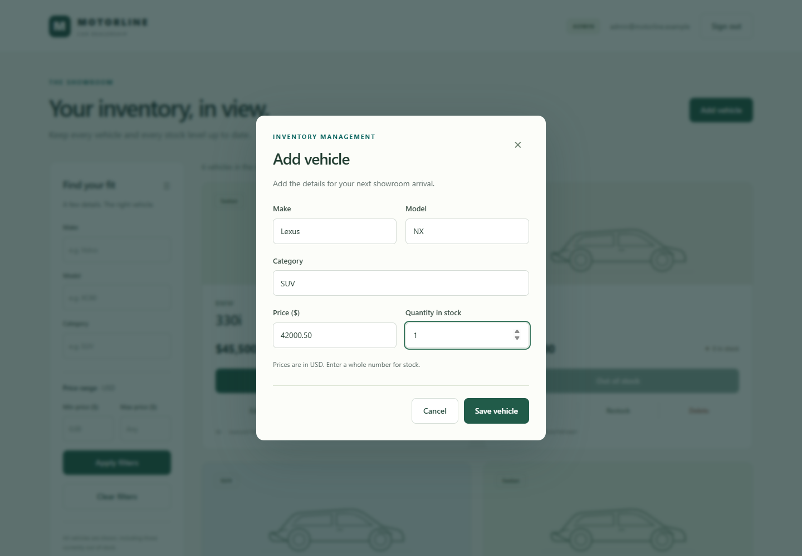
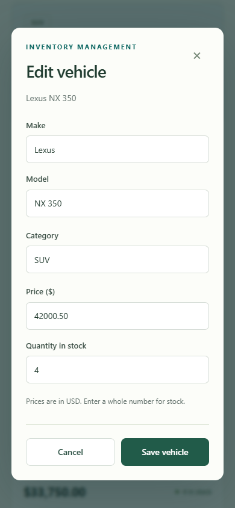

# Original development session: requirements audit tool activity

Source: **Build car inventory system**, 24 October 2026. [Return to the conversation](../../PROMPTS.md).

Tool input and output text below is preserved as recorded. Stored content blocks are decoded for display; image attachments retain their original bytes. Any truncation notices were already present in the source. Timestamps are UTC.

### Record 191

Tool call: wait — 2026-10-24T17:29:59.209Z

Call ID: `call_69p6UWgk0TtNABexkCFgDUOZ`

```json
{"cell_id":"73","yield_time_ms":1000,"max_tokens":2500}
```

### Record 192

Tool output — 2026-10-24T17:30:00.440Z

Call ID: `call_69p6UWgk0TtNABexkCFgDUOZ`

```text
Script failed
Wall time 0.0 seconds
Output:

```

```text
Script error:
exec cell 73 not found
```

### Record 193

Tool call: exec — 2026-10-24T17:30:07.940Z

Call ID: `call_vnMmXGRMwC9tU2ix4VfRw4Lt`

```javascript
const results = await Promise.allSettled([
tools.exec_command({cmd:"git status --short\ngit log --format='%h %s%n%b' -25\nGet-Content -Raw README.md\nGet-Content -Raw package.json","max_output_tokens":6500}),
tools.exec_command({cmd:"rg --files backend/src frontend/src frontend/e2e -g '!*.test.*'\nrg 'router\\.(get|post|put|delete)|app.use' backend/src\nGet-Content -Raw backend/coverage/coverage-summary.json\nGet-Content -Raw frontend/coverage/coverage-summary.json\nGet-Process node -ErrorAction SilentlyContinue | Select-Object Id,CPU,StartTime\nGet-ChildItem screenshots | Select-Object Name,Length","max_output_tokens":5000})
]);results.forEach((r,i)=>text({i,...r}));

```

### Record 194

Tool output — 2026-10-24T17:30:18.797Z

Call ID: `call_vnMmXGRMwC9tU2ix4VfRw4Lt`

```text
Script completed
Wall time 10.5 seconds
Output:

```

````text
{"i":0,"status":"fulfilled","value":{"chunk_id":"d9ab74","wall_time_seconds":2.44459,"exit_code":0,"original_token_count":3308,"output":" M README.md\n M backend/.env.example\n M frontend/package.json\n M package-lock.json\n M package.json\n?? backend/reports/\n?? backend/scripts/\n?? frontend/e2e/\n?? frontend/playwright.config.mjs\n?? frontend/reports/\n?? screenshots/\nbf9e715 feat: complete admin inventory dialogs and responsive styling (green)\n32 frontend tests pass; line coverage 97.71%, branch coverage 90.98%. Frontend typecheck and production build pass.\n\nCo-authored-by: OpenAI Codex <AI@users.noreply.github.com>\n\nc6e762c test: specify admin add, edit, restock, and delete interactions (red)\nSeven new tests fail because admin dialogs and handlers do not exist yet.\n\nCo-authored-by: OpenAI Codex <AI@users.noreply.github.com>\n\n749adbd feat: search inventory and purchase with exact cents and refreshed stock (green)\nAll 25 frontend tests and typecheck pass, including duplicate-submit prevention and stock-conflict refresh.\n\nCo-authored-by: OpenAI Codex <AI@users.noreply.github.com>\n\n9328c8a test: specify combined filtering, purchase refreshes, and exact money parsing (red)\nObserved missing search, purchase, retry, and money behavior. Corrected the expiry test to await the actual message; expiry already passes.\n\nCo-authored-by: OpenAI Codex <AI@users.noreply.github.com>\n\ne038329 feat: add responsive authentication and inventory screens (green)\nSix UI tests and frontend typecheck pass. Stock and admin controls display correctly; handlers follow in the next TDD cycle.\n\nCo-authored-by: OpenAI Codex <AI@users.noreply.github.com>\n\n5932af4 test: specify sign-in, registration, stock display, and admin UI (red)\nAfter fixing matcher resolution, all six tests fail because the screens are missing.\n\nCo-authored-by: OpenAI Codex <AI@users.noreply.github.com>\n\n7406a14 feat: add validated startup, local admin setup, and persistent server (green)\n80 tests pass; lines 97.67%, branches 98.3%. Backend typecheck and build pass.\n\nCo-authored-by: OpenAI Codex <AI@users.noreply.github.com>\n\nffad750 test: verify connection persistence and specify startup validation (red)\nPersistence and malformed-body checks pass; config validation and JSON 404 cases fail as expected.\n\nCo-authored-by: OpenAI Codex <AI@users.noreply.github.com>\n\n6ddaf80 feat: enforce atomic purchases and admin-only restock (green)\nAll 67 integration tests pass. First coverage run is below the 90% line target; database startup and HTTP error paths remain to verify.\n\nCo-authored-by: OpenAI Codex <AI@users.noreply.github.com>\n\nb0c465c test: specify purchase races and admin restocking (red)\n16 inventory tests fail, including twelve concurrent attempts to buy the last unit.\n\nCo-authored-by: OpenAI Codex <AI@users.noreply.github.com>\n\nf99b2bc feat: replace vehicle details and restrict deletion to admins (green)\nAll 51 backend tests pass, including revoked admin roles and missing IDs.\n\nCo-authored-by: OpenAI Codex <AI@users.noreply.github.com>\n\n7f2718e test: specify updates, admin-only deletion, and current-role checks (red)\nSix new cases fail for absent update and delete routes.\n\nCo-authored-by: OpenAI Codex <AI@users.noreply.github.com>\n\ncab2fdf feat: combine literal text search with inclusive price filters (green)\nAll 45 backend tests pass.\n\nCo-authored-by: OpenAI Codex <AI@users.noreply.github.com>\n\nd3c75db test: specify combined vehicle search and safe query parsing (red)\nObserved 11 failing search cases; existing 16 vehicle tests still pass.\n\nCo-authored-by: OpenAI Codex <AI@users.noreply.github.com>\n\n4063c5b feat: persist validated vehicles and list all stock levels (green)\nAll 34 backend tests pass. Prices and quantities use safe nonnegative integers.\n\nCo-authored-by: OpenAI Codex <AI@users.noreply.github.com>\n\na30acfa test: specify vehicle creation, listing, and validation (red)\nAll 16 new vehicle cases fail because routes are absent.\n\nCo-authored-by: OpenAI Codex <AI@users.noreply.github.com>\n\n88f66c1 feat: authenticate logins and protect vehicle routes with verified JWTs (green)\nAll 18 integration tests pass; authorization loads current users from MongoDB.\n\nCo-authored-by: OpenAI Codex <AI@users.noreply.github.com>\n\n408a530 test: specify login and JWT protection for all vehicle routes (red)\nObserved 11 failing cases for missing login and authentication behaviour.\n\nCo-authored-by: OpenAI Codex <AI@users.noreply.github.com>\n\nc4ea8b0 fix: enforce unique email with a database index (green)\nAll 7 registration tests pass, including concurrent duplicate requests.\n\nCo-authored-by: OpenAI Codex <AI@users.noreply.github.com>\n\n790baf0 test: expose duplicate-email race and validate credentials (red)\nObserved two 201 responses for simultaneous duplicate emails; expected 201 and 409. Updated test tools; npm audit reports zero vulnerabilities.\n\nCo-authored-by: OpenAI Codex <AI@users.noreply.github.com>\n\na9c1d98 feat: register users with hashed passwords and JWT sessions (green)\nRegistration integration test passed against isolated MongoDB.\n\nCo-authored-by: OpenAI Codex <AI@users.noreply.github.com>\n\n2d7bb6d test: specify registration persistence and safe role defaults (red)\nObserved failure: POST /api/auth/register returned 404 instead of 201 against real MongoDB.\n\nCo-authored-by: OpenAI Codex <AI@users.noreply.github.com>\n\n5381210 chore: initialize workspace, MongoDB test isolation, and assignment checklist\nAI assistance: OpenAI Codex prepared setup and preserved the original request.\n\nCo-authored-by: OpenAI Codex <AI@users.noreply.github.com>\n\n# Car Dealership Inventory System\r\n\r\nThis repository contains the completed local implementation of the required car\r\ndealership inventory application:\r\n\r\n- Backend: Node.js, TypeScript, Express, MongoDB, JWT, bcryptjs, and Zod\r\n- Frontend: React, TypeScript, Vite, HTML5, CSS3, and Tailwind CSS\r\n- Persistence: MongoDB; the application does not use an in-memory database\r\n\r\nThe assignment PDF was not present in the workspace during this continuation.\r\nThe implementation follows the requirements supplied in the project prompt and\r\ndoes not claim PDF verification.\r\n\r\n## Requirements status\r\n\r\n- [x] Persistent MongoDB with isolated disposable test databases\r\n- [x] Registration, password hashing, login, JWT validation, and admin setup\r\n- [x] Authenticated vehicle create/list/search/update APIs and admin-only delete\r\n- [x] Atomic one-unit purchase and admin-only positive-integer restock\r\n- [x] Responsive registration, login, inventory, search, purchase, and admin UI\r\n- [x] Loading, validation, success, error, empty, and pending states\r\n- [x] Backend/frontend unit tests, coverage, production builds, and browser tests\r\n- [x] Setup, API, assumptions, screenshot, and AI usage documentation\r\n- [ ] User must export and append the complete raw AI conversation to [PROMPTS.md](PROMPTS.md)\r\n- [ ] User must add a personal AI reflection and publish the repository if required\r\n\r\n## Prerequisites\r\n\r\n- Node.js 22.12 or newer\r\n- npm\r\n- A running MongoDB instance\r\n- Chromium or Google Chrome for the Playwright browser tests\r\n\r\n## Setup\r\n\r\nFrom the repository root:\r\n\r\n```powershell\r\nnpm install\r\nnpm run setup:env\r\n```\r\n\r\nThe setup command creates [backend/.env](backend/.env) with a random local JWT\r\nsecret and preserves an existing file. It never overwrites local configuration.\r\nFor manual setup, copy [backend/.env.example](backend/.env.example) to\r\n`backend/.env` and replace the JWT placeholder. The frontend proxy can be\r\nconfigured by copying [frontend/.env.example](frontend/.env.example) to\r\n`frontend/.env`; the default target is the local backend and normally needs no\r\nchange.\r\n\r\nThe application uses prices as nonnegative integer cents in USD. For example,\r\n`42000.50` in the UI is sent to the API as `4200050`.\r\n\r\n## Admin setup\r\n\r\nAfter configuring MongoDB and `backend/.env`, create an administrator locally:\r\n\r\n```powershell\r\n$env:ADMIN_EMAIL = \"admin@example.com\"\r\n$env:ADMIN_PASSWORD = \"choose-a-password-of-at-least-8-characters\"\r\nnpm run admin --workspace backend\r\n```\r\n\r\nThe registration endpoint always creates a regular `user`; request bodies\r\ncannot assign themselves the `admin` role.\r\n\r\n## Run the application\r\n\r\nRun the backend and frontend in separate terminals:\r\n\r\n```powershell\r\nnpm run dev:backend\r\nnpm run dev:frontend\r\n```\r\n\r\nOpen <http://127.0.0.1:5173>. The backend serves the production frontend after\r\n`npm run build` and starts on `http://127.0.0.1:3000` by default.\r\n\r\n## API\r\n\r\nAuthentication endpoints do not require a token:\r\n\r\n- `POST /api/auth/register` with `{ \"email\": \"...\", \"password\": \"...\" }`\r\n- `POST /api/auth/login` with the same body\r\n\r\nSend an `Authorization` header containing the JWT for every vehicle endpoint:\r\n\r\n- `POST /api/vehicles` — create a vehicle\r\n- `GET /api/vehicles` — list all vehicles, including zero-stock vehicles\r\n- `GET /api/vehicles/search?make=&model=&category=&minPrice=&maxPrice` — combine any filters; prices are cents\r\n- `PUT /api/vehicles/:id` — replace a vehicle\r\n- `DELETE /api/vehicles/:id` — admin only\r\n- `POST /api/vehicles/:id/purchase` — purchase one unit; request body is `{}` or omitted\r\n- `POST /api/vehicles/:id/restock` — admin only; body is `{ \"quantity\": 1 }` with a positive integer\r\n\r\nCreate and update are authenticated-user API operations because the assignment\r\nexplicitly restricts deletion, while the frontend exposes create/update controls\r\nonly to administrators. Purchase stock changes use one atomic MongoDB\r\nconditional update, so concurrent requests cannot make quantity negative.\r\n\r\n## Tests, coverage, and build\r\n\r\nTests use a database name ending in `_test` and create a random database below\r\nit. They never use `MONGODB_URI`. Set `TEST_MONGODB_URI` only when the default\r\nlocal test MongoDB URI is not suitable.\r\n\r\n```powershell\r\nnpm test\r\nnpm run test:coverage\r\nnpm run typecheck\r\nnpm run build\r\nnpm run test:e2e\r\n```\r\n\r\nThe latest verified results in this workspace are:\r\n\r\n- Backend: 80 tests passed; 97.88% statements, 98.30% branches\r\n- Frontend: 32 tests passed; 92.38% statements, 90.98% branches\r\n- Playwright: 3 tests passed, covering registration/search/purchase, admin inventory flows, and persistence after backend restart\r\n- Type checks and both production builds passed\r\n\r\nMachine-readable reports are generated in [backend/reports](backend/reports)\r\nand [frontend/reports](frontend/reports). HTML coverage reports are generated\r\nunder [backend/coverage](backend/coverage) and [frontend/coverage](frontend/coverage).\r\n\r\n## Screenshots\r\n\r\nThe browser suite captures the verified UI states in [screenshots](screenshots):\r\n\r\n- [login-desktop.png](screenshots/login-desktop.png)\r\n- [inventory-desktop.png](screenshots/inventory-desktop.png)\r\n- [inventory-mobile.png](screenshots/inventory-mobile.png)\r\n- [admin-desktop.png](screenshots/admin-desktop.png)\r\n- [admin-form.png](screenshots/admin-form.png)\r\n- [admin-form-mobile.png](screenshots/admin-form-mobile.png)\r\n\r\n## Assumptions and scope\r\n\r\n- One purchase click decreases stock by exactly one.\r\n- Restock quantity must be a positive integer.\r\n- Currency is USD because the assignment does not specify a currency.\r\n- No payments, carts, wishlists, purchase history, analytics, notifications,\r\n  image uploads, password reset, or deployment features were added.\r\n- The local Playwright suite uses a random test database and removes it during\r\n  teardown.\r\n\r\n## My AI Usage\r\n\r\nThis implementation was continued with an AI assistant using Copilot SDK in VS\r\nCode. It was used to inspect the existing repository, read the supplied\r\nrequirements, review the existing code and test evidence, run verification\r\ncommands, and update setup documentation. The AI helped identify the completed\r\nimplementation state and document the actual test, coverage, build, and browser\r\nresults; it did not publish the repository or export the conversation.\r\n\r\nThe complete raw conversation is not available for automatic export in this\r\nworkspace. Before submission, export the full unedited chat (user messages,\r\nassistant messages, and tool activity if available) from the AI client and\r\nappend it to [PROMPTS.md](PROMPTS.md), or add a public chat link there. Do not\r\nreplace it with a summary. Add your own honest reflection if the assignment\r\nrequires one.\r\n\r\n## Submission steps still requiring the user\r\n\r\n1. Export and append the complete raw AI conversation to [PROMPTS.md](PROMPTS.md).\r\n2. Add any required personal reflection.\r\n3. Create a public repository and provide its URL if the assignment requires\r\n   publication. No external publication or credential sharing was performed.\r\n\r\n{\n  \"name\": \"car-dealership-inventory\",\n  \"private\": true,\n  \"version\": \"1.0.0\",\n  \"workspaces\": [\n    \"backend\",\n    \"frontend\"\n  ],\n  \"engines\": {\n    \"node\": \">=22.12.0\"\n  },\n  \"scripts\": {\n    \"setup:env\": \"node backend/scripts/setup-env.mjs\",\n    \"dev:backend\": \"npm run dev --workspace backend\",\n    \"dev:frontend\": \"npm run dev --workspace frontend\",\n    \"test\": \"npm run test --workspaces\",\n    \"test:coverage\": \"npm run test:coverage --workspaces\",\n    \"test:e2e\": \"npm run build && npm run test:e2e --workspace frontend\",\n    \"typecheck\": \"npm run typecheck --workspaces\",\n    \"build\": \"npm run build --workspaces\"\n  },\n  \"devDependencies\": {\n    \"prettier\": \"^3.6.2\"\n  }\n}\n\r\n"}}
````

```text
{"i":1,"status":"fulfilled","value":{"chunk_id":"f3c293","wall_time_seconds":2.8814511,"exit_code":0,"original_token_count":2347,"output":"frontend/src\\vitest.d.ts\nfrontend/e2e\\inventory.spec.mjs\nfrontend/src\\types.ts\nfrontend/src\\test-setup.ts\nfrontend/src\\styles.css\nfrontend/src\\money.ts\nfrontend/src\\main.tsx\nfrontend/src\\api.ts\nfrontend/src\\App.tsx\nfrontend/src\\components\\VehicleCard.tsx\nfrontend/src\\components\\SearchForm.tsx\nfrontend/src\\components\\InventoryDialog.tsx\nfrontend/src\\components\\Dashboard.tsx\nfrontend/src\\components\\Brand.tsx\nfrontend/src\\components\\AuthForm.tsx\nbackend/src\\vehicles\\validation.ts\nbackend/src\\vehicles\\routes.ts\nbackend/src\\vehicles\\repository.ts\nbackend/src\\vehicles\\inventory.ts\nbackend/src\\server.ts\nbackend/src\\errors.ts\nbackend/src\\database.ts\nbackend/src\\create-admin.ts\nbackend/src\\config.ts\nbackend/src\\auth\\service.ts\nbackend/src\\auth\\routes.ts\nbackend/src\\auth\\middleware.ts\nbackend/src\\app.ts\nbackend/src\\app.ts:  app.use(express.json({ limit: '16kb' }));\nbackend/src\\app.ts:  app.use('/api/auth', authRoutes(db, jwtSecret));\nbackend/src\\app.ts:  app.use('/api/vehicles', authenticate(db, jwtSecret), vehicleRoutes(db));\nbackend/src\\app.ts:  app.use('/api', (_req, res) => { res.status(404).json({ error: 'Route not found' }); });\nbackend/src\\app.ts:  app.use(errorHandler);\nbackend/src\\auth\\routes.ts:  router.post('/register', async (req, res) => {\nbackend/src\\auth\\routes.ts:  router.post('/login', async (req, res) => {\nbackend/src\\vehicles\\routes.ts:  router.post('/', async (req, res) => {\nbackend/src\\vehicles\\routes.ts:  router.get('/', async (_req, res) => {\nbackend/src\\vehicles\\routes.ts:  router.get('/search', async (req, res) => {\nbackend/src\\vehicles\\routes.ts:  router.put('/:id', async (req, res) => {\nbackend/src\\vehicles\\routes.ts:  router.delete('/:id', requireAdmin, async (req, res) => {\nbackend/src\\vehicles\\routes.ts:  router.post('/:id/purchase', async (req, res) => {\nbackend/src\\vehicles\\routes.ts:  router.post('/:id/restock', requireAdmin, async (req, res) => {\nbackend/src\\server.ts:app.use(express.static(frontendDirectory));\n{\"total\": {\"lines\":{\"total\":129,\"covered\":126,\"skipped\":0,\"pct\":97.67},\"statements\":{\"total\":142,\"covered\":139,\"skipped\":0,\"pct\":97.88},\"functions\":{\"total\":39,\"covered\":39,\"skipped\":0,\"pct\":100},\"branches\":{\"total\":59,\"covered\":58,\"skipped\":0,\"pct\":98.3},\"branchesTrue\":{\"total\":0,\"covered\":0,\"skipped\":0,\"pct\":100}}\n,\"D:\\\\Harsh\\\\Incubyte\\\\car dealership\\\\backend\\\\src\\\\app.ts\": {\"lines\":{\"total\":7,\"covered\":7,\"skipped\":0,\"pct\":100},\"functions\":{\"total\":2,\"covered\":2,\"skipped\":0,\"pct\":100},\"statements\":{\"total\":8,\"covered\":8,\"skipped\":0,\"pct\":100},\"branches\":{\"total\":0,\"covered\":0,\"skipped\":0,\"pct\":100}}\n,\"D:\\\\Harsh\\\\Incubyte\\\\car dealership\\\\backend\\\\src\\\\config.ts\": {\"lines\":{\"total\":4,\"covered\":4,\"skipped\":0,\"pct\":100},\"functions\":{\"total\":2,\"covered\":2,\"skipped\":0,\"pct\":100},\"statements\":{\"total\":4,\"covered\":4,\"skipped\":0,\"pct\":100},\"branches\":{\"total\":0,\"covered\":0,\"skipped\":0,\"pct\":100}}\n,\"D:\\\\Harsh\\\\Incubyte\\\\car dealership\\\\backend\\\\src\\\\database.ts\": {\"lines\":{\"total\":9,\"covered\":7,\"skipped\":0,\"pct\":77.77},\"functions\":{\"total\":3,\"covered\":3,\"skipped\":0,\"pct\":100},\"statements\":{\"total\":10,\"covered\":8,\"skipped\":0,\"pct\":80},\"branches\":{\"total\":0,\"covered\":0,\"skipped\":0,\"pct\":100}}\n,\"D:\\\\Harsh\\\\Incubyte\\\\car dealership\\\\backend\\\\src\\\\errors.ts\": {\"lines\":{\"total\":16,\"covered\":16,\"skipped\":0,\"pct\":100},\"functions\":{\"total\":3,\"covered\":3,\"skipped\":0,\"pct\":100},\"statements\":{\"total\":18,\"covered\":18,\"skipped\":0,\"pct\":100},\"branches\":{\"total\":8,\"covered\":8,\"skipped\":0,\"pct\":100}}\n,\"D:\\\\Harsh\\\\Incubyte\\\\car dealership\\\\backend\\\\src\\\\auth\\\\middleware.ts\": {\"lines\":{\"total\":16,\"covered\":16,\"skipped\":0,\"pct\":100},\"functions\":{\"total\":3,\"covered\":3,\"skipped\":0,\"pct\":100},\"statements\":{\"total\":19,\"covered\":19,\"skipped\":0,\"pct\":100},\"branches\":{\"total\":13,\"covered\":13,\"skipped\":0,\"pct\":100}}\n,\"D:\\\\Harsh\\\\Incubyte\\\\car dealership\\\\backend\\\\src\\\\auth\\\\routes.ts\": {\"lines\":{\"total\":6,\"covered\":6,\"skipped\":0,\"pct\":100},\"functions\":{\"total\":3,\"covered\":3,\"skipped\":0,\"pct\":100},\"statements\":{\"total\":6,\"covered\":6,\"skipped\":0,\"pct\":100},\"branches\":{\"total\":0,\"covered\":0,\"skipped\":0,\"pct\":100}}\n,\"D:\\\\Harsh\\\\Incubyte\\\\car dealership\\\\backend\\\\src\\\\auth\\\\service.ts\": {\"lines\":{\"total\":19,\"covered\":18,\"skipped\":0,\"pct\":94.73},\"functions\":{\"total\":5,\"covered\":5,\"skipped\":0,\"pct\":100},\"statements\":{\"total\":20,\"covered\":19,\"skipped\":0,\"pct\":95},\"branches\":{\"total\":10,\"covered\":9,\"skipped\":0,\"pct\":90}}\n,\"D:\\\\Harsh\\\\Incubyte\\\\car dealership\\\\backend\\\\src\\\\vehicles\\\\inventory.ts\": {\"lines\":{\"total\":5,\"covered\":5,\"skipped\":0,\"pct\":100},\"functions\":{\"total\":1,\"covered\":1,\"skipped\":0,\"pct\":100},\"statements\":{\"total\":6,\"covered\":6,\"skipped\":0,\"pct\":100},\"branches\":{\"total\":6,\"covered\":6,\"skipped\":0,\"pct\":100}}\n,\"D:\\\\Harsh\\\\Incubyte\\\\car dealership\\\\backend\\\\src\\\\vehicles\\\\repository.ts\": {\"lines\":{\"total\":19,\"covered\":19,\"skipped\":0,\"pct\":100},\"functions\":{\"total\":7,\"covered\":7,\"skipped\":0,\"pct\":100},\"statements\":{\"total\":23,\"covered\":23,\"skipped\":0,\"pct\":100},\"branches\":{\"total\":17,\"covered\":17,\"skipped\":0,\"pct\":100}}\n,\"D:\\\\Harsh\\\\Incubyte\\\\car dealership\\\\backend\\\\src\\\\vehicles\\\\routes.ts\": {\"lines\":{\"total\":19,\"covered\":19,\"skipped\":0,\"pct\":100},\"functions\":{\"total\":8,\"covered\":8,\"skipped\":0,\"pct\":100},\"statements\":{\"total\":19,\"covered\":19,\"skipped\":0,\"pct\":100},\"branches\":{\"total\":2,\"covered\":2,\"skipped\":0,\"pct\":100}}\n,\"D:\\\\Harsh\\\\Incubyte\\\\car dealership\\\\backend\\\\src\\\\vehicles\\\\validation.ts\": {\"lines\":{\"total\":9,\"covered\":9,\"skipped\":0,\"pct\":100},\"functions\":{\"total\":2,\"covered\":2,\"skipped\":0,\"pct\":100},\"statements\":{\"total\":9,\"covered\":9,\"skipped\":0,\"pct\":100},\"branches\":{\"total\":3,\"covered\":3,\"skipped\":0,\"pct\":100}}\n}\n\r\n{\"total\": {\"lines\":{\"total\":175,\"covered\":171,\"skipped\":0,\"pct\":97.71},\"statements\":{\"total\":210,\"covered\":194,\"skipped\":0,\"pct\":92.38},\"functions\":{\"total\":43,\"covered\":40,\"skipped\":0,\"pct\":93.02},\"branches\":{\"total\":233,\"covered\":212,\"skipped\":0,\"pct\":90.98},\"branchesTrue\":{\"total\":0,\"covered\":0,\"skipped\":0,\"pct\":100}}\n,\"D:\\\\Harsh\\\\Incubyte\\\\car dealership\\\\frontend\\\\src\\\\App.tsx\": {\"lines\":{\"total\":16,\"covered\":16,\"skipped\":0,\"pct\":100},\"functions\":{\"total\":4,\"covered\":4,\"skipped\":0,\"pct\":100},\"statements\":{\"total\":18,\"covered\":18,\"skipped\":0,\"pct\":100},\"branches\":{\"total\":13,\"covered\":13,\"skipped\":0,\"pct\":100}}\n,\"D:\\\\Harsh\\\\Incubyte\\\\car dealership\\\\frontend\\\\src\\\\api.ts\": {\"lines\":{\"total\":12,\"covered\":11,\"skipped\":0,\"pct\":91.66},\"functions\":{\"total\":4,\"covered\":2,\"skipped\":0,\"pct\":50},\"statements\":{\"total\":16,\"covered\":13,\"skipped\":0,\"pct\":81.25},\"branches\":{\"total\":22,\"covered\":18,\"skipped\":0,\"pct\":81.81}}\n,\"D:\\\\Harsh\\\\Incubyte\\\\car dealership\\\\frontend\\\\src\\\\money.ts\": {\"lines\":{\"total\":9,\"covered\":9,\"skipped\":0,\"pct\":100},\"functions\":{\"total\":3,\"covered\":3,\"skipped\":0,\"pct\":100},\"statements\":{\"total\":10,\"covered\":10,\"skipped\":0,\"pct\":100},\"branches\":{\"total\":5,\"covered\":5,\"skipped\":0,\"pct\":100}}\n,\"D:\\\\Harsh\\\\Incubyte\\\\car dealership\\\\frontend\\\\src\\\\vitest.d.ts\": {\"lines\":{\"total\":0,\"covered\":0,\"skipped\":0,\"pct\":0},\"functions\":{\"total\":0,\"covered\":0,\"skipped\":0,\"pct\":0},\"statements\":{\"total\":0,\"covered\":0,\"skipped\":0,\"pct\":0},\"branches\":{\"total\":0,\"covered\":0,\"skipped\":0,\"pct\":0}}\n,\"D:\\\\Harsh\\\\Incubyte\\\\car dealership\\\\frontend\\\\src\\\\components\\\\AuthForm.tsx\": {\"lines\":{\"total\":21,\"covered\":19,\"skipped\":0,\"pct\":90.47},\"functions\":{\"total\":3,\"covered\":3,\"skipped\":0,\"pct\":100},\"statements\":{\"total\":24,\"covered\":21,\"skipped\":0,\"pct\":87.5},\"branches\":{\"total\":28,\"covered\":26,\"skipped\":0,\"pct\":92.85}}\n,\"D:\\\\Harsh\\\\Incubyte\\\\car dealership\\\\frontend\\\\src\\\\components\\\\Brand.tsx\": {\"lines\":{\"total\":2,\"covered\":2,\"skipped\":0,\"pct\":100},\"functions\":{\"total\":2,\"covered\":2,\"skipped\":0,\"pct\":100},\"statements\":{\"total\":2,\"covered\":2,\"skipped\":0,\"pct\":100},\"branches\":{\"total\":4,\"covered\":4,\"skipped\":0,\"pct\":100}}\n,\"D:\\\\Harsh\\\\Incubyte\\\\car dealership\\\\frontend\\\\src\\\\components\\\\Dashboard.tsx\": {\"lines\":{\"total\":60,\"covered\":60,\"skipped\":0,\"pct\":100},\"functions\":{\"total\":14,\"covered\":14,\"skipped\":0,\"pct\":100},\"statements\":{\"total\":74,\"covered\":69,\"skipped\":0,\"pct\":93.24},\"branches\":{\"total\":84,\"covered\":75,\"skipped\":0,\"pct\":89.28}}\n,\"D:\\\\Harsh\\\\Incubyte\\\\car dealership\\\\frontend\\\\src\\\\components\\\\InventoryDialog.tsx\": {\"lines\":{\"total\":35,\"covered\":34,\"skipped\":0,\"pct\":97.14},\"functions\":{\"total\":6,\"covered\":5,\"skipped\":0,\"pct\":83.33},\"statements\":{\"total\":41,\"covered\":36,\"skipped\":0,\"pct\":87.8},\"branches\":{\"total\":56,\"covered\":51,\"skipped\":0,\"pct\":91.07}}\n,\"D:\\\\Harsh\\\\Incubyte\\\\car dealership\\\\frontend\\\\src\\\\components\\\\SearchForm.tsx\": {\"lines\":{\"total\":18,\"covered\":18,\"skipped\":0,\"pct\":100},\"functions\":{\"total\":3,\"covered\":3,\"skipped\":0,\"pct\":100},\"statements\":{\"total\":21,\"covered\":21,\"skipped\":0,\"pct\":100},\"branches\":{\"total\":11,\"covered\":10,\"skipped\":0,\"pct\":90.9}}\n,\"D:\\\\Harsh\\\\Incubyte\\\\car dealership\\\\frontend\\\\src\\\\components\\\\VehicleCard.tsx\": {\"lines\":{\"total\":2,\"covered\":2,\"skipped\":0,\"pct\":100},\"functions\":{\"total\":4,\"covered\":4,\"skipped\":0,\"pct\":100},\"statements\":{\"total\":4,\"covered\":4,\"skipped\":0,\"pct\":100},\"branches\":{\"total\":10,\"covered\":10,\"skipped\":0,\"pct\":100}}\n}\n\r\n\r\n   Id    CPU StartTime          \r\n   --    --- ---------          \r\n13288 2.4375 24-10-2026 15:59:23\r\n                                \r\n                                \r\n                                \r\n                                \r\n                                \r\n                                \r\n\r\n\r\n"}}
```

### Record 195

Tool call: exec — 2026-10-24T17:31:09.169Z

Call ID: `call_DYsYzcfbRjS68qEpuDFVEYmj`

```javascript
const results = await Promise.allSettled([
tools.exec_command({cmd:"Get-Content -Encoding UTF8 -Raw README.md\ngit diff --stat\ngit remote -v\ngit check-ignore backend/.env\nGet-Content -Encoding UTF8 PROMPTS.md -TotalCount 13\nGet-Content -Raw node_modules/prettier/package.json | ConvertFrom-Json | Select-Object name,version","max_output_tokens":5500}),
tools.exec_command({cmd:"Get-Content -Raw frontend/src/components/Dashboard.tsx\nGet-Content -Raw backend/src/auth/service.ts\nGet-Content -Raw backend/src/vehicles/repository.ts\nGet-Content -Raw frontend/reports/e2e.json | ConvertFrom-Json | Select-Object -ExpandProperty stats\nGet-Content -Raw backend/reports/tests.json | ConvertFrom-Json | Select-Object numTotalTests,numPassedTests,success\nGet-Content -Raw frontend/reports/tests.json | ConvertFrom-Json | Select-Object numTotalTests,numPassedTests,success","max_output_tokens":6500})
]);results.forEach((r,i)=>text({i,...r}));

```

### Record 196

Tool output — 2026-10-24T17:31:13.811Z

Call ID: `call_DYsYzcfbRjS68qEpuDFVEYmj`

```text
Script completed
Wall time 4.3 seconds
Output:

```

````text
{"i":0,"status":"fulfilled","value":{"chunk_id":"bf12c8","wall_time_seconds":2.4030154,"exit_code":0,"original_token_count":2098,"output":"# Car Dealership Inventory System\r\n\r\nThis repository contains the completed local implementation of the required car\r\ndealership inventory application:\r\n\r\n- Backend: Node.js, TypeScript, Express, MongoDB, JWT, bcryptjs, and Zod\r\n- Frontend: React, TypeScript, Vite, HTML5, CSS3, and Tailwind CSS\r\n- Persistence: MongoDB; the application does not use an in-memory database\r\n\r\nThe assignment PDF was not present in the workspace during this continuation.\r\nThe implementation follows the requirements supplied in the project prompt and\r\ndoes not claim PDF verification.\r\n\r\n## Requirements status\r\n\r\n- [x] Persistent MongoDB with isolated disposable test databases\r\n- [x] Registration, password hashing, login, JWT validation, and admin setup\r\n- [x] Authenticated vehicle create/list/search/update APIs and admin-only delete\r\n- [x] Atomic one-unit purchase and admin-only positive-integer restock\r\n- [x] Responsive registration, login, inventory, search, purchase, and admin UI\r\n- [x] Loading, validation, success, error, empty, and pending states\r\n- [x] Backend/frontend unit tests, coverage, production builds, and browser tests\r\n- [x] Setup, API, assumptions, screenshot, and AI usage documentation\r\n- [ ] User must export and append the complete raw AI conversation to [PROMPTS.md](PROMPTS.md)\r\n- [ ] User must add a personal AI reflection and publish the repository if required\r\n\r\n## Prerequisites\r\n\r\n- Node.js 22.12 or newer\r\n- npm\r\n- A running MongoDB instance\r\n- Chromium or Google Chrome for the Playwright browser tests\r\n\r\n## Setup\r\n\r\nFrom the repository root:\r\n\r\n```powershell\r\nnpm install\r\nnpm run setup:env\r\n```\r\n\r\nThe setup command creates [backend/.env](backend/.env) with a random local JWT\r\nsecret and preserves an existing file. It never overwrites local configuration.\r\nFor manual setup, copy [backend/.env.example](backend/.env.example) to\r\n`backend/.env` and replace the JWT placeholder. The frontend proxy can be\r\nconfigured by copying [frontend/.env.example](frontend/.env.example) to\r\n`frontend/.env`; the default target is the local backend and normally needs no\r\nchange.\r\n\r\nThe application uses prices as nonnegative integer cents in USD. For example,\r\n`42000.50` in the UI is sent to the API as `4200050`.\r\n\r\n## Admin setup\r\n\r\nAfter configuring MongoDB and `backend/.env`, create an administrator locally:\r\n\r\n```powershell\r\n$env:ADMIN_EMAIL = \"admin@example.com\"\r\n$env:ADMIN_PASSWORD = \"choose-a-password-of-at-least-8-characters\"\r\nnpm run admin --workspace backend\r\n```\r\n\r\nThe registration endpoint always creates a regular `user`; request bodies\r\ncannot assign themselves the `admin` role.\r\n\r\n## Run the application\r\n\r\nRun the backend and frontend in separate terminals:\r\n\r\n```powershell\r\nnpm run dev:backend\r\nnpm run dev:frontend\r\n```\r\n\r\nOpen <http://127.0.0.1:5173>. The backend serves the production frontend after\r\n`npm run build` and starts on `http://127.0.0.1:3000` by default.\r\n\r\n## API\r\n\r\nAuthentication endpoints do not require a token:\r\n\r\n- `POST /api/auth/register` with `{ \"email\": \"...\", \"password\": \"...\" }`\r\n- `POST /api/auth/login` with the same body\r\n\r\nSend an `Authorization` header containing the JWT for every vehicle endpoint:\r\n\r\n- `POST /api/vehicles` — create a vehicle\r\n- `GET /api/vehicles` — list all vehicles, including zero-stock vehicles\r\n- `GET /api/vehicles/search?make=&model=&category=&minPrice=&maxPrice` — combine any filters; prices are cents\r\n- `PUT /api/vehicles/:id` — replace a vehicle\r\n- `DELETE /api/vehicles/:id` — admin only\r\n- `POST /api/vehicles/:id/purchase` — purchase one unit; request body is `{}` or omitted\r\n- `POST /api/vehicles/:id/restock` — admin only; body is `{ \"quantity\": 1 }` with a positive integer\r\n\r\nCreate and update are authenticated-user API operations because the assignment\r\nexplicitly restricts deletion, while the frontend exposes create/update controls\r\nonly to administrators. Purchase stock changes use one atomic MongoDB\r\nconditional update, so concurrent requests cannot make quantity negative.\r\n\r\n## Tests, coverage, and build\r\n\r\nTests use a database name ending in `_test` and create a random database below\r\nit. They never use `MONGODB_URI`. Set `TEST_MONGODB_URI` only when the default\r\nlocal test MongoDB URI is not suitable.\r\n\r\n```powershell\r\nnpm test\r\nnpm run test:coverage\r\nnpm run typecheck\r\nnpm run build\r\nnpm run test:e2e\r\n```\r\n\r\nThe latest verified results in this workspace are:\r\n\r\n- Backend: 80 tests passed; 97.88% statements, 98.30% branches\r\n- Frontend: 32 tests passed; 92.38% statements, 90.98% branches\r\n- Playwright: 3 tests passed, covering registration/search/purchase, admin inventory flows, and persistence after backend restart\r\n- Type checks and both production builds passed\r\n\r\nMachine-readable reports are generated in [backend/reports](backend/reports)\r\nand [frontend/reports](frontend/reports). HTML coverage reports are generated\r\nunder [backend/coverage](backend/coverage) and [frontend/coverage](frontend/coverage).\r\n\r\n## Screenshots\r\n\r\nThe browser suite captures the verified UI states in [screenshots](screenshots):\r\n\r\n- [login-desktop.png](screenshots/login-desktop.png)\r\n- [inventory-desktop.png](screenshots/inventory-desktop.png)\r\n- [inventory-mobile.png](screenshots/inventory-mobile.png)\r\n- [admin-desktop.png](screenshots/admin-desktop.png)\r\n- [admin-form.png](screenshots/admin-form.png)\r\n- [admin-form-mobile.png](screenshots/admin-form-mobile.png)\r\n\r\n## Assumptions and scope\r\n\r\n- One purchase click decreases stock by exactly one.\r\n- Restock quantity must be a positive integer.\r\n- Currency is USD because the assignment does not specify a currency.\r\n- No payments, carts, wishlists, purchase history, analytics, notifications,\r\n  image uploads, password reset, or deployment features were added.\r\n- The local Playwright suite uses a random test database and removes it during\r\n  teardown.\r\n\r\n## My AI Usage\r\n\r\nThis implementation was continued with an AI assistant using Copilot SDK in VS\r\nCode. It was used to inspect the existing repository, read the supplied\r\nrequirements, review the existing code and test evidence, run verification\r\ncommands, and update setup documentation. The AI helped identify the completed\r\nimplementation state and document the actual test, coverage, build, and browser\r\nresults; it did not publish the repository or export the conversation.\r\n\r\nThe complete raw conversation is not available for automatic export in this\r\nworkspace. Before submission, export the full unedited chat (user messages,\r\nassistant messages, and tool activity if available) from the AI client and\r\nappend it to [PROMPTS.md](PROMPTS.md), or add a public chat link there. Do not\r\nreplace it with a summary. Add your own honest reflection if the assignment\r\nrequires one.\r\n\r\n## Submission steps still requiring the user\r\n\r\n1. Export and append the complete raw AI conversation to [PROMPTS.md](PROMPTS.md).\r\n2. Add any required personal reflection.\r\n3. Create a public repository and provide its URL if the assignment requires\r\n   publication. No external publication or credential sharing was performed.\r\n\r\nwarning: in the working copy of 'README.md', CRLF will be replaced by LF the next time Git touches it\n README.md             | 190 +++++++++++++++++++++++++++++++++++++++++---------\n backend/.env.example  |   4 +-\n frontend/package.json |   3 +-\n package-lock.json     |  19 +++++\n package.json          |  14 +++-\n 5 files changed, 193 insertions(+), 37 deletions(-)\nbackend/.env\n# Raw AI conversation record\r\n\r\nStatus: INCOMPLETE. The exact original pasted user request is preserved below.\r\nThis is not the full conversation. Before submission, export this complete Codex\r\nchat (user and assistant messages, and tool activity if available) and paste it\r\nverbatim below or add a public chat link. Do not replace it with a summary.\r\nThe agent cannot export the full chat from this environment.\r\n\r\n## Original pasted user request (verbatim)\r\n\r\nBuild the “Car Dealership Inventory System” described in `AI_Kata_Car_Dealership_Inventory_System_V2.pdf`.\r\n\r\nRead the PDF if it is available in this workspace. Treat it as the source of truth. Implement every mandatory requirement and do not add extra product features. If you cannot read it, say so and use the requirements below without claiming to have verified the PDF.\r\n\r\nname     version\r\n----     -------\r\nprettier 3.6.2  \r\n\r\n\r\n"}}
````

```text
{"i":1,"status":"fulfilled","value":{"chunk_id":"c5f5e2","wall_time_seconds":1.838041,"exit_code":0,"original_token_count":2743,"output":"import { useCallback, useEffect, useRef, useState } from 'react';\nimport { api, ApiError } from '../api';\nimport type { Session, Vehicle } from '../types';\nimport { Brand } from './Brand';\nimport { VehicleCard } from './VehicleCard';\nimport { SearchForm } from './SearchForm';\nimport { InventoryDialog, type InventoryAction, type InventoryPayload } from './InventoryDialog';\n\nexport function Dashboard({ session, onSignOut }: { session: Session; onSignOut: (expired?: boolean) => void }) {\n  const [vehicles, setVehicles] = useState<Vehicle[]>([]);\n  const [loading, setLoading] = useState(true);\n  const [error, setError] = useState('');\n  const [query, setQuery] = useState('');\n  const [message, setMessage] = useState<{ text: string; error: boolean } | null>(null);\n  const [pending, setPending] = useState<string | null>(null);\n  const mutationBusy = useRef(false);\n  const requestId = useRef(0);\n  const [action, setAction] = useState<InventoryAction | null>(null);\n  const admin = session.user.role === 'admin';\n  const load = useCallback(async (signal?: AbortSignal) => {\n    const current = ++requestId.current;\n    setLoading(true);\n    setError('');\n    try {\n      const result = await api<Vehicle[]>(query ? `/vehicles/search?${query}` : '/vehicles', { token: session.token, signal });\n      if (!signal?.aborted && current === requestId.current) setVehicles(result);\n    } catch (failure) {\n      if (!signal?.aborted && current === requestId.current) {\n        if (failure instanceof ApiError && failure.status === 401) onSignOut(true);\n        else setError((failure as Error).message);\n      }\n    } finally { if (!signal?.aborted && current === requestId.current) setLoading(false); }\n  }, [query, session.token, onSignOut]);\n  useEffect(() => {\n    const controller = new AbortController();\n    void load(controller.signal);\n    return () => controller.abort();\n  }, [load]);\n\n  async function purchase(vehicle: Vehicle) {\n    if (mutationBusy.current) return;\n    mutationBusy.current = true;\n    setPending(vehicle.id);\n    setMessage(null);\n    try {\n      await api<Vehicle>(`/vehicles/${vehicle.id}/purchase`, { token: session.token, method: 'POST' });\n      setMessage({ text: `Purchased one ${vehicle.make} ${vehicle.model}.`, error: false });\n      await load();\n    } catch (failure) {\n      if (failure instanceof ApiError && failure.status === 401) onSignOut(true);\n      else {\n        setMessage({ text: (failure as Error).message, error: true });\n        if (failure instanceof ApiError && [404, 409].includes(failure.status)) await load();\n      }\n    } finally { mutationBusy.current = false; setPending(null); }\n  }\n\n  function search(next: string) {\n    setMessage(null);\n    if (next === query) void load();\n    else setQuery(next);\n  }\n\n  async function saveInventory(input: InventoryPayload) {\n    if (!action || mutationBusy.current) return;\n    mutationBusy.current = true;\n    setPending('admin');\n    setMessage(null);\n    const path = action.kind === 'add' ? '/vehicles' : `/vehicles/${action.vehicle.id}${action.kind === 'restock' ? '/restock' : ''}`;\n    const method = action.kind === 'delete' ? 'DELETE' : action.kind === 'edit' ? 'PUT' : 'POST';\n    try {\n      await api(path, { token: session.token, method, body: input });\n      setAction(null);\n      setMessage({ text: { add: 'Vehicle added.', edit: 'Vehicle updated.', delete: 'Vehicle deleted.', restock: 'Vehicle restocked.' }[action.kind], error: false });\n      await load();\n    } catch (failure) {\n      if (failure instanceof ApiError && failure.status === 401) onSignOut(true);\n      throw failure;\n    } finally { mutationBusy.current = false; setPending(null); }\n  }\n  return <div className=\"app-shell\">\n    <header className=\"app-header\"><div className=\"header-inner\">\n      <Brand /><nav aria-label=\"Account\" className=\"account-nav\">\n        <span className=\"role-badge\">{admin ? 'Admin' : 'Member'}</span>\n        <span className=\"account-email\">{session.user.email}</span>\n        <button className=\"button button-quiet\" onClick={() => onSignOut()}>Sign out</button>\n      </nav>\n    </div></header>\n    <main className=\"dashboard\">\n      <div className=\"dashboard-intro\"><div><p className=\"eyebrow text-teal-800\">THE SHOWROOM</p>\n        <h1>{admin ? 'Your inventory, in view.' : 'Find your next drive.'}</h1>\n        <p className=\"muted mt-3\">{admin ? 'Keep every vehicle and every stock level up to date.' : 'Explore our vehicles and make your next move.'}</p>\n      </div>{admin && <button className=\"button button-primary\" disabled={loading || pending !== null} onClick={() => setAction({ kind: 'add' })}>Add vehicle</button>}</div>\n      {message && <p role={message.error ? 'alert' : 'status'} className={`${message.error ? 'error-box' : 'success-box'} mb-6`}>{message.text}</p>}\n      <div className=\"inventory-layout\">\n        <SearchForm onSearch={search} disabled={loading || pending !== null} />\n        <section aria-label=\"Vehicle inventory\" className=\"min-w-0\">\n          {error && <div role=\"alert\" className=\"error-box mb-6\">{error}<button className=\"button button-secondary ml-3\" onClick={() => void load()}>Retry</button></div>}\n          {loading ? <p role=\"status\" className=\"empty-state\">Loading inventory…</p> :\n            !error && (vehicles.length ? <><p className=\"results-label\">{vehicles.length} {vehicles.length === 1 ? 'vehicle' : 'vehicles'} {query ? 'matching your filters' : 'in the showroom'}</p><div className=\"vehicle-grid\">{vehicles.map(vehicle => <VehicleCard key={vehicle.id} vehicle={vehicle} admin={admin} disabled={pending !== null} purchasing={pending === vehicle.id} onPurchase={() => void purchase(vehicle)} onAdmin={kind => setAction({ kind, vehicle })} />)}</div></> :\n              <div className=\"empty-state\"><h2>{query ? 'No matching vehicles' : 'No vehicles yet'}</h2><p className=\"muted\">{query ? 'Try a different search or clear your filters.' : admin ? 'Add your first vehicle to get started.' : 'New vehicles will appear here when they are added.'}</p></div>)}\n        </section>\n      </div>\n    </main>\n    <footer className=\"app-footer\"><span>MOTORLINE</span><span>Car dealership inventory</span></footer>\n    {action && <InventoryDialog action={action} onSave={saveInventory} onClose={() => setAction(null)} />}\n  </div>;\n}\n\r\nimport bcrypt from 'bcryptjs';\nimport jwt from 'jsonwebtoken';\nimport { MongoServerError, ObjectId, type Db } from 'mongodb';\nimport { z } from 'zod';\nimport { users, type UserDocument } from '../database.js';\nimport { HttpError } from '../errors.js';\n\nconst credentials = z.object({\n  email: z.string().trim().toLowerCase().email().max(254),\n  password: z.string().min(8).refine(value => Buffer.byteLength(value, 'utf8') <= 72,\n    'Password must be at most 72 UTF-8 bytes')\n});\nconst dummyPasswordHash = bcrypt.hashSync('unused-password-for-timing', 12);\n\nexport function authResult(user: UserDocument, secret: string) {\n  return {\n    user: { id: user._id.toHexString(), email: user.email, role: user.role },\n    token: jwt.sign({}, secret, {\n      subject: user._id.toHexString(), expiresIn: '1h', algorithm: 'HS256',\n      issuer: 'car-dealership', audience: 'car-dealership-ui'\n    })\n  };\n}\n\nexport async function register(db: Db, secret: string, input: unknown) {\n  return authResult(await createUser(db, input, 'user'), secret);\n}\n\n// The role argument is chosen by server code, never from a registration body.\nexport async function createUser(db: Db, input: unknown, role: UserDocument['role']) {\n  const { email, password } = credentials.parse(input);\n  const user: UserDocument = {\n    _id: new ObjectId(), email, passwordHash: await bcrypt.hash(password, 12), role\n  };\n  try {\n    await users(db).insertOne(user);\n  } catch (error) {\n    if (error instanceof MongoServerError && error.code === 11000) {\n      throw new HttpError(409, 'An account with that email already exists');\n    }\n    throw error;\n  }\n  return user;\n}\n\nexport async function login(db: Db, secret: string, input: unknown) {\n  const { email, password } = credentials.parse(input);\n  const user = await users(db).findOne({ email });\n  // Spend the same hashing work on unknown emails, too.\n  const hash = user?.passwordHash ?? dummyPasswordHash;\n  const matches = await bcrypt.compare(password, hash);\n  if (!user || !matches) throw new HttpError(401, 'Email or password is incorrect');\n  return authResult(user, secret);\n}\n\r\nimport { ObjectId, type Db, type Filter } from 'mongodb';\nimport type { SearchInput, VehicleInput } from './validation.js';\nimport { HttpError } from '../errors.js';\n\nexport interface VehicleDocument extends VehicleInput { _id: ObjectId }\nexport const vehicles = (db: Db) => db.collection<VehicleDocument>('vehicles');\nexport function publicVehicle({ _id, ...vehicle }: VehicleDocument) {\n  return { id: _id.toHexString(), ...vehicle };\n}\n\nexport async function insertVehicle(db: Db, input: VehicleInput) {\n  const vehicle = { _id: new ObjectId(), ...input };\n  await vehicles(db).insertOne(vehicle);\n  return publicVehicle(vehicle);\n}\n\nexport async function listVehicles(db: Db, search: SearchInput = {}) {\n  const filter: Filter<VehicleDocument> = {};\n  for (const field of ['make', 'model', 'category'] as const) {\n    const value = search[field];\n    if (value) filter[field] = { $regex: value.replace(/[.*+?^${}()|[\\]\\\\]/g, '\\\\$&'), $options: 'i' };\n  }\n  if (search.minPrice !== undefined || search.maxPrice !== undefined) {\n    filter.price = {\n      ...(search.minPrice !== undefined ? { $gte: search.minPrice } : {}),\n      ...(search.maxPrice !== undefined ? { $lte: search.maxPrice } : {})\n    };\n  }\n  return (await vehicles(db).find(filter).sort({ make: 1, model: 1, _id: 1 }).toArray()).map(publicVehicle);\n}\n\nexport async function replaceVehicle(db: Db, id: ObjectId, input: VehicleInput) {\n  const result = await vehicles(db).findOneAndUpdate({ _id: id }, { $set: input }, { returnDocument: 'after' });\n  if (!result) throw new HttpError(404, 'Vehicle not found');\n  return publicVehicle(result);\n}\n\nexport async function deleteVehicle(db: Db, id: ObjectId) {\n  const result = await vehicles(db).deleteOne({ _id: id });\n  if (!result.deletedCount) throw new HttpError(404, 'Vehicle not found');\n}\n\nexport async function changeStock(db: Db, id: ObjectId, change: number) {\n  // The stock condition and increment happen in ONE MongoDB write.\n  // Checking stock in a separate read before writing would allow overselling.\n  const quantity = change < 0 ? { $gte: -change } : { $lte: Number.MAX_SAFE_INTEGER - change };\n  return vehicles(db).findOneAndUpdate(\n    { _id: id, quantity }, { $inc: { quantity: change } }, { returnDocument: 'after' }\n  );\n}\n\r\n\r\n\r\nstartTime  : 2026-10-24T12:42:10.609Z\r\nduration   : 28236.066000000003\r\nexpected   : 3\r\nskipped    : 0\r\nunexpected : 0\r\nflaky      : 0\r\n\r\nnumTotalTests  : 80\r\nnumPassedTests : 80\r\nsuccess        : True\r\n\r\nnumTotalTests  : 32\r\nnumPassedTests : 32\r\nsuccess        : True\r\n\r\n\r\n\r\n"}}
```

### Record 197

Tool call: exec — 2026-10-24T17:33:00.581Z

Call ID: `call_N5TDro8OsTvoZbSlyk3nNyCB`

````javascript
text(await tools.apply_patch("*** Begin Patch\n*** Update File: README.md\n@@\n-The assignment PDF was not present in the workspace during this continuation.\n-The implementation follows the requirements supplied in the project prompt and\n-does not claim PDF verification.\n+All three pages of `AI_Kata_Car_Dealership_Inventory_System_V2.pdf` were read from\n+the supplied file and visually checked during this Codex session. The implementation\n+also follows the more specific stack, permissions, stock, and testing requirements\n+in the original pasted request.\n@@\n-- [ ] User must add a personal AI reflection and publish the repository if required\n+- [ ] User must add their personal AI reflection to the section below\n+- [ ] User must publish the repository and supply its public URL; this is mandatory for submission\n@@\n-- A running MongoDB instance\n-- Chromium or Google Chrome for the Playwright browser tests\n+- A running MongoDB instance (verified locally with MongoDB 8.0)\n+- Google Chrome for the Playwright browser tests (the default browser channel)\n@@\n-npm install\n+npm ci\n npm run setup:env\n@@\n The application uses prices as nonnegative integer cents in USD. For example,\n `42000.50` in the UI is sent to the API as `4200050`.\n+\n+### MongoDB setup\n+\n+The default connection is `mongodb://127.0.0.1:27017/car_dealership`.\n+Use an installed MongoDB service, or start MongoDB Community Server with a persistent\n+data directory. On Windows, check an existing service with `Get-Service MongoDB`.\n+If it is already running, no additional server is needed. If no service is running,\n+run these commands from the repository root in a separate terminal:\n+\n+```powershell\n+New-Item -ItemType Directory -Force .local/mongodb\n+mongod --dbpath .local/mongodb --bind_ip 127.0.0.1 --port 27017\n+```\n+\n+If `mongod` is not on PATH, use its installed absolute path; for example,\n+`& 'C:\\Program Files\\MongoDB\\Server\\8.0\\bin\\mongod.exe'` followed by the same arguments.\n+MongoDB creates the application database when the first data is written. An existing\n+service retains data in its configured data directory. The manual setup retains it\n+in `.local/mongodb`, which is excluded from Git. Do not start a second server on an\n+occupied port. For a different MongoDB instance, edit `MONGODB_URI` in `backend/.env`.\n@@\n $env:ADMIN_PASSWORD = \"choose-a-password-of-at-least-8-characters\"\n npm run admin --workspace backend\n+Remove-Item Env:ADMIN_EMAIL, Env:ADMIN_PASSWORD\n@@\n cannot assign themselves the `admin` role.\n+Use a new email address: the command refuses duplicates rather than overwriting an\n+existing account. Passwords must be at least 8 characters and at most 72 UTF-8 bytes.\n+No admin password or populated development inventory is shipped. Create your own\n+admin, sign in, and use **Add vehicle**. Screenshot data exists only in the test database.\n@@\n Open <http://127.0.0.1:5173>. The backend serves the production frontend after\n `npm run build` and starts on `http://127.0.0.1:3000` by default.\n+\n+For a local production build:\n+\n+```powershell\n+npm run build\n+npm run start --workspace backend\n+```\n+\n+Open <http://127.0.0.1:3000>. Vite proxies `/api` during development; Express serves\n+the compiled SPA and API from the same origin in the production build. Both servers\n+bind locally. JWTs expire after one hour. The UI keeps the session in per-tab\n+`sessionStorage`, clears it on sign-out, and returns to sign-in after a 401 response.\n@@\n-Send an `Authorization` header containing the JWT for every vehicle endpoint:\n+Both authentication endpoints return `{ \"token\": \"...\", \"user\": { \"id\": \"...\",\n+\"email\": \"...\", \"role\": \"user\" } }`. Password hashes are never returned.\n+Send `Authorization: Bearer <token>` for every vehicle endpoint:\n@@\n-- `GET /api/vehicles/search?make=&model=&category=&minPrice=&maxPrice` — combine any filters; prices are cents\n+- `GET /api/vehicles/search` — combine any filters; prices are cents\n@@\n conditional update, so concurrent requests cannot make quantity negative.\n+\n+Create and update accept all five fields below. `PUT` is a complete replacement of\n+these details, including the absolute stock quantity; it does not accept partial updates.\n+Responses include the stable `id` in addition to these fields. Lists/search return\n+arrays, and successful deletion returns HTTP 204 with no body.\n+\n+```json\n+{ \"make\": \"Volvo\", \"model\": \"XC60\", \"category\": \"SUV\", \"price\": 4890000, \"quantity\": 3 }\n+```\n+\n+| Search parameter | Meaning |\n+| --- | --- |\n+| `make`, `model`, `category` | Case-insensitive literal substring matches; combine using AND |\n+| `minPrice`, `maxPrice` | Inclusive bounds in integer cents; either bound may be omitted |\n+\n+Example: `/api/vehicles/search?make=volvo&category=suv&minPrice=3000000&maxPrice=5000000`.\n+Omit unused parameters instead of sending empty strings. Text is trimmed and limited\n+to 100 characters. Prices and stock must be safe integers from 0 through\n+`Number.MAX_SAFE_INTEGER`; restock must be at least 1. IDs are MongoDB ObjectIds.\n+Validation errors return 400, invalid credentials/tokens 401, forbidden admin\n+actions 403, missing vehicles 404, and duplicate email/out-of-stock/overflow 409.\n+Errors use `{ \"error\": \"...\" }`, with field-level `details` on validation errors.\n@@\n-Tests use a database name ending in `_test` and create a random database below\n-it. They never use `MONGODB_URI`. Set `TEST_MONGODB_URI` only when the default\n-local test MongoDB URI is not suitable.\n+Backend and browser tests connect to real MongoDB. They ignore `backend/.env` and\n+the development `MONGODB_URI`. By default the test base URI is\n+`mongodb://127.0.0.1:27017/car_dealership_test`; each run creates a separate randomly\n+suffixed database and deletes only that database at teardown. A supplied base name\n+must end in `_test`. To use another instance, set `TEST_MONGODB_URI` in the terminal.\n+Frontend component tests mock HTTP responses; browser tests use the real Express API.\n@@\n npm run test:e2e\n ```\n+\n+`test:e2e` rebuilds both applications, creates an isolated database, invokes the real\n+admin CLI, starts a backend on a free local port, launches headless Chrome, captures\n+screenshots, and cleans up its own process/database. It does not need running dev\n+servers. For installed Edge, set `$env:PLAYWRIGHT_CHANNEL = 'msedge'`. Tests use random\n+temporary passwords and JWT secrets. No test credentials are valid in development.\n@@\n under [backend/coverage](backend/coverage) and [frontend/coverage](frontend/coverage).\n+Open `backend/coverage/index.html` or `frontend/coverage/index.html` after running\n+coverage. The browser HTML report is `frontend/playwright-report/index.html`.\n+Backend coverage excludes the server and admin CLI entrypoints; the browser suite\n+exercises both entrypoints, including a real backend process restart. Coverage is\n+reported separately from the browser scenarios.\n+\n+### Code layout and TDD evidence\n+\n+- `backend/src/auth`: credential handling, routes, and JWT/admin middleware.\n+- `backend/src/vehicles`: validation, MongoDB access, routes, and stock rules.\n+- `backend/tests`: real database integration tests and configuration checks.\n+- `frontend/src/components`: authentication, dashboard, filters, cards, and admin dialogs.\n+- `frontend/e2e`: browser scenarios, temporary database setup, and restart verification.\n+\n+Git history contains actual failing-test commits followed by passing implementation\n+commits, beginning with registration and continuing through the admin UI. No history\n+was reconstructed after implementation. For example, `b0c465c` records failing\n+purchase/restock tests and `6ddaf80` records their passing implementation. Every local\n+commit made by Codex carries an AI co-author trailer. `git log --format=full` shows it.\n@@\n - The local Playwright suite uses a random test database and removes it during\n   teardown.\n+- “Motorline” branding and the generic car outline are presentation choices. The\n+  outline is decorative, not an uploaded image or a representation of a specific model.\n+- Sign-out, deletion confirmation, retry buttons, and form feedback support the\n+  requested authentication and inventory flows. They do not add business features.\n+- Vite, Vitest, Testing Library, Playwright, and Prettier are development/testing\n+  tools, not additional product scope. There are no third-party UI component libraries.\n+\n+### PDF requirement audit (24 October 2026)\n+\n+| Assignment requirement | Status and evidence |\n+| --- | --- |\n+| Allowed backend stack and persistent database | Met: Node/TypeScript/Express with MongoDB; process-restart test passes |\n+| Registration, login, token authentication | Met: implemented and integration-tested |\n+| Five protected vehicle routes and required fields | Met: exact routes, all six vehicle fields including ID |\n+| Admin-only delete and restock | Met: enforced by backend, tested with regular and admin users |\n+| Purchase decreases quantity | Met: atomic conditional write; twelve last-unit purchase attempts yield one success |\n+| React, HTML5, CSS3, Tailwind SPA | Met: source and production build verified |\n+| Auth forms, inventory dashboard, filters, purchase, admin UI | Met: component tests and real browser workflows |\n+| Purchase disabled at zero stock | Met: UI and backend rejection verified |\n+| Responsive and visually appealing design | Implemented; screenshots reviewed and overflow checks pass at 320/390/768/1440px |\n+| TDD, clean code, meaningful tests, frequent Git commits | Met with recorded red/green progression and separated responsibilities |\n+| AI co-authorship | Met for every Codex-created commit |\n+| README setup, screenshots, test report | Met; links and reproducible commands above |\n+| Detailed “My AI Usage” and personal reflection | Tool/process details documented; personal reflection still required |\n+| Raw AI conversations/public chat links in root PROMPTS.md | Incomplete: original request only; full conversation export required |\n+| Public Git repository link | Incomplete: no remote/publication configured |\n+| Interview discussion of AI usage | User preparation remains; cannot be fulfilled by generated code |\n+| Deployed application | Optional in the PDF and explicitly outside the requested implementation |\n+\n+No unrequested payments, carts, wishlists, history, analytics, notifications, uploads,\n+or password-reset features were found in the implementation.\n@@\n-This implementation was continued with an AI assistant using Copilot SDK in VS\n-Code. It was used to inspect the existing repository, read the supplied\n-requirements, review the existing code and test evidence, run verification\n-commands, and update setup documentation. The AI helped identify the completed\n-implementation state and document the actual test, coverage, build, and browser\n-results; it did not publish the repository or export the conversation.\n+**Verified tool usage in this conversation:** OpenAI Codex read the assignment PDF\n+using Python PDF tools, wrote the initial project, tests, API, and React components,\n+ran red/green cycles, fixed observed failures, captured screenshots with Playwright,\n+and prepared documentation. It also consulted the official MongoDB, Express, and\n+Tailwind documentation. No external project's application code was copied.\n+\n+**Observed impact:** AI produced and revised substantial implementation and test\n+code. Running it exposed real issues, including duplicate email races, a frontend\n+test-matcher compatibility problem, and a browser-launcher path mistake. The\n+recorded test runs and commits preserve those corrections. This description is a\n+factual account of the assisted work, not the submitter's personal reflection.\n+\n+An intervening README edit mentioned a Copilot SDK/VS Code continuation. That usage\n+cannot be verified from this Codex conversation. If another AI tool was actually\n+used, add its exact role and include its raw conversations too.\n+\n+**Personal reflection: INCOMPLETE.** The submitter must explain in their own words\n+what they reviewed, understood or changed, how AI affected their workflow, and what\n+they learned. Prepare to discuss the implementation and AI assistance in the interview.\n@@\n-replace it with a summary. Add your own honest reflection if the assignment\n-requires one.\n+replace it with a summary. The full transcript and personal reflection are mandatory.\n@@\n-2. Add any required personal reflection.\n-3. Create a public repository and provide its URL if the assignment requires\n-   publication. No external publication or credential sharing was performed.\n+2. Complete the personal reflection and confirm any AI tools used outside this chat.\n+3. Create a public repository, push this repository with its existing TDD history,\n+   and provide the public URL. Publication requires explicit user authorization;\n+   no external publication was performed by Codex.\n+4. Prepare to explain the code, tests, stock concurrency, and AI usage in the interview.\n*** Add File: .prettierrc.json\n+{\n+  \"singleQuote\": true,\n+  \"trailingComma\": \"all\",\n+  \"printWidth\": 100\n+}\n*** Add File: .prettierignore\n+node_modules/\n+dist/\n+coverage/\n+reports/\n+playwright-report/\n+test-results/\n+.tools/\n+.local/\n+tmp/\n+screenshots/\n+PROMPTS.md\n+package-lock.json\n+.env\n+.env.*\n*** Update File: package.json\n@@\n-    \"build\": \"npm run build --workspaces\"\n+    \"build\": \"npm run build --workspaces\",\n+    \"format\": \"prettier --write .\",\n+    \"format:check\": \"prettier --check .\"\n*** End Patch"));
text(await tools.exec_command({cmd:"npm.cmd run format","yield_time_ms":1000,"max_output_tokens":3500}));

````

### Record 198

Tool output — 2026-10-24T17:33:20.867Z

Call ID: `call_N5TDro8OsTvoZbSlyk3nNyCB`

```text
Script completed
Wall time 20.2 seconds
Output:

```

```text
{}
```

```text
{"chunk_id":"0de022","wall_time_seconds":10.0156859,"session_id":39896,"original_token_count":16,"output":"\n> car-dealership-inventory@1.0.0 format\n> prettier --write .\n\n"}
```

### Record 199

Tool call: exec — 2026-10-24T17:33:49.490Z

Call ID: `call_wUITFvOxZ3O0p4eBsNs0RWCd`

```javascript
text(await tools.write_stdin({session_id:39896,chars:"","yield_time_ms":1000,"max_output_tokens":3500}));
text(await tools.exec_command({cmd:"rg -n 'â|if required|not present|Copilot' README.md\nGet-Content -Raw node_modules/prettier/package.json | ConvertFrom-Json | Select-Object version\ngit diff --check\npython -c \"from pathlib import Path; raw=Path(r'C:\\Users\\Dell\\.codex\\attachments\\148fc916-3ddf-4534-993e-52bea3ff0129\\Pasted text.txt').read_bytes(); log=Path('PROMPTS.md').read_bytes(); print('Original request preserved byte-for-byte:', raw in log)\"","max_output_tokens":2500}));

```

### Record 200

Tool output — 2026-10-24T17:33:55.222Z

Call ID: `call_wUITFvOxZ3O0p4eBsNs0RWCd`

```text
Script completed
Wall time 5.3 seconds
Output:

```

```text
{"chunk_id":"821f86","wall_time_seconds":0.0000377,"exit_code":0,"original_token_count":416,"output":".prettierrc.json 403ms (unchanged)\nbackend/package.json 6ms (unchanged)\nbackend/scripts/setup-env.mjs 40ms\nbackend/src/app.ts 432ms\nbackend/src/auth/middleware.ts 35ms\nbackend/src/auth/routes.ts 18ms (unchanged)\nbackend/src/auth/service.ts 36ms\nbackend/src/config.ts 42ms\nbackend/src/create-admin.ts 11ms\nbackend/src/database.ts 10ms (unchanged)\nbackend/src/errors.ts 15ms\nbackend/src/server.ts 10ms\nbackend/src/vehicles/inventory.ts 7ms\nbackend/src/vehicles/repository.ts 17ms\nbackend/src/vehicles/routes.ts 14ms\nbackend/src/vehicles/validation.ts 20ms\nbackend/tests/auth.test.ts 59ms\nbackend/tests/config.test.ts 6ms\nbackend/tests/database.ts 8ms\nbackend/tests/http.test.ts 22ms\nbackend/tests/vehicles.test.ts 183ms\nbackend/tsconfig.build.json 3ms (unchanged)\nbackend/tsconfig.json 2ms (unchanged)\nbackend/vitest.config.ts 5ms\nfrontend/e2e/inventory.spec.mjs 92ms\nfrontend/index.html 314ms\nfrontend/package.json 2ms (unchanged)\nfrontend/playwright.config.mjs 4ms\nfrontend/src/api.ts 13ms\nfrontend/src/App.test.tsx 98ms\nfrontend/src/App.tsx 11ms\nfrontend/src/components/AuthForm.tsx 29ms\nfrontend/src/components/Brand.tsx 8ms\nfrontend/src/components/Dashboard.tsx 40ms\nfrontend/src/components/InventoryDialog.tsx 27ms\nfrontend/src/components/SearchForm.tsx 13ms\nfrontend/src/components/VehicleCard.tsx 10ms\nfrontend/src/main.tsx 2ms\nfrontend/src/money.test.ts 4ms\nfrontend/src/money.ts 27ms\nfrontend/src/styles.css 211ms\nfrontend/src/test-setup.ts 4ms\nfrontend/src/types.ts 3ms\nfrontend/src/vitest.d.ts 4ms (unchanged)\nfrontend/tsconfig.json 2ms (unchanged)\nfrontend/vite.config.ts 4ms\nfrontend/vitest.config.ts 4ms\npackage.json 2ms (unchanged)\nREADME.md 257ms\n"}
```

```text
{"chunk_id":"b6d72e","wall_time_seconds":3.2745673,"exit_code":0,"original_token_count":177,"output":"129:- `POST /api/vehicles` — create a vehicle\n130:- `GET /api/vehicles` — list all vehicles, including zero-stock vehicles\n131:- `GET /api/vehicles/search` — combine any filters; prices are cents\n132:- `PUT /api/vehicles/:id` — replace a vehicle\n133:- `DELETE /api/vehicles/:id` — admin only\n134:- `POST /api/vehicles/:id/purchase` — purchase one unit; request body is `{}` or omitted\n135:- `POST /api/vehicles/:id/restock` — admin only; body is `{ \"quantity\": 1 }` with a positive integer\n283:An intervening README edit mentioned a Copilot SDK/VS Code continuation. That usage\n\r\nOriginal request preserved byte-for-byte: True\r\nversion\r\n-------\r\n3.6.2  \r\n\r\n\r\n"}
```

### Record 201

Tool call: exec — 2026-10-24T17:34:14.970Z

Call ID: `call_gAn83WDX17zP87m7blZxqz0j`

```javascript
text(await tools.apply_patch("*** Begin Patch\n*** Update File: README.md\n@@\n-- `POST /api/vehicles` — create a vehicle\n-- `GET /api/vehicles` — list all vehicles, including zero-stock vehicles\n-- `GET /api/vehicles/search` — combine any filters; prices are cents\n-- `PUT /api/vehicles/:id` — replace a vehicle\n-- `DELETE /api/vehicles/:id` — admin only\n-- `POST /api/vehicles/:id/purchase` — purchase one unit; request body is `{}` or omitted\n-- `POST /api/vehicles/:id/restock` — admin only; body is `{ \"quantity\": 1 }` with a positive integer\n+- `POST /api/vehicles` - create a vehicle\n+- `GET /api/vehicles` - list all vehicles, including zero-stock vehicles\n+- `GET /api/vehicles/search` - combine any filters; prices are cents\n+- `PUT /api/vehicles/:id` - replace a vehicle\n+- `DELETE /api/vehicles/:id` - admin only\n+- `POST /api/vehicles/:id/purchase` - purchase one unit; request body is `{}` or omitted\n+- `POST /api/vehicles/:id/restock` - admin only; body is `{ \"quantity\": 1 }` with a positive integer\n@@\n conditional update, so concurrent requests cannot make quantity negative.\n+This follows [MongoDB's single-document atomicity guidance](https://www.mongodb.com/docs/manual/core/write-operations-atomicity/).\n*** End Patch"));
const results=await Promise.allSettled([
tools.exec_command({cmd:"npm.cmd run test:coverage","yield_time_ms":1000,"max_output_tokens":4000}),
tools.exec_command({cmd:"npm.cmd run typecheck\nnpm.cmd run format:check","yield_time_ms":1000,"max_output_tokens":2000}),
tools.exec_command({cmd:"npm.cmd run test:e2e","sandbox_permissions":"require_escalated","justification":"May I run the final production build and headless browser verification after the audit and formatting, including the corrected dialog screenshots?","prefix_rule":["npm.cmd","run","test:e2e"],"yield_time_ms":1000,"max_output_tokens":3500})
]);results.forEach((r,i)=>text({i,...r}));

```

### Record 202

Tool output — 2026-10-24T17:34:38.652Z

Call ID: `call_gAn83WDX17zP87m7blZxqz0j`

```text
Script completed
Wall time 23.6 seconds
Output:

```

```text
{}
```

```text
{"i":0,"status":"fulfilled","value":{"chunk_id":"9330cc","wall_time_seconds":18.6631772,"session_id":53261,"original_token_count":36,"output":"\n> car-dealership-inventory@1.0.0 test:coverage\n> npm run test:coverage --workspaces\n\n\n> backend@1.0.0 test:coverage\n> vitest run --coverage\n\n"}}
```

```text
{"i":1,"status":"fulfilled","value":{"chunk_id":"e5a95a","wall_time_seconds":19.4021576,"session_id":18555,"original_token_count":31,"output":"\n> car-dealership-inventory@1.0.0 typecheck\n> npm run typecheck --workspaces\n\n\n> backend@1.0.0 typecheck\n> tsc --noEmit\n\n"}}
```

```text
{"i":2,"status":"fulfilled","value":{"chunk_id":"8b5c28","wall_time_seconds":10.0095319,"session_id":91134,"original_token_count":56,"output":"\n> car-dealership-inventory@1.0.0 test:e2e\n> npm run build && npm run test:e2e --workspace frontend\n\n\n> car-dealership-inventory@1.0.0 build\n> npm run build --workspaces\n\n\n> backend@1.0.0 build\n> tsc -p tsconfig.build.json\n\n"}}
```

### Record 203

Tool call: exec — 2026-10-24T17:35:19.001Z

Call ID: `call_aa0kfcTGlyj3z4eb2JVkF4yD`

```javascript
const results=await Promise.allSettled([
tools.write_stdin({session_id:53261,chars:"","yield_time_ms":1000,"max_output_tokens":4500}),
tools.write_stdin({session_id:18555,chars:"","yield_time_ms":1000,"max_output_tokens":2000}),
tools.write_stdin({session_id:91134,chars:"","yield_time_ms":1000,"max_output_tokens":3500}),
tools.exec_command({cmd:"git ls-files '*.env' '.env' '*/.env'\ngit log --format='%h %(trailers:key=Co-authored-by,valueonly)'\nGet-ChildItem backend/reports,frontend/reports -Recurse -File | Select-Object FullName,Length","max_output_tokens":2000})
]);results.forEach((r,i)=>text({i,...r}));

```

### Record 204

Tool output — 2026-10-24T17:35:24.300Z

Call ID: `call_aa0kfcTGlyj3z4eb2JVkF4yD`

```text
Script completed
Wall time 5.0 seconds
Output:

```

```text
{"i":0,"status":"fulfilled","value":{"chunk_id":"259836","wall_time_seconds":5.0123448,"session_id":53261,"original_token_count":188,"output":"\n RUN  v5.0.5 D:/Harsh/Incubyte/car dealership/backend\n      Coverage enabled with v8\n\n ✓ tests/auth.test.ts (18 tests) 8229ms\n   ✓ registration (18)\n     ✓ registers a regular user and persists a hash without returning it 1803ms\n     ✓ rejects duplicate normalized email addresses, including racing registrations 1410ms\n     ✓ logs in with a normalized email and returns only public user fields 940ms\n     ✓ rejects bad login without disclosing whether email exists 699ms\n     ✓ rejects bad login without disclosing whether email exists 1463ms\n ✓ tests/http.test.ts (4 tests) 2194ms\n   ✓ HTTP errors and persistent connection lifecycle (4)\n     ✓ preserves users across closing connections and recreating the application 2014ms\n"}}
```

```text
{"i":1,"status":"fulfilled","value":{"chunk_id":"3840f8","wall_time_seconds":0.0000187,"exit_code":0,"original_token_count":45,"output":"\n> frontend@1.0.0 typecheck\n> tsc --noEmit\n\n\n> car-dealership-inventory@1.0.0 format:check\n> prettier --check .\n\nChecking formatting...\nAll matched files use Prettier code style!\n"}}
```

```text
{"i":2,"status":"fulfilled","value":{"chunk_id":"c314dd","wall_time_seconds":5.008637,"session_id":91134,"original_token_count":161,"output":"\n> frontend@1.0.0 build\n> tsc --noEmit && vite build\n\nvite v7.3.7 building client environment for production...\ntransforming...\n✓ 37 modules transformed.\nrendering chunks...\ncomputing gzip size...\ndist/index.html                   0.57 kB │ gzip:  0.34 kB\ndist/assets/index-Hn4MxuSS.css   16.12 kB │ gzip:  4.64 kB\ndist/assets/index-DkJAHLUn.js   239.78 kB │ gzip: 74.94 kB\n✓ built in 4.89s\n\n> frontend@1.0.0 test:e2e\n> playwright test\n\n\nRunning 3 tests using 1 worker\n\n(node:14640) Warning: The 'NO_COLOR' env is ignored due to the 'FORCE_COLOR' env being set.\n(Use `node --trace-warnings ...` to show where the warning was created)\n"}}
```

```text
{"i":3,"status":"fulfilled","value":{"chunk_id":"50ed4c","wall_time_seconds":2.404389,"exit_code":0,"original_token_count":422,"output":"bf9e715 OpenAI Codex <AI@users.noreply.github.com>\n\nc6e762c OpenAI Codex <AI@users.noreply.github.com>\n\n749adbd OpenAI Codex <AI@users.noreply.github.com>\n\n9328c8a OpenAI Codex <AI@users.noreply.github.com>\n\ne038329 OpenAI Codex <AI@users.noreply.github.com>\n\n5932af4 OpenAI Codex <AI@users.noreply.github.com>\n\n7406a14 OpenAI Codex <AI@users.noreply.github.com>\n\nffad750 OpenAI Codex <AI@users.noreply.github.com>\n\n6ddaf80 OpenAI Codex <AI@users.noreply.github.com>\n\nb0c465c OpenAI Codex <AI@users.noreply.github.com>\n\nf99b2bc OpenAI Codex <AI@users.noreply.github.com>\n\n7f2718e OpenAI Codex <AI@users.noreply.github.com>\n\ncab2fdf OpenAI Codex <AI@users.noreply.github.com>\n\nd3c75db OpenAI Codex <AI@users.noreply.github.com>\n\n4063c5b OpenAI Codex <AI@users.noreply.github.com>\n\na30acfa OpenAI Codex <AI@users.noreply.github.com>\n\n88f66c1 OpenAI Codex <AI@users.noreply.github.com>\n\n408a530 OpenAI Codex <AI@users.noreply.github.com>\n\nc4ea8b0 OpenAI Codex <AI@users.noreply.github.com>\n\n790baf0 OpenAI Codex <AI@users.noreply.github.com>\n\na9c1d98 OpenAI Codex <AI@users.noreply.github.com>\n\n2d7bb6d OpenAI Codex <AI@users.noreply.github.com>\n\n5381210 OpenAI Codex <AI@users.noreply.github.com>\n\n\r\nFullName                                                     Length\r\n--------                                                     ------\r\nD:\\Harsh\\Incubyte\\car dealership\\backend\\reports\\junit.xml        0\r\nD:\\Harsh\\Incubyte\\car dealership\\backend\\reports\\tests.json   57609\r\nD:\\Harsh\\Incubyte\\car dealership\\frontend\\reports\\e2e.json     7983\r\nD:\\Harsh\\Incubyte\\car dealership\\frontend\\reports\\junit.xml    6262\r\nD:\\Harsh\\Incubyte\\car dealership\\frontend\\reports\\tests.json  77528\r\n\r\n\r\n"}}
```

### Record 205

Tool call: exec — 2026-10-24T17:35:51.400Z

Call ID: `call_dF0oi4ynDFJtdr70a2ft8lVP`

```javascript
const results=await Promise.allSettled([
tools.write_stdin({session_id:53261,chars:"","yield_time_ms":1000,"max_output_tokens":5000}),
tools.write_stdin({session_id:91134,chars:"","yield_time_ms":1000,"max_output_tokens":3500}),
tools.exec_command({cmd:"git diff --numstat\nGet-Content -Encoding UTF8 -Raw frontend/src/components/Dashboard.tsx","max_output_tokens":4500})
]);results.forEach((r,i)=>text({i,...r}));

```

### Record 206

Tool output — 2026-10-24T17:35:58.785Z

Call ID: `call_dF0oi4ynDFJtdr70a2ft8lVP`

```text
Script completed
Wall time 7.3 seconds
Output:

```

```text
{"i":0,"status":"fulfilled","value":{"chunk_id":"6b1825","wall_time_seconds":5.0084857,"session_id":53261,"original_token_count":470,"output":" ✓ tests/vehicles.test.ts (49 tests) 2379ms\n   ✓ vehicle inventory (49)\n     ✓ allows an authenticated regular user to create a persistent vehicle 391ms\n ✓ tests/config.test.ts (9 tests) 15ms\n\n Test Files  4 passed (4)\n      Tests  80 passed (80)\n   Start at  23:04:41\n   Duration  46.31s (import 59%, tests 31%, transform 9%, worker 1%)\n\n    Isolate  4 workers spawned · ~937ms startup each (spawn + environment, per file)\n             at least ~2.81s faster with isolate: false — reuses workers across files instead of one per file\n\nJSON report written to D:/Harsh/Incubyte/car dealership/backend/reports/tests.json\nJUNIT report written to D:/Harsh/Incubyte/car dealership/backend/reports/junit.xml\n % Coverage report from v8\n----------------|---------|----------|---------|---------|-------------------\nFile            | % Stmts | % Branch | % Funcs | % Lines | Uncovered Line #s \n----------------|---------|----------|---------|---------|-------------------\nAll files       |   97.88 |     98.3 |     100 |   97.74 |                   \n src            |      95 |      100 |     100 |   94.87 |                   \n  database.ts   |      80 |      100 |     100 |   77.77 | 23-24             \n src/auth       |   97.77 |    95.65 |     100 |   97.56 |                   \n  service.ts    |      95 |       90 |     100 |   94.73 | 52                \n----------------|---------|----------|---------|---------|-------------------\n\n=============================== Coverage summary ===============================\nStatements   : 97.88% ( 139/142 )\nBranches     : 98.3% ( 58/59 )\nFunctions    : 100% ( 39/39 )\nLines        : 97.74% ( 130/133 )\n================================================================================\n\n> frontend@1.0.0 test:coverage\n> vitest run --coverage\n\n\n RUN  v5.0.5 D:/Harsh/Incubyte/car dealership/frontend\n      Coverage enabled with v8\n\n"}}
```

```text
{"i":1,"status":"fulfilled","value":{"chunk_id":"3ec42a","wall_time_seconds":3.528792,"exit_code":1,"original_token_count":429,"output":"  ok 1 e2e\\inventory.spec.mjs:135:1 › regular user registers, searches, purchases and cannot perform admin actions (5.9s)\n  ok 2 e2e\\inventory.spec.mjs:193:1 › admin adds, edits, restocks, and deletes through the actual UI (3.4s)\n  x  3 e2e\\inventory.spec.mjs:233:1 › vehicles and accounts persist after restarting the actual backend process (11.2s)\n\n\n  1) e2e\\inventory.spec.mjs:233:1 › vehicles and accounts persist after restarting the actual backend process \n\n    Error: Backend did not start: Admin account created: admin@motorline.example\n    Car Dealership running at http://127.0.0.1:64090\n\n\n      43 |     await new Promise((resolve) => setTimeout(resolve, 100));\n      44 |   }\n    > 45 |   throw new Error(`Backend did not start: ${output}`);\n         |         ^\n      46 | }\n      47 |\n      48 | async function stopServer() {\n        at startServer (D:\\Harsh\\Incubyte\\car dealership\\frontend\\e2e\\inventory.spec.mjs:45:9)\n        at D:\\Harsh\\Incubyte\\car dealership\\frontend\\e2e\\inventory.spec.mjs:245:3\n\n    Error Context: test-results\\inventory-vehicles-and-acc-ccbbc--the-actual-backend-process\\error-context.md\n\n    Error Context: test-results\\inventory-vehicles-and-acc-ccbbc--the-actual-backend-process\\error-context.md\n\n  1 failed\n    e2e\\inventory.spec.mjs:233:1 › vehicles and accounts persist after restarting the actual backend process \n  2 passed (32.5s)\nnpm error Lifecycle script `test:e2e` failed with error:\nnpm error code 1\nnpm error path D:\\Harsh\\Incubyte\\car dealership\\frontend\nnpm error workspace frontend@1.0.0\nnpm error location D:\\Harsh\\Incubyte\\car dealership\\frontend\nnpm error command failed\nnpm error command C:\\WINDOWS\\system32\\cmd.exe /d /s /c playwright test\n"}}
```

```text
{"i":2,"status":"fulfilled","value":{"chunk_id":"e5e3ee","wall_time_seconds":5.1340666,"exit_code":0,"original_token_count":2285,"output":"295\t32\tREADME.md\n2\t2\tbackend/.env.example\n3\t1\tbackend/src/app.ts\n9\t3\tbackend/src/auth/middleware.ts\n17\t6\tbackend/src/auth/service.ts\n11\t3\tbackend/src/config.ts\n8\t4\tbackend/src/create-admin.ts\n13\t4\tbackend/src/errors.ts\n7\t3\tbackend/src/server.ts\n5\t2\tbackend/src/vehicles/inventory.ts\n17\t6\tbackend/src/vehicles/repository.ts\n3\t1\tbackend/src/vehicles/routes.ts\n40\t19\tbackend/src/vehicles/validation.ts\n46\t22\tbackend/tests/auth.test.ts\n15\t5\tbackend/tests/config.test.ts\n3\t2\tbackend/tests/database.ts\n25\t9\tbackend/tests/http.test.ts\n201\t55\tbackend/tests/vehicles.test.ts\n3\t3\tbackend/vitest.config.ts\n4\t1\tfrontend/index.html\n2\t1\tfrontend/package.json\n128\t30\tfrontend/src/App.test.tsx\n25\t6\tfrontend/src/App.tsx\n22\t7\tfrontend/src/api.ts\n114\t40\tfrontend/src/components/AuthForm.tsx\n30\t11\tfrontend/src/components/Brand.tsx\n158\t46\tfrontend/src/components/Dashboard.tsx\n182\t44\tfrontend/src/components/InventoryDialog.tsx\n72\t24\tfrontend/src/components/SearchForm.tsx\n54\t20\tfrontend/src/components/VehicleCard.tsx\n5\t1\tfrontend/src/main.tsx\n13\t4\tfrontend/src/money.test.ts\n2\t1\tfrontend/src/money.ts\n661\t65\tfrontend/src/styles.css\n6\t2\tfrontend/src/test-setup.ts\n9\t2\tfrontend/src/types.ts\n2\t2\tfrontend/vite.config.ts\n3\t3\tfrontend/vitest.config.ts\n19\t0\tpackage-lock.json\n15\t3\tpackage.json\nimport { useCallback, useEffect, useRef, useState } from 'react';\nimport { api, ApiError } from '../api';\nimport type { Session, Vehicle } from '../types';\nimport { Brand } from './Brand';\nimport { VehicleCard } from './VehicleCard';\nimport { SearchForm } from './SearchForm';\nimport { InventoryDialog, type InventoryAction, type InventoryPayload } from './InventoryDialog';\n\nexport function Dashboard({\n  session,\n  onSignOut,\n}: {\n  session: Session;\n  onSignOut: (expired?: boolean) => void;\n}) {\n  const [vehicles, setVehicles] = useState<Vehicle[]>([]);\n  const [loading, setLoading] = useState(true);\n  const [error, setError] = useState('');\n  const [query, setQuery] = useState('');\n  const [message, setMessage] = useState<{ text: string; error: boolean } | null>(null);\n  const [pending, setPending] = useState<string | null>(null);\n  const mutationBusy = useRef(false);\n  const requestId = useRef(0);\n  const [action, setAction] = useState<InventoryAction | null>(null);\n  const admin = session.user.role === 'admin';\n  const load = useCallback(\n    async (signal?: AbortSignal) => {\n      const current = ++requestId.current;\n      setLoading(true);\n      setError('');\n      try {\n        const result = await api<Vehicle[]>(query ? `/vehicles/search?${query}` : '/vehicles', {\n          token: session.token,\n          signal,\n        });\n        if (!signal?.aborted && current === requestId.current) setVehicles(result);\n      } catch (failure) {\n        if (!signal?.aborted && current === requestId.current) {\n          if (failure instanceof ApiError && failure.status === 401) onSignOut(true);\n          else setError((failure as Error).message);\n        }\n      } finally {\n        if (!signal?.aborted && current === requestId.current) setLoading(false);\n      }\n    },\n    [query, session.token, onSignOut],\n  );\n  useEffect(() => {\n    const controller = new AbortController();\n    void load(controller.signal);\n    return () => controller.abort();\n  }, [load]);\n\n  async function purchase(vehicle: Vehicle) {\n    if (mutationBusy.current) return;\n    mutationBusy.current = true;\n    setPending(vehicle.id);\n    setMessage(null);\n    try {\n      await api<Vehicle>(`/vehicles/${vehicle.id}/purchase`, {\n        token: session.token,\n        method: 'POST',\n      });\n      setMessage({ text: `Purchased one ${vehicle.make} ${vehicle.model}.`, error: false });\n      await load();\n    } catch (failure) {\n      if (failure instanceof ApiError && failure.status === 401) onSignOut(true);\n      else {\n        setMessage({ text: (failure as Error).message, error: true });\n        if (failure instanceof ApiError && [404, 409].includes(failure.status)) await load();\n      }\n    } finally {\n      mutationBusy.current = false;\n      setPending(null);\n    }\n  }\n\n  function search(next: string) {\n    setMessage(null);\n    if (next === query) void load();\n    else setQuery(next);\n  }\n\n  async function saveInventory(input: InventoryPayload) {\n    if (!action || mutationBusy.current) return;\n    mutationBusy.current = true;\n    setPending('admin');\n    setMessage(null);\n    const path =\n      action.kind === 'add'\n        ? '/vehicles'\n        : `/vehicles/${action.vehicle.id}${action.kind === 'restock' ? '/restock' : ''}`;\n    const method = action.kind === 'delete' ? 'DELETE' : action.kind === 'edit' ? 'PUT' : 'POST';\n    try {\n      await api(path, { token: session.token, method, body: input });\n      setAction(null);\n      setMessage({\n        text: {\n          add: 'Vehicle added.',\n          edit: 'Vehicle updated.',\n          delete: 'Vehicle deleted.',\n          restock: 'Vehicle restocked.',\n        }[action.kind],\n        error: false,\n      });\n      await load();\n    } catch (failure) {\n      if (failure instanceof ApiError && failure.status === 401) onSignOut(true);\n      throw failure;\n    } finally {\n      mutationBusy.current = false;\n      setPending(null);\n    }\n  }\n  return (\n    <div className=\"app-shell\">\n      <header className=\"app-header\">\n        <div className=\"header-inner\">\n          <Brand />\n          <nav aria-label=\"Account\" className=\"account-nav\">\n            <span className=\"role-badge\">{admin ? 'Admin' : 'Member'}</span>\n            <span className=\"account-email\">{session.user.email}</span>\n            <button className=\"button button-quiet\" onClick={() => onSignOut()}>\n              Sign out\n            </button>\n          </nav>\n        </div>\n      </header>\n      <main className=\"dashboard\">\n        <div className=\"dashboard-intro\">\n          <div>\n            <p className=\"eyebrow text-teal-800\">THE SHOWROOM</p>\n            <h1>{admin ? 'Your inventory, in view.' : 'Find your next drive.'}</h1>\n            <p className=\"muted mt-3\">\n              {admin\n                ? 'Keep every vehicle and every stock level up to date.'\n                : 'Explore our vehicles and make your next move.'}\n            </p>\n          </div>\n          {admin && (\n            <button\n              className=\"button button-primary\"\n              disabled={loading || pending !== null}\n              onClick={() => setAction({ kind: 'add' })}\n            >\n              Add vehicle\n            </button>\n          )}\n        </div>\n        {message && (\n          <p\n            role={message.error ? 'alert' : 'status'}\n            className={`${message.error ? 'error-box' : 'success-box'} mb-6`}\n          >\n            {message.text}\n          </p>\n        )}\n        <div className=\"inventory-layout\">\n          <SearchForm onSearch={search} disabled={loading || pending !== null} />\n          <section aria-label=\"Vehicle inventory\" className=\"min-w-0\">\n            {error && (\n              <div role=\"alert\" className=\"error-box mb-6\">\n                {error}\n                <button className=\"button button-secondary ml-3\" onClick={() => void load()}>\n                  Retry\n                </button>\n              </div>\n            )}\n            {loading ? (\n              <p role=\"status\" className=\"empty-state\">\n                Loading inventory…\n              </p>\n            ) : (\n              !error &&\n              (vehicles.length ? (\n                <>\n                  <p className=\"results-label\">\n                    {vehicles.length} {vehicles.length === 1 ? 'vehicle' : 'vehicles'}{' '}\n                    {query ? 'matching your filters' : 'in the showroom'}\n                  </p>\n                  <div className=\"vehicle-grid\">\n                    {vehicles.map((vehicle) => (\n                      <VehicleCard\n                        key={vehicle.id}\n                        vehicle={vehicle}\n                        admin={admin}\n                        disabled={pending !== null}\n                        purchasing={pending === vehicle.id}\n                        onPurchase={() => void purchase(vehicle)}\n                        onAdmin={(kind) => setAction({ kind, vehicle })}\n                      />\n                    ))}\n                  </div>\n                </>\n              ) : (\n                <div className=\"empty-state\">\n                  <h2>{query ? 'No matching vehicles' : 'No vehicles yet'}</h2>\n                  <p className=\"muted\">\n                    {query\n                      ? 'Try a different search or clear your filters.'\n                      : admin\n                        ? 'Add your first vehicle to get started.'\n                        : 'New vehicles will appear here when they are added.'}\n                  </p>\n                </div>\n              ))\n            )}\n          </section>\n        </div>\n      </main>\n      <footer className=\"app-footer\">\n        <span>MOTORLINE</span>\n        <span>Car dealership inventory</span>\n      </footer>\n      {action && (\n        <InventoryDialog action={action} onSave={saveInventory} onClose={() => setAction(null)} />\n      )}\n    </div>\n  );\n}\n\r\n"}}
```

### Record 207

Tool call: exec — 2026-10-24T17:36:23.118Z

Call ID: `call_qTKP92jVZbAAjJ7j0zZLwmBQ`

```javascript
text(await tools.apply_patch("*** Begin Patch\n*** Update File: frontend/e2e/inventory.spec.mjs\n@@\n-  for (let attempt = 0; attempt < 100; attempt++) {\n+  // Cold process startup can exceed ten seconds on a busy Windows machine.\n+  // Wait for a real authenticated-route response, with a bounded deadline.\n+  const deadline = Date.now() + 45000;\n+  while (Date.now() < deadline) {\n@@\n-      if ((await fetch(`${baseURL}/api/vehicles`)).status === 401) return;\n+      if ((await fetch(`${baseURL}/api/vehicles`, { signal: AbortSignal.timeout(1000) })).status === 401) return;\n*** End Patch"));
text(await tools.exec_command({cmd:"node node_modules/prettier/bin/prettier.cjs --write frontend/e2e/inventory.spec.mjs","max_output_tokens":1000}));
text(await tools.write_stdin({session_id:53261,chars:"","yield_time_ms":1000,"max_output_tokens":4500}));

```

### Record 208

Tool output — 2026-10-24T17:36:27.796Z

Call ID: `call_qTKP92jVZbAAjJ7j0zZLwmBQ`

```text
Script completed
Wall time 4.6 seconds
Output:

```

```text
{}
```

```text
{"chunk_id":"bacbce","wall_time_seconds":1.6862953,"exit_code":0,"original_token_count":10,"output":"frontend/e2e/inventory.spec.mjs 588ms\n"}
```

```text
{"chunk_id":"ceff48","wall_time_seconds":0.000017,"exit_code":0,"original_token_count":613,"output":" ✓ src/money.test.ts (12 tests) 12ms\n ✓ src/App.test.tsx (20 tests) 8729ms\n   ✓ admin inventory forms (7)\n     ✓ adds a vehicle with integer-cent pricing and reloads inventory 1802ms\n     ✓ prefills and updates a vehicle with the full replacement contract 665ms\n     ✓ restocks using a positive integer and refreshes stock 333ms\n     ✓ confirms deletion and supports cancelling without deleting 356ms\n   ✓ authentication and inventory dashboard (13)\n     ✓ signs in, requests the real API contract, and shows vehicle information 799ms\n     ✓ registers an account without submitting a role 707ms\n     ✓ shows login errors and lets the user retry 694ms\n     ✓ prevents duplicate login submissions while pending 736ms\n     ✓ combines search fields, converts dollars to cents, and clears filters 868ms\n\n Test Files  2 passed (2)\n      Tests  32 passed (32)\n   Start at  23:05:39\n   Duration  40.98s (environment 63%, setup 17%, tests 13%, import 4%, transform 3%)\n\nJSON report written to D:/Harsh/Incubyte/car dealership/frontend/reports/tests.json\nJUNIT report written to D:/Harsh/Incubyte/car dealership/frontend/reports/junit.xml\n % Coverage report from v8\n-------------------|---------|----------|---------|---------|-------------------\nFile               | % Stmts | % Branch | % Funcs | % Lines | Uncovered Line #s \n-------------------|---------|----------|---------|---------|-------------------\nAll files          |   92.38 |    90.98 |   93.02 |   96.85 |                   \n src               |   93.18 |       90 |   81.81 |   97.56 |                   \n  api.ts           |   81.25 |    81.81 |      50 |    92.3 | 35                \n src/components    |   92.16 |    91.19 |   96.87 |   96.66 |                   \n  AuthForm.tsx     |    87.5 |    92.85 |     100 |    91.3 | 24-25             \n  Dashboard.tsx    |   93.24 |    89.28 |     100 |     100 | 36-38,43-85,108   \n  ...oryDialog.tsx |    87.8 |    91.07 |   83.33 |    92.1 | 59,87-88          \n  SearchForm.tsx   |     100 |     90.9 |     100 |     100 | 23                \n-------------------|---------|----------|---------|---------|-------------------\n\n=============================== Coverage summary ===============================\nStatements   : 92.38% ( 194/210 )\nBranches     : 90.98% ( 212/233 )\nFunctions    : 93.02% ( 40/43 )\nLines        : 96.85% ( 185/191 )\n================================================================================\n"}
```

### Record 209

Tool call: exec — 2026-10-24T17:36:42.121Z

Call ID: `call_LcA4f3D3qbfh4cAo9DhBznfF`

```javascript
text(await tools.exec_command({cmd:"npm.cmd run test:e2e --workspace frontend","sandbox_permissions":"require_escalated","justification":"May I rerun the browser suite after correcting its startup timeout, to verify the restart requirement and save the final screenshots?","prefix_rule":["npm.cmd","run","test:e2e"],"yield_time_ms":1000,"max_output_tokens":3500}));

```

### Record 210

Tool output — 2026-10-24T17:38:45.674Z

Call ID: `call_LcA4f3D3qbfh4cAo9DhBznfF`

```text
Script running with cell ID 9
Wall time 31.0 seconds
Output:

```

### Record 211

Tool call: wait — 2026-10-24T17:39:09.419Z

Call ID: `call_JioqhTrZXwfsCkGx9YdJ5KsB`

```json
{"cell_id":"9","yield_time_ms":1000,"max_tokens":3000}
```

### Record 212

Tool output — 2026-10-24T17:39:09.693Z

Call ID: `call_JioqhTrZXwfsCkGx9YdJ5KsB`

```text
Script completed
Wall time 0.0 seconds
Output:

```

```text
{"chunk_id":"d276b4","wall_time_seconds":10.0109864,"session_id":23055,"original_token_count":20,"output":"\n> frontend@1.0.0 test:e2e\n> playwright test\n\n\nRunning 3 tests using 1 worker\n\n"}
```

### Record 213

Tool call: exec — 2026-10-24T17:39:42.341Z

Call ID: `call_gpOgiEqtvdic0JRRORV8r7p2`

```javascript
const results=await Promise.allSettled([
tools.write_stdin({session_id:23055,chars:"","yield_time_ms":1000,"max_output_tokens":3500}),
tools.exec_command({cmd:"Copy-Item -LiteralPath backend/coverage/coverage-summary.json -Destination backend/reports/coverage-summary.json\nCopy-Item -LiteralPath frontend/coverage/coverage-summary.json -Destination frontend/reports/coverage-summary.json\nGet-ChildItem backend/reports,frontend/reports -File | Select-Object FullName,Length\ngit diff --check","max_output_tokens":2000})
]);results.forEach((r,i)=>text({i,...r}));

```

### Record 214

Tool output — 2026-10-24T17:39:46.915Z

Call ID: `call_gpOgiEqtvdic0JRRORV8r7p2`

```text
Script completed
Wall time 4.2 seconds
Output:

```

```text
{"i":0,"status":"fulfilled","value":{"chunk_id":"e3c169","wall_time_seconds":0.000035,"exit_code":0,"original_token_count":135,"output":"(node:3652) Warning: The 'NO_COLOR' env is ignored due to the 'FORCE_COLOR' env being set.\n(Use `node --trace-warnings ...` to show where the warning was created)\n  ok 1 e2e\\inventory.spec.mjs:142:1 › regular user registers, searches, purchases and cannot perform admin actions (4.4s)\n  ok 2 e2e\\inventory.spec.mjs:200:1 › admin adds, edits, restocks, and deletes through the actual UI (2.8s)\n  ok 3 e2e\\inventory.spec.mjs:240:1 › vehicles and accounts persist after restarting the actual backend process (7.4s)\n\n  3 passed (27.5s)\n"}}
```

```text
{"i":1,"status":"fulfilled","value":{"chunk_id":"9d008b","wall_time_seconds":2.2743938,"exit_code":0,"original_token_count":182,"output":"\r\nFullName                                                                Length\r\n--------                                                                ------\r\nD:\\Harsh\\Incubyte\\car dealership\\backend\\reports\\coverage-summary.json    3665\r\nD:\\Harsh\\Incubyte\\car dealership\\backend\\reports\\junit.xml               14619\r\nD:\\Harsh\\Incubyte\\car dealership\\backend\\reports\\tests.json              57692\r\nD:\\Harsh\\Incubyte\\car dealership\\frontend\\reports\\coverage-summary.json   3436\r\nD:\\Harsh\\Incubyte\\car dealership\\frontend\\reports\\e2e.json                7974\r\nD:\\Harsh\\Incubyte\\car dealership\\frontend\\reports\\junit.xml               6261\r\nD:\\Harsh\\Incubyte\\car dealership\\frontend\\reports\\tests.json             78561\r\n\r\n\r\n"}}
```

### Record 215

Tool call: exec — 2026-10-24T17:40:06.797Z

Call ID: `call_DksEKhTxLtOtBAcBS8yNJkNc`

```javascript
for(const name of ["admin-form","admin-form-mobile"]){ const r=await tools.view_image({path:`D:/Harsh/Incubyte/car dealership/screenshots/${name}.png`});image(r.image_url); }
text(await tools.apply_patch("*** Begin Patch\n*** Update File: README.md\n@@\n-- Backend: 80 tests passed; 97.88% statements, 98.30% branches\n-- Frontend: 32 tests passed; 92.38% statements, 90.98% branches\n+- Backend: 80 tests passed; 97.88% statements, 97.74% lines, 98.30% branches\n+- Frontend: 32 tests passed; 92.38% statements, 96.85% lines, 90.98% branches\n@@\n - Type checks and both production builds passed\n+- Formatting check passed. The final browser run passed all three scenarios after\n+  extending its readiness deadline for slow local process starts.\n@@\n coverage. The browser HTML report is `frontend/playwright-report/index.html`.\n+Checked-in snapshots are [backend tests](backend/reports/tests.json),\n+[backend coverage](backend/reports/coverage-summary.json),\n+[frontend tests](frontend/reports/tests.json),\n+[frontend coverage](frontend/reports/coverage-summary.json), and\n+[browser results](frontend/reports/e2e.json). The test commands regenerate current\n+reports; coverage snapshots were copied from the actual coverage output for submission.\n*** End Patch"));
text(await tools.exec_command({cmd:"node node_modules/prettier/bin/prettier.cjs --write README.md\nnpm.cmd run format:check","yield_time_ms":1000,"max_output_tokens":1500}));

```

### Record 216

Tool output — 2026-10-24T17:40:17.939Z

Call ID: `call_DksEKhTxLtOtBAcBS8yNJkNc`

```text
Script completed
Wall time 11.1 seconds
Output:

```





```text
{}
```

```text
{"chunk_id":"5b973d","wall_time_seconds":8.1412829,"exit_code":0,"original_token_count":41,"output":"README.md 551ms (unchanged)\n\n> car-dealership-inventory@1.0.0 format:check\n> prettier --check .\n\nChecking formatting...\nAll matched files use Prettier code style!\n"}
```

### Record 217

Tool call: exec — 2026-10-24T17:41:09.053Z

Call ID: `call_OppOTLVTNxwdlNzJDxAdtIH9`

```javascript
let r=await tools.exec_command({cmd:"git -c 'safe.directory=D:/Harsh/Incubyte/car dealership' add backend/src backend/tests backend/vitest.config.ts frontend/src frontend/index.html frontend/vite.config.ts frontend/vitest.config.ts\ngit -c 'safe.directory=D:/Harsh/Incubyte/car dealership' commit -m \"refactor: format source and tests for readable interview review\" -m \"No behavior changes. Verified 80 backend tests, 32 frontend tests, type checks, production builds, and browser workflows after formatting.\" -m \"Co-authored-by: OpenAI Codex <AI@users.noreply.github.com>\"","sandbox_permissions":"require_escalated","justification":"May I save the verified source-formatting refactor in the local repository?","prefix_rule":["git","-c","safe.directory=D:/Harsh/Incubyte/car dealership"],"max_output_tokens":1600});text(r);while(r.session_id){r=await tools.write_stdin({session_id:r.session_id,chars:"","yield_time_ms":1000,"max_output_tokens":1600});text(r);}
text(await tools.exec_command({cmd:"git diff --check\ngit status --short\nGet-Content -Raw frontend/reports/e2e.json | ConvertFrom-Json | Select-Object -ExpandProperty stats\nGet-Content -Raw backend/reports/coverage-summary.json | ConvertFrom-Json | Select-Object -ExpandProperty total\nGet-Content -Raw frontend/reports/coverage-summary.json | ConvertFrom-Json | Select-Object -ExpandProperty total","max_output_tokens":2500}));

```

### Record 218

Tool output — 2026-10-24T17:45:11.369Z

Call ID: `call_OppOTLVTNxwdlNzJDxAdtIH9`

```text
Script running with cell ID 12
Wall time 31.0 seconds
Output:

```

### Record 219

Tool call: wait — 2026-10-24T17:45:20.471Z

Call ID: `call_atHHDGc9ZLG1RAtiHtCOjMMA`

```json
{"cell_id":"12","yield_time_ms":1000,"max_tokens":3000}
```

### Record 220

Tool output — 2026-10-24T17:45:21.541Z

Call ID: `call_atHHDGc9ZLG1RAtiHtCOjMMA`

```text
Script running with cell ID 12
Wall time 1.0 seconds
Output:

```

### Record 221

Tool call: wait — 2026-10-24T17:45:48.005Z

Call ID: `call_6vxwt31SAyY85VfCYaoscW0K`

```json
{"cell_id":"12","yield_time_ms":1000,"max_tokens":3000}
```

### Record 222

Tool output — 2026-10-24T17:45:48.123Z

Call ID: `call_6vxwt31SAyY85VfCYaoscW0K`

```text
Script completed
Wall time 0.0 seconds
Output:

```

```text
{"chunk_id":"08eb18","wall_time_seconds":10.0091669,"session_id":86542,"original_token_count":0,"output":""}
```

```text
{"chunk_id":"3777b6","wall_time_seconds":1.9510996999999999,"exit_code":0,"original_token_count":35,"output":"[master e6a7264] refactor: format source and tests for readable interview review\n 35 files changed, 1916 insertions(+), 457 deletions(-)\n"}
```

```text
{"chunk_id":"bdf2bd","wall_time_seconds":2.3966784,"exit_code":0,"original_token_count":257,"output":" M README.md\n M backend/.env.example\n M frontend/package.json\n M package-lock.json\n M package.json\n?? .prettierignore\n?? .prettierrc.json\n?? backend/reports/\n?? backend/scripts/\n?? frontend/e2e/\n?? frontend/playwright.config.mjs\n?? frontend/reports/\n?? screenshots/\n\r\n\r\nstartTime  : 2026-10-24T17:38:52.169Z\r\nduration   : 27499.783\r\nexpected   : 3\r\nskipped    : 0\r\nunexpected : 0\r\nflaky      : 0\r\n\r\nlines        : @{total=133; covered=130; skipped=0; pct=97.74}\r\nstatements   : @{total=142; covered=139; skipped=0; pct=97.88}\r\nfunctions    : @{total=39; covered=39; skipped=0; pct=100}\r\nbranches     : @{total=59; covered=58; skipped=0; pct=98.3}\r\nbranchesTrue : @{total=0; covered=0; skipped=0; pct=100}\r\n\r\nlines        : @{total=191; covered=185; skipped=0; pct=96.85}\r\nstatements   : @{total=210; covered=194; skipped=0; pct=92.38}\r\nfunctions    : @{total=43; covered=40; skipped=0; pct=93.02}\r\nbranches     : @{total=233; covered=212; skipped=0; pct=90.98}\r\nbranchesTrue : @{total=0; covered=0; skipped=0; pct=100}\r\n\r\n\r\n\r\n"}
```

### Record 223

Tool call: exec — 2026-10-24T17:46:00.780Z

Call ID: `call_pNokPwBHCxuFa9TN55qKwqJ4`

```javascript
let r=await tools.exec_command({cmd:"git -c 'safe.directory=D:/Harsh/Incubyte/car dealership' add README.md .prettierignore .prettierrc.json backend/.env.example backend/scripts backend/reports frontend/package.json frontend/e2e frontend/playwright.config.mjs frontend/reports package.json package-lock.json screenshots\ngit -c 'safe.directory=D:/Harsh/Incubyte/car dealership' commit -m \"docs: complete requirement audit, setup, reports, and browser evidence\" -m \"Includes reproducible browser tests and reviewed screenshots. 80 backend, 32 frontend, and 3 browser tests pass. Public repository, complete raw chat export, and personal AI reflection remain explicitly incomplete.\" -m \"Co-authored-by: OpenAI Codex <AI@users.noreply.github.com>\"","sandbox_permissions":"require_escalated","justification":"May I save the final requirements audit, setup instructions, reproducible browser tests, actual reports, and screenshots as a local commit?","prefix_rule":["git","-c","safe.directory=D:/Harsh/Incubyte/car dealership"],"max_output_tokens":2500});text(r);while(r.session_id){r=await tools.write_stdin({session_id:r.session_id,chars:"","yield_time_ms":1000,"max_output_tokens":2500});text(r);}
text(await tools.exec_command({cmd:"git status --short\ngit log -3 --oneline\ngit diff --check\nrg -n '^### PDF requirement audit|^## My AI Usage|^## Submission|^## Run|^## Tests' README.md\npython -c \"from pathlib import Path; import json; a=json.loads(Path('backend/reports/tests.json').read_text()); b=json.loads(Path('frontend/reports/tests.json').read_text()); c=json.loads(Path('frontend/reports/e2e.json').read_text()); print({'backend':a['numPassedTests'],'frontend':b['numPassedTests'],'browser':c['stats']['expected'],'browserFailures':c['stats']['unexpected']}); raw=Path(r'C:\\Users\\Dell\\.codex\\attachments\\148fc916-3ddf-4534-993e-52bea3ff0129\\Pasted text.txt').read_bytes(); print('Raw request unchanged:',raw in Path('PROMPTS.md').read_bytes())\"","max_output_tokens":1500}));

```

### Record 224

Tool output — 2026-10-24T17:47:52.569Z

Call ID: `call_pNokPwBHCxuFa9TN55qKwqJ4`

```text
Script running with cell ID 13
Wall time 31.0 seconds
Output:

```

### Record 225

Tool call: wait — 2026-10-24T17:48:15.658Z

Call ID: `call_091SOyRRQMVXEBJ3U41LcFyW`

```json
{"cell_id":"13","yield_time_ms":1000,"max_tokens":3500}
```

### Record 226

Tool output — 2026-10-24T17:48:16.275Z

Call ID: `call_091SOyRRQMVXEBJ3U41LcFyW`

```text
Script completed
Wall time 0.0 seconds
Output:

```

```text
{"chunk_id":"975215","wall_time_seconds":7.8274819,"exit_code":0,"original_token_count":257,"output":"[master 1e7decb] docs: complete requirement audit, setup, reports, and browser evidence\n 23 files changed, 1206 insertions(+), 38 deletions(-)\n create mode 100644 .prettierignore\n create mode 100644 .prettierrc.json\n create mode 100644 backend/reports/coverage-summary.json\n create mode 100644 backend/reports/junit.xml\n create mode 100644 backend/reports/tests.json\n create mode 100644 backend/scripts/setup-env.mjs\n create mode 100644 frontend/e2e/inventory.spec.mjs\n create mode 100644 frontend/playwright.config.mjs\n create mode 100644 frontend/reports/coverage-summary.json\n create mode 100644 frontend/reports/e2e.json\n create mode 100644 frontend/reports/junit.xml\n create mode 100644 frontend/reports/tests.json\n create mode 100644 screenshots/admin-desktop.png\n create mode 100644 screenshots/admin-form-mobile.png\n create mode 100644 screenshots/admin-form.png\n create mode 100644 screenshots/inventory-desktop.png\n create mode 100644 screenshots/inventory-mobile.png\n create mode 100644 screenshots/login-desktop.png\n"}
```

```text
{"chunk_id":"393f8a","wall_time_seconds":3.795707,"exit_code":0,"original_token_count":126,"output":"1e7decb docs: complete requirement audit, setup, reports, and browser evidence\ne6a7264 refactor: format source and tests for readable interview review\nbf9e715 feat: complete admin inventory dialogs and responsive styling (green)\n94:## Run the application\n165:## Tests, coverage, and build\n253:### PDF requirement audit (24 October 2026)\n278:## My AI Usage\n306:## Submission steps still requiring the user\n{'backend': 80, 'frontend': 32, 'browser': 3, 'browserFailures': 0}\r\nRaw request unchanged: True\r\n"}
```

